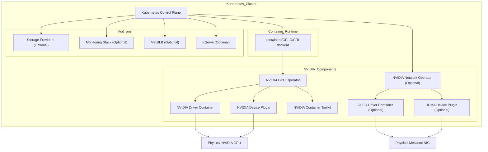
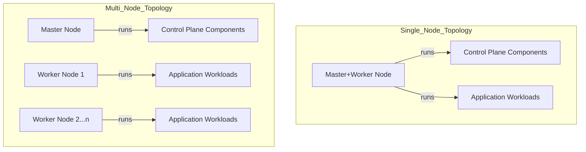

<!-- source: DeepWiki mcp.deepwiki.com · repo NVIDIA/cloud-native-stack · page 2.3 Bare Metal Installation · fetched 2026-11-11 -->

# Bare Metal Installation

<details>
<summary>Relevant source files</summary>

The following files were used as context for generating this wiki page:

- [README.md](README.md)
- [install-guides/readme.md](install-guides/readme.md)
- [playbooks/cns-installation.yaml](playbooks/cns-installation.yaml)
- [playbooks/prerequisites.yaml](playbooks/prerequisites.yaml)
- [playbooks/readme.md](playbooks/readme.md)
- [playbooks/setup.sh](playbooks/setup.sh)

</details>


This document provides detailed instructions for installing NVIDIA Cloud Native Stack (CNS) on physical server hardware. Bare metal installation offers direct access to NVIDIA GPUs for maximum performance in GPU-accelerated workloads. For cloud provider installations, see [Cloud Provider Installation](#2.4).

## System Requirements

Before starting the installation, ensure your system meets the following requirements:

| Requirement | Specification |
|-------------|---------------|
| Hardware | NVIDIA Certified System (x86-64) or Qualified System (ARM64) |
| GPU | At least one NVIDIA GPU |
| CPU | Minimum 2 CPU cores (4 recommended) |
| Memory | Minimum 4GB RAM (8GB recommended) |
| Storage | Minimum 40GB on root filesystem |
| Network | Static IP address on single interface with internet access |
| BIOS | UEFI secure boot disabled |
| OS | Ubuntu 22.04/24.04 LTS or RHEL 8.10 |

Sources: [README.md:85-98](), [playbooks/readme.md:15-26]()

## Installation Workflow

### Bare Metal Installation Process

```mermaid
flowchart TD
    start["Start Installation"] --> prereq["System Prerequisites Check"]
    prereq --> repo["Clone Repository"]
    repo --> inventory["Configure Inventory"]
    inventory --> setup["Run setup.sh script"]
    setup --> k8s["Install Kubernetes"]
    k8s --> runtime["Configure Container Runtime"]
    runtime --> init["Initialize Kubernetes Cluster"]
    runtime --> networkPlugin["Install CNI Plugin"]
    init --> gpuOperator["Install NVIDIA GPU Operator"]
    gpuOperator --> netOperator["Install Network Operator (optional)"]
    netOperator --> addons["Configure Add-ons (optional)"]
    addons --> validate["Validate Installation"]
    validate --> end["Installation Complete"]
```

Sources: [playbooks/setup.sh:1-399](), [playbooks/cns-installation.yaml:1-309]()

## Installation Steps

### 1. Clone the Repository

```bash
git clone https://github.com/NVIDIA/cloud-native-stack.git
cd cloud-native-stack/playbooks
```

### 2. Configure the Inventory File

Edit the `hosts` file to specify your master and worker nodes:

```
nano hosts

[master]
10.110.16.178 ansible_ssh_user=nvidia ansible_ssh_pass=nvidipass ansible_sudo_pass=nvidiapass ansible_ssh_common_args='-o StrictHostKeyChecking=no'
[nodes]
10.110.16.179 ansible_ssh_user=nvidia ansible_ssh_pass=nvidiapass ansible_sudo_pass=nvidiapass ansible_ssh_common_args='-o StrictHostKeyChecking=no'
```

Sources: [playbooks/readme.md:67-76](), [README.md:107-118]()

### 3. Choose CNS Version

NVIDIA Cloud Native Stack supports several versions. Edit the `cns_version.yaml` file to select the version you want to install:

```bash
nano cns_version.yaml
```

Available versions include:
- 15.0 (Ubuntu 24.04)
- 14.1 (Ubuntu 22.04)
- 13.3 (Ubuntu 22.04)

Sources: [playbooks/readme.md:79-90]()

### 4. Customize Installation (Optional)

You can customize the installation by editing the version-specific values file:

```bash
nano cns_values_14.1.yaml  # Replace with your chosen version
```

Key customization options include:

| Parameter | Description | Default |
|-----------|-------------|---------|
| container_runtime | Container runtime (containerd, cri-o, cri-dockerd) | containerd |
| k8s_version | Kubernetes version | Depends on CNS version |
| enable_gpu_operator | Install GPU Operator | yes |
| enable_network_operator | Install Network Operator | no |
| enable_rdma | Enable RDMA capabilities | no |
| storage | Deploy storage providers | no |
| monitoring | Deploy monitoring stack | no |
| loadbalancer | Deploy MetalLB for load balancing | no |

Sources: [playbooks/readme.md:97-236]()

### 5. Run the Installation

Execute the installation using the setup script:

```bash
bash setup.sh install
```

The installation process typically takes 15-30 minutes depending on system performance and internet speed.

Sources: [playbooks/setup.sh:264-344](), [README.md:122-125]()

## Component Architecture



Sources: [README.md:60-72](), [playbooks/readme.md:832-861]()

## Configuration Details

### Container Runtime Options

The default container runtime is `containerd`. You can also choose `cri-o` or `cri-dockerd` by modifying the `container_runtime` parameter in your values file.

When using `containerd`, the installation sets up systemd cgroups and configures the runtime with NVIDIA container support.

Sources: [playbooks/prerequisites.yaml:254-577]()

### GPU Operator Configuration

The GPU Operator manages NVIDIA GPU resources in Kubernetes. Key configuration options include:

| Option | Description | Values |
|--------|-------------|--------|
| enable_mig | Enable Multi-Instance GPU | yes/no |
| mig_strategy | MIG deployment strategy | single/mixed |
| gpu_driver_version | NVIDIA driver version | Version number |
| enable_gds | Enable GPU Direct Storage | yes/no |
| enable_vgpu | Enable Virtual GPU support | yes/no |

Sources: [playbooks/readme.md:136-155]()

### Network Operator Configuration

For systems with NVIDIA Mellanox NICs, enable the Network Operator:

```yaml
# Network Operator Values
enable_network_operator: yes
# Enable RDMA yes for NVIDIA Certification
enable_rdma: yes
# Enable for MLNX-OFED Driver Deployment
deploy_ofed: yes
```

Sources: [playbooks/readme.md:164-170]()

## Validation

After installation completes, wait a few minutes for all components to initialize, then validate the installation:

```bash
bash setup.sh validate
```

The validation process checks:
- Kubernetes cluster status
- Node status and health
- Pod status across all namespaces
- GPU Operator component status
- NVIDIA driver and CUDA libraries functionality

If the validation reports any failures, refer to the troubleshooting section for guidance.

Sources: [playbooks/setup.sh:384-394](), [playbooks/readme.md:801-872]()

## Cluster Deployment Topologies

NVIDIA Cloud Native Stack supports two deployment topologies:

1. Single-node deployment: Control plane and worker functionality on one node
2. Multi-node deployment: One control plane node and any number of worker nodes



Note: Cloud Native Stack does not support deploying multiple control plane nodes.

Sources: [README.md:127-134]()

## Add-on Components

You can enable various add-on components during or after installation:

### Storage

Enable persistent storage options:
```yaml
# Local Path Provisioner and NFS Provisioner as Storage option
storage: yes
```

This deploys:
- Local Path Provisioner
- NFS Provisioner

Sources: [playbooks/readme.md:679-690]()

### Monitoring

Deploy monitoring tools for observability:
```yaml
# Monitoring Stack Prometheus/Grafana with GPU Metrics and Elastic Logging stack
monitoring: yes
```

This deploys:
- Prometheus for metrics collection
- Grafana for visualization (accessible at http://\<node-ip\>:32222, credentials: admin/cns-stack)
- Elastic Stack for logging (accessible at http://\<node-ip\>:32221, credentials: elastic/cns-stack)

Sources: [playbooks/readme.md:666-677]()

### Load Balancer

Deploy MetalLB for load balancing capabilities:
```yaml
# Install MetalLB
loadbalancer: yes
# Example input loadbalancer_ip: "10.117.20.50/32"
loadbalancer_ip: "<your-node-ip>/32"
```

Sources: [playbooks/readme.md:692-701]()

### KServe

Deploy KServe for machine learning model serving:
```yaml
# Enable Kserve on Cloud Native Stack with Istio and Cert-Manager
kserve: yes
```

Note: It's recommended to enable storage, monitoring, and loadbalancer when using KServe.

Sources: [playbooks/readme.md:357-485]()

## Troubleshooting

If you encounter issues during installation, check the following:

1. **Prerequisites verification:**
   - Check internet connectivity: `ping google.com`
   - Verify GPU is detected: `lspci | grep -i nvidia`
   - Ensure adequate disk space: `df -h /`

2. **Installation failures:**
   - Review Ansible logs in `cloud-native-stack/playbooks`
   - Check that secure boot is disabled: `mokutil --sb-state`
   - Verify nouveau blacklist: `lsmod | grep nouveau`

3. **GPU Operator issues:**
   - Check GPU operator pods: `kubectl get pods -n nvidia-gpu-operator`
   - View pod logs: `kubectl logs <pod-name> -n nvidia-gpu-operator`
   - Verify driver module: `lsmod | grep nvidia`

4. **DNS issues:**
   - Follow the [DNS Troubleshooting](#5.3) guide for resolving DNS-related problems

For more detailed troubleshooting information, refer to the [Troubleshooting](#5.2) page.

Sources: [README.md:135-138]()

## Next Steps

After successfully installing NVIDIA Cloud Native Stack on bare metal, you can:

1. Deploy GPU-accelerated workloads
2. Configure additional [Add-ons](#4.4) like storage, monitoring, or KServe
3. Explore the [NVIDIA GPU Operator](#4.1) capabilities
4. Set up [Multi-Node Deployments](#6.3) if needed

Sources: [README.md:142-151]()

---

