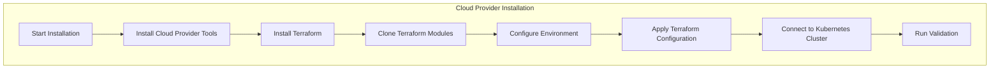
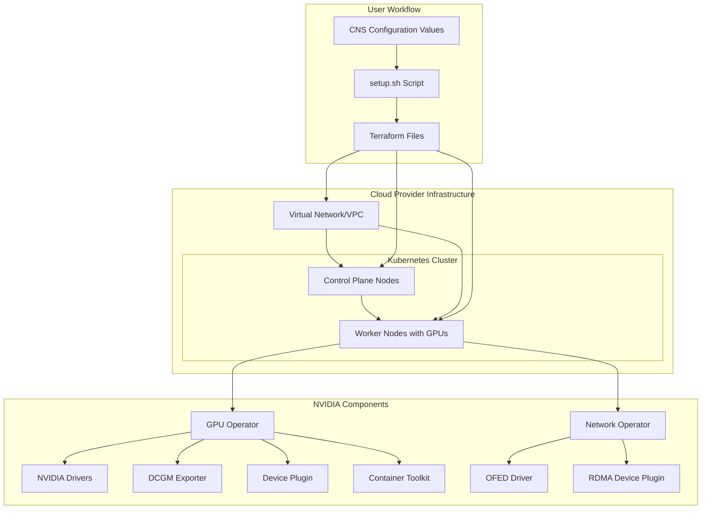
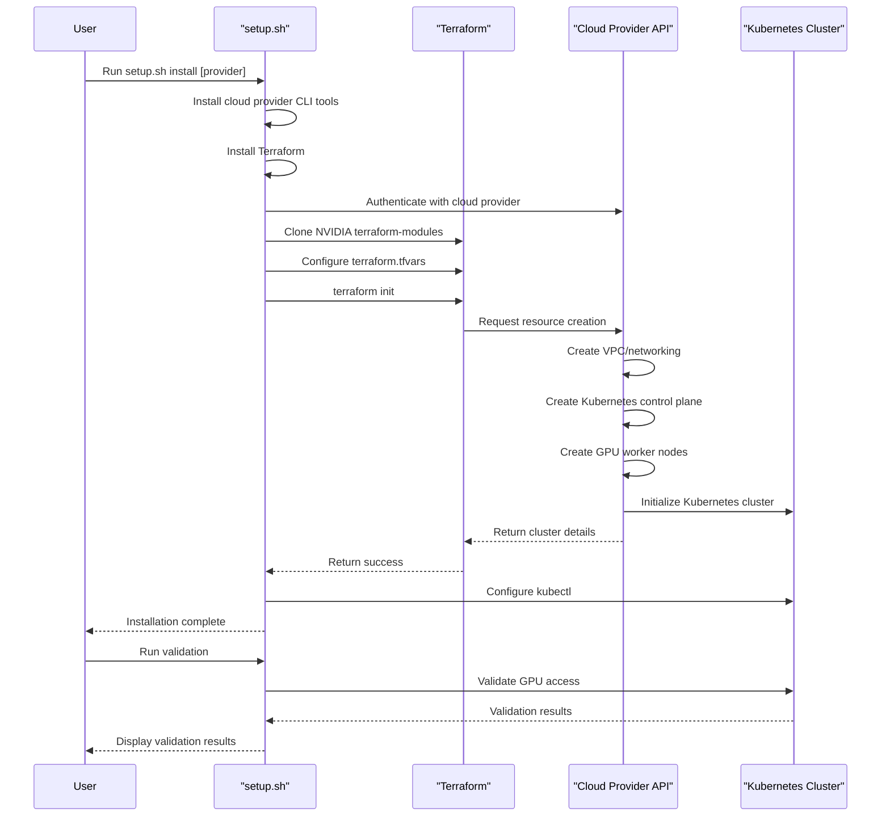
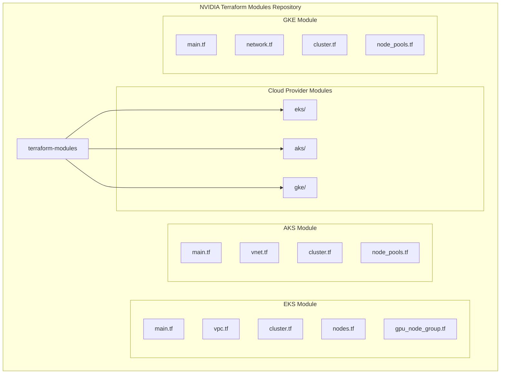

<!-- source: DeepWiki mcp.deepwiki.com · repo NVIDIA/cloud-native-stack · page 2.4 Cloud Provider Installation · fetched 2026-11-11 -->

# Cloud Provider Installation

<details>
<summary>Relevant source files</summary>

The following files were used as context for generating this wiki page:

- [install-guides/readme.md](install-guides/readme.md)
- [playbooks/cns-validation.yaml](playbooks/cns-validation.yaml)
- [playbooks/cns_values.yaml](playbooks/cns_values.yaml)
- [playbooks/cns_values_13.0.yaml](playbooks/cns_values_13.0.yaml)
- [playbooks/cns_values_13.1.yaml](playbooks/cns_values_13.1.yaml)
- [playbooks/cns_values_13.2.yaml](playbooks/cns_values_13.2.yaml)
- [playbooks/cns_values_14.0.yaml](playbooks/cns_values_14.0.yaml)
- [playbooks/files/kube-prometheus-stack.values](playbooks/files/kube-prometheus-stack.values)
- [playbooks/files/network-operator-value.yaml](playbooks/files/network-operator-value.yaml)
- [playbooks/files/nic-cluster-policy.yaml](playbooks/files/nic-cluster-policy.yaml)
- [playbooks/gpu_operator.yaml](playbooks/gpu_operator.yaml)
- [playbooks/readme.md](playbooks/readme.md)
- [playbooks/setup.sh](playbooks/setup.sh)

</details>


This page provides detailed guidelines for deploying NVIDIA Cloud Native Stack (CNS) on major cloud service providers (CSPs): AWS EKS, Azure AKS, and Google GKE. For bare metal installation instructions, see [Bare Metal Installation](#2.3).

## Overview

NVIDIA Cloud Native Stack supports automated deployment on cloud platforms using Terraform modules to provision GPU-accelerated Kubernetes clusters. This automation simplifies the process of setting up and configuring GPU-enabled environments in the cloud.



Sources: [playbooks/setup.sh:147-324]()

## Supported Cloud Providers

NVIDIA Cloud Native Stack officially supports the following cloud platforms:

| Cloud Provider | Service | Description |
|----------------|---------|-------------|
| Amazon Web Services | EKS (Elastic Kubernetes Service) | Managed Kubernetes service with GPU instance support |
| Microsoft Azure | AKS (Azure Kubernetes Service) | Managed Kubernetes service with GPU VM support |
| Google Cloud | GKE (Google Kubernetes Engine) | Managed Kubernetes service with GPU node support |

Sources: [playbooks/setup.sh:267-324](), [playbooks/readme.md:708-756]()

## Prerequisites

Before deploying CNS on cloud platforms, ensure you have:

1. A valid account on the target cloud platform with permissions to create resources
2. Sufficient quota for GPU instances
3. Local system with internet access to run the installation scripts

Sources: [playbooks/readme.md:15-26]()

## Common Installation Architecture

The following diagram illustrates the high-level architecture of the NVIDIA Cloud Native Stack deployment on cloud providers:



Sources: [playbooks/setup.sh:267-324](), [playbooks/cns_values.yaml:118-136]()

## Installation Process

The installation process uses the `setup.sh` script with cloud provider-specific commands to deploy CNS.

### Common Setup Steps

1. Clone the repository and navigate to the playbooks directory:
   ```bash
   git clone https://github.com/NVIDIA/cloud-native-stack.git
   cd cloud-native-stack/playbooks
   ```

2. Review and update the configuration in `cns_values.yaml` file for your chosen cloud provider.

Sources: [playbooks/setup.sh:265-324](), [playbooks/readme.md:708-756]()

## AWS EKS Installation

### Configuration Parameters

Edit the EKS-specific parameters in the CNS values file:

```yaml
# AWS EKS values
aws_region: us-east-2
aws_cluster_name: cns-cluster-1
aws_gpu_instance_type: g4dn.2xlarge
```

Key configuration parameters:
- `aws_region`: AWS region where the cluster will be deployed
- `aws_cluster_name`: Name for your EKS cluster
- `aws_gpu_instance_type`: GPU instance type to use (e.g., g4dn.2xlarge, p3.2xlarge)

### Installation Steps

1. Update AWS credentials in the `files/aws_credentials` file.

2. Run the installation command:
   ```bash
   bash setup.sh install eks
   ```

3. The script will:
   - Install AWS CLI tools
   - Install Terraform
   - Clone NVIDIA Terraform modules
   - Apply Terraform configuration to create the EKS cluster
   - Configure kubectl to connect to the cluster

Sources: [playbooks/setup.sh:306-324](), [playbooks/readme.md:708-723]()

## Azure AKS Installation

### Configuration Parameters

Edit the AKS-specific parameters in the CNS values file:

```yaml
# Azure AKS Values
aks_cluster_name: aks-cluster-1
aks_cluster_location: "West US 2"
azure_object_id: [""]
```

Key configuration parameters:
- `aks_cluster_name`: Name for your AKS cluster
- `aks_cluster_location`: Azure region where the cluster will be deployed
- `azure_object_id`: Azure Active Directory object IDs that need admin access

### Installation Steps

1. Run the installation command:
   ```bash
   bash setup.sh install aks
   ```

2. The script will:
   - Install Azure CLI tools
   - Install Terraform
   - Authenticate with Azure using device code login
   - Clone NVIDIA Terraform modules
   - Apply Terraform configuration to create the AKS cluster
   - Configure kubectl to connect to the cluster

Sources: [playbooks/setup.sh:267-283](), [playbooks/readme.md:725-739]()

## Google GKE Installation

### Configuration Parameters

Edit the GKE-specific parameters in the CNS values file:

```yaml
# Google Cloud GKE Values
gke_project_id: 
gke_region: us-west1
gke_node_zones: ["us-west1-b"]
gke_cluster_name: gke-cluster-1
```

Key configuration parameters:
- `gke_project_id`: Google Cloud project ID
- `gke_region`: GCP region where the cluster will be deployed
- `gke_node_zones`: Specific zones for deploying nodes
- `gke_cluster_name`: Name for your GKE cluster

### Installation Steps

1. Run the installation command:
   ```bash
   bash setup.sh install gke
   ```

2. The script will:
   - Install Google Cloud SDK tools
   - Install Terraform
   - Authenticate with Google Cloud
   - Clone NVIDIA Terraform modules
   - Apply Terraform configuration to create the GKE cluster
   - Configure kubectl to connect to the cluster

3. After GKE cluster creation, run the following command to properly configure the kubectl command:
   ```bash
   source $HOME/cloud-native-stack/playbooks/google-cloud-sdk/path.bash.inc
   ```

Sources: [playbooks/setup.sh:284-306](), [playbooks/readme.md:741-765]()

## Installation Workflow Diagram

The following diagram illustrates the detailed installation workflow for cloud providers:



Sources: [playbooks/setup.sh:267-324](), [playbooks/cns-validation.yaml:1-445]()

## Terraform Module Structure

The installation process uses NVIDIA's Terraform modules to provision the required cloud resources.



Sources: [playbooks/setup.sh:274-323]()

## Validation

After installing CNS on a cloud provider, you can validate the installation:

```bash
bash setup.sh validate
```

This runs the validation playbook which checks:
- Kubernetes cluster accessibility
- Running status of all pods
- GPU operator functionality
- NVIDIA driver installation
- Container runtime configuration

Sources: [playbooks/setup.sh:384-394](), [playbooks/cns-validation.yaml:1-445](), [playbooks/readme.md:802-809]()

## Uninstallation

To remove the CNS installation and clean up cloud resources:

```bash
bash setup.sh uninstall [provider]
```

Where `[provider]` is one of: `eks`, `aks`, or `gke`.

The uninstallation process:
1. Navigates to the appropriate Terraform module directory
2. Runs `terraform destroy` to remove all cloud resources
3. Cleans up local files created during installation

Sources: [playbooks/setup.sh:356-383](), [playbooks/readme.md:821-826]()

## Additional Resources

1. For additional information about Cloud Native Stack installation options, refer to the [Installation Process](#2.2) page.
2. For information about GPU Operator configuration, see the [NVIDIA GPU Operator](#4.1) page.
3. For bare metal installations, see the [Bare Metal Installation](#2.3) page.

Sources: [playbooks/readme.md:708-776](), [install-guides/readme.md:1-27]()

---

