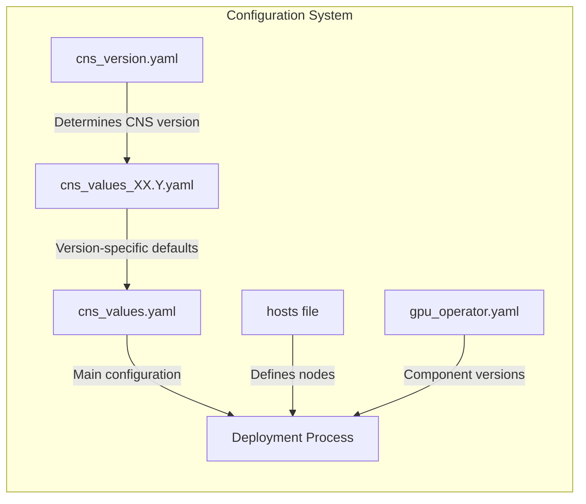
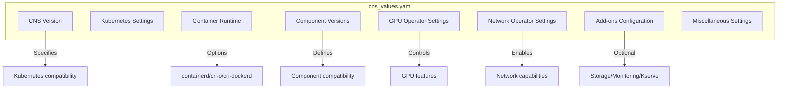
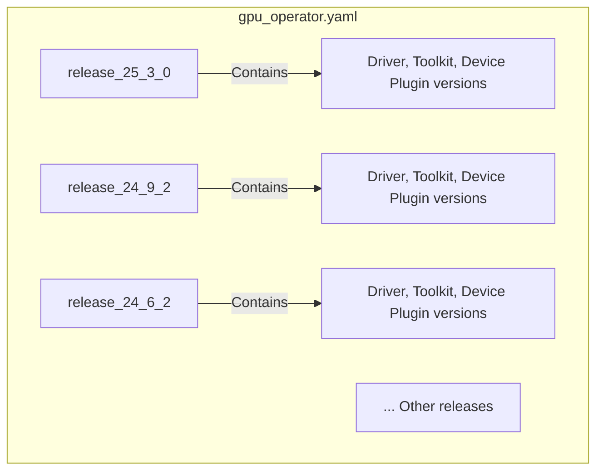
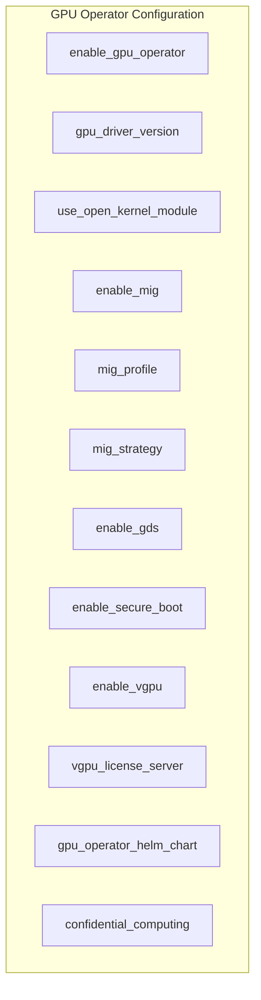
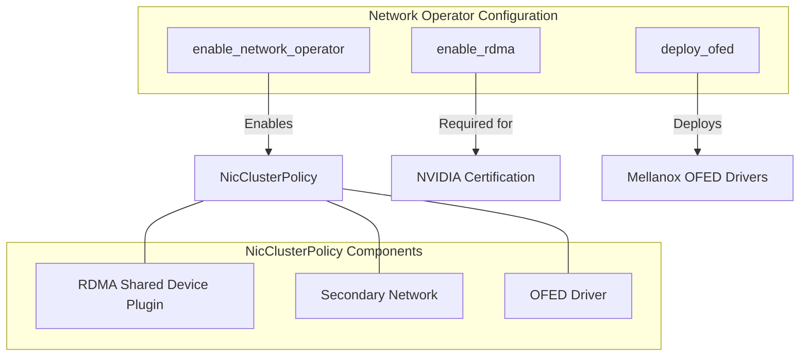

<!-- source: DeepWiki mcp.deepwiki.com · repo NVIDIA/cloud-native-stack · page 3.1 Configuration Files · fetched 2026-11-11 -->

# Configuration Files

<details>
<summary>Relevant source files</summary>

The following files were used as context for generating this wiki page:

- [playbooks/cns-validation.yaml](playbooks/cns-validation.yaml)
- [playbooks/cns_values.yaml](playbooks/cns_values.yaml)
- [playbooks/cns_values_13.0.yaml](playbooks/cns_values_13.0.yaml)
- [playbooks/cns_values_13.1.yaml](playbooks/cns_values_13.1.yaml)
- [playbooks/cns_values_13.2.yaml](playbooks/cns_values_13.2.yaml)
- [playbooks/cns_values_14.0.yaml](playbooks/cns_values_14.0.yaml)
- [playbooks/cns_version.yaml](playbooks/cns_version.yaml)
- [playbooks/files/kube-prometheus-stack.values](playbooks/files/kube-prometheus-stack.values)
- [playbooks/files/network-operator-value.yaml](playbooks/files/network-operator-value.yaml)
- [playbooks/files/nic-cluster-policy.yaml](playbooks/files/nic-cluster-policy.yaml)
- [playbooks/gpu_operator.yaml](playbooks/gpu_operator.yaml)
- [playbooks/hosts](playbooks/hosts)

</details>


This page provides a detailed explanation of the configuration files used in the NVIDIA Cloud Native Stack (CNS) and their parameters. These files are crucial for customizing your CNS deployment according to your specific requirements and environment. For information about version compatibility between different components, see [Version Compatibility](#3.2).

## Configuration File Structure

The NVIDIA Cloud Native Stack uses a hierarchical configuration system to manage deployments across different versions and deployment scenarios. Below is the structure of the configuration system and how different files interact with each other.



**Configuration File Hierarchy**

Sources: [playbooks/cns_values.yaml](), [playbooks/cns_version.yaml](), [playbooks/cns_values_13.0.yaml](), [playbooks/hosts](), [playbooks/gpu_operator.yaml]()

## Main Configuration Files

### cns_values.yaml

This is the primary configuration file that controls the entire CNS deployment. It contains values for:
- CNS version
- Kubernetes configuration
- Container runtime selection
- Component versions
- Feature enablement flags
- GPU Operator settings
- Network Operator settings
- Add-on configurations

#### Example Structure of cns_values.yaml



**cns_values.yaml Structure**

Sources: [playbooks/cns_values.yaml]()

### Version-Specific Configuration Files

These files (e.g., `cns_values_13.0.yaml`, `cns_values_13.1.yaml`, `cns_values_14.0.yaml`) contain predefined configurations specific to each CNS version. They define the recommended component versions and default settings for each CNS release.

Sources: [playbooks/cns_values_13.0.yaml](), [playbooks/cns_values_13.1.yaml](), [playbooks/cns_values_13.2.yaml](), [playbooks/cns_values_14.0.yaml]()

### cns_version.yaml

A simple file containing only the CNS version. This is used to determine which version-specific configuration file to load.

```
cns_version: 14.1
```

Sources: [playbooks/cns_version.yaml]()

### hosts

Ansible inventory file that defines the master and worker nodes for the CNS deployment.

```
[master]
#localhost ansible_ssh_user=nvidia ansible_ssh_pass=nvidiapass ansible_sudo_pass=nvidiapass ansible_ssh_common_args='-o StrictHostKeyChecking=no'
[nodes]
```

Sources: [playbooks/hosts]()

### gpu_operator.yaml

This file contains detailed version information for all components included in each GPU Operator release. It's organized in a hierarchical structure with each GPU Operator version having its own section listing all component versions.



**GPU Operator Version Structure**

Sources: [playbooks/gpu_operator.yaml]()

## Key Configuration Parameters

The following table outlines the key configuration parameters found in the `cns_values.yaml` file, grouped by category:

| Category | Parameter | Description | Default Value |
|----------|-----------|-------------|--------------|
| **Basic Configuration** | cns_version | NVIDIA Cloud Native Stack version | 14.1 |
| | microk8s | Enable MicroK8s cluster deployment | no |
| | install_k8s | Install Kubernetes with Kubeadm | yes |
| **Container Runtime** | container_runtime | Container runtime selection | "containerd" |
| | containerd_version | Containerd version | "2.0.3" |
| | nvidia_container_toolkit_version | NVIDIA Container Toolkit version | "1.17.5" |
| **Kubernetes** | k8s_version | Kubernetes version | "1.31.6" |
| | calico_version | Calico network plugin version | "3.29.3" |
| | flannel_version | Flannel network plugin version | "0.25.6" |
| **NVIDIA Components** | enable_gpu_operator | Enable GPU Operator | yes |
| | gpu_operator_version | GPU Operator version | "25.3.0" |
| | gpu_driver_version | NVIDIA GPU driver version | "570.124.06" |
| | enable_network_operator | Enable Network Operator | no |
| | enable_nim_operator | Enable NIM Operator | yes |
| **GPU Features** | enable_mig | Enable Multi-Instance GPU | no |
| | use_open_kernel_module | Use open kernel module for driver | no |
| | enable_gds | Enable GPUDirect Storage | no |
| | enable_secure_boot | Enable Secure Boot (Ubuntu only) | no |
| **Add-ons** | storage | Enable storage options | no |
| | monitoring | Enable monitoring stack | no |
| | kserve | Enable KServe | no |
| | loadbalancer | Install MetalLB | no |

Sources: [playbooks/cns_values.yaml](), [playbooks/cns_values_13.0.yaml](), [playbooks/cns_values_13.1.yaml](), [playbooks/cns_values_13.2.yaml](), [playbooks/cns_values_14.0.yaml]()

## GPU Operator Configuration

The GPU Operator has several important configuration parameters that control its behavior and features:



**GPU Operator Configuration Options**

Sources: [playbooks/cns_values.yaml:35-54]()

## Network Operator Configuration

The Network Operator configuration controls advanced networking features in the CNS deployment:



**Network Operator Configuration Structure**

Sources: [playbooks/cns_values.yaml:64-70](), [playbooks/files/nic-cluster-policy.yaml]()

## Add-on Configurations

CNS supports several optional add-ons that can be enabled based on your requirements:

1. **Storage Options**
   - Local Path Provisioner
   - NFS Provisioner

2. **Monitoring**
   - Prometheus Stack
   - Grafana for visualization
   - DCGM Exporter for GPU metrics

3. **KServe** for machine learning model serving

4. **MetalLB** for load balancing in bare metal environments

These add-ons can be enabled by setting the corresponding parameters in the `cns_values.yaml` file.

Sources: [playbooks/cns_values.yaml:92-108](), [playbooks/files/kube-prometheus-stack.values]()

## Configuration File Validation

The CNS repository includes a validation playbook (`cns-validation.yaml`) that checks the installed components against the expected versions defined in the configuration files. This helps ensure that the deployed environment matches the intended configuration.

The validation system checks:
- Operating system version
- Container runtime version
- Kubernetes version
- GPU Operator and its component versions
- Network Operator and its component versions (if enabled)
- Add-on versions

Sources: [playbooks/cns-validation.yaml]()

## Customizing Configuration Files

When deploying CNS, you can customize the configuration in multiple ways:

1. Edit the `cns_values.yaml` file directly to change parameters
2. Update `cns_version.yaml` to switch to a different version's defaults
3. Modify the `hosts` file to define your cluster nodes
4. Create custom component configurations, such as network operator values

When customizing, be aware of version compatibility as defined in the GPU Operator and component version tables.

## Best Practices

1. **Version Consistency**: Ensure all component versions are compatible with each other and with your hardware
2. **Feature Planning**: Enable only the features you need to minimize complexity
3. **Validation**: Always run the validation after deployment to verify your configuration
4. **Documentation**: Document any custom changes to the configuration files
5. **Backup**: Keep backups of your configuration files before making changes

## Summary

The NVIDIA Cloud Native Stack uses a flexible configuration system based on YAML files to control deployment options. The main file is `cns_values.yaml`, which contains all the parameters needed for deployment. Version-specific defaults are provided in the `cns_values_XX.Y.yaml` files, and the `gpu_operator.yaml` file contains detailed component version information.

By understanding and properly configuring these files, you can tailor your CNS deployment to meet your specific requirements while ensuring compatibility between all components.

---

