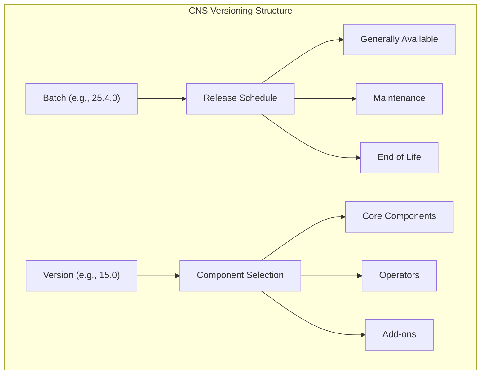
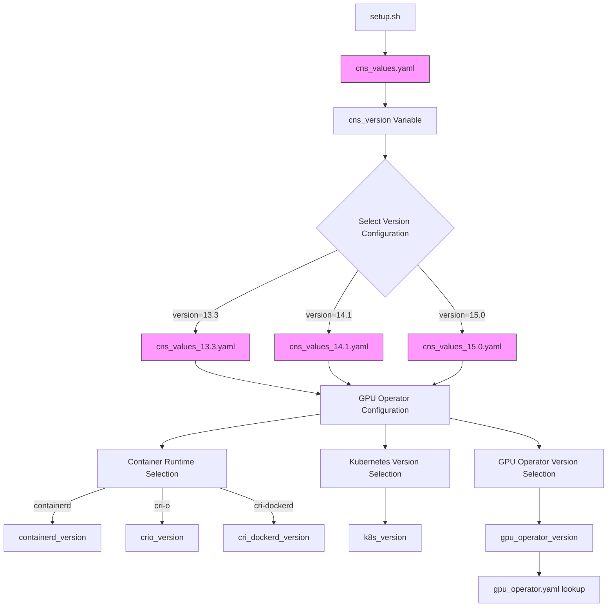
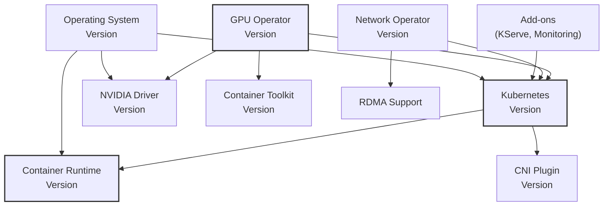
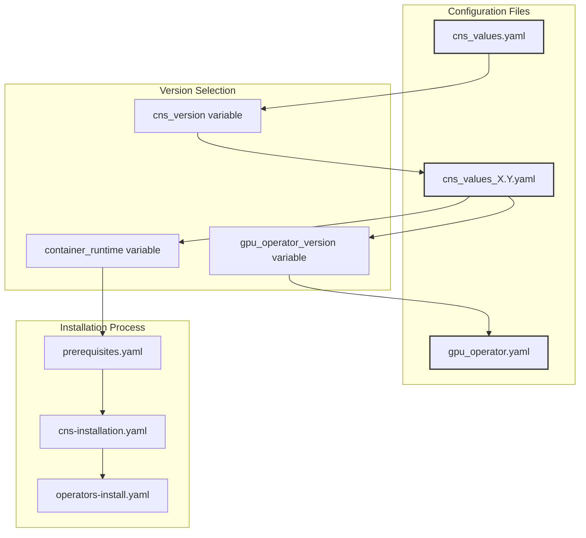
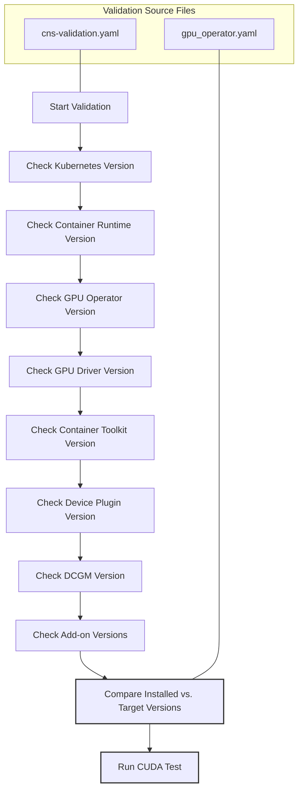

<!-- source: DeepWiki mcp.deepwiki.com · repo NVIDIA/cloud-native-stack · page 3.2 Version Compatibility · fetched 2026-11-11 -->

# Version Compatibility

Relevant source files

The following files were used as context for generating this wiki page:

- [README.md](README.md)
- [playbooks/cns-installation.yaml](playbooks/cns-installation.yaml)
- [playbooks/cns-validation.yaml](playbooks/cns-validation.yaml)
- [playbooks/cns_values.yaml](playbooks/cns_values.yaml)
- [playbooks/cns_values_13.0.yaml](playbooks/cns_values_13.0.yaml)
- [playbooks/cns_values_13.1.yaml](playbooks/cns_values_13.1.yaml)
- [playbooks/cns_values_13.2.yaml](playbooks/cns_values_13.2.yaml)
- [playbooks/cns_values_14.0.yaml](playbooks/cns_values_14.0.yaml)
- [playbooks/files/kube-prometheus-stack.values](playbooks/files/kube-prometheus-stack.values)
- [playbooks/files/network-operator-value.yaml](playbooks/files/network-operator-value.yaml)
- [playbooks/files/nic-cluster-policy.yaml](playbooks/files/nic-cluster-policy.yaml)
- [playbooks/gpu_operator.yaml](playbooks/gpu_operator.yaml)
- [playbooks/prerequisites.yaml](playbooks/prerequisites.yaml)

This page provides detailed information about component version compatibility within different NVIDIA Cloud Native Stack (CNS) releases. Understanding the compatibility between various components is essential for successful deployment and operation of CNS environments.

For information about configuration files and parameters, see [Configuration Files](#3.1).

## CNS Versioning Structure

NVIDIA Cloud Native Stack uses a dual-level versioning scheme consisting of "batches" and "versions":

- **Batch**: The major release cycle (e.g., 24.11.2, 25.4.0) typically aligned with calendar quarters
- **Version**: The minor release number within a batch (e.g., 13.3, 14.1, 15.0)

Sources: [README.md:20-35](https://github.com/NVIDIA/cloud-native-stack)

### Lifecycle Management

Each CNS batch goes through the following lifecycle:

1. **Generally Available (GA)**: The latest batch release (currently 25.4.0)
2. **Maintenance**: The previous batch (currently 24.11.2), receiving only patch updates
3. **End of Life (EOL)**: All prior batches (24.5.0 and lower), receiving no updates

Upgrades are only supported from one batch to the next consecutive batch.

Sources: [README.md:20-35](https://github.com/NVIDIA/cloud-native-stack)

## Component Matrix

Each CNS version includes a specific set of tested and compatible component versions. The following table outlines the component versions for current CNS versions:

| Component | CNS 15.0 | CNS 14.1 | CNS 13.3 |
|-----------|----------|----------|----------|
| Supported OS | Ubuntu 24.04 LTS | Ubuntu 22.04 LTS | Ubuntu 22.04 LTS |
| Containerd | 2.0.3 | 2.0.3 | 1.7.27 |
| NVIDIA Container Toolkit | 1.17.5 | 1.17.5 | 1.17.5 |
| CRI-O | 1.32.1 | 1.31.5 | 1.30.10 |
| Kubernetes | 1.32.2 | 1.31.6 | 1.30.10 |
| CNI (Calico) | 3.29.2 | 3.29.2 | 3.29.2 |
| NVIDIA GPU Operator | 25.3.0 | 25.3.0 | 25.3.0 |
| NVIDIA Network Operator | 25.1.0 | 25.1.0 | 25.1.0 |
| NVIDIA Data Center Driver | 570.124.06 | 570.124.06 | 570.124.06 |
| Helm | 3.17.2 | 3.17.2 | 3.17.2 |

Sources: [README.md:38-54](https://github.com/NVIDIA/cloud-native-stack), [playbooks/cns_values.yaml:1-33](https://github.com/NVIDIA/cloud-native-stack)

### Add-on Component Versions

In addition to the core components, CNS supports several add-on components with specific compatible versions:

| Add-on Component | CNS 15.0 | CNS 14.1 | CNS 13.3 |
|------------------|----------|----------|----------|
| MicroK8s | 1.32 | 1.31 | 1.30 |
| KServe | 0.15 with Istio 1.23.2, Knative 1.15.7, CertManager 1.16.1 | 0.15 with Istio 1.23.2, Knative 1.15.7, CertManager 1.16.1 | 0.15 with Istio 1.23.2, Knative 1.15.7, CertManager 1.16.1 |
| LeaderWorkerSet | 0.5.1 | 0.5.1 | 0.5.1 |
| LoadBalancer (MetalLB) | 0.14.9 | 0.14.9 | 0.14.9 |
| Storage | NFS: 4.0.18, Local Path: 0.0.31 | NFS: 4.0.18, Local Path: 0.0.31 | NFS: 4.0.18, Local Path: 0.0.31 |
| Monitoring | Prometheus: 70.3.0, Prometheus Adapter: 4.13.0, Elastic: 8.17.4 | Prometheus: 70.3.0, Prometheus Adapter: 4.13.0, Elastic: 8.17.4 | Prometheus: 70.3.0, Prometheus Adapter: 4.13.0, Elastic: 8.17.4 |

Sources: [README.md:74-81](https://github.com/NVIDIA/cloud-native-stack)

## GPU Operator Component Versions

The NVIDIA GPU Operator consists of several subcomponents, each with its own versioning. The following table shows the component versions for GPU Operator 25.3.0, which is used in the latest CNS releases:

| GPU Operator Component | Version |
|------------------------|---------|
| GPU Driver | 570.124.06 |
| Driver Manager | 0.8.0 |
| Container Toolkit | v1.17.5 |
| Device Plugin | v0.17.1 |
| DCGM Exporter | 4.1.1-4.0.4 |
| Node Feature Discovery | v0.17.2 |
| GPU Feature Discovery | v0.17.1 |
| MIG Manager | v0.12.1 |
| DCGM | 4.1.1-2 |
| Validator | v25.3.0 |
| GDS Driver | 2.20.5 |

Sources: [playbooks/gpu_operator.yaml:1-14](https://github.com/NVIDIA/cloud-native-stack)

## Version Configuration Flow

CNS uses a configuration system to determine which component versions to use. The following diagram illustrates how version selection works:

Sources: [playbooks/cns_values.yaml](https://github.com/NVIDIA/cloud-native-stack), [playbooks/cns_values_13.1.yaml](https://github.com/NVIDIA/cloud-native-stack), [playbooks/cns_values_14.0.yaml](https://github.com/NVIDIA/cloud-native-stack)

The version configuration process works as follows:

1. The `setup.sh` script uses the `cns_values.yaml` file as the primary configuration
2. The `cns_version` variable in this file determines which version-specific configuration to apply
3. Component versions are defined in the appropriate `cns_values_X.Y.yaml` file
4. The GPU Operator configuration is determined by the `gpu_operator_version` variable
5. The GPU Operator component versions are defined in `gpu_operator.yaml`

## Component Interdependencies

Understanding the dependencies between different components is crucial for ensuring compatibility. The following diagram illustrates the key dependencies:

Sources: [playbooks/cns_values.yaml:1-33](https://github.com/NVIDIA/cloud-native-stack), [playbooks/prerequisites.yaml:157-165](https://github.com/NVIDIA/cloud-native-stack)

Key interdependencies include:

- Kubernetes version determines compatible container runtime versions
- GPU Operator version determines compatible NVIDIA driver and container toolkit versions
- Operating system version affects compatibility with Kubernetes, container runtimes, and NVIDIA drivers
- Network Operator requires specific RDMA support aligned with driver versions

## Version Selection Process

The CNS installation process selects component versions based on the following:

1. **CNS Version**: The primary determinant of component versions, specified in `cns_values.yaml`
2. **Container Runtime**: Selected via the `container_runtime` parameter (containerd, cri-o, or cri-dockerd)
3. **GPU Operator Version**: Determined by the `gpu_operator_version` parameter
4. **Network Operator**: Optional component enabled via `enable_network_operator`

Sources: [playbooks/cns-installation.yaml:4-20](https://github.com/NVIDIA/cloud-native-stack), [playbooks/prerequisites.yaml:3-6](https://github.com/NVIDIA/cloud-native-stack)

## Validating Component Versions

CNS provides validation mechanisms to ensure the correct component versions are installed. The validation process is implemented in `cns-validation.yaml` and can be enabled by setting `cns_validation: yes` in the configuration.

Sources: [playbooks/cns-validation.yaml:7-169](https://github.com/NVIDIA/cloud-native-stack), [playbooks/cns-validation.yaml:244-260](https://github.com/NVIDIA/cloud-native-stack)

The validation process:

1. Checks Kubernetes cluster status and version
2. Verifies container runtime version
3. Validates GPU Operator and all its component versions
4. Compares installed versions against target versions in `gpu_operator.yaml`
5. Runs CUDA tests to verify GPU functionality

## Version Compatibility Guidelines

When working with CNS, follow these version compatibility guidelines:

1. **Use Matching CNS Version Components**: Always use the component versions specified for your CNS version
2. **Upgrade Path**: Upgrade only from one batch to the next consecutive batch
3. **Container Runtime Consistency**: Choose one container runtime and use it consistently
4. **OS Compatibility**: Ensure your operating system version is supported for your CNS version
5. **Validation**: Run the validation process after installation to verify component versions

## Troubleshooting Version Issues

If you encounter version compatibility issues:

1. **Check Configuration**: Verify your `cns_values.yaml` has the correct `cns_version` set
2. **Validation Results**: Review the output of `cns-validation.yaml` to identify mismatched versions
3. **Component Logs**: Check component logs for version-related errors
4. **Clean Installation**: For persistent issues, consider a clean installation with the correct versions

Sources: [playbooks/cns-validation.yaml:244-334](https://github.com/NVIDIA/cloud-native-stack)

## Summary

Version compatibility is a critical aspect of successfully deploying and maintaining NVIDIA Cloud Native Stack. By understanding the component versioning scheme, interdependencies, and validation processes, you can ensure a correctly configured and functional CNS environment.

The current batch (25.4.0) includes CNS versions 15.0, 14.1, and 13.3, each with its own set of compatible component versions. Always refer to the component matrices in this document and the README to ensure you are using tested and compatible versions.

---

