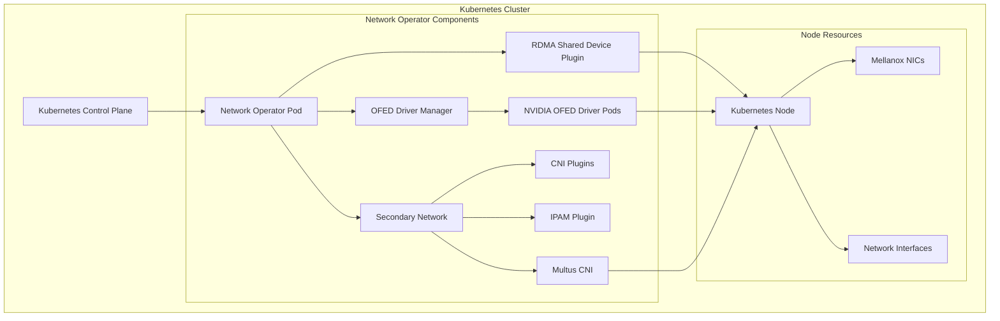
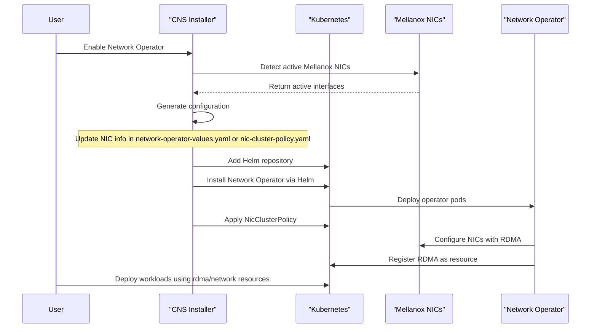
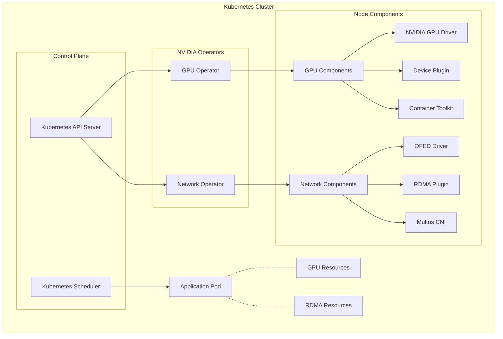

<!-- source: DeepWiki mcp.deepwiki.com · repo NVIDIA/cloud-native-stack · page 4.2 NVIDIA Network Operator · fetched 2026-11-11 -->

# NVIDIA Network Operator

<details>
<summary>Relevant source files</summary>

The following files were used as context for generating this wiki page:

- [README.md](README.md)
- [cns.json](cns.json)
- [playbooks/cns-installation.yaml](playbooks/cns-installation.yaml)
- [playbooks/cns-upgrade.yaml](playbooks/cns-upgrade.yaml)
- [playbooks/cns_values_13.0.yaml](playbooks/cns_values_13.0.yaml)
- [playbooks/cns_values_13.1.yaml](playbooks/cns_values_13.1.yaml)
- [playbooks/files/network-operator-value.yaml](playbooks/files/network-operator-value.yaml)
- [playbooks/files/nic-cluster-policy.yaml](playbooks/files/nic-cluster-policy.yaml)
- [playbooks/k8s-install.yaml](playbooks/k8s-install.yaml)
- [playbooks/nvidia-docker.yaml](playbooks/nvidia-docker.yaml)
- [playbooks/nvidia-driver.yaml](playbooks/nvidia-driver.yaml)
- [playbooks/operators-install.yaml](playbooks/operators-install.yaml)
- [playbooks/operators-upgrade.yaml](playbooks/operators-upgrade.yaml)
- [playbooks/prerequisites.yaml](playbooks/prerequisites.yaml)

</details>


The NVIDIA Network Operator is a Kubernetes operator designed to automate the management of NVIDIA networking resources in Kubernetes environments. It enables high-performance networking capabilities for GPU-accelerated workloads as part of the NVIDIA Cloud Native Stack (CNS). This document explains the Network Operator's architecture, deployment, configuration, and integration with other CNS components.

## Purpose and Overview

The NVIDIA Network Operator serves as the networking infrastructure foundation for NVIDIA Cloud Native Stack. It provides automated deployment and management of networking components required for high-performance workloads, with particular emphasis on:

- RDMA (Remote Direct Memory Access) capabilities for high-throughput, low-latency communication
- NVIDIA Mellanox networking device management
- Secondary network configurations for specialized workloads
- Integration with GPU-accelerated computing environments

The Network Operator enables containerized applications to leverage the full performance capabilities of NVIDIA's networking hardware while maintaining Kubernetes-native deployment patterns.

Sources: [README.md:62-64](), [README.md:147-149]()

## Architecture and Components

The NVIDIA Network Operator consists of several key components that work together to enable high-performance networking in Kubernetes environments.



### Core Components

1. **OFED Driver Manager**: Manages the NVIDIA OFED (OpenFabrics Enterprise Distribution) drivers required for RDMA communication
   
2. **RDMA Shared Device Plugin**: Discovers and exposes RDMA-capable devices to Kubernetes as consumable resources

3. **Secondary Network**:
   - **Multus CNI**: Enables attaching multiple network interfaces to pods
   - **CNI Plugins**: Network plugins for configuring pod networking
   - **IPAM Plugin**: IP Address Management for secondary networks

The Network Operator follows a controller pattern, constantly reconciling the desired state (defined in NicClusterPolicy CR) with the actual state in the cluster.

Sources: [playbooks/files/nic-cluster-policy.yaml:1-72](), [playbooks/operators-install.yaml:120-237]()

## Deployment and Configuration

The Network Operator is deployed in the NVIDIA Cloud Native Stack through Helm charts and configured via YAML files. The deployment process involves several steps:



### Configuration Setup

The Network Operator is configured primarily through a `NicClusterPolicy` custom resource, which specifies:

1. **OFED Driver Configuration**:
   - Driver version and repository
   - Update policies and probe configurations
   - Environment variables

2. **RDMA Device Plugin Configuration**:
   - Resource allocations
   - Device selectors (vendors, interface names)

3. **Secondary Network Configuration**:
   - CNI plugins configuration
   - Multus deployment options
   - IPAM plugin settings

During installation, the CNS system automatically detects available Mellanox NICs and configures the operator to use them.

Sources: [playbooks/operators-install.yaml:129-200](), [playbooks/files/nic-cluster-policy.yaml:38-56]()

## Integration with GPU Operator

The NVIDIA Network Operator is designed to work in conjunction with the GPU Operator to enable high-performance computing workloads with accelerated networking capabilities.



### Key Integration Points:

1. **Resource Coordination**: The GPU and Network Operators coordinate to ensure proper resource allocation for workloads that need both GPU and RDMA capabilities.

2. **RDMA for GPU Communication**: For multi-GPU or multi-node GPU workloads, RDMA provides high-speed, low-latency communication between GPUs.

3. **Driver Compatibility**: The Network Operator ensures that the networking drivers are compatible with the GPU drivers and container runtime.

When both operators are enabled in CNS, special configurations are applied to ensure they work together seamlessly:

```
helm install --version {{ gpu_operator_version }} --values {{ ansible_user_dir }}/values.yaml --create-namespace --namespace nvidia-gpu-operator --devel '{{ gpu_operator_helm_chart }}' --set driver.rdma.enabled=true,driver.version='{{ gpu_driver_version }}',driver.repository='{{ gpu_operator_driver_registry }}' --wait --generate-name
```

This command shows how the GPU Operator installation is configured with RDMA enabled when the Network Operator is present.

Sources: [playbooks/operators-install.yaml:451-457](), [README.md:62-64]()

## Deployment Options and Parameters

The Network Operator supports various deployment options through configuration parameters in the CNS installation:

| Parameter | Description | Default |
|-----------|-------------|---------|
| `enable_network_operator` | Enable or disable Network Operator deployment | `no` |
| `enable_rdma` | Enable RDMA capabilities | `no` |
| `deploy_ofed` | Deploy NVIDIA OFED drivers | `no` |
| `network_operator_version` | Version of Network Operator to deploy | Varies by CNS version |

These options are defined in the CNS values configuration files and can be adjusted based on your networking requirements.

### Example Values from Recent CNS Versions

| CNS Version | Network Operator Version |
|-------------|--------------------------|
| 15.0 | 25.1.0 |
| 14.1 | 25.1.0 |
| 13.3 | 25.1.0 |
| 13.1 | 24.4.1 |
| 13.0 | 24.1.1 |

Sources: [playbooks/cns_values_13.0.yaml:18-24](), [playbooks/cns_values_13.1.yaml:18-24](), [cns.json:10-19]()

## NIC Detection and Configuration

The Network Operator automatically detects and configures available Mellanox NICs in the Kubernetes cluster:

```mermaid
graph TD
    subgraph "NIC Detection Process"
        START["Start Network Operator Deployment"]
        DETECT["Detect Active Mellanox NICs"]
        COLLECT["Collect Active NIC Information"]
        UPDATE["Update Network Operator Configuration"]
        CONFIG["Generate NIC Cluster Policy"]
        APPLY["Apply Configuration to Cluster"]
        
        START --> DETECT
        DETECT --> COLLECT
        COLLECT --> UPDATE
        UPDATE --> CONFIG
        CONFIG --> APPLY
    end
    
    subgraph "NIC Resource Configuration"
        POLICY["NicClusterPolicy"]
        RDMA_RES["RDMA Shared Resources"]
        POD["Application Pod"]
        
        POLICY --> RDMA_RES
        RDMA_RES --> POD
    end
```



The process involves:

1. Detecting Mellanox NICs on each node using commands like:
   ```
   lshw -class network -short | grep -i ConnectX | awk '{print $2}'
   ```

2. Checking if NICs have active links:
   ```
   ethtool $device | grep -i 'Link detected'
   ```

3. Updating configuration files with active NIC information:
   ```
   sed -i "s/devices: \[.*\]/devices: \\[ {{ active_nic.stdout }}\]/g" {{ ansible_user_dir }}/network-operator-values.yaml
   ```

4. Applying configuration to make NICs available as Kubernetes resources:
   ```
   kubectl apply -f {{ ansible_user_dir }}/nic-cluster-policy.yaml
   ```

This automated detection ensures that the Network Operator is configured with the correct hardware information for the specific environment.

Sources: [playbooks/operators-install.yaml:129-147](), [playbooks/operators-install.yaml:163-200]()

## Common Usage Patterns

### RDMA for High-Performance Computing

The most common use case for the Network Operator is enabling RDMA for high-performance computing workloads. RDMA allows for direct memory access between devices, bypassing the CPU and reducing latency, which is crucial for:

- Multi-node deep learning training
- High-performance computing (HPC) workloads
- Data analytics with distributed processing

Applications request RDMA resources in their pod specifications:

```yaml
resources:
  limits:
    rdma/hca_shared_devices_a: 1
  requests:
    rdma/hca_shared_devices_a: 1
```

### Secondary Networks for Specialized Workloads

The Network Operator enables creating secondary networks for isolating specific traffic types:

- Storage networks for high-throughput data access
- Dedicated networks for east-west traffic between application components
- Isolated networks for tenant segregation in multi-tenant environments

This is achieved through the Multus CNI plugin that allows attaching multiple network interfaces to pods.

Sources: [playbooks/files/nic-cluster-policy.yaml:38-56](), [playbooks/files/nic-cluster-policy.yaml:57-72]()

## Troubleshooting

When troubleshooting Network Operator issues, focus on these common areas:

1. **Check Network Operator deployment status**:
   ```bash
   kubectl get pods -n network-operator
   ```

2. **Verify NIC detection**:
   Examine the active NIC detection logs in the CNS installation process

3. **Review NicClusterPolicy**:
   ```bash
   kubectl get nicclusterpolicies
   kubectl describe nicclusterpolicy nic-cluster-policy
   ```

4. **Validate RDMA resource availability**:
   ```bash
   kubectl describe node <node-name> | grep rdma
   ```

5. **Check OFED driver status**:
   ```bash
   kubectl get pods -n network-operator -l app=nvidia-driver
   ```

Sources: [playbooks/operators-install.yaml:120-128](), [playbooks/operators-install.yaml:248-254]()

## Conclusion

The NVIDIA Network Operator is a critical component of the NVIDIA Cloud Native Stack that enables high-performance networking for GPU-accelerated workloads. By automating the deployment and management of networking components like RDMA and OFED drivers, it allows applications to leverage the full capabilities of NVIDIA networking hardware within Kubernetes environments.

When used in conjunction with the GPU Operator, it creates a comprehensive platform for running GPU-accelerated workloads with high-performance networking, essential for modern AI, ML, and HPC applications.

---

