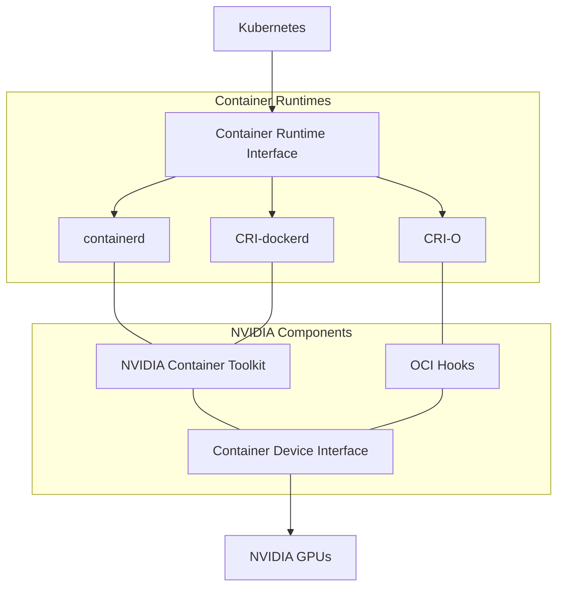
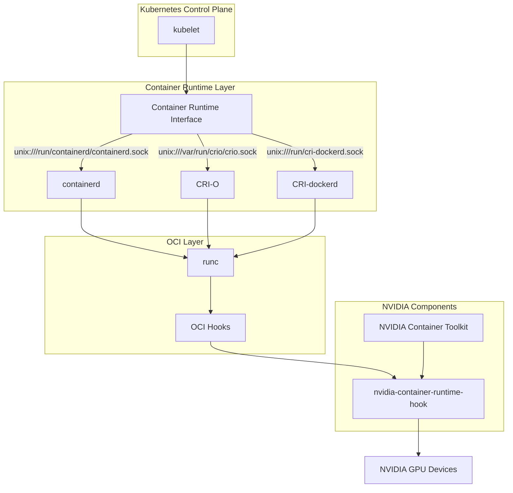
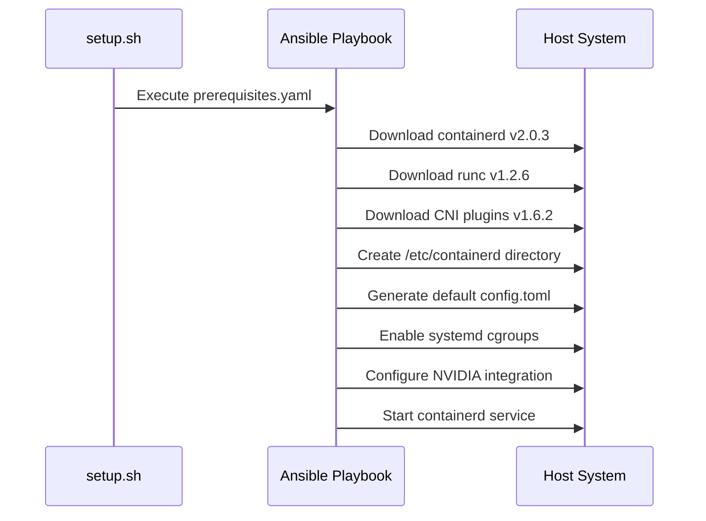
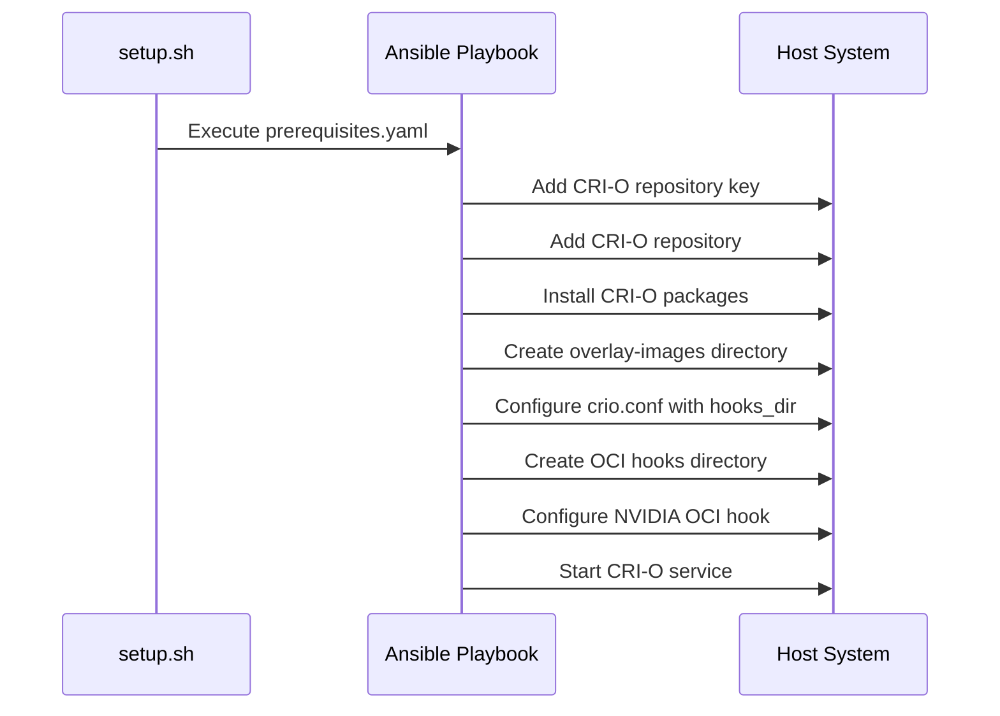

<!-- source: DeepWiki mcp.deepwiki.com · repo NVIDIA/cloud-native-stack · page 4.3 Container Runtimes · fetched 2026-11-11 -->

# Container Runtimes

<details>
<summary>Relevant source files</summary>

The following files were used as context for generating this wiki page:

- [README.md](README.md)
- [cns.json](cns.json)
- [playbooks/cns-installation.yaml](playbooks/cns-installation.yaml)
- [playbooks/cns-upgrade.yaml](playbooks/cns-upgrade.yaml)
- [playbooks/cns-validation.yaml](playbooks/cns-validation.yaml)
- [playbooks/cns_values.yaml](playbooks/cns_values.yaml)
- [playbooks/cns_values_13.2.yaml](playbooks/cns_values_13.2.yaml)
- [playbooks/cns_values_14.0.yaml](playbooks/cns_values_14.0.yaml)
- [playbooks/files/kube-prometheus-stack.values](playbooks/files/kube-prometheus-stack.values)
- [playbooks/gpu_operator.yaml](playbooks/gpu_operator.yaml)
- [playbooks/k8s-install.yaml](playbooks/k8s-install.yaml)
- [playbooks/nvidia-docker.yaml](playbooks/nvidia-docker.yaml)
- [playbooks/nvidia-driver.yaml](playbooks/nvidia-driver.yaml)
- [playbooks/operators-install.yaml](playbooks/operators-install.yaml)
- [playbooks/operators-upgrade.yaml](playbooks/operators-upgrade.yaml)
- [playbooks/prerequisites.yaml](playbooks/prerequisites.yaml)

</details>


## Purpose and Scope

This document provides a technical overview of the container runtimes supported by NVIDIA Cloud Native Stack (CNS). It covers the configuration, integration, and management of containerd, CRI-O, and CRI-dockerd within CNS deployments. This page focuses specifically on the container runtime layer; for information about how these runtimes integrate with the GPU Operator, see [NVIDIA GPU Operator](#4.1).

## Overview

Container runtimes are a critical component in the NVIDIA Cloud Native Stack architecture, serving as the interface between Kubernetes and the container execution environment. CNS supports three container runtimes, each with specific configurations to enable GPU acceleration:

1. **containerd** - The default and recommended runtime
2. **CRI-O** - An alternative OCI-compliant runtime
3. **CRI-dockerd** - Docker with CRI adapter for Kubernetes compatibility

All supported runtimes are configured to work with the NVIDIA Container Toolkit, enabling GPU workloads to access NVIDIA GPUs.



Sources: [README.md:44-46](). [playbooks/cns_values.yaml:9-16](). [playbooks/prerequisites.yaml:300-523]().

## Container Runtime Selection

The container runtime is selected during CNS installation by setting the `container_runtime` parameter in the `cns_values.yaml` file. The default value is "containerd", but it can be changed to "cri-o" or "cri-dockerd" as needed.

```yaml
# Container Runtime options are containerd, cri-o, cri-dockerd
container_runtime: "containerd"
```

When a runtime is selected, CNS will automatically install and configure the specified runtime with proper integration for NVIDIA GPU support.

Sources: [playbooks/cns_values.yaml:9-10](). [playbooks/cns-installation.yaml:261-272]().

## Supported Versions

The following table shows the container runtime versions supported in different CNS releases:

| CNS Version | Containerd | CRI-O | CRI-dockerd | NVIDIA Container Toolkit |
|-------------|------------|-------|------------|--------------------------|
| 15.0 (Ubuntu 24.04) | 2.0.3 | 1.32.1 | 0.3.16 | 1.17.5 |
| 14.1 (Ubuntu 22.04) | 2.0.3 | 1.31.5 | 0.3.16 | 1.17.5 |
| 13.3 (Ubuntu 22.04) | 1.7.27 | 1.30.10 | 0.3.16 | 1.17.5 |

Sources: [README.md:39-53](). [cns.json:1-70]().

## Container Runtime Architecture

The following diagram illustrates how container runtimes integrate with Kubernetes and NVIDIA components within the NVIDIA Cloud Native Stack:



Sources: [playbooks/k8s-install.yaml:192-195](). [playbooks/prerequisites.yaml:300-523]().

## Containerd

Containerd is the default and recommended container runtime for NVIDIA Cloud Native Stack. It provides a minimal but complete implementation of the Kubernetes Container Runtime Interface (CRI).

### Installation and Configuration

CNS installs containerd using the following process:

1. Download containerd binaries from GitHub
2. Install runc and CNI plugins
3. Configure containerd to use systemd cgroups
4. Enable NVIDIA container runtime support

The containerd configuration is stored in `/etc/containerd/config.toml` and is set up to use systemd cgroups and the NVIDIA Container Toolkit.



Sources: [playbooks/prerequisites.yaml:324-512](). [playbooks/nvidia-docker.yaml:321-359]().

### NVIDIA Integration

For containerd, the NVIDIA Container Toolkit is configured using the `nvidia-ctk` command-line tool:

```bash
nvidia-ctk runtime configure --runtime containerd --cdi.enabled
```

This setup allows containerd to recognize and properly mount NVIDIA GPU devices into containers that request them.

Sources: [playbooks/nvidia-docker.yaml:384-392]().

## CRI-O

CRI-O is an alternative container runtime specifically designed for Kubernetes. It is OCI-compliant and focuses exclusively on the requirements of Kubernetes, without extra features found in more general-purpose container engines.

### Installation and Configuration

CNS installs CRI-O using the following process:

1. Add the CRI-O repository appropriate for the OS version
2. Install CRI-O packages
3. Create overlay-images directory
4. Configure CRI-O for NVIDIA GPU support using OCI hooks

The main configuration file is `/etc/crio/crio.conf` or `/etc/crio/crio.conf.d/10-crio.conf` (depending on CRI-O version), and CNS adds the NVIDIA OCI hooks configuration.



Sources: [playbooks/prerequisites.yaml:579-1017](). [playbooks/operators-install.yaml:98-110]().

### NVIDIA Integration

For CRI-O, NVIDIA GPU support is implemented through the OCI hooks mechanism. CNS creates a JSON configuration file at `/usr/share/containers/oci/hooks.d/oci-nvidia-hook.json` that instructs CRI-O to execute the NVIDIA container runtime hook during container creation.

Sources: [playbooks/prerequisites.yaml:993-1017]().

## CRI-dockerd

CRI-dockerd is an adapter that allows Docker to be used as a Kubernetes container runtime by implementing the Container Runtime Interface. This is useful for environments where Docker is already in use or required.

### Installation and Configuration

Although there's less explicit code for CRI-dockerd in the playbooks, the installation process involves:

1. Installing Docker CE
2. Installing CRI-dockerd
3. Configuring Docker to use the NVIDIA container runtime
4. Starting the CRI-dockerd service

When Docker is configured with NVIDIA support, a daemon.json file is created with the following configuration:

```json
{
  "default-runtime": "nvidia",
  "runtimes": {
    "nvidia": {
      "path": "/usr/bin/nvidia-container-runtime",
      "runtimeArgs": []
    }
  }
}
```

Sources: [playbooks/nvidia-docker.yaml:234-319](). [playbooks/k8s-install.yaml:69-78]().

## NVIDIA Container Toolkit

The NVIDIA Container Toolkit is a key component that enables GPU support for all container runtimes. It provides:

1. The `nvidia-container-runtime` executable
2. OCI hooks for runtime integration
3. Container Device Interface (CDI) support for modern container runtimes

### Container Device Interface (CDI)

Newer versions of the NVIDIA Container Toolkit support the Container Device Interface (CDI), which provides a more standardized way to expose GPU devices to containers. CDI is configured as follows:

```bash
nvidia-ctk runtime configure --runtime containerd --cdi.enabled
nvidia-ctk runtime configure --runtime docker --cdi.enabled
nvidia-ctk cdi generate --output=/etc/cdi/nvidia.yaml
```

This generates a CDI specification file that describes how to access NVIDIA GPUs from containers, replacing the older volume-mount based approach.

Sources: [playbooks/nvidia-docker.yaml:384-392]().

## Runtime Selection Considerations

When selecting a container runtime for CNS, consider the following factors:

1. **Feature requirements**: Different runtimes support different feature sets
2. **Performance characteristics**: Runtime overhead varies
3. **Ecosystem compatibility**: Some applications may require specific runtimes
4. **Operational familiarity**: Your team's existing experience with particular runtimes

For most users, the default containerd runtime is recommended as it provides the best balance of performance, features, and compatibility with Kubernetes.

Sources: [README.md:44-46](). [playbooks/cns_values.yaml:9-16]().

## Integration with Kubernetes

Kubernetes is configured to use the selected container runtime through the kubelet configuration. The `cri-socket` parameter specifies the socket path used to communicate with the container runtime:

```yaml
CRI_SOCKET: "unix:///run/containerd/containerd.sockunix:///var/run/crio/crio.sockunix:///run/cri-dockerd.sock"
```

This configuration ensures that Kubernetes can communicate with the chosen container runtime for container lifecycle management.

Sources: [playbooks/k8s-install.yaml:192-195]().

## Troubleshooting

When troubleshooting container runtime issues in CNS, check the following:

1. **Service status**: Verify the container runtime service is running
   ```bash
   systemctl status containerd  # or crio, docker
   ```

2. **Socket availability**: Check if the runtime socket is available
   ```bash
   ls -la /run/containerd/containerd.sock  # or appropriate socket path
   ```

3. **Configuration**: Verify runtime configuration is correctly set up
   ```bash
   cat /etc/containerd/config.toml  # or appropriate config file
   ```

4. **Logs**: Check container runtime logs for errors
   ```bash
   journalctl -u containerd  # or crio, docker, cri-dockerd
   ```

5. **NVIDIA integration**: Test NVIDIA GPU access
   ```bash
   # For containerd:
   ctr run --rm --gpus 0 docker.io/nvidia/cuda:11.6.2-base-ubuntu20.04 cuda-test nvidia-smi
   
   # For Docker:
   docker run --rm --gpus all nvidia/cuda:11.6.2-base-ubuntu20.04 nvidia-smi
   ```

Sources: [playbooks/operators-install.yaml:59-67](). [playbooks/cns-validation.yaml:86-107]().

## Summary

Container runtimes form a critical layer in the NVIDIA Cloud Native Stack, providing the interface between Kubernetes and container execution. CNS supports three container runtimes—containerd, CRI-O, and CRI-dockerd—each integrated with the NVIDIA Container Toolkit to enable GPU-accelerated workloads. The default and recommended runtime is containerd, but the choice can be customized based on specific needs and preferences.

---

