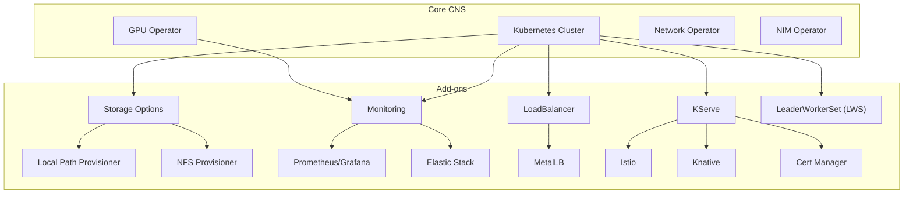
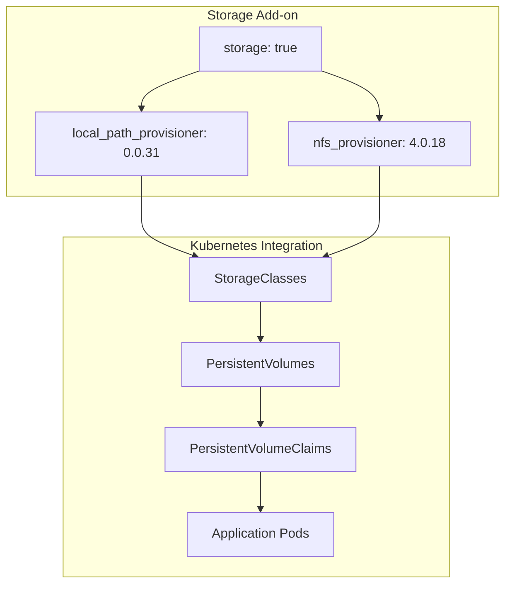
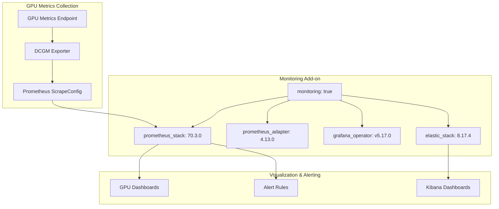
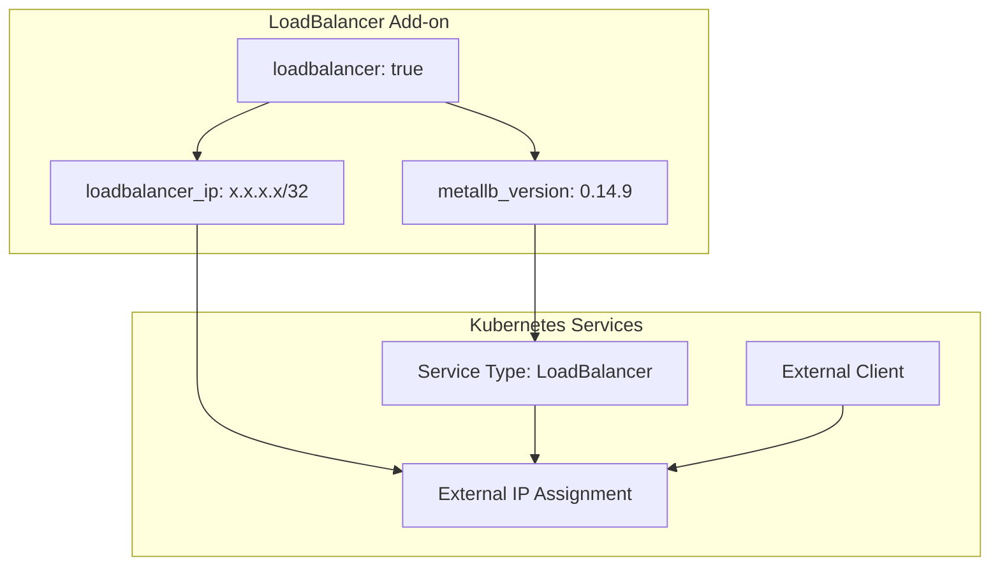
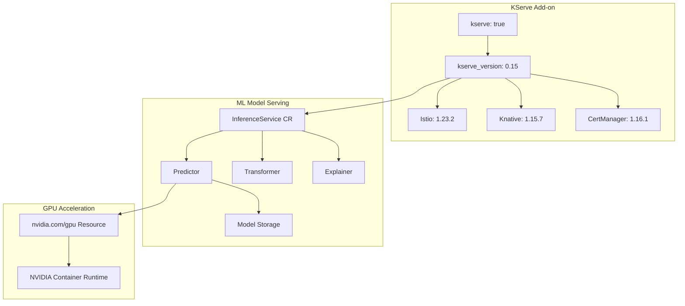
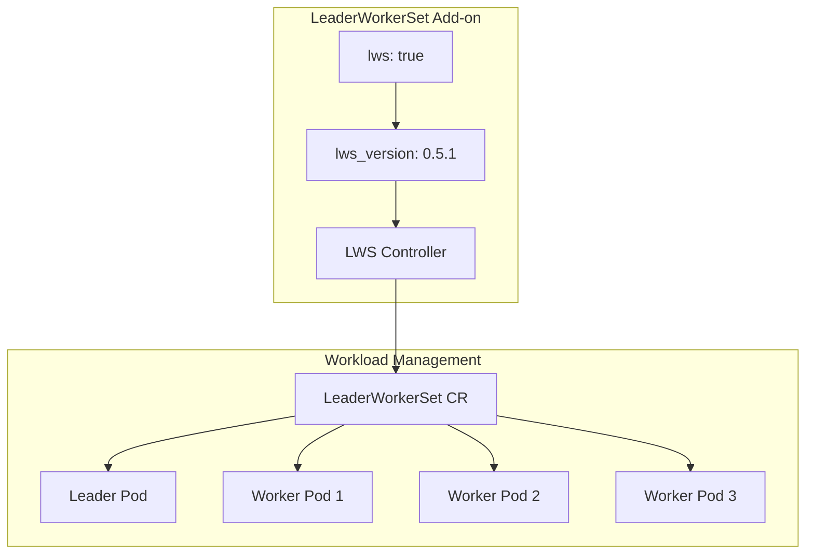
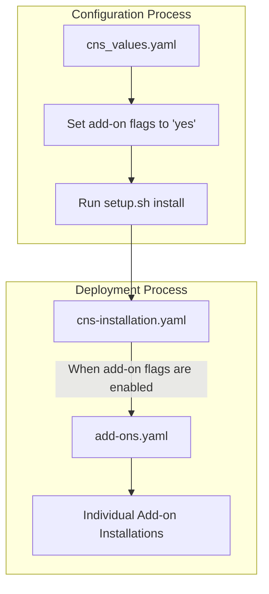
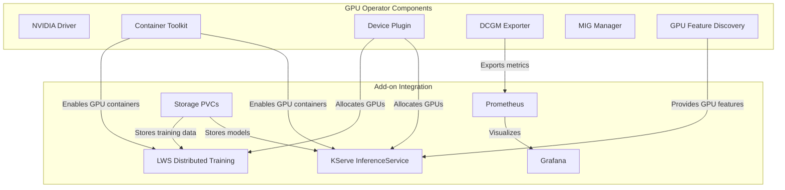
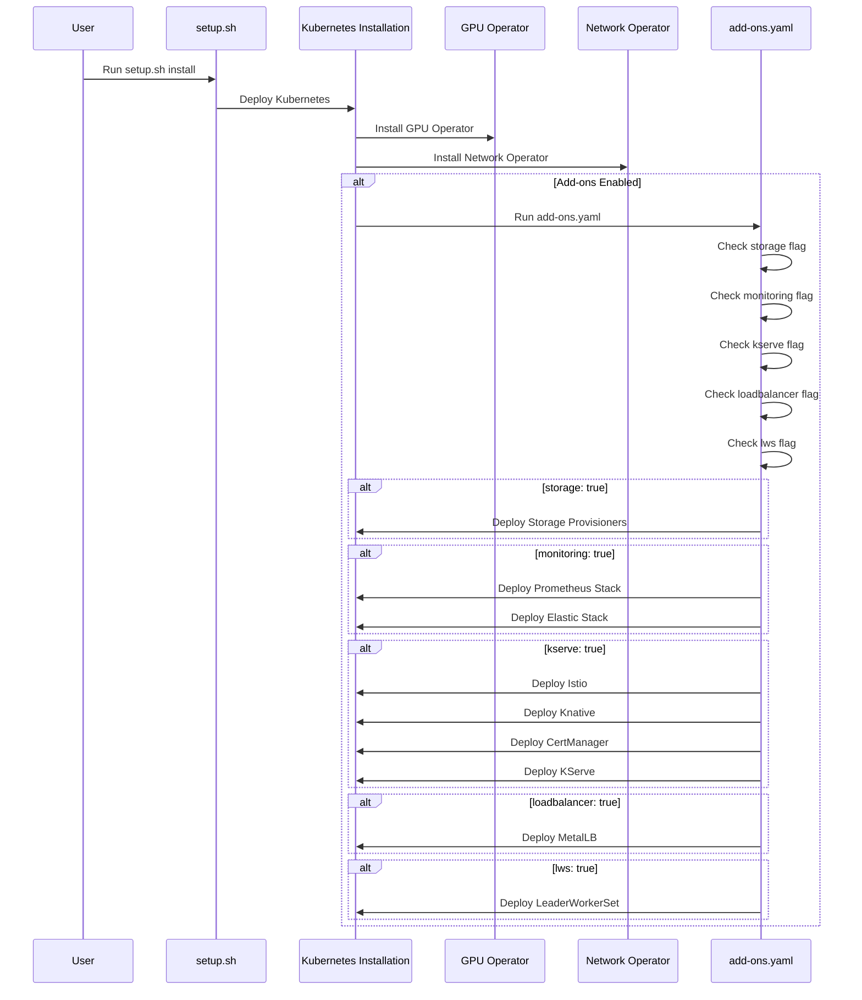

<!-- source: DeepWiki mcp.deepwiki.com · repo NVIDIA/cloud-native-stack · page 4.4 Add-ons · fetched 2026-11-11 -->

# Add-ons

Relevant source files

The following files were used as context for generating this wiki page:

- [README.md](README.md)
- [playbooks/cns-installation.yaml](playbooks/cns-installation.yaml)
- [playbooks/cns-validation.yaml](playbooks/cns-validation.yaml)
- [playbooks/cns_values.yaml](playbooks/cns_values.yaml)
- [playbooks/cns_values_13.2.yaml](playbooks/cns_values_13.2.yaml)
- [playbooks/cns_values_14.0.yaml](playbooks/cns_values_14.0.yaml)
- [playbooks/files/kube-prometheus-stack.values](playbooks/files/kube-prometheus-stack.values)
- [playbooks/gpu_operator.yaml](playbooks/gpu_operator.yaml)
- [playbooks/prerequisites.yaml](playbooks/prerequisites.yaml)

## Introduction

The NVIDIA Cloud Native Stack (CNS) Add-ons module provides optional components that extend the functionality of your GPU-accelerated Kubernetes environment. These add-ons enhance the core infrastructure with capabilities for storage, monitoring, load balancing, ML model serving, and workload management. This document covers the available add-ons, their configuration, and how they integrate with the core CNS components.

Sources: [README.md:67-72](), [playbooks/cns_values.yaml:92-107]()

## Add-on Components Overview

NVIDIA Cloud Native Stack includes several optional add-on components that can be deployed based on your specific requirements. These components are disabled by default and can be enabled through configuration settings.

Sources: [README.md:67-72](), [README.md:75-81](), [playbooks/cns_values.yaml:92-107]()

## Available Add-ons

### Storage Options

Storage add-ons provide persistent storage capabilities for your containerized applications in the NVIDIA Cloud Native Stack. CNS supports two storage provisioner options:

1. **Local Path Provisioner** - For local node storage
2. **NFS Provisioner** - For shared network file system storage

Sources: [README.md:68](), [README.md:80](), [playbooks/cns_values.yaml:96-97]()

### Monitoring Stack

The monitoring add-on provides visibility into the performance and health of your GPU-enabled Kubernetes cluster. It includes:

1. **Prometheus and Grafana** - For metrics collection, storage, and visualization
2. **Prometheus Adapter** - For scaling based on custom metrics
3. **Elastic Stack** - For log aggregation and analysis

The configuration automatically sets up GPU metrics scraping from the NVIDIA GPU Operator.

Prometheus is configured to scrape GPU metrics from the NVIDIA GPU Operator's DCGM exporter, providing visibility into GPU utilization, memory, temperature, and other critical metrics.

Sources: [README.md:69](), [README.md:81](), [playbooks/cns_values.yaml:98-100](), [playbooks/files/kube-prometheus-stack.values:1-22]()

### Load Balancer

The Load Balancer add-on provides external access to services deployed in your Kubernetes cluster. CNS uses MetalLB for this purpose, which is particularly useful in bare-metal environments without cloud provider load balancing.

MetalLB operates in Layer 2 mode, announcing the service IP through ARP/NDP. It requires a pool of available IP addresses to assign to LoadBalancer services.

Sources: [README.md:70](), [README.md:79](), [playbooks/cns_values.yaml:104-107]()

### KServe

KServe is a standardized ML model serving platform for Kubernetes, supporting multiple frameworks like TensorFlow, PyTorch, and ONNX. It leverages NVIDIA GPU acceleration for inference workloads.

KServe components include Istio for traffic routing, Knative for serverless capabilities, and Cert-Manager for TLS certificate management. It integrates with the GPU Operator to access GPU resources for accelerated inference.

Sources: [README.md:71](), [README.md:77](), [playbooks/cns_values.yaml:101-103]()

### LeaderWorkerSet (LWS)

LeaderWorkerSet is a Kubernetes controller that simplifies the deployment and management of distributed workloads with leader-worker patterns, commonly used in machine learning and data processing.

LeaderWorkerSet simplifies deployment of distributed applications where coordination between leader and worker nodes is required, such as in distributed machine learning workloads.

Sources: [README.md:72](), [README.md:78](), [playbooks/cns_values.yaml:92-94]()

## Configuration and Deployment

Add-ons are configured through the `cns_values.yaml` file and deployed through the Ansible playbooks. Each add-on has a boolean flag that enables or disables its installation.

### Configuration Example

Here's the relevant section of the configuration that controls add-on deployment:

| Add-on       | Configuration Flag | Default Value |
|--------------|-------------------|---------------|
| LeaderWorkerSet | `lws`          | `no`          |
| Storage      | `storage`         | `no`          |
| Monitoring   | `monitoring`      | `no`          |
| KServe       | `kserve`          | `no`          |
| LoadBalancer | `loadbalancer`    | `no`          |

For LoadBalancer, an additional parameter `loadbalancer_ip` is required to specify the IP address pool.

The addons are deployed after the core CNS components are installed, ensuring that the necessary infrastructure is available.

Sources: [playbooks/cns-installation.yaml:279-280](), [playbooks/cns_values.yaml:92-107]()

## Version Matrix

The NVIDIA Cloud Native Stack maintains specific tested versions of add-ons for each CNS release. Below is the version matrix for CNS 15.0, 14.1, and 13.3:

| Add-on Component | Version in CNS 15.0/14.1/13.3 |
|------------------|------------------------------|
| MicroK8s         | 1.32/1.31/1.30               |
| KServe           | 0.15 (with Istio 1.23.2, Knative 1.15.7, CertManager 1.16.1) |
| LeaderWorkerSet  | 0.5.1                        |
| LoadBalancer     | MetalLB 0.14.9               |
| Storage          | NFS 4.0.18, Local Path 0.0.31 |
| Monitoring       | Prometheus 70.3.0, Prometheus Adapter 4.13.0, Elastic 8.17.4 |

These versions are tested for compatibility with the corresponding CNS release.

Sources: [README.md:74-81]()

## Integration with GPU Operator

Add-ons like Monitoring and KServe are designed to work with the NVIDIA GPU Operator to provide enhanced functionality for GPU-accelerated workloads.

The GPU Operator's components provide the necessary infrastructure for add-ons to leverage GPU acceleration:

1. **DCGM Exporter** provides GPU metrics that are collected by the Prometheus monitoring add-on
2. **Device Plugin** enables GPU resource allocation for KServe and LeaderWorkerSet workloads
3. **Container Toolkit** ensures containers can access GPUs
4. **GPU Feature Discovery** helps with scheduling optimizations

Sources: [playbooks/files/kube-prometheus-stack.values:8-22](), [playbooks/cns-validation.yaml:47-60]()

## Deployment Workflow

The following diagram illustrates how add-ons are installed as part of the CNS deployment process:

Sources: [playbooks/cns-installation.yaml:262-280](), [playbooks/cns_values.yaml:92-107]()

## Validation

The CNS validation system can verify that add-ons are properly deployed and configured. This is handled by the `cns-validation.yaml` playbook which checks component versions and operational status.

For monitoring components, the validation verifies:
- Prometheus stack version
- GPU metrics scraping configuration
- Dashboard availability

For storage, the validation ensures:
- Storage classes are created
- Provisioners are running
- PVCs can be created and used

For KServe, it confirms:
- All required components (Istio, Knative, CertManager) are running
- InferenceService CRD is installed
- GPU resources are available for inference

Sources: [playbooks/cns-validation.yaml:1-505]()

## Summary

Add-ons extend the core NVIDIA Cloud Native Stack with essential capabilities for running production workloads:

1. **Storage** provides persistence for applications and data
2. **Monitoring** offers visibility into cluster and GPU performance
3. **LoadBalancer** enables external access to services
4. **KServe** facilitates GPU-accelerated ML model serving
5. **LeaderWorkerSet** simplifies distributed workload management

These add-ons are optional and can be enabled based on your specific requirements. They are designed to integrate seamlessly with the core CNS components, particularly leveraging GPU resources through the NVIDIA GPU Operator.

---

