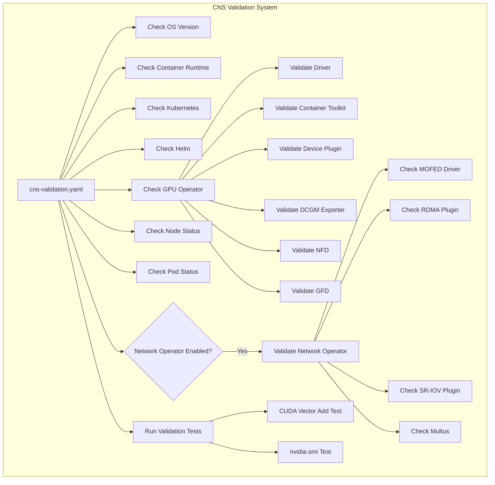
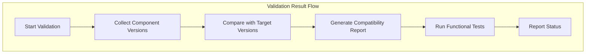
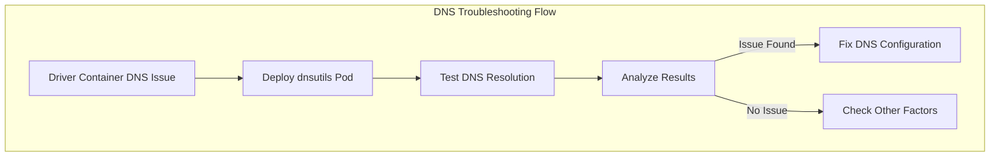

<!-- source: DeepWiki mcp.deepwiki.com · repo NVIDIA/cloud-native-stack · page 5 Validation and Troubleshooting · fetched 2026-11-11 -->

# Validation and Troubleshooting

<details>
<summary>Relevant source files</summary>

The following files were used as context for generating this wiki page:

- [playbooks/cns-validation.yaml](playbooks/cns-validation.yaml)
- [playbooks/cns_values.yaml](playbooks/cns_values.yaml)
- [playbooks/cns_values_13.2.yaml](playbooks/cns_values_13.2.yaml)
- [playbooks/cns_values_14.0.yaml](playbooks/cns_values_14.0.yaml)
- [playbooks/files/kube-prometheus-stack.values](playbooks/files/kube-prometheus-stack.values)
- [playbooks/gpu_operator.yaml](playbooks/gpu_operator.yaml)
- [troubleshooting/README.md](troubleshooting/README.md)
- [troubleshooting/dns.md](troubleshooting/dns.md)
- [troubleshooting/driver-container-logs.png](troubleshooting/driver-container-logs.png)

</details>


This page provides documentation on validating your NVIDIA Cloud Native Stack (CNS) deployment and troubleshooting common issues. The validation system helps verify that all components are correctly installed and functioning as expected, while the troubleshooting resources assist in diagnosing and resolving problems that may arise during deployment or operation.

## Validation System Overview

The CNS validation system verifies your deployment in a structured manner, checking everything from base components like Kubernetes and container runtimes to NVIDIA-specific components like the GPU Operator and drivers.



Sources: [playbooks/cns-validation.yaml:1-505]()

## Running Validation

The validation can be run either automatically during installation or manually after deployment.

### Automatic Validation

To enable automatic validation during installation, set the `cns_validation` parameter to `yes` in your CNS values file:

```yaml
## Cloud Native Stack Validation
cns_validation: yes
```

Sources: [playbooks/cns_values.yaml:110-111]()

### Manual Validation

To run validation manually, execute the validation playbook:

```bash
ansible-playbook -i hosts playbooks/cns-validation.yaml
```

### Validation Checks

The validation playbook performs numerous checks, including:

1. **Base System Validation**
   - Operating System version
   - Container runtime (containerd, cri-o, or cri-dockerd) version
   - Kubernetes version and cluster health
   - Helm version

2. **GPU Operator Component Validation**
   - GPU Operator version
   - NVIDIA Driver version
   - Container Toolkit version
   - Device Plugin version
   - DCGM Exporter version
   - Node Feature Discovery (NFD) version
   - GPU Feature Discovery (GFD) version
   - MIG Manager version (if applicable)
   - Validator version

3. **Network Operator Validation** (if enabled)
   - Network Operator version
   - MOFED Driver version
   - RDMA Shared Device Plugin version
   - SR-IOV Device Plugin version
   - Container Networking Plugins version
   - Multus version
   - Whereabouts version

4. **Functional Testing**
   - Running CUDA vector addition test
   - Running nvidia-smi test
   - Checking node readiness
   - Verifying all pods are in Running state

Sources: [playbooks/cns-validation.yaml:7-45](), [playbooks/cns-validation.yaml:47-95](), [playbooks/cns-validation.yaml:108-148](), [playbooks/cns-validation.yaml:425-442]()

## Interpreting Validation Results

The validation playbook provides a detailed output comparing installed component versions with target versions to ensure compatibility.



### Example Validation Output

```
===========================================================================================
  Components                          Target Version          ||     Installed Version    
===========================================================================================
GPU Operator Version                  v25.3.0                 ||     v25.3.0
NVIDIA Container Driver Version       570.124.06              ||     570.124.06
GPU Operator NV Toolkit Driver        v1.17.5                 ||     v1.17.5
K8sDevice Plugin Version              v0.17.1                 ||     v0.17.1
Data Center GPU Manager(DCGM) Version 4.1.1-4.0.4             ||     4.1.1-4.0.4
Node Feature Discovery Version        v0.17.2                 ||     v0.17.2
GPU Feature Discovery Version         v0.17.1                 ||     v0.17.1
NVIDIA validator version              v25.3.0                 ||     v25.3.0
NVIDIA MIG Manager version            v0.12.1                 ||     v0.12.1
```

Sources: [playbooks/cns-validation.yaml:318-334]()

## Component Version Compatibility

CNS ensures compatibility between all components through version validation. The validation system uses the appropriate target versions based on your CNS version.

| CNS Version | GPU Operator | NVIDIA Driver | Container Toolkit | Device Plugin |
|-------------|--------------|---------------|-------------------|---------------|
| 14.1        | v25.3.0      | 570.124.06    | v1.17.5           | v0.17.1       |
| 14.0        | v24.9.2      | 570.86.15     | v1.17.4           | v0.17.0       |
| 13.2        | v24.9.2      | 570.86.15     | v1.17.4           | v0.17.0       |
| 13.1        | v24.6.2      | 550.90.07     | v1.16.2           | v0.16.1       |

Sources: [playbooks/gpu_operator.yaml:1-27](), [playbooks/cns_values.yaml:1-34](), [playbooks/cns_values_14.0.yaml:1-34](), [playbooks/cns_values_13.2.yaml:1-34]()

## Troubleshooting Common Issues

### DNS Resolution Issues

DNS issues are a common source of problems in CNS deployments, particularly for the driver container which needs to download packages during initialization.



#### Diagnosing DNS Issues

1. Deploy the dnsutils debugging pod:
   ```bash
   kubectl apply -f https://k8s.io/examples/admin/dns/dnsutils.yaml
   ```

2. Test DNS resolution from within the cluster:
   ```bash
   kubectl exec -i -t dnsutils -- nslookup archive.ubuntu.com
   ```

3. In a properly functioning deployment, you should see output similar to:
   ```
   Server:     10.96.0.10
   Address:    10.96.0.10#53

   Non-authoritative answer:
   Name:   archive.ubuntu.com
   Address: 91.189.91.82
   ...
   ```

4. If DNS resolution fails or returns incorrect results, check your cluster's DNS configuration and network connectivity.

Sources: [troubleshooting/dns.md:1-62]()

### Driver Container Issues

If the driver container fails to start or initialize properly, this is often visible in the container logs:

1. Identify the driver container pod:
   ```bash
   kubectl get pods -n gpu-operator-resources | grep driver
   ```

2. Check the driver container logs:
   ```bash
   kubectl logs -n gpu-operator-resources <driver-pod-name>
   ```

3. Look for specific error messages related to:
   - Package download failures
   - DNS resolution issues
   - Kernel header mismatches
   - Build errors

Sources: [troubleshooting/dns.md:5-10]()

### GPU Operator Validation Issues

If the GPU Operator components don't function correctly:

1. Check the overall status of GPU Operator pods:
   ```bash
   kubectl get pods -n gpu-operator-resources
   ```

2. For specific component validation issues, check the appropriate component logs:
   ```bash
   kubectl logs -n gpu-operator-resources <component-pod-name>
   ```

3. Run a basic nvidia-smi test to validate GPU access:
   ```bash
   kubectl run nvidia-smi --rm -t -i --restart=Never \
     --image=nvidia/cuda:12.6.0-base-ubuntu22.04 -- nvidia-smi
   ```

4. Validate component versions match the expected ones for your CNS version:
   ```bash
   kubectl get pods --all-namespaces -o=jsonpath="{range .items[*]}{.metadata.name}{'\t'}{.spec.containers[*].image}{'\n'}" | grep 'nvidia'
   ```

Sources: [playbooks/cns-validation.yaml:433-437]()

## Monitoring GPU Components

For advanced troubleshooting, the CNS deployment can include monitoring tools such as Prometheus and Grafana, which can provide detailed metrics about GPU usage and health.

To enable monitoring during installation:

```yaml
# Monitoring Stack Prometheus/Grafana with GPU Metrics and Elastic Logging stack
monitoring: yes
```

The monitoring stack collects NVIDIA GPU metrics that can be used for troubleshooting performance or health issues:

```yaml
- job_name: gpu-metrics
  scrape_interval: 1s
  metrics_path: /metrics
  scheme: http
  kubernetes_sd_configs:
  - role: endpoints
    namespaces:
      names:
      - nvidia-gpu-operator
      - default
```

Sources: [playbooks/cns_values.yaml:98-100](), [playbooks/files/kube-prometheus-stack.values:1-22]()

## Network Operator Troubleshooting

If you're using the Network Operator for high-performance networking, additional validation and troubleshooting steps may be needed:

1. Validate Network Operator component status:
   ```bash
   kubectl get pods -n network-operator
   ```

2. Check MOFED driver installation status:
   ```bash
   kubectl get pods --all-namespaces | grep mofed
   ```

3. Verify RDMA device plugin status:
   ```bash
   kubectl get pods --all-namespaces | grep rdma-shared
   ```

4. For SR-IOV configuration issues, check the device plugin logs:
   ```bash
   kubectl logs -n network-operator <sriov-device-plugin-pod>
   ```

Sources: [playbooks/cns-validation.yaml:108-148]()

## Additional Resources

For more detailed information about specific components:

- For installation issues, see [Installation Process](#2)
- For configuration problems, see [Configuration](#3)
- For GPU Operator details, see [NVIDIA GPU Operator](#4.1)
- For Network Operator information, see [NVIDIA Network Operator](#4.2)

Sources: [playbooks/cns-validation.yaml](), [troubleshooting/README.md:1-6](), [troubleshooting/dns.md]()

---

