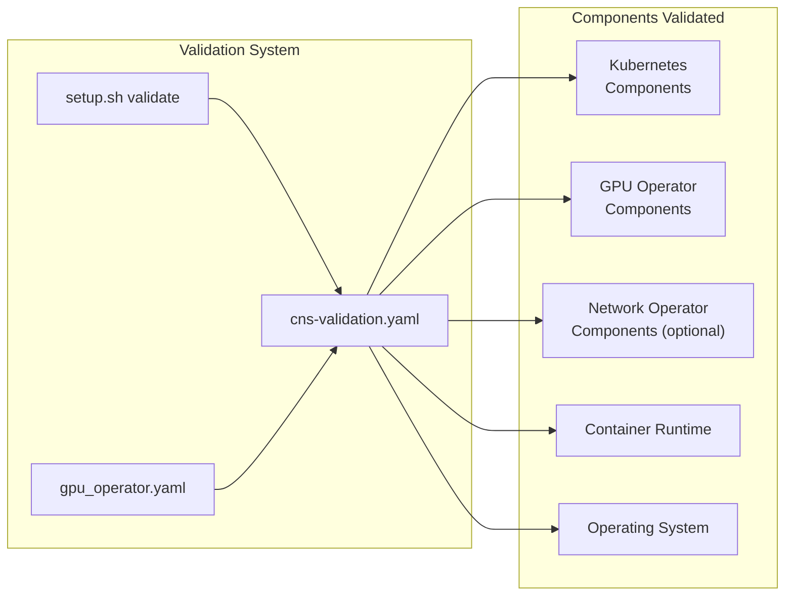
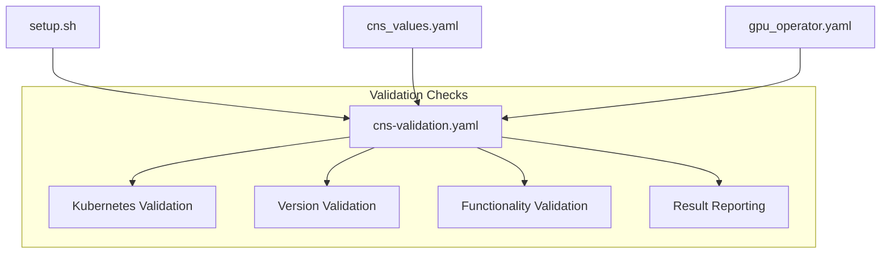

<!-- source: DeepWiki mcp.deepwiki.com · repo NVIDIA/cloud-native-stack · page 5.1 Validation · fetched 2026-11-11 -->

# Validation

<details>
<summary>Relevant source files</summary>

The following files were used as context for generating this wiki page:

- [README.md](README.md)
- [install-guides/readme.md](install-guides/readme.md)
- [playbooks/cns-installation.yaml](playbooks/cns-installation.yaml)
- [playbooks/cns-validation.yaml](playbooks/cns-validation.yaml)
- [playbooks/cns_values.yaml](playbooks/cns_values.yaml)
- [playbooks/cns_values_13.2.yaml](playbooks/cns_values_13.2.yaml)
- [playbooks/cns_values_14.0.yaml](playbooks/cns_values_14.0.yaml)
- [playbooks/files/kube-prometheus-stack.values](playbooks/files/kube-prometheus-stack.values)
- [playbooks/gpu_operator.yaml](playbooks/gpu_operator.yaml)
- [playbooks/prerequisites.yaml](playbooks/prerequisites.yaml)
- [playbooks/readme.md](playbooks/readme.md)
- [playbooks/setup.sh](playbooks/setup.sh)

</details>


The Validation system in NVIDIA Cloud Native Stack (CNS) provides a systematic way to verify the correct installation and proper functioning of all components in a CNS environment. It checks component versions, validates the health of the Kubernetes cluster, and ensures that GPU functionality is working as expected.

This page describes the architecture, workflow, and usage of the validation system. For troubleshooting issues found during validation, see [Troubleshooting](#5.2).

## Validation System Overview

The CNS validation system is an automated verification framework that performs a series of checks to ensure that all components are properly installed and functioning correctly. The validation process is implemented as an Ansible playbook that performs various checks across the cluster.



Sources: [playbooks/cns-validation.yaml](), [playbooks/setup.sh:384-394](), [playbooks/gpu_operator.yaml]()

## Validation Process Flow

The validation process follows a systematic approach to check all components of the CNS stack. Below is the detailed workflow of the validation process:

```mermaid
flowchart TD
    start["Start Validation"] --> k8sCheck{{"Check Kubernetes\nCluster Status"}}
    k8sCheck --> versionCheck["Collect Component Versions"]
    versionCheck --> compareVersions["Compare with Target Versions"]
    compareVersions --> podCheck{{"Check Pod Status"}}
    podCheck --> nodeCheck{{"Check Node Status"}}
    nodeCheck --> cudaValidation["Run CUDA Test"]
    cudaValidation --> smiValidation["Run nvidia-smi Test"]
    smiValidation --> reportResults["Report Validation Results"]
    reportResults --> end["End Validation"]
```

Sources: [playbooks/cns-validation.yaml:7-438]()

## Validation Components

The validation system checks the following key components:

### 1. Kubernetes Environment Validation

- Kubernetes cluster status
- Node readiness
- Pod status across all namespaces

### 2. Component Version Validation

The system compares installed versions with target versions defined in the configuration files. The components checked include:

| Component Category | Components Checked |
|-------------------|-------------------|
| Operating System | Ubuntu/RHEL version |
| Container Runtime | Containerd, CRI-O, or CRI-Dockerd version |
| Kubernetes | Kubernetes, Etcd, Helm versions |
| GPU Operator | GPU Operator, NVIDIA Driver, Container Toolkit, Device Plugin, DCGM, MIG Manager, etc. |
| Network Operator | Network Operator, MOFED Driver, RDMA Device Plugin, SRIOV Device Plugin, etc. |
| Networking | Calico, Flannel versions |

Sources: [playbooks/cns-validation.yaml:13-168](), [playbooks/gpu_operator.yaml]()

### 3. Functionality Validation

The validation system runs functional tests to ensure that GPU functionality is working correctly:

- CUDA Vector Addition Test: Validates that CUDA applications can run on the cluster
- NVIDIA-SMI Test: Ensures that the NVIDIA System Management Interface is properly functioning

Sources: [playbooks/cns-validation.yaml:426-438]()

### 4. Result Reporting

The system generates detailed reports that show:

- Comparison between target and installed versions
- Status of all components
- Results of functionality tests
- Overall validation status

Sources: [playbooks/cns-validation.yaml:229-505]()

## Validation Architecture

The validation system consists of several key files that work together to perform the validation process:



Sources: [playbooks/setup.sh:384-394](), [playbooks/cns-validation.yaml](), [playbooks/cns_values.yaml](), [playbooks/gpu_operator.yaml]()

## Running the Validation System

To validate your CNS installation, follow these steps:

1. Make sure you're in the CNS playbooks directory:
   ```bash
   cd cloud-native-stack/playbooks
   ```

2. Run the validation script:
   ```bash
   bash setup.sh validate
   ```

3. The system will execute the validation process and display the results. A successful validation will show all components as "ok" or "changed", while failed validations will show as "failed" or "ignored".

Sources: [playbooks/setup.sh:384-394](), [README.md:385-394]()

## Understanding Validation Results

The validation system generates detailed reports comparing the installed versions of components with their target versions. Here's how to interpret the results:

### Component Version Comparison

The system outputs a table comparing target versions with installed versions:

```
===========================================================================================
  Components                          Target Version          ||     Installed Version    
===========================================================================================
GPU Operator Version                  v25.3.0                 ||     v25.3.0
NVIDIA Container Driver Version       570.124.06               ||     570.124.06
GPU Operator NV Toolkit Driver        v1.17.5                 ||     v1.17.5
```

Discrepancies between target and installed versions may indicate installation issues that need to be addressed.

### Functional Test Results

The validation system also outputs the results of the CUDA and NVIDIA-SMI tests. These should indicate successful execution and proper GPU functionality.

Sources: [playbooks/cns-validation.yaml:248-379]()

## Validation Checks Reference

Below is a comprehensive list of the key validation checks performed by the system:

| Category | Check | Description |
|----------|-------|-------------|
| Kubernetes | Cluster Status | Verifies Kubernetes control plane is accessible |
| Kubernetes | Node Readiness | Ensures all nodes are in Ready state |
| Kubernetes | Pod Status | Checks that all pods are Running or Completed |
| OS | Version | Validates OS version compatibility |
| Container Runtime | Version | Checks container runtime version |
| Kubernetes | Version | Verifies Kubernetes version |
| Kubernetes | Helm | Validates Helm is properly installed |
| GPU Operator | Component Versions | Checks all GPU Operator component versions |
| Network Operator | Component Versions | Validates Network Operator components if enabled |
| Functionality | CUDA Test | Runs a CUDA vector addition test |
| Functionality | NVIDIA-SMI | Executes nvidia-smi within a container |

Sources: [playbooks/cns-validation.yaml:7-438]()

## Automated Validation

The CNS validation system can be incorporated into continuous integration/continuous deployment (CI/CD) pipelines or regular system health checks. This ensures that any changes to the system do not break the expected functionality.

The `cns_validation` flag in the configuration files can be used to automatically run validation after installation:

```yaml
## Cloud Native Stack Validation
cns_validation: yes
```

Sources: [playbooks/cns_values.yaml:110](), [playbooks/cns-installation.yaml:306-309]()

## Common Validation Issues

Here are some common issues that may be identified during validation:

1. **Component Version Mismatch**: If installed component versions don't match target versions, it might indicate an incomplete or incorrect installation.

2. **Pod Status Issues**: Pods in states other than Running or Completed may indicate configuration or resource issues.

3. **CUDA Test Failure**: If the CUDA test fails, there might be issues with GPU drivers or device plugin.

4. **NVIDIA-SMI Failure**: Failure of the NVIDIA-SMI test suggests problems with the NVIDIA driver installation.

For detailed troubleshooting steps, refer to the [Troubleshooting](#5.2) page.

Sources: [playbooks/cns-validation.yaml:176-180](), [playbooks/cns-validation.yaml:426-438](), [README.md:135-137]()

## Summary

The NVIDIA Cloud Native Stack validation system provides a comprehensive framework for verifying the correct installation and proper functioning of all CNS components. By running the validation process, users can quickly identify any issues and ensure that their GPU-enabled Kubernetes environment is working as expected.

Regular validation is recommended after installation, upgrades, or significant system changes to ensure continued proper operation of the CNS environment.

---

