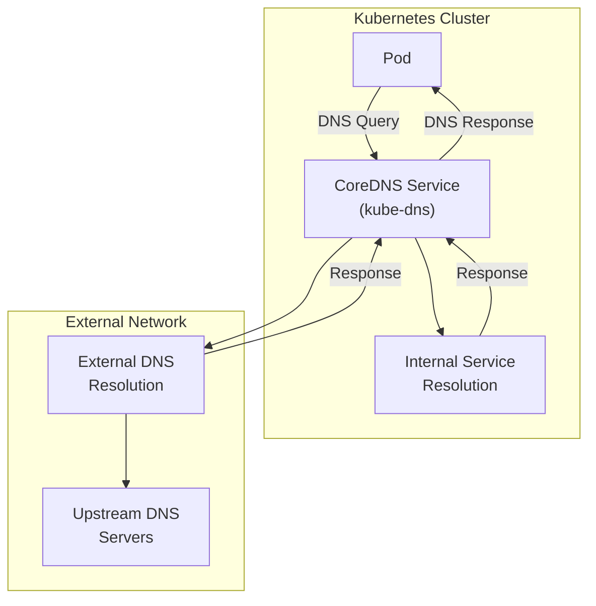
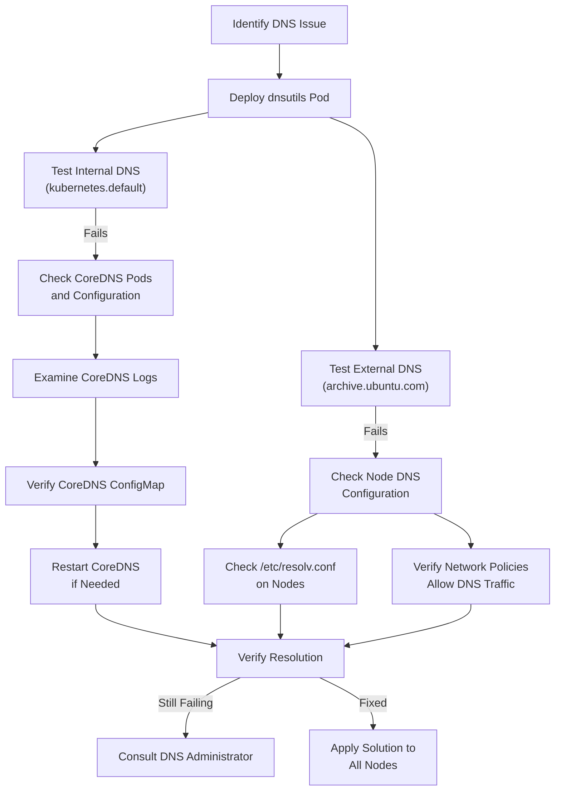

<!-- source: DeepWiki mcp.deepwiki.com · repo NVIDIA/cloud-native-stack · page 5.3 DNS Troubleshooting · fetched 2026-11-11 -->

# DNS Troubleshooting

<details>
<summary>Relevant source files</summary>

The following files were used as context for generating this wiki page:

- [troubleshooting/README.md](troubleshooting/README.md)
- [troubleshooting/dns.md](troubleshooting/dns.md)
- [troubleshooting/driver-container-logs.png](troubleshooting/driver-container-logs.png)

</details>


## Introduction

This document provides guidance for diagnosing and resolving DNS resolution issues in NVIDIA Cloud Native Stack (CNS) deployments. DNS problems can prevent proper communication between components and cause deployment failures, particularly affecting the GPU Operator and Driver Container. For general troubleshooting information, see [Troubleshooting](#5.2).

Sources: [troubleshooting/README.md:1-6]()

## DNS Resolution Architecture in Kubernetes/CNS

In CNS deployments, DNS resolution follows the standard Kubernetes DNS architecture where all pod DNS queries are handled by the CoreDNS service:



Sources: [troubleshooting/dns.md]()

## Common DNS Issues in CNS

DNS issues in CNS environments typically manifest as:

1. Pods unable to resolve external domains (like archive.ubuntu.com)
2. Driver Container failing to download packages or access external resources
3. Installation or update processes failing due to DNS resolution errors
4. Internal services unable to communicate with each other

## DNS Troubleshooting Process

The following diagram illustrates the systematic approach to troubleshooting DNS issues in CNS deployments:



Sources: [troubleshooting/dns.md:13-15]()

## Deploying DNS Diagnostic Tools

The primary tool for diagnosing DNS issues in CNS is the `dnsutils` pod, which contains utilities like `nslookup` and `dig`.

### Deploying dnsutils Pod

1. Deploy the diagnostic pod:

```
kubectl apply -f https://k8s.io/examples/admin/dns/dnsutils.yaml
```

2. Verify the pod is running:

```
kubectl get pods dnsutils
```

Sources: [troubleshooting/dns.md:17-20]()

## Testing DNS Resolution

Once the `dnsutils` pod is running, you can use it to test DNS resolution within your CNS environment.

### Testing External Domain Resolution

To test resolution of external domains, which is critical for component installation and updates:

```
kubectl exec -i -t dnsutils -- nslookup archive.ubuntu.com
```

In a properly functioning CNS deployment, you should see output similar to:

```
Server:         10.96.0.10
Address:        10.96.0.10#53

Non-authoritative answer:
Name:   archive.ubuntu.com
Address: 91.189.91.82
Name:   archive.ubuntu.com
Address: 185.125.190.82
...additional addresses...
```

Key indicators of proper resolution:
- Server address should be your CoreDNS service IP (typically 10.96.0.10)
- The "Name" field must exactly match "archive.ubuntu.com"
- Multiple IP addresses should be returned

If the "Name" field differs from "archive.ubuntu.com", this indicates a DNS override that may require administrator intervention.

Sources: [troubleshooting/dns.md:24-58]()

### Testing Internal Service Resolution

To verify internal DNS resolution, test the Kubernetes API service:

```
kubectl exec -i -t dnsutils -- nslookup kubernetes.default
```

Proper resolution should return the Kubernetes service IP.

## Driver Container DNS Issues

### Driver Container Failed to Access archive.ubuntu.com

#### Issue:

The most common DNS issue in CNS involves the Driver Container failing to access external repositories during installation. The Driver Container logs may show errors like:

```
Err:1 http://archive.ubuntu.com/ubuntu focal InRelease
  Temporary failure resolving 'archive.ubuntu.com'
```

#### Troubleshooting:

1. Check DNS resolution using dnsutils:
   ```
   kubectl exec -i -t dnsutils -- nslookup archive.ubuntu.com
   ```

2. Verify that the Name field exactly matches "archive.ubuntu.com"

3. If the Name field shows a different domain, your organization's DNS may have created a custom entry for archive.ubuntu.com:
   - This could redirect to an internal mirror that's not accessible
   - Contact your DNS administrator to remove any custom entry for archive.ubuntu.com

Sources: [troubleshooting/dns.md:5-12](), [troubleshooting/dns.md:61-62]()

## Investigating CoreDNS Configuration

If DNS resolution fails, examine the CoreDNS configuration:

1. Check CoreDNS pod status:
   ```
   kubectl get pods -n kube-system | grep coredns
   ```

2. Examine CoreDNS logs for errors:
   ```
   kubectl logs -n kube-system coredns-<pod-id>
   ```

3. Verify CoreDNS ConfigMap:
   ```
   kubectl get configmap coredns -n kube-system -o yaml
   ```

4. Ensure the Corefile in the ConfigMap has the proper forward plugin configuration:
   ```
   forward . /etc/resolv.conf
   ```
   or
   ```
   forward . <upstream-dns-server>
   ```

5. Restart CoreDNS pods after any configuration changes:
   ```
   kubectl delete pod -n kube-system coredns-<pod-id>
   ```

## Checking Node DNS Configuration

DNS issues may also originate from the node's configuration:

1. Check the node's resolv.conf file:
   ```
   cat /etc/resolv.conf
   ```

2. Test direct DNS resolution from the node:
   ```
   nslookup archive.ubuntu.com
   ```

3. If node-level resolution fails, update DNS configuration on all nodes.

## Network Policy Considerations

In CNS deployments with network policies, ensure policies allow:
- Outbound DNS traffic (TCP/UDP port 53) from all pods
- Inbound DNS traffic to CoreDNS pods

This is especially important in secure environments where restrictive network policies are in place.

## Resolution Verification

After implementing fixes, verify DNS resolution:

1. Test using dnsutils:
   ```
   kubectl exec -i -t dnsutils -- nslookup archive.ubuntu.com
   ```

2. Verify Driver Container can access repositories:
   ```
   kubectl logs -n gpu-operator-resources nvidia-driver-daemonset-<pod-id>
   ```

Sources: [troubleshooting/dns.md:24-54]()

## Troubleshooting Table

| Issue | Possible Causes | Diagnostic Commands | Resolution |
|-------|----------------|---------------------|------------|
| Driver Container cannot resolve archive.ubuntu.com | Custom DNS entries, CoreDNS issues, Node DNS configuration | `kubectl exec -i -t dnsutils -- nslookup archive.ubuntu.com` | Remove custom DNS entries, fix CoreDNS configuration |
| CoreDNS pods in CrashLoopBackOff | Configuration errors, resource constraints | `kubectl logs -n kube-system coredns-<pod-id>` | Fix ConfigMap, increase resource limits |
| Internal services cannot resolve each other | CoreDNS service issues, Network policies | `kubectl exec -i -t dnsutils -- nslookup kubernetes.default` | Restart CoreDNS, update network policies |
| DNS works for some pods but not others | Pod-specific DNS configuration, Network policies | Test from affected pods, check NetworkPolicy resources | Update pod DNS config, modify network policies |

## Summary

DNS issues in CNS deployments can significantly impact the installation and operation of components like the GPU Operator. By systematically testing and troubleshooting DNS resolution using the tools and techniques described in this document, you can identify and resolve these issues efficiently.

Always verify both internal and external DNS resolution, examine CoreDNS configuration, and check node-level DNS settings to ensure proper operation of the NVIDIA Cloud Native Stack.

---

