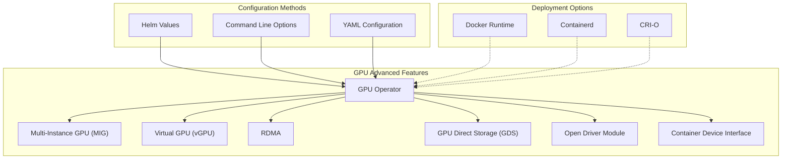
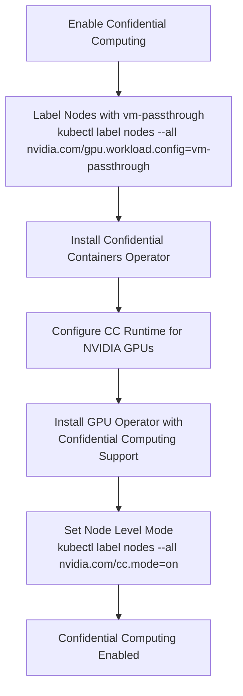
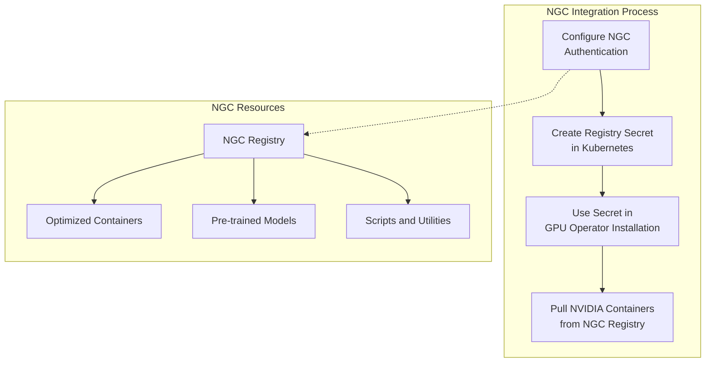

<!-- source: DeepWiki mcp.deepwiki.com · repo NVIDIA/cloud-native-stack · page 6 Advanced Topics · fetched 2026-11-11 -->

# Advanced Topics

<details>
<summary>Relevant source files</summary>

The following files were used as context for generating this wiki page:

- [README.md](README.md)
- [cns.json](cns.json)
- [playbooks/cns-installation.yaml](playbooks/cns-installation.yaml)
- [playbooks/cns-upgrade.yaml](playbooks/cns-upgrade.yaml)
- [playbooks/k8s-install.yaml](playbooks/k8s-install.yaml)
- [playbooks/nvidia-docker.yaml](playbooks/nvidia-docker.yaml)
- [playbooks/nvidia-driver.yaml](playbooks/nvidia-driver.yaml)
- [playbooks/operators-install.yaml](playbooks/operators-install.yaml)
- [playbooks/operators-upgrade.yaml](playbooks/operators-upgrade.yaml)
- [playbooks/prerequisites.yaml](playbooks/prerequisites.yaml)

</details>


This page covers advanced configuration and usage scenarios for the NVIDIA Cloud Native Stack. Here we explore specialized features, upgrade procedures, and complex deployment options that extend beyond basic installation. For standard installation procedures, see [Installation](#2) and for basic configuration options see [Configuration](#3).

## Upgrading NVIDIA Cloud Native Stack

Cloud Native Stack follows a defined versioning system with regular batches of updates. Understanding the upgrade process is crucial for maintaining system stability and access to new features.

```mermaid
flowchart TD
    Start["Start Upgrade"] --> Check["Check Current Version"]
    Check --> VersionCheck{"Is Current Version\nSupported for Upgrade?"}
    VersionCheck -->|"Yes"| PreUpgrade["Prepare for Upgrade\n- Backup configurations\n- Update inventory"]
    VersionCheck -->|"No"| FreshInstall["Perform Fresh Install"]
    PreUpgrade --> UpgradeK8s["Upgrade Kubernetes\nComponents"]
    UpgradeK8s --> NetworkPlugin["Update Network Plugin"]
    NetworkPlugin --> UpgradeGPUOp["Upgrade GPU Operator"]
    UpgradeGPUOp --> UpgradeNetOp["Upgrade Network Operator"]
    UpgradeNetOp --> ValidateUpgrade["Validate Upgrade\nSuccess"]
    ValidateUpgrade --> AddOns["Upgrade Add-ons\n(if installed)"]
</flowchart>

Sources: [playbooks/cns-upgrade.yaml:1-200](), [playbooks/operators-upgrade.yaml:1-162]()

### Upgrade Compatibility Matrix

Cloud Native Stack versioning follows a pattern where only upgrades from the previous batch to the latest batch are supported. The following table outlines the upgrade paths:

| From Version | Supported Upgrade Path | Kubernetes Version Transition |
|--------------|------------------------|------------------------------|
| 14.0         | 14.1                   | 1.31.2 → 1.31.6             |
| 13.2         | 13.3                   | 1.30.6 → 1.30.10            |
| 13.1         | 13.2                   | 1.30.2 → 1.30.6             |
| 13.0         | 13.1                   | 1.30.0 → 1.30.2             |
| 12.2         | 12.3                   | 1.29.6 → 1.29.9             |
| 12.1         | 12.2                   | 1.29.4 → 1.29.6             |
| 12.0         | 12.1                   | 1.29.2 → 1.29.4             |

Sources: [cns.json:1-705](), [playbooks/cns-upgrade.yaml:117-147]()

### Performing an Upgrade

The upgrade process typically consists of the following steps:

1. **Create or update version configuration**:
   ```bash
   git clone https://github.com/NVIDIA/cloud-native-stack.git
   cd cloud-native-stack/playbooks
   ```

2. **Run the upgrade script**:
   ```bash
   bash setup.sh upgrade
   ```

The upgrade process executes several key phases:
- Updates Kubernetes control plane components
- Applies newer network plugins (Calico or Flannel)
- Upgrades GPU and Network operators
- Reconfigures CRDs (Custom Resource Definitions)

Sources: [playbooks/cns-upgrade.yaml:94-199](), [playbooks/operators-upgrade.yaml:1-162]()

## Advanced Deployment Options

### Multi-Node Deployments

NVIDIA Cloud Native Stack supports both single-node and multi-node deployments with various topologies.

```mermaid
graph TD
    subgraph "Single-Node Deployment"
        SN["Single Node"] --> SNCP["Control Plane"]
        SN --> SNW["Worker"]
    end
    
    subgraph "Multi-Node Deployment"
        CP["Master Node"] --> MC["Control Plane\nComponents"]
        
        W1["Worker Node 1"] --> W1C["Container Runtime"]
        W1["Worker Node 1"] --> W1G["GPU Resources"]
        
        W2["Worker Node 2"] --> W2C["Container Runtime"]
        W2["Worker Node 2"] --> W2G["GPU Resources"]
        
        WN["Worker Node N"] --> WNC["Container Runtime"]
        WN["Worker Node N"] --> WNG["GPU Resources"]
        
        CP -.-> W1
        CP -.-> W2
        CP -.-> WN
    end
    
    classDef master fill:#f9f,stroke:#333,stroke-width:1px;
    classDef worker fill:#bbf,stroke:#333,stroke-width:1px;
    class CP master;
    class W1,W2,WN worker;
```

Sources: [README.md:128-133]()

To set up a multi-node deployment:

1. Configure the `hosts` inventory file with both master and worker nodes:
   ```
   [master]
   192.168.1.100 ansible_ssh_user=nvidia ansible_ssh_pass=password ansible_sudo_pass=password
   [nodes]
   192.168.1.101 ansible_ssh_user=nvidia ansible_ssh_pass=password ansible_sudo_pass=password
   192.168.1.102 ansible_ssh_user=nvidia ansible_ssh_pass=password ansible_sudo_pass=password
   ```

2. Execute the installation:
   ```bash
   bash setup.sh install
   ```

The installation process will:
- Initialize the Kubernetes control plane on the master node
- Generate join tokens for worker nodes
- Configure networking between nodes
- Label worker nodes appropriately

Sources: [playbooks/k8s-install.yaml:325-343](), [playbooks/k8s-install.yaml:344-407]()

Note: NVIDIA Cloud Native Stack does not support multiple control plane nodes, so high availability at the control plane level must be implemented through other means if required.

## Advanced GPU Features

NVIDIA Cloud Native Stack provides several advanced GPU features that can be enabled for specific workloads and use cases.



Sources: [playbooks/operators-install.yaml:383-482]()

### Multi-Instance GPU (MIG)

MIG allows a single NVIDIA GPU to be partitioned into multiple logical GPU instances, each with dedicated compute resources. This feature is particularly useful for maximizing GPU utilization in multi-tenant environments.

To enable MIG with the GPU Operator:

1. Set the appropriate values when installing the GPU Operator:
   ```bash
   helm install gpu-operator nvidia/gpu-operator --set mig.strategy=single
   ```

2. Or specify it in your playbook configuration:
   ```yaml
   enable_mig: true
   mig_strategy: single
   ```

After installation, you can configure MIG profiles on individual nodes:
```bash
kubectl label nodes <node-name> nvidia.com/mig.config=<profile>
```

Available profiles include `all-disabled`, `all-enabled`, and various custom configurations.

Sources: [playbooks/operators-install.yaml:441-446](), [playbooks/nvidia-driver.yaml:322-329]()

### Virtual GPU (vGPU)

vGPU technology allows multiple virtual machines to share a single physical GPU, with each VM having access to its own dedicated GPU memory. This is primarily used in virtualized environments.

To enable vGPU support:

1. Create licensing configuration:
   ```bash
   kubectl create configmap licensing-config -n nvidia-gpu-operator --from-file=gridd.conf --from-file=client_configuration_token.tok
   ```

2. Install the GPU Operator with vGPU support:
   ```bash
   helm install gpu-operator nvidia/gpu-operator \
     --set driver.repository=nvcr.io/nvidia \
     --set driver.version=<version> \
     --set driver.licensingConfig.configMapName=licensing-config
   ```

Sources: [playbooks/operators-install.yaml:431-441]()

### RDMA (Remote Direct Memory Access)

RDMA enables high-throughput, low-latency networking by allowing direct memory access transfers between systems. This is particularly important for multi-node AI and HPC workloads.

To enable RDMA with the GPU Operator:

```bash
helm install gpu-operator nvidia/gpu-operator \
  --set driver.rdma.enabled=true
```

For systems with pre-installed MOFED (Mellanox OFED) drivers:

```bash
helm install gpu-operator nvidia/gpu-operator \
  --set driver.rdma.enabled=true \
  --set driver.rdma.useHostMofed=true
```

Sources: [playbooks/operators-install.yaml:452-457](), [playbooks/operators-install.yaml:484-489]()

### GPU Direct Storage (GDS)

GDS enables a direct data path between local or remote storage and GPU memory, bypassing the CPU and system memory. This significantly improves I/O performance for GPU-accelerated applications.

To enable GDS:

```bash
helm install gpu-operator nvidia/gpu-operator \
  --set gds.enabled=true
```

Or combine with other features like RDMA:

```bash
helm install gpu-operator nvidia/gpu-operator \
  --set driver.rdma.enabled=true \
  --set gds.enabled=true
```

Sources: [playbooks/operators-install.yaml:459-465](), [playbooks/operators-install.yaml:467-473]()

### Open Kernel Module

NVIDIA provides an option to use open kernel modules instead of proprietary ones. This can be enabled during GPU Operator installation:

```bash
helm install gpu-operator nvidia/gpu-operator \
  --set driver.useOpenKernelModules=true
```

Sources: [playbooks/operators-install.yaml:411-417](), [playbooks/nvidia-driver.yaml:284-301]()

### Container Device Interface (CDI)

CDI provides a standard way to expose device-specific functionality to containerized workloads, simplifying GPU access and management.

To enable CDI:

```bash
helm install gpu-operator nvidia/gpu-operator \
  --set cdi.enabled=true
```

Sources: [playbooks/operators-install.yaml:404-409](), [playbooks/nvidia-docker.yaml:384-392]()

## Advanced Security Features

NVIDIA Cloud Native Stack provides several security-focused features for enhanced protection in production environments.

### Confidential Computing

Confidential Computing protects data in use by performing computation in a hardware-based Trusted Execution Environment (TEE). NVIDIA supports this through integration with technologies like AMD SEV and Intel SGX.



To enable Confidential Computing:

1. Label nodes for VM passthrough:
   ```bash
   kubectl label nodes --all nvidia.com/gpu.workload.config=vm-passthrough
   ```

2. Install the GPU Operator with Confidential Computing support:
   ```bash
   helm install gpu-operator nvidia/gpu-operator \
     --set sandboxWorkloads.enabled=true \
     --set kataManager.enabled=true \
     --set ccManager.enabled=true
   ```

3. Enable Confidential Computing mode:
   ```bash
   kubectl label nodes --all nvidia.com/cc.mode=on
   ```

Sources: [playbooks/operators-install.yaml:311-358](), [playbooks/cns-installation.yaml:67-78]()

### Secure Boot Support

NVIDIA Cloud Native Stack supports secure boot configurations where signed kernel modules are required. This is particularly important for environments with stringent security requirements.

To enable support for secure boot:

```bash
helm install gpu-operator nvidia/gpu-operator \
  --set driver.usePrecompiled=true
```

After installation, you may need to patch the cluster policy:

```bash
kubectl patch clusterpolicy/cluster-policy --type='json' -p='[{"op":"replace", "path":"/spec/driver/usePrecompiled", "value":true}]'
```

Sources: [playbooks/operators-install.yaml:419-429](), [playbooks/operators-upgrade.yaml:128-135]()

## Working with NGC Registry

NVIDIA GPU Cloud (NGC) Registry provides access to optimized containers for AI, machine learning, and HPC workloads. Advanced CNS deployments often require integration with NGC.



### Setting Up NGC Registry Access

1. Register for an NGC account at https://ngc.nvidia.com

2. Generate an API key in the NGC web interface

3. Create a Kubernetes secret for the NGC registry:
   ```bash
   kubectl create secret docker-registry ngc-secret \
     --docker-server=nvcr.io \
     --docker-username='$oauthtoken' \
     --docker-password='YOUR_NGC_API_KEY' \
     --namespace nvidia-gpu-operator
   ```

4. Reference this secret when installing operators:
   ```bash
   helm install gpu-operator nvidia/gpu-operator \
     --set driver.imagePullSecrets[0]=ngc-secret
   ```

Sources: [playbooks/operators-install.yaml:360-370](), [playbooks/nvidia-docker.yaml:394-434]()

### NGC CLI Setup

NVIDIA Cloud Native Stack includes the NGC CLI tool for enhanced interaction with the registry:

1. The NGC CLI is automatically installed during setup at `~/ngc-cli/`

2. The PATH is updated to include the NGC CLI

3. Authenticate with the CLI:
   ```bash
   ngc config set
   ```

4. Pull container images:
   ```bash
   ngc registry image pull nvcr.io/nvidia/tensorflow:xx.xx
   ```

Sources: [playbooks/nvidia-docker.yaml:394-434]()

## Troubleshooting Advanced Configurations

When working with advanced features in NVIDIA Cloud Native Stack, you may encounter specific issues that require specialized troubleshooting approaches.

### Common Issues with Advanced Features

| Feature | Common Issue | Troubleshooting Approach |
|---------|--------------|--------------------------|
| MIG     | MIG configuration not applied | Check GPU operator logs with `kubectl logs -n nvidia-gpu-operator <pod-name>` and verify node labels |
| vGPU    | Licensing issues | Verify licensing configuration and token files in the configmap |
| RDMA    | Network connectivity problems | Check Mellanox NIC detection and verify OFED driver installation |
| GDS     | Storage access failures | Verify compatible storage configuration and proper driver loading |
| Confidential Computing | TEE initialization failures | Check hardware compatibility and kernel configuration |

### Diagnostic Tools

1. **GPU Operator Status**: Check the status of GPU operator components:
   ```bash
   kubectl get pods -n nvidia-gpu-operator
   ```

2. **Node Feature Discovery**: Verify GPU-related features are properly detected:
   ```bash
   kubectl describe node <node-name> | grep nvidia
   ```

3. **NVIDIA SMI in Driver Container**: Run diagnostic commands inside the driver container:
   ```bash
   kubectl exec -it <driver-pod> -n nvidia-gpu-operator -- nvidia-smi
   ```

4. **Advanced Device Query**: For detailed device information:
   ```bash
   kubectl exec -it <driver-pod> -n nvidia-gpu-operator -- nvidia-smi -q
   ```

5. **MIG-specific Diagnostics**: For Multi-Instance GPU issues:
   ```bash
   kubectl exec -it <driver-pod> -n nvidia-gpu-operator -- nvidia-smi mig -i 0 -lgi
   ```

Sources: [playbooks/cns-upgrade.yaml:1-199](), [README.md:137-139]()

## Container Runtime Advanced Configurations

NVIDIA Cloud Native Stack supports multiple container runtimes, each with their own advanced configuration options.

### Containerd Advanced Configuration

Containerd is the default container runtime for NVIDIA Cloud Native Stack. Advanced configurations include:

1. **Concurrent Download Settings**:
   ```toml
   [plugins."io.containerd.grpc.v1.cri".registry]
      max_concurrent_downloads = 10
   ```

2. **NVIDIA Runtime Configuration**:
   ```toml
   [plugins."io.containerd.grpc.v1.cri".containerd.runtimes.nvidia]
      privileged_without_host_devices = false
      runtime_type = "io.containerd.runc.v2"
      [plugins."io.containerd.grpc.v1.cri".containerd.runtimes.nvidia.options]
         BinaryName = "/usr/bin/nvidia-container-runtime"
   ```

Sources: [playbooks/prerequisites.yaml:498-512](), [playbooks/nvidia-docker.yaml:321-359]()

### CRI-O Advanced Configuration

For CRI-O users, advanced configurations include:

1. **OCI Hooks for NVIDIA**:
   ```json
   {
       "version": "1.0.0",
       "hook": {
           "path": "/usr/bin/nvidia-container-runtime-hook",
           "args": ["nvidia-container-runtime-hook", "prestart"],
           "env": [
               "PATH=/usr/local/sbin:/usr/local/bin:/usr/sbin:/usr/bin:/sbin:/bin"
           ]
       },
       "when": {
           "always": true,
           "commands": [".*"]
       },
       "stages": ["prestart"]
   }
   ```

2. **CRI-O Configuration for NVIDIA**: Update the CRI-O configuration with:
   ```toml
   hooks_dir = [
       "/usr/share/containers/oci/hooks.d",
   ]
   ```

Sources: [playbooks/prerequisites.yaml:971-1017](), [playbooks/prerequisites.yaml:904-914]()

## Summary

This page covered advanced topics for NVIDIA Cloud Native Stack deployments, including:

1. Upgrading CNS to newer versions
2. Configuring multi-node deployments
3. Enabling advanced GPU features like MIG, vGPU, RDMA, and GDS
4. Implementing security features such as Confidential Computing and Secure Boot
5. Working with NGC Registry for optimized containers
6. Troubleshooting advanced configurations
7. Container runtime advanced configurations

These advanced features provide the flexibility to adapt NVIDIA Cloud Native Stack to a wide range of enterprise and specialized deployment scenarios.

---

