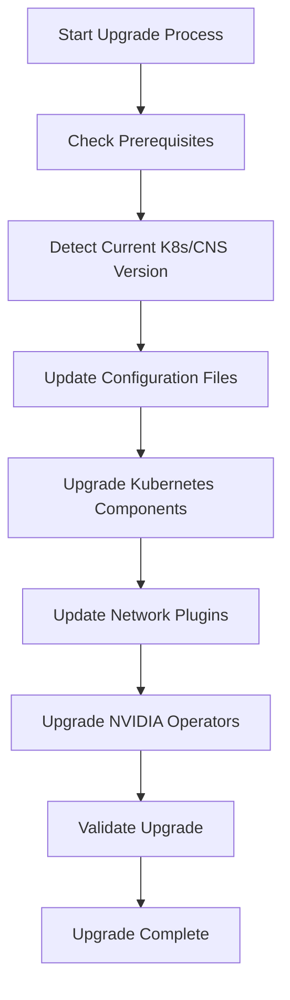
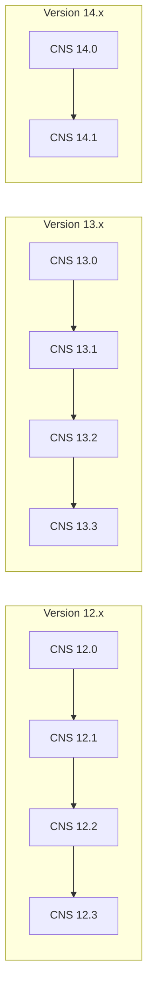
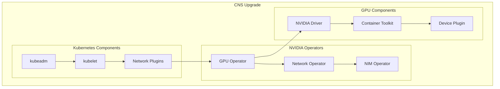

<!-- source: DeepWiki mcp.deepwiki.com · repo NVIDIA/cloud-native-stack · page 6.2 Upgrading CNS · fetched 2026-11-11 -->

# Upgrading CNS

<details>
<summary>Relevant source files</summary>

The following files were used as context for generating this wiki page:

- [cns.json](cns.json)
- [install-guides/readme.md](install-guides/readme.md)
- [playbooks/cns-upgrade.yaml](playbooks/cns-upgrade.yaml)
- [playbooks/k8s-install.yaml](playbooks/k8s-install.yaml)
- [playbooks/nvidia-docker.yaml](playbooks/nvidia-docker.yaml)
- [playbooks/nvidia-driver.yaml](playbooks/nvidia-driver.yaml)
- [playbooks/operators-install.yaml](playbooks/operators-install.yaml)
- [playbooks/operators-upgrade.yaml](playbooks/operators-upgrade.yaml)
- [playbooks/readme.md](playbooks/readme.md)
- [playbooks/setup.sh](playbooks/setup.sh)

</details>


This document provides technical instructions for upgrading the NVIDIA Cloud Native Stack (CNS) to newer versions. It covers the upgrade process flow, supported upgrade paths, prerequisites, and post-upgrade validation. For information about installing CNS from scratch, see [Installation Process](#2.2).

## Overview of the Upgrade Process

The CNS upgrade process is automated through Ansible playbooks and involves updating multiple components including Kubernetes, container runtimes, network plugins, and NVIDIA operators. The upgrade detects your current version and applies the appropriate changes to move to the next minor version.



Sources: [playbooks/setup.sh:345-355](), [playbooks/cns-upgrade.yaml:1-200]()

## Supported Upgrade Paths

CNS supports upgrades between consecutive minor versions within the same major version. You cannot skip versions or upgrade directly between major versions (e.g., from 13.x to 14.x).



The table below shows the Kubernetes versions associated with each CNS version:

| CNS Version | Kubernetes Version |
|-------------|-------------------|
| 14.1        | v1.31.6           |
| 14.0        | v1.31.2           |
| 13.3        | v1.30.10          |
| 13.2        | v1.30.6           |
| 13.1        | v1.30.2           |
| 13.0        | v1.30.0           |
| 12.3        | v1.29.9           |
| 12.2        | v1.29.6           |
| 12.1        | v1.29.4           |
| 12.0        | v1.29.2           |

Sources: [playbooks/cns-upgrade.yaml:24-72](), [cns.json:1-1560]()

## Prerequisites for Upgrading

Before upgrading CNS, ensure your environment meets these requirements:

1. A functional CNS installation with a supported version
2. Internet access for downloading updated components
3. Sufficient disk space (at least 10GB free)
4. Root or sudo access to the system
5. Backup of critical data and configurations
6. All nodes in the cluster should be in a healthy state

Sources: [playbooks/readme.md:15-39](), [playbooks/cns-upgrade.yaml:95-96]()

## Executing the Upgrade

The upgrade is performed using the provided `setup.sh` script:

```bash
bash setup.sh upgrade
```

This command executes different Ansible playbooks depending on your environment:

- For cloud VMs (AWS EC2, Azure, GCP): Uses a local connection
- For on-premises deployments: Uses the inventory defined in the `hosts` file

Sources: [playbooks/setup.sh:345-355]()

## Components Upgraded During the Process



Sources: [playbooks/cns-upgrade.yaml:107-196](), [playbooks/operators-upgrade.yaml:1-162]()

## Upgrade Process Details

The upgrade process consists of several key steps:

### 1. Version Detection and Configuration

The process starts by detecting your current Kubernetes version and determining the appropriate CNS version to upgrade to. It then creates and updates the necessary configuration files.

```bash
# Example of version detection
kubectl version -o json | jq .serverVersion.gitVersion | sed 's/\"//g'
```

Sources: [playbooks/cns-upgrade.yaml:24-87]()

### 2. Kubernetes Component Upgrade

The system upgrades Kubernetes components using `kubeadm upgrade apply` with the appropriate version:

```bash
# Example for upgrading from 13.2 to 13.3
kubeadm upgrade apply v1.30.10 --force --ignore-preflight-errors=CreateJob
```

Sources: [playbooks/cns-upgrade.yaml:114-150]()

### 3. Network Plugin Update

After Kubernetes is upgraded, the network plugin (Calico for x86/ARM systems or Flannel for Jetson systems) is updated to a compatible version:

```bash
# Example for CNS 13.3 or 14.1
kubectl apply -f https://raw.githubusercontent.com/projectcalico/calico/v3.29.3/manifests/calico.yaml
```

Sources: [playbooks/cns-upgrade.yaml:152-178]()

### 4. NVIDIA Operators Upgrade

The final step is upgrading the NVIDIA operators, which is handled by the `operators-upgrade.yaml` playbook:

#### GPU Operator Upgrade

The GPU Operator upgrade process:
1. Updates the operator CRDs (Custom Resource Definitions)
2. Obtains the new values file for configuration
3. Uses `helm upgrade` to update the operator

Different configurations are applied based on your environment settings:

- Systems with pre-installed drivers
- Systems using MIG (Multi-Instance GPU)
- Systems using RDMA (Remote Direct Memory Access)
- Systems with secure boot enabled
- Systems with vGPUs

Sources: [playbooks/operators-upgrade.yaml:69-142]()

#### Network Operator Upgrade

If the Network Operator is enabled, it's upgraded with:

```bash
helm upgrade $(helm ls -A | grep network-operator | awk '{print $1}') \
  mellanox/network-operator --version {{ network_operator_version }} \
  --namespace network-operator \
  --values {{ ansible_user_dir }}/network-operator-values.yaml
```

Sources: [playbooks/operators-upgrade.yaml:55-67]()

## Environment-Specific Considerations

### Jetson Devices

Jetson devices (with 'tegra' in the kernel release) use Flannel instead of Calico for networking and have specific upgrade paths:

```bash
# For Jetson systems upgrading to 12.1/11.2/10.5
kubectl apply -f https://raw.githubusercontent.com/coreos/flannel/v0.25.1/Documentation/kube-flannel.yml
```

Sources: [playbooks/cns-upgrade.yaml:172-178]()

### Cloud Provider Environments

The upgrade process detects if it's running in a cloud environment (AWS EC2, Microsoft Azure, or Google Cloud) and adjusts the playbook execution accordingly.

Sources: [playbooks/setup.sh:345-355]()

## Post-Upgrade Validation

After the upgrade completes, you should validate the system to ensure all components are functioning correctly:

```bash
bash setup.sh validate
```

This command runs the validation playbook, which verifies:
1. Kubernetes version matches the expected version
2. Container runtime is functioning correctly
3. Network plugin is running properly
4. NVIDIA operators are deployed and running
5. GPU resources are available and functional

Sources: [playbooks/setup.sh:384-394](), [playbooks/readme.md:802-809]()

## Troubleshooting Upgrade Issues

### Common Issues and Solutions

| Issue | Possible Cause | Solution |
|-------|---------------|----------|
| Kubeadm upgrade fails | API server unreachable | Ensure the Kubernetes API server is running |
| Operator upgrade fails | Helm repository connection issues | Check internet connectivity and proxy settings |
| Node not ready after upgrade | Container runtime or kubelet issues | Restart the container runtime and kubelet services |
| GPU resources unavailable | NVIDIA driver or device plugin issues | Check GPU Operator pod logs for errors |
| Network issues | Network plugin configuration | Verify network plugin pods are running correctly |

### Special Note on CNS 14.0 to 14.1 Upgrade

There is a known limitation when upgrading from CNS 14.0 to CNS 14.1 due to containerd issues. Refer to the [containerd issue #11535](https://github.com/containerd/containerd/issues/11535) for more details.

Sources: [playbooks/readme.md:818-819]()

## Notes on Upgrade Limitations

1. You can only upgrade to the next minor version within the same major version
2. All nodes in the cluster must be upgraded
3. Custom configurations may need manual adjustments after the upgrade
4. Consider backing up critical workloads before upgrading

Sources: [playbooks/readme.md:812-819]()

---

