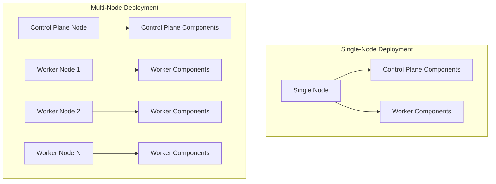
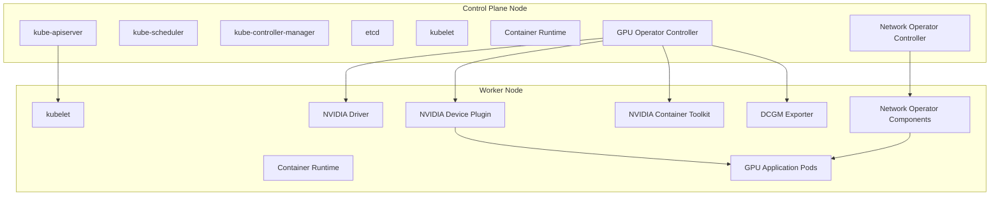
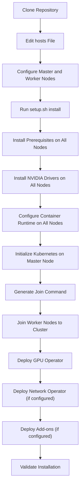
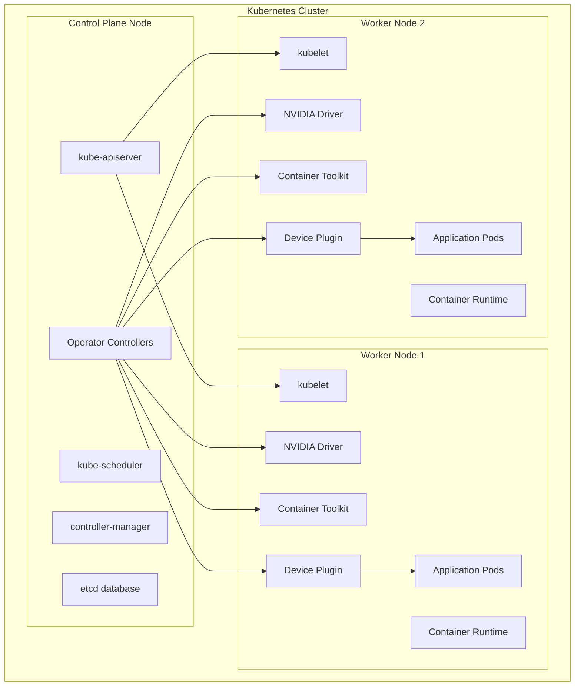

<!-- source: DeepWiki mcp.deepwiki.com · repo NVIDIA/cloud-native-stack · page 6.3 Multi-Node Deployments · fetched 2026-11-11 -->

# Multi-Node Deployments

<details>
<summary>Relevant source files</summary>

The following files were used as context for generating this wiki page:

- [README.md](README.md)
- [playbooks/cns-installation.yaml](playbooks/cns-installation.yaml)
- [playbooks/cns_version.yaml](playbooks/cns_version.yaml)
- [playbooks/hosts](playbooks/hosts)
- [playbooks/prerequisites.yaml](playbooks/prerequisites.yaml)

</details>


## Purpose and Scope

This document describes how to configure and deploy NVIDIA Cloud Native Stack (CNS) across multiple nodes. It covers the setup process, supported topologies, component distribution, and best practices for multi-node deployments. The focus is on distributing GPU-accelerated workloads across several machines to improve resource utilization and scalability.

For information about installation on cloud service providers, refer to [Cloud Provider Installation](#2.4).

## Supported Topologies

NVIDIA Cloud Native Stack supports two primary deployment topologies:

1. Single-node deployment (control plane and worker functionality on the same machine)
2. Multi-node deployment with one control plane node and any number of worker nodes



**Note:** Cloud Native Stack does not currently support high-availability deployments with multiple control plane nodes.

Sources: [README.md:127-133]()

## Multi-Node Architecture

In a multi-node deployment, CNS components are distributed across nodes according to their roles:



This architecture ensures that the Kubernetes control plane runs on a dedicated node, while the worker nodes focus on running GPU-accelerated workloads.

Sources: [README.md:129-132](), [playbooks/cns-installation.yaml:261-280]()

## Configuring Multi-Node Deployments

### Hosts File Configuration

The key to setting up a multi-node deployment is properly configuring the Ansible inventory file (`hosts`). This file defines which machines will function as control plane and worker nodes.

Edit the `hosts` file in the playbooks directory with the following structure:

```
[master]
<master-IP> ansible_ssh_user=nvidia ansible_ssh_pass=nvidiapass ansible_sudo_pass=nvidiapass ansible_ssh_common_args='-o StrictHostKeyChecking=no'
[nodes]
<worker1-IP> ansible_ssh_user=nvidia ansible_ssh_pass=nvidiapass ansible_sudo_pass=nvidiapass ansible_ssh_common_args='-o StrictHostKeyChecking=no'
<worker2-IP> ansible_ssh_user=nvidia ansible_ssh_pass=nvidiapass ansible_sudo_pass=nvidiapass ansible_ssh_common_args='-o StrictHostKeyChecking=no'
```

Each entry includes:
- The node's IP address
- SSH credentials (username and password)
- Sudo password for privilege escalation
- SSH arguments to bypass host key checking

Sources: [playbooks/hosts:1-3](), [README.md:109-118]()

### Prerequisites for All Nodes

All nodes in a multi-node deployment must meet the following requirements:

| Requirement | Specification |
|-------------|---------------|
| Internet Access | Direct access with adequate bandwidth |
| Operating System | Ubuntu 22.04/24.04 LTS or supported OS |
| DNS | Working DNS resolution |
| Network | Single network interface with static IP |
| UEFI | Secure boot disabled |
| Storage | At least 40GB root filesystem |
| CPU | Minimum 2 CPU cores |
| Memory | Minimum 4GB RAM |
| GPU | At least one NVIDIA GPU per node |

Sources: [README.md:85-99]()

## Deployment Process

The multi-node deployment process follows these steps:



### Step-by-Step Instructions

1. Clone the NVIDIA Cloud Native Stack repository:
   ```bash
   git clone https://github.com/NVIDIA/cloud-native-stack.git
   cd cloud-native-stack/playbooks
   ```

2. Edit the `hosts` file to define your master and worker nodes:
   ```bash
   nano hosts
   ```

3. Run the installation script:
   ```bash
   bash setup.sh install
   ```

4. The deployment process will automatically:
   - Set up prerequisites on all nodes
   - Install NVIDIA drivers on nodes requiring them
   - Configure the selected container runtime
   - Initialize Kubernetes on the master node
   - Join worker nodes to the cluster
   - Deploy the NVIDIA GPU Operator and other configured operators
   - Install selected add-ons (storage, monitoring, etc.)

Sources: [README.md:104-125](), [playbooks/cns-installation.yaml:261-280]()

## Component Distribution

In a multi-node deployment, components are distributed across nodes as follows:



### Control Plane Node Components
- Kubernetes control plane (API server, scheduler, controller manager, etcd)
- Operator controllers (GPU Operator, Network Operator)
- CNI networking

### Worker Node Components
- Kubelet and kube-proxy
- Container runtime (containerd, CRI-O, or CRI-dockerd)
- NVIDIA software stack:
  - NVIDIA Driver
  - NVIDIA Container Toolkit
  - NVIDIA Device Plugin
  - DCGM Exporter
- Network components (if Network Operator is enabled)
- Application pods

Sources: [README.md:60-72](), [playbooks/cns-installation.yaml:273-280]()

## Container Runtime Options

Cloud Native Stack supports multiple container runtimes for multi-node deployments:

| Container Runtime | Configuration Variable | Description |
|-------------------|------------------------|-------------|
| containerd | `container_runtime: containerd` | Default runtime, installed on all nodes |
| CRI-O | `container_runtime: cri-o` | Alternative OCI-compliant runtime |
| CRI-dockerd | `container_runtime: cri-dockerd` | Docker-compatible runtime interface |

The container runtime is configured consistently across all nodes in the cluster.

Sources: [playbooks/prerequisites.yaml:300-323](), [playbooks/prerequisites.yaml:579-1023]()

## Operational Considerations

### Network Requirements
- Ensure reliable network connectivity between all nodes
- Control plane node must be reachable by all worker nodes on port 6443
- Allow required Kubernetes ports in any firewall configuration

### Resource Planning
- Control plane node: Minimum 2 CPU cores, 4GB RAM
- Worker nodes: Size according to workload requirements
- All nodes should have NVIDIA GPUs for running GPU workloads

### Scaling
To add additional worker nodes to an existing deployment:
1. Add the new node to the `hosts` file under the `[nodes]` section
2. Re-run the installation script to configure the new node

### Validation

After deployment, validate your multi-node cluster:

```bash
# Verify all nodes have joined the cluster
kubectl get nodes

# Check GPU availability across nodes
kubectl get nodes -o=custom-columns=NAME:.metadata.name,GPUs:.status.capacity.'nvidia\.com/gpu'

# Verify GPU operator components are running
kubectl get pods -n nvidia-gpu-operator
```

All nodes should show as `Ready` and display their GPU capacity.

Sources: [playbooks/cns-installation.yaml:294-306]()

## Add-ons for Multi-Node Deployments

Cloud Native Stack supports various add-ons that can enhance multi-node deployments:

| Add-on | Purpose | Configuration |
|--------|---------|---------------|
| Storage | Provides persistent storage | `storage: true` |
| Monitoring | Prometheus & Grafana monitoring | `monitoring: true` |
| LoadBalancer | MetalLB for bare-metal load balancing | `loadbalancer: true` |
| KServe | ML model serving platform | `kserve: true` |

These add-ons are deployed after the core cluster and NVIDIA operators are installed.

Sources: [README.md:67-71](), [playbooks/cns-installation.yaml:279-280]()

## Limitations

- Cloud Native Stack does not support multiple control plane nodes (no HA control plane)
- The installation is primarily for test and PoC environments, not production deployments
- Upgrading between CNS versions in multi-node deployments requires careful planning

Sources: [README.md:12-18]()