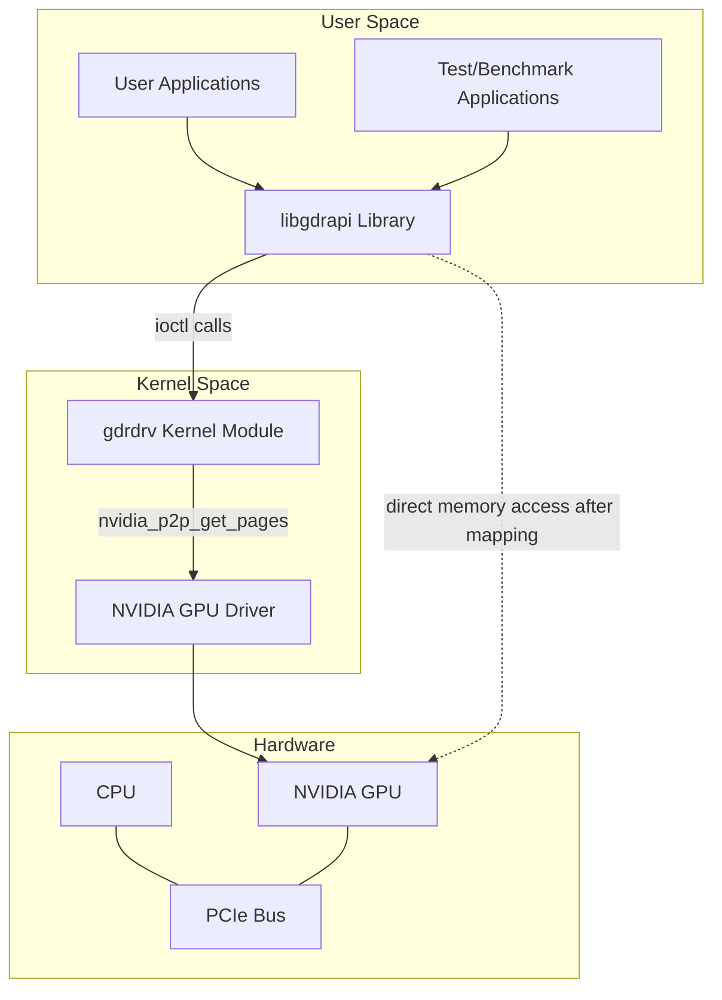
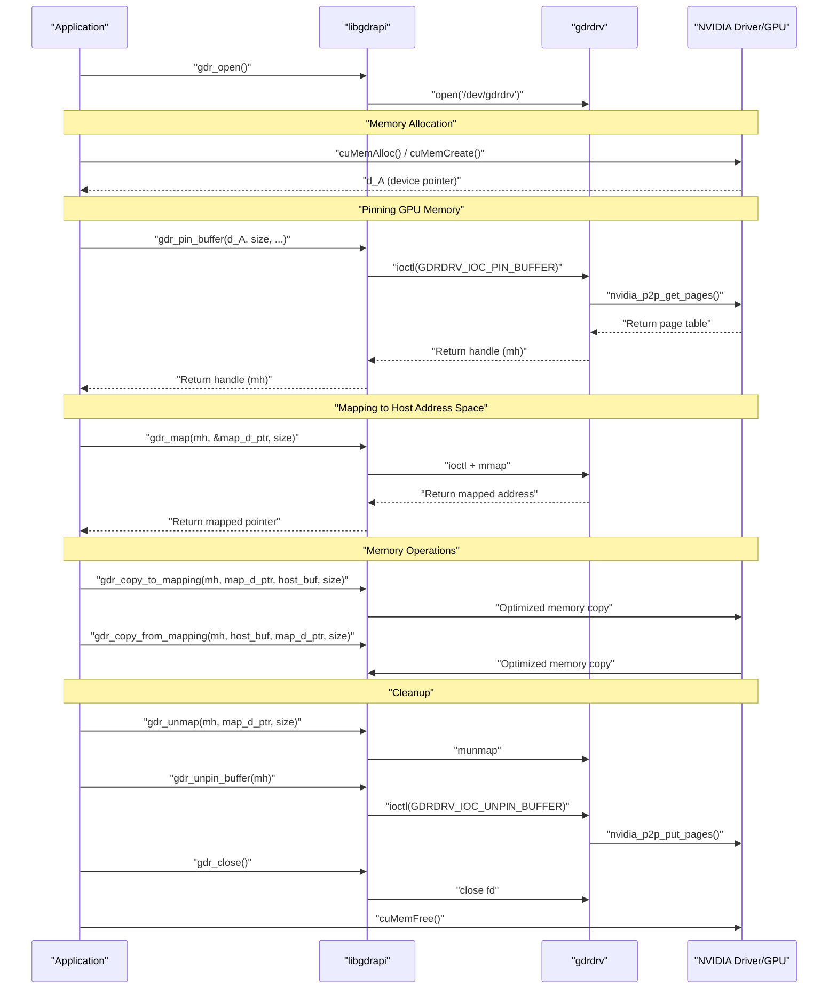
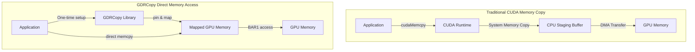
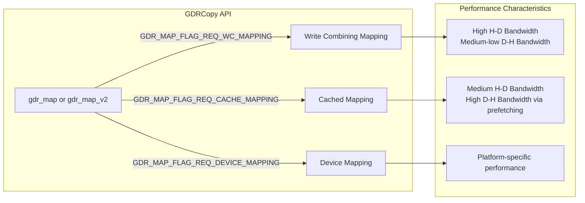

<!-- source: DeepWiki mcp.deepwiki.com · repo NVIDIA/gdrcopy · page 1 Overview · fetched 2026-11-11 -->

# Overview

Relevant source files

The following files were used as context for generating this wiki page:

- [CHANGELOG.md](CHANGELOG.md)
- [README.md](README.md)
- [packages/rhel/gdrcopy.service](packages/rhel/gdrcopy.service)
- [tests/copylat.cpp](tests/copylat.cpp)

GDRCopy is a low-latency GPU memory copy library built on NVIDIA's GPUDirect RDMA technology. It enables direct access to GPU memory from the CPU, providing significantly lower latency for data transfers compared to traditional CUDA memory operations. This document provides a high-level overview of GDRCopy's architecture, components, and functionality.

For detailed information about the kernel driver implementation, see [Kernel Driver (gdrdrv)](#2). For in-depth coverage of the user-space library API, refer to [User-Space Library (libgdrapi)](#3).

## Purpose and Benefits

GDRCopy leverages GPUDirect RDMA technology to create user-space mappings of GPU memory, which can then be manipulated as if it were regular host memory. This approach offers several advantages:

- **Very low overhead**: GDRCopy operations are CPU-driven, with typical operations having an overhead of just 0.1-0.2μs compared to 6-7μs for a traditional `cudaMemcpy`.
- **High bandwidth**: Write operations (host-to-device) can achieve 6-8 GB/s on supported platforms.
- **Direct memory access**: Applications can directly read from and write to GPU memory without intermediate copies.

These characteristics make GDRCopy particularly well-suited for applications where low latency is critical, such as high-performance computing, real-time data processing, and communication middleware.

Sources: [README.md:1-15](), [README.md:18-36]()

## System Components

GDRCopy consists of three main components:

1. **Kernel Driver (gdrdrv)**: A Linux kernel module that facilitates direct memory access between GPUs and the CPU.
2. **User-Space Library (libgdrapi)**: A C library that provides the API for applications to interact with the kernel driver.
3. **Test and Benchmark Utilities**: Tools for verifying functionality and measuring performance, including sanity tests and bandwidth/latency benchmarks.

The following diagram illustrates the system architecture:

Sources: [README.md:18-36](), [README.md:44-53]()

## Core Workflow

The typical workflow when using GDRCopy involves:

1. **Initialization**: Open a connection to the GDRCopy driver using `gdr_open()`
2. **Memory Allocation**: Allocate GPU memory using CUDA functions like `cuMemAlloc()`
3. **Pinning**: Make GPU memory resident and prevent swapping with `gdr_pin_buffer()`
4. **Mapping**: Create a CPU-accessible mapping of the GPU memory with `gdr_map()`
5. **Memory Operations**: Copy data to/from the mapped memory using `gdr_copy_to_mapping()` and `gdr_copy_from_mapping()`
6. **Cleanup**: Unmap, unpin, and release resources with `gdr_unmap()`, `gdr_unpin_buffer()`, `gdr_close()`, and `cuMemFree()`

Sources: [README.md:18-36](), [tests/copylat.cpp:221-374]()

## Performance Comparison

GDRCopy provides significant performance advantages over traditional CUDA memory copies, particularly for small transfers and latency-sensitive applications:

The key differences are:

| Characteristic | Traditional CUDA Memory Copy | GDRCopy Direct Memory Access |
|----------------|------------------------------|------------------------------|
| Setup Cost | Low (simple API call) | High (pinning and mapping, 10μs-1ms) |
| Transfer Overhead | High (6-7μs per transfer) | Low (~0.1μs per transfer) |
| Small Transfer Efficiency | Poor (overhead dominates) | Excellent (minimal overhead) |
| Host-to-Device Bandwidth | Medium | High (6-8 GB/s on supported hardware) |
| Device-to-Host Bandwidth | Medium | Low (limited by PCIe read characteristics) |
| Use Case | Large, infrequent transfers | Small, frequent transfers; latency-sensitive applications |

As shown in the benchmark results from `gdrcopy_copylat`, GDRCopy operations maintain very low latencies for small data sizes, while traditional CUDA operations have a higher fixed overhead regardless of the transfer size.

Sources: [README.md:23-35](), [tests/copylat.cpp:249-302]()

## Memory Mapping Types

GDRCopy provides multiple memory mapping types to optimize for different access patterns:

1. **Write Combining (WC) Mapping**:
   - Default mapping type
   - Optimized for host-to-device (H-D) transfers
   - Uses write-combining to batch writes for better performance
   - Achieves 6-8 GB/s for H-D transfers
   - Slower for device-to-host (D-H) transfers due to lack of prefetching

2. **Cached Mapping**:
   - CPU caches the contents of GPU memory
   - Better for frequent reads from GPU memory
   - Provides more balanced performance between H-D and D-H transfers
   - Available on specific platforms like POWER9 with NVLink

3. **Device Mapping**:
   - Direct device memory mapping
   - Performance characteristics vary by platform
   - Used in specific hardware configurations

The mapping type is specified when calling `gdr_map()` or `gdr_map_v2()` and can be verified through `gdr_get_info()` or `gdr_get_info_v2()`.

Sources: [README.md:30-35](), [CHANGELOG.md:10-14]()

## Requirements and Compatibility

GDRCopy requires:

- NVIDIA Data Center GPU or NVIDIA RTX GPU based on Kepler or newer generations
- GPU display driver ≥ 418.40 on ppc64le and ≥ 331.14 on other platforms
- CUDA ≥ 6.0
- DKMS for installing the kernel module package (optional on RHEL/SLE where kmod can be used instead)

Supported architectures:
- Linux x86_64
- ppc64le
- arm64

Supported platforms:
- RHEL8, RHEL9
- Ubuntu 20.04, Ubuntu 22.04
- SLE-15 (any SP) and Leap 15.x

Root privileges are necessary to load/install the kernel-mode device driver.

Sources: [README.md:44-86](), [CHANGELOG.md:77-81]()

## Restrictions and Known Issues

- GDRCopy works with regular CUDA device memory only (as returned by `cudaMalloc`), not with CUDA managed memory.
- `gdr_map()` requires that the pinned address is aligned to the GPU page size.
- CUDA memory allocation functions don't guarantee aligned addresses; users must ensure proper alignment.
- Multiple pinning of the same GPU address may consume additional BAR1 space in some GPU driver versions.
- On POWER9 with NVLink, CUDA 9.2 and GPU Driver v396.37 are minimum requirements for full performance.
- There are compatibility issues with Linux confidential computing (CC) configurations on Intel CPUs when gdrdrv is compiled with the proprietary NVIDIA driver.

Sources: [README.md:438-472]()

## Service Management

GDRCopy can be installed as a system service that loads the kernel driver at boot time. On systems using systemd (such as RHEL9), this is handled through a service unit file.

The service:
- Starts the GDRCopy driver after the multi-user target is reached
- Remains active after initialization (RemainAfterExit=yes)
- Can be controlled through standard systemd commands like `systemctl start/stop/restart gdrcopy`

Sources: [packages/rhel/gdrcopy.service:1-14]()

---

