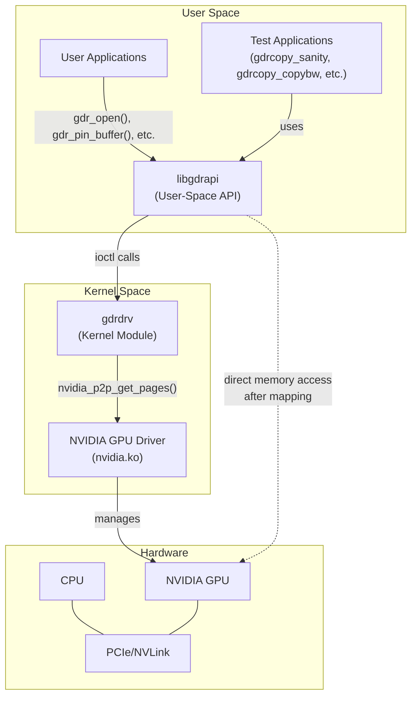
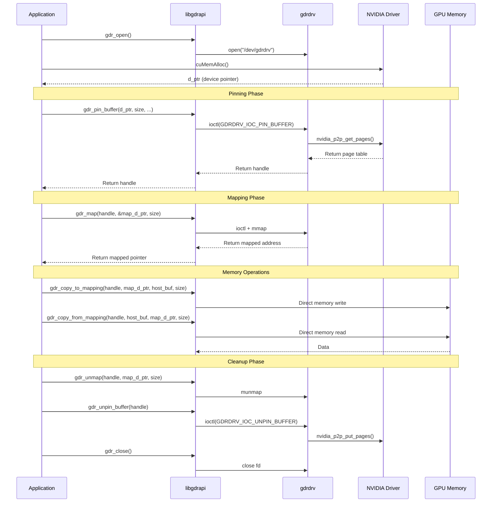
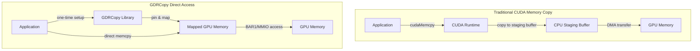
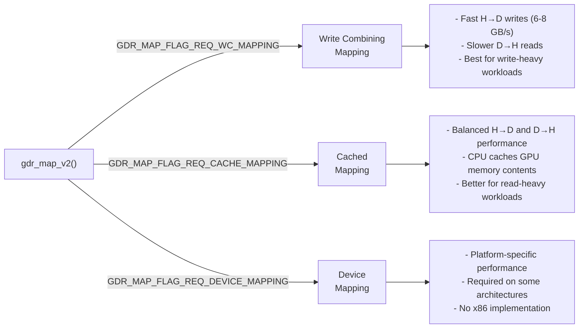
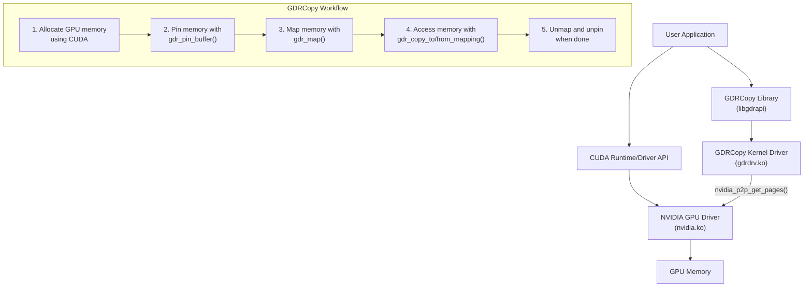

<!-- source: DeepWiki mcp.deepwiki.com · repo NVIDIA/gdrcopy · page 1.1 Architecture · fetched 2026-11-11 -->

# Architecture

Relevant source files

The following files were used as context for generating this wiki page:

- [README.md](README.md)
- [packages/rhel/gdrcopy.service](packages/rhel/gdrcopy.service)
- [scripts/test_gdrdrv_HAVE_PROC_OPS.sh](scripts/test_gdrdrv_HAVE_PROC_OPS.sh)
- [src/gdrapi.c](src/gdrapi.c)
- [src/gdrdrv/gdrdrv.c](src/gdrdrv/gdrdrv.c)
- [tests/copylat.cpp](tests/copylat.cpp)

This document provides a comprehensive overview of the GDRCopy system architecture, explaining how different components interact to enable low-latency memory copies between CPUs and GPUs. For details about specific APIs, see [API Reference](#3.1), and for information about building the kernel driver, see [Building the Driver](#2.3).

## System Overview

GDRCopy enables direct access to GPU memory from the CPU by leveraging NVIDIA's GPUDirect RDMA technology. While GPUDirect RDMA was primarily designed for direct access from third-party devices, GDRCopy uses these APIs to create valid CPU mappings of GPU memory, significantly reducing the overhead compared to traditional CUDA memory transfers.

Sources: [src/gdrdrv/gdrdrv.c:380-402](], [src/gdrapi.c:124-200](), [README.md:1-36]()

## Key Components

### User Space Components

1. **libgdrapi Library**: The primary interface for applications using GDRCopy
   - Provides the API for pinning, mapping, and accessing GPU memory
   - Implements optimized memory copy routines
   - Manages communication with the kernel driver via ioctl calls

2. **Test and Benchmark Applications**:
   - `gdrcopy_sanity`: Unit tests for the library and driver
   - `gdrcopy_copybw`: Measures read/write bandwidth
   - `gdrcopy_copylat`: Measures latency for various buffer sizes
   - `gdrcopy_apiperf`: Benchmarks API call latency
   - `gdrcopy_pplat`: Measures round-trip ping-pong latency

Sources: [README.md:37-43](), [src/gdrapi.c:123-167]()

### Kernel Space Components

1. **gdrdrv Kernel Module**:
   - Enables direct CPU access to GPU memory
   - Interfaces with NVIDIA's driver via P2P APIs
   - Creates memory mappings for userspace applications
   - Handles buffer pinning to ensure memory remains resident

2. **NVIDIA GPU Driver**:
   - Provides access to GPU resources
   - Manages physical memory on the GPU
   - Offers P2P APIs used by gdrdrv (`nvidia_p2p_get_pages`, etc.)

Sources: [src/gdrdrv/gdrdrv.c:92-107](), [src/gdrdrv/gdrdrv.c:285-316]()

## Memory Mapping Process

Sources: [src/gdrapi.c:124-200](), [src/gdrapi.c:231-356](), [src/gdrapi.c:410-513](), [src/gdrdrv/gdrdrv.c:760-935]()

## Buffer Pinning and Mapping

### Buffer Pinning

The pinning process makes GPU memory resident and accessible to the CPU:

1. Application calls `gdr_pin_buffer()` with a GPU memory pointer obtained from CUDA
2. libgdrapi makes an ioctl call to the kernel driver
3. The driver calls `nvidia_p2p_get_pages()` to get physical pages from NVIDIA driver
4. A handle is returned to the application for subsequent operations

Key data structures involved:
- `gdr_mr_t`: Memory region structure in kernel driver
- `GDRDRV_IOC_PIN_BUFFER_PARAMS`: ioctl parameters for pinning

Sources: [src/gdrdrv/gdrdrv.c:352-373](), [src/gdrdrv/gdrdrv.c:760-935](), [src/gdrapi.c:231-265]()

### Buffer Mapping

After pinning, the GPU memory must be mapped to the userspace address space:

1. Application calls `gdr_map()` with the handle from pinning
2. libgdrapi requests a specific mapping type (WC, cached, or device)
3. The driver establishes the appropriate mapping via `mmap`
4. A mapped pointer is returned, which the application can use for direct access

Key aspects:
- Mappings must be aligned to GPU page boundaries (64KB)
- Various mapping types provide different performance characteristics
- The mapped region can be used with standard memcpy or specialized GDRCopy functions

Sources: [src/gdrapi.c:410-513](), [src/gdrdrv/gdrdrv.c:375-402]()

## Memory Transfer Pathways

GDRCopy provides two key advantages over traditional CUDA memory transfers:

1. **Reduced Latency**: By eliminating intermediate buffers and complex runtime logic, GDRCopy achieves much lower latency (0.1-1μs vs. 6-7μs for small transfers).

2. **Direct Memory Access**: After the initial setup, applications can directly access GPU memory as if it were regular system memory, using either standard memory operations or optimized GDRCopy functions.

| Transfer Method | Initialization Overhead | Transfer Latency | Best Use Case |
|-----------------|-------------------------|------------------|---------------|
| CUDA Memory Copy | Low (1-2μs) | Medium (6-7μs) | Large transfers, simplicity |
| GDRCopy | High (10μs-1ms) | Very Low (0.1-1μs) | Small transfers, latency-sensitive applications |

Sources: [README.md:23-36](), [tests/copylat.cpp:260-364]()

## Memory Mapping Types

GDRCopy supports three different memory mapping types, each with different performance characteristics:

### Write Combining (WC) Mapping

The default mapping type on most platforms:
- Stores are combined (batched) before being sent to the device
- Provides excellent performance for host-to-device transfers
- Device-to-host transfers are slower due to lack of prefetching
- Implemented differently on x86, POWER, and ARM64 platforms

### Cached Mapping

Used on platforms with coherent CPU-GPU memory access:
- CPU can cache the contents of GPU memory
- More balanced performance between reads and writes
- Particularly useful on systems like NVIDIA Grace-Hopper

### Device Mapping

Specialized mapping for certain platforms:
- Used on ARM64 platforms
- Not implemented on x86 systems
- Performance characteristics vary by platform

Sources: [src/gdrapi.c:410-449](), [src/gdrdrv/gdrdrv.c:165-237](), [tests/copylat.cpp:253-257]()

## Platform-Specific Considerations

GDRCopy includes various optimizations for different CPU architectures:

### x86_64
- Uses AVX/SSE extensions for optimized memory copies when available
- Implements specialized write-combining operations
- Fence operations use x86-specific instructions (`_mm_sfence()`, `_mm_mfence()`)

### POWER
- Uses POWER-specific sync operations
- Optimized for different memory access patterns
- Requires specific NVIDIA driver versions for optimal performance

### ARM64
- Support for device mappings specific to ARM platforms
- Platform-specific fence operations
- Different memory ordering semantics

NUMA effects can significantly impact performance. For optimal results, applications should ensure that the CPU accessing GPU memory is the one physically connected to the GPU.

Sources: [src/gdrapi.c:548-631](), [README.md:360-434]()

## Integration with NVIDIA Stack

GDRCopy integrates with NVIDIA's software stack at multiple levels:

1. **Application Level**: 
   - Applications use both CUDA for GPU memory allocation and GDRCopy for low-latency access

2. **Driver Level**:
   - The gdrdrv kernel module interacts with the NVIDIA kernel driver through P2P APIs
   - Uses NVIDIA's `nvidia_p2p_get_pages()` to get physical pages for mapping
   - Supports both persistent and non-persistent mapping approaches

3. **Version Compatibility**:
   - Requires specific minimum versions of NVIDIA drivers (≥ 418.40 on ppc64le, ≥ 331.14 on other platforms)
   - Support for persistent mapping depends on driver version
   - Some features are only available with newer NVIDIA driver releases

Sources: [src/gdrdrv/gdrdrv.c:241-276](), [src/gdrdrv/gdrdrv.c:445-459](), [README.md:44-53]()

## Key Implementation Details

### Memory Protection and Fencing

GDRCopy implements various mechanisms to ensure correct memory access:

1. **Callback Mechanism**:
   - NVIDIA driver can reclaim GPU memory at any time
   - GDRCopy registers a callback (`gdrdrv_get_pages_free_callback`) to handle this
   - When triggered, all mappings are destroyed and resources freed

2. **Memory Fencing**:
   - Write combining requires explicit fences to ensure memory operations complete
   - Different fencing operations based on architecture and mapping type
   - Stronger fences when multiple mapping types are used concurrently

3. **Process Isolation**:
   - GPU driver does not support sharing allocations between processes
   - GDRCopy tracks the process that opened the driver and prevents others from using it

Sources: [src/gdrdrv/gdrdrv.c:693-716](), [src/gdrapi.c:856-868](), [src/gdrdrv/gdrdrv.c:430-441]()

### Optimized Memory Copy Implementations

GDRCopy includes specialized memory copy routines optimized for different scenarios:

1. **Architecture-specific optimizations**:
   - AVX/SSE implementations for x86_64
   - Optimized routines for POWER and ARM64

2. **Transfer-specific optimizations**:
   - Different implementations for host-to-device vs device-to-host
   - Specific handling for various data sizes and alignment requirements

3. **Mapping-specific optimizations**:
   - Special handling for device mappings requiring aligned access
   - Different strategies for write-combining vs cached mappings

The library automatically selects the most appropriate implementation based on the platform capabilities and the mapping type in use.

Sources: [src/gdrapi.c:635-707](), [src/gdrapi.c:800-869](), [src/gdrapi.c:759-798]()

## Summary

GDRCopy's architecture enables low-latency, direct access to GPU memory from the CPU by leveraging NVIDIA's GPUDirect RDMA technology. The system consists of a kernel driver that interacts with the NVIDIA GPU driver and a user-space library that provides a simple API for applications. Different mapping types and platform-specific optimizations allow GDRCopy to achieve excellent performance across various hardware configurations and use cases.

The main trade-off is between the higher initial setup cost (pinning and mapping) versus the significantly lower per-transfer latency compared to traditional CUDA memory copies. This makes GDRCopy particularly valuable for applications requiring frequent small transfers between CPU and GPU.

---

