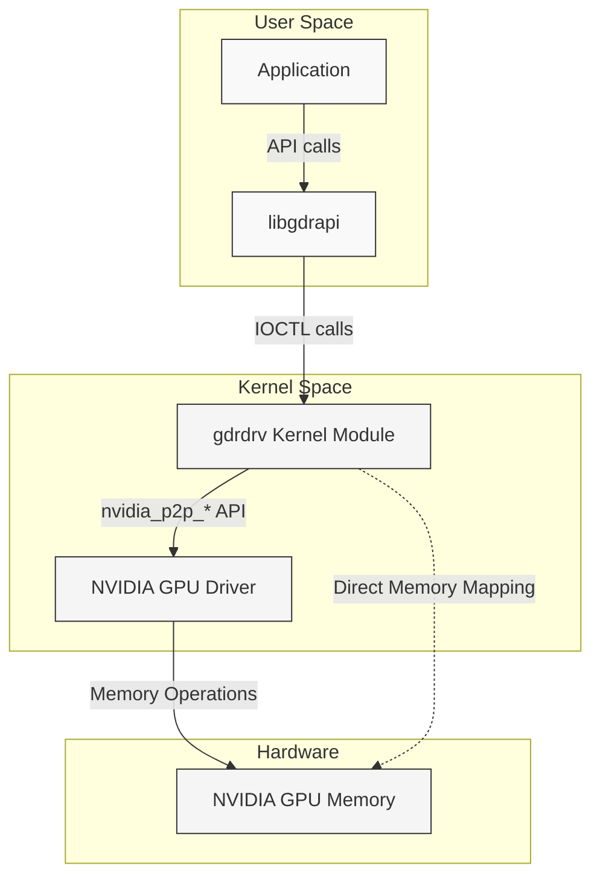
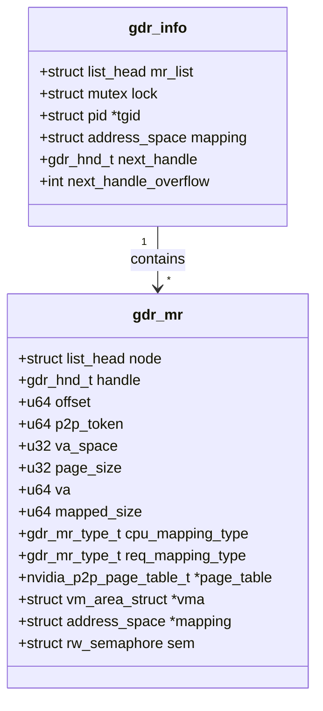
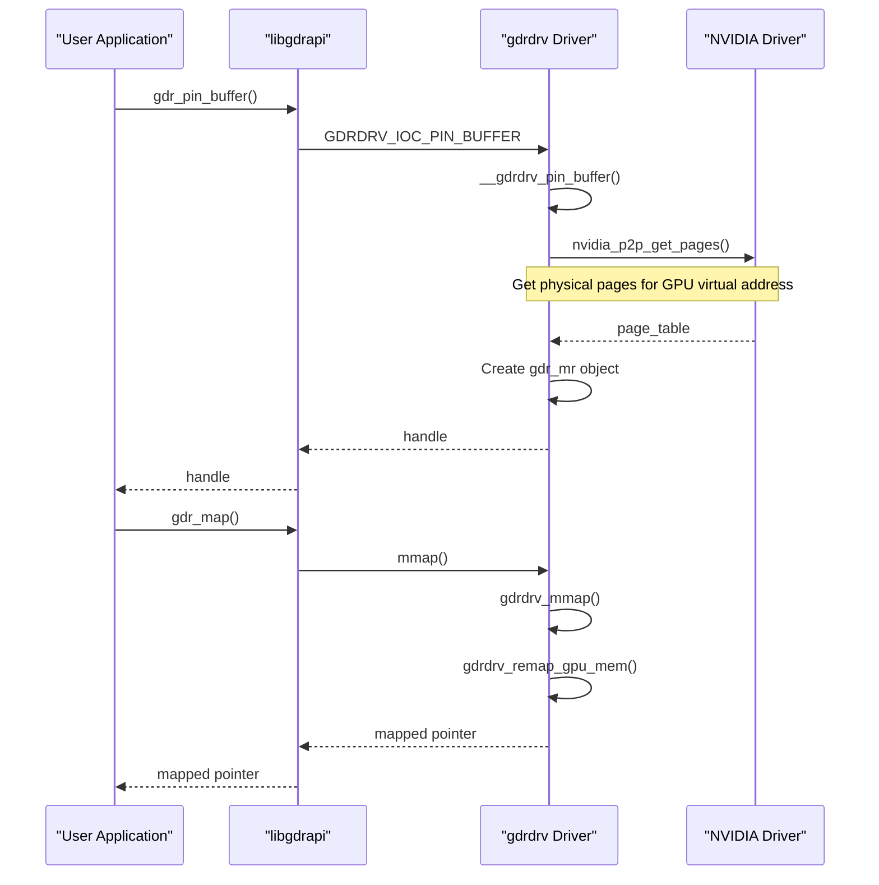
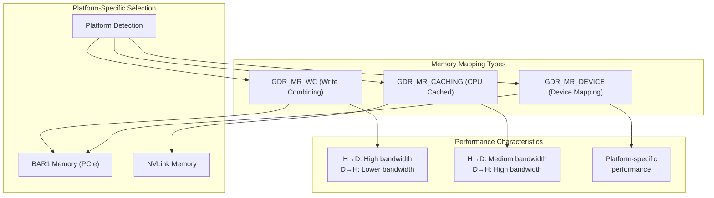
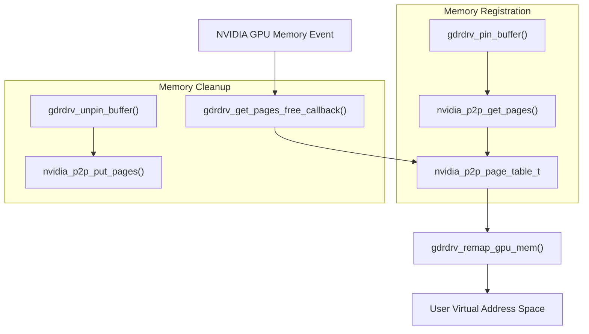
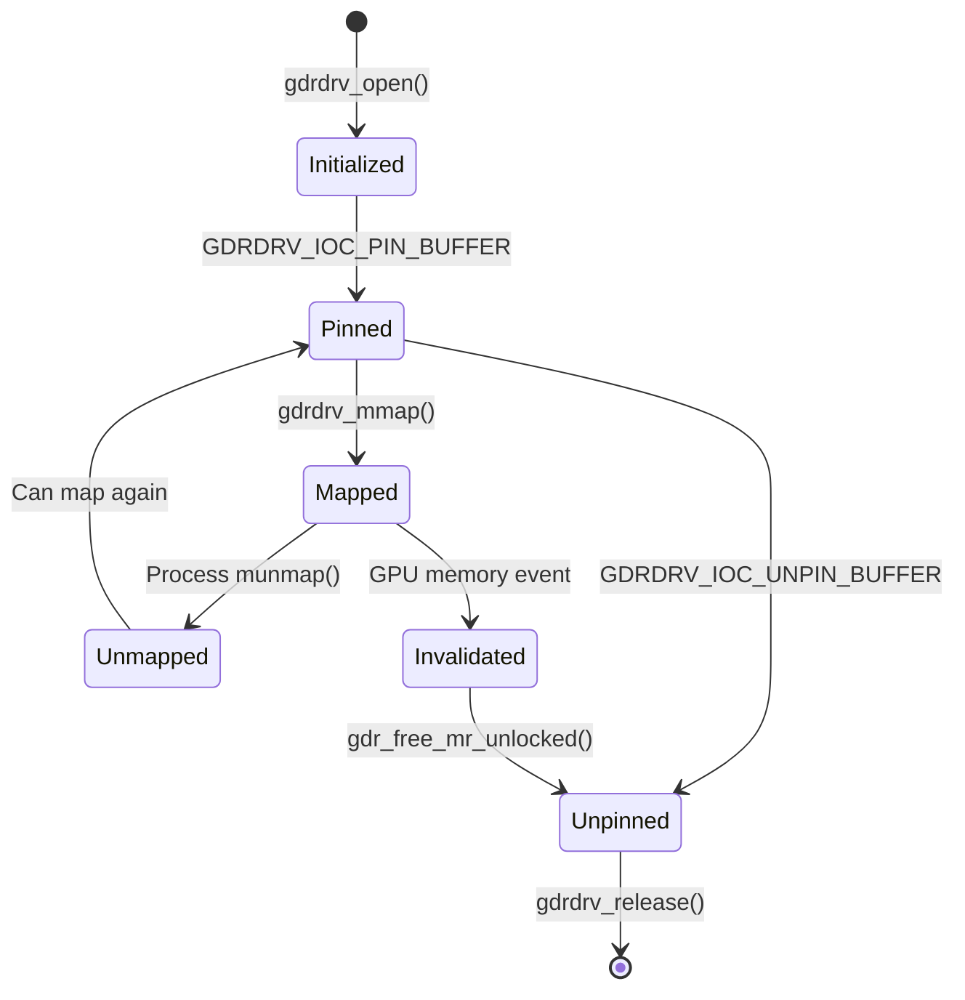

<!-- source: DeepWiki mcp.deepwiki.com · repo NVIDIA/gdrcopy · page 2 Kernel Driver (gdrdrv) · fetched 2026-11-11 -->

# Kernel Driver (gdrdrv)

Relevant source files

The following files were used as context for generating this wiki page:

- [scripts/test_gdrdrv_HAVE_PROC_OPS.sh](scripts/test_gdrdrv_HAVE_PROC_OPS.sh)
- [src/gdrdrv/gdrdrv.c](src/gdrdrv/gdrdrv.c)
- [src/gdrdrv/gdrdrv.h](src/gdrdrv/gdrdrv.h)

The gdrdrv kernel module is a critical component of the GDRCopy system, serving as the bridge between user-space applications and NVIDIA GPU memory. It provides the infrastructure necessary to establish direct memory access between the CPU and GPU memory by interfacing with the NVIDIA GPU driver. This page details the architecture, interfaces, and functionality of the gdrdrv kernel driver.

## Purpose and Overview

The gdrdrv driver enables low-latency memory copies between the CPU and GPU by:

1. Creating memory mappings that allow user-space applications to directly access GPU memory
2. Managing GPU memory resources through pinning/unpinning
3. Providing different memory mapping types optimized for various access patterns
4. Interfacing with the NVIDIA driver to handle GPU page tables

Sources: [src/gdrdrv/gdrdrv.c:1-21](), [src/gdrdrv/gdrdrv.h:1-21]()

## Driver Architecture

The gdrdrv kernel driver is integrated into the system through standard Linux kernel mechanisms and communicates with the NVIDIA driver through the NVIDIA P2P (peer-to-peer) API. It exposes its functionality to user-space applications through a character device interface with IOCTL commands.

Sources: [src/gdrdrv/gdrdrv.c:1841-1914](), [src/gdrdrv/gdrdrv.c:1322-1388]()

## Data Structures

### Core Structures

The driver maintains several key data structures:

1. **gdr_info**: Represents an opened file descriptor to the driver
2. **gdr_mr**: Represents a memory region that has been pinned for GPU direct access

Sources: [src/gdrdrv/gdrdrv.c:352-372](), [src/gdrdrv/gdrdrv.c:406-425]()

## Memory Registration Process

The driver implements a memory registration process that enables direct access to GPU memory:

Sources: [src/gdrdrv/gdrdrv.c:760-935](), [src/gdrdrv/gdrdrv.c:1549-1717]()

## IOCTL Interface

The driver exposes its functionality through a set of IOCTL commands that allow user-space applications to:

| IOCTL Command | Description | Structure |
|---------------|-------------|-----------|
| `GDRDRV_IOC_PIN_BUFFER` | Pin GPU memory for access | `GDRDRV_IOC_PIN_BUFFER_PARAMS` |
| `GDRDRV_IOC_PIN_BUFFER_V2` | Enhanced version with additional flags | `GDRDRV_IOC_PIN_BUFFER_V2_PARAMS` |
| `GDRDRV_IOC_UNPIN_BUFFER` | Unpin GPU memory | `GDRDRV_IOC_UNPIN_BUFFER_PARAMS` |
| `GDRDRV_IOC_GET_CB_FLAG` | Check if callback was triggered | `GDRDRV_IOC_GET_CB_FLAG_PARAMS` |
| `GDRDRV_IOC_GET_INFO` | Get memory region info | `GDRDRV_IOC_GET_INFO_PARAMS` |
| `GDRDRV_IOC_GET_INFO_V2` | Enhanced version with more details | `GDRDRV_IOC_GET_INFO_V2_PARAMS` |
| `GDRDRV_IOC_GET_ATTR` | Get driver attributes | `GDRDRV_IOC_GET_ATTR_PARAMS` |
| `GDRDRV_IOC_REQ_MAPPING_TYPE` | Request specific mapping type | `GDRDRV_IOC_REQ_MAPPING_TYPE_PARAMS` |
| `GDRDRV_IOC_GET_VERSION` | Get driver version | `GDRDRV_IOC_GET_VERSION_PARAMS` |

The driver validates these calls and ensures that the caller process is the same as the one that opened the file descriptor.

Sources: [src/gdrdrv/gdrdrv.h:63-184](), [src/gdrdrv/gdrdrv.c:1322-1388]()

## Memory Mapping Types

The driver supports different memory mapping types to optimize for various access patterns:

1. **Write Combining (WC)**: Optimized for host-to-device transfers by batching writes
2. **CPU Cached**: Allows CPU to cache GPU memory contents for faster read operations
3. **Device Mapping**: Platform-specific mapping used on certain ARM64 platforms

The appropriate mapping type is selected based on hardware capabilities and specific requirements.

Sources: [src/gdrdrv/gdrdrv.c:164-233](), [src/gdrdrv/gdrdrv.h:47-52](), [src/gdrdrv/gdrdrv.c:1499-1544]()

## Pinning and Mapping Process

The driver implements a two-step process to access GPU memory:

1. **Pinning**: Makes GPU memory resident and obtains its physical address mapping
   - Calls `nvidia_p2p_get_pages()` or `nvidia_p2p_get_pages_persistent()`
   - Creates a mapping handle for future reference
   
2. **Mapping**: Maps the pinned memory into user-space virtual address space
   - Uses `gdrdrv_mmap()` to establish the memory mapping
   - Applies the appropriate memory attributes (WC, cached, device)

This separation allows applications to pin memory once and map/unmap it multiple times as needed.

Sources: [src/gdrdrv/gdrdrv.c:760-935](), [src/gdrdrv/gdrdrv.c:1549-1717]()

## Interaction with NVIDIA Driver

The driver interacts with the NVIDIA driver through the P2P API:

The driver uses:
1. `nvidia_p2p_get_pages()` to obtain mappings of GPU virtual addresses to physical addresses
2. `nvidia_p2p_put_pages()` to release these mappings
3. A callback mechanism (`gdrdrv_get_pages_free_callback()`) to handle GPU memory invalidation events

The driver supports both traditional and persistent mapping modes, with the latter being more efficient for long-term mappings.

Sources: [src/gdrdrv/gdrdrv.c:694-716](), [src/gdrdrv/gdrdrv.c:445-459]()

## Platform Compatibility

The driver includes special handling for different platforms:

| Platform | Features |
|----------|----------|
| x86_64 | Write Combining (WC) mappings |
| PPC64 (POWER9) | Can use CPU cached mappings for NVLink-connected GPUs |
| ARM64 | Supports both WC and Device mappings |

The driver detects platform capabilities at initialization and adapts its behavior accordingly.

Sources: [src/gdrdrv/gdrdrv.c:164-233](), [src/gdrdrv/gdrdrv.c:1872-1908]()

## Error Handling and Safety

The driver implements several safety mechanisms:

1. **Process Isolation**: Only the process that opened the driver can use its file descriptor
2. **Reference Counting**: Tracks outstanding NVIDIA P2P mappings to prevent leaks
3. **Callback Mechanism**: Handles GPU memory invalidation events properly
4. **Resource Cleanup**: Automatically frees resources when applications terminate

Sources: [src/gdrdrv/gdrdrv.c:430-441](), [src/gdrdrv/gdrdrv.c:584-623]()

## Lifecycle Management

The driver carefully manages the lifecycle of memory regions:

Each state transition is protected by appropriate locking mechanisms to ensure consistency.

Sources: [src/gdrdrv/gdrdrv.c:527-579](), [src/gdrdrv/gdrdrv.c:1401-1424]()

## Driver Configuration

The driver can be configured through module parameters:

| Parameter | Description |
|-----------|-------------|
| `dbg_enabled` | Enable debug output |
| `info_enabled` | Enable informational output |
| `use_persistent_mapping` | Use persistent mapping mode |

These settings can be viewed and monitored through the `/proc` filesystem interface.

Sources: [src/gdrdrv/gdrdrv.c:317-322](), [src/gdrdrv/gdrdrv.c:1789-1830]()

## Version Compatibility

The driver implements version checking to ensure compatibility between the user-space library and kernel driver. It also adapts to different Linux kernel versions through preprocessor conditionals.

Sources: [src/gdrdrv/gdrdrv.h:29-43](), [src/gdrdrv/gdrdrv.c:1305-1319]()

---

