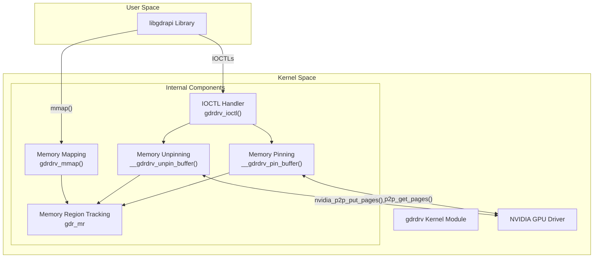
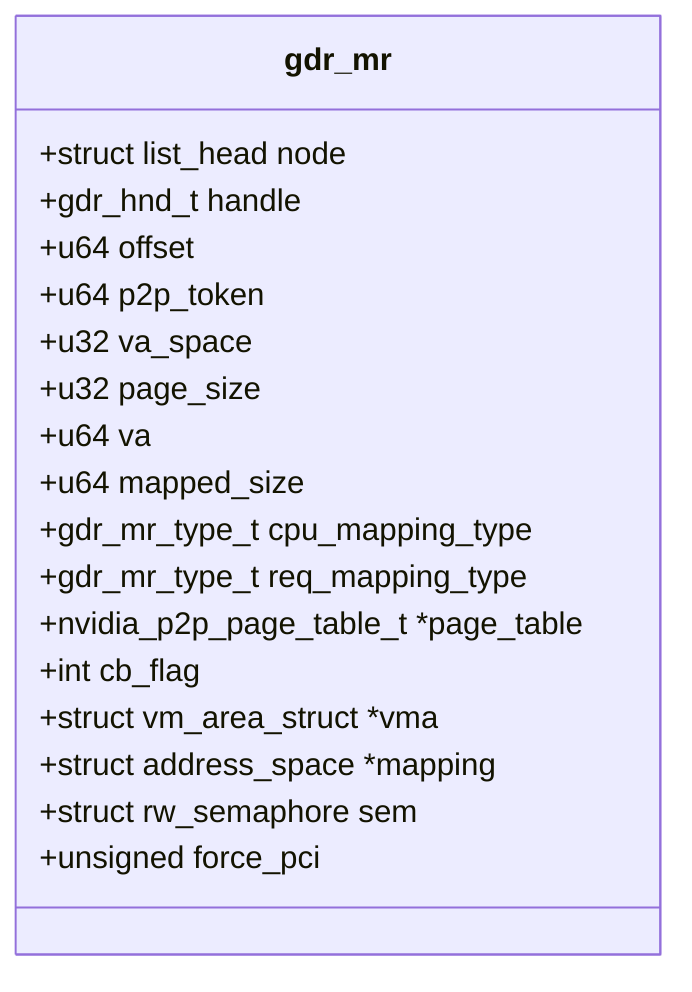
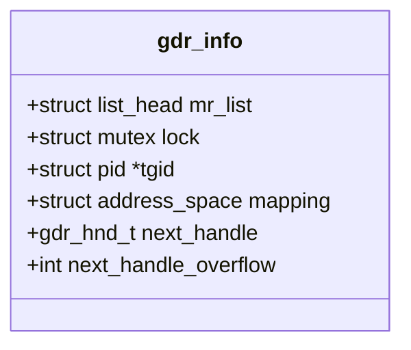
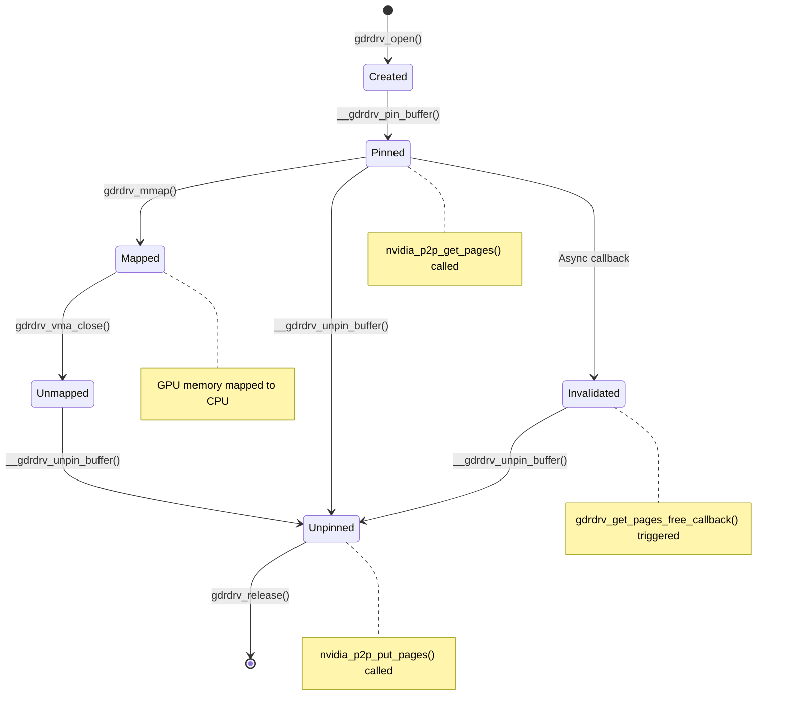
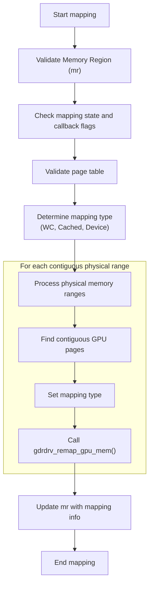
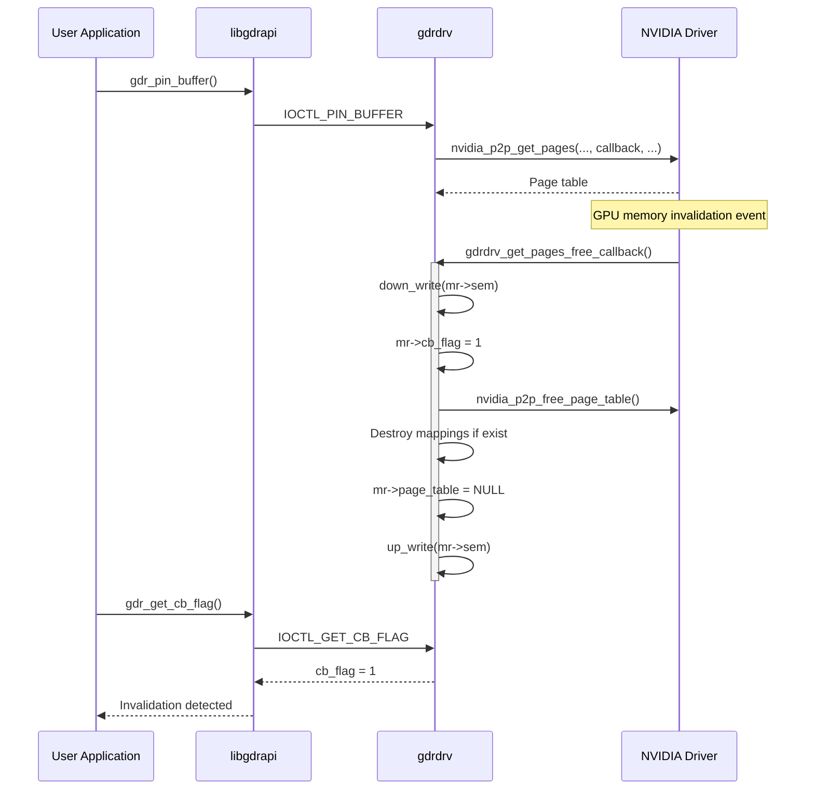
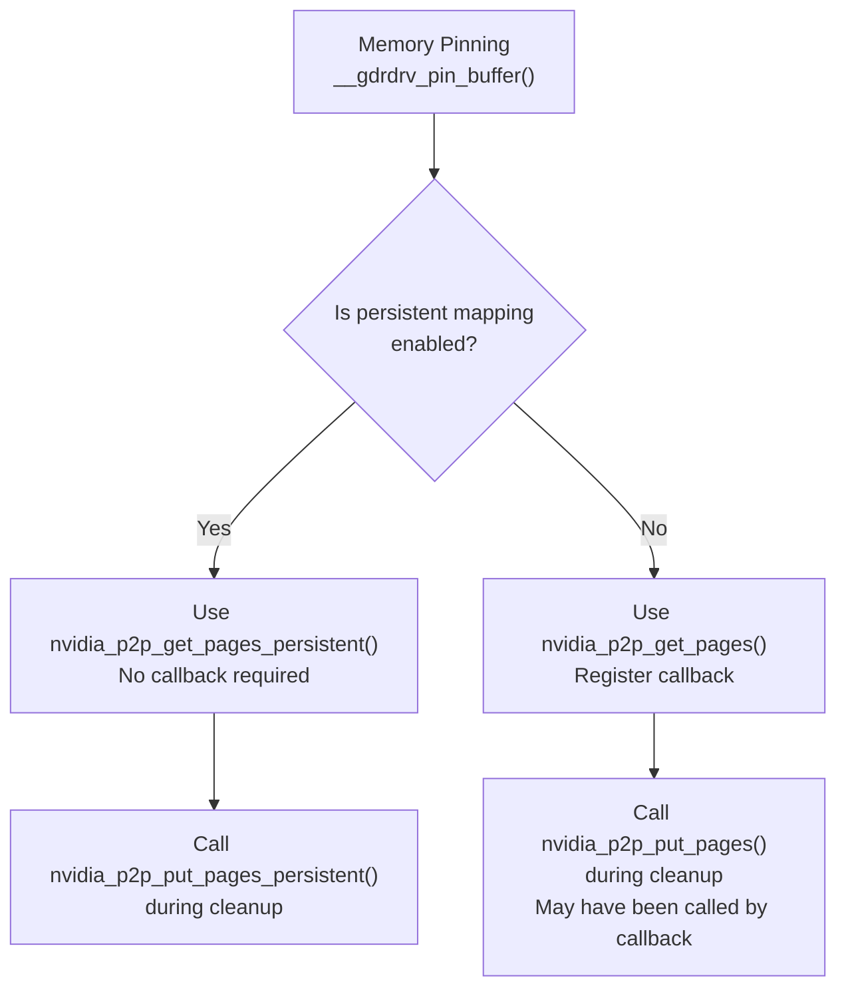

<!-- source: DeepWiki mcp.deepwiki.com · repo NVIDIA/gdrcopy · page 2.1 Driver Internals · fetched 2026-11-11 -->

# Driver Internals

Relevant source files

The following files were used as context for generating this wiki page:

- [scripts/test_gdrdrv_HAVE_PROC_OPS.sh](scripts/test_gdrdrv_HAVE_PROC_OPS.sh)
- [src/gdrdrv/gdrdrv.c](src/gdrdrv/gdrdrv.c)

This document provides a detailed explanation of the GDRCopy kernel driver's internal architecture, memory management mechanisms, and its interaction with NVIDIA GPUs. For information about the driver's interface and API, see [Driver Interface](#2.2), and for build instructions, see [Building the Driver](#2.3).

## 1. Driver Architecture Overview

The `gdrdrv` kernel module serves as the bridge between the user-space GDRCopy library and NVIDIA's GPU driver. It enables direct memory operations between CPU and GPU memory by leveraging NVIDIA's GPUDirect RDMA technology.

Sources: [src/gdrdrv/gdrdrv.c:1323-1388](), [src/gdrdrv/gdrdrv.c:760-935](), [src/gdrdrv/gdrdrv.c:939-972](), [src/gdrdrv/gdrdrv.c:1499-1717]()

## 2. Core Data Structures

### 2.1 Memory Region (gdr_mr)

The `gdr_mr` structure represents a pinned GPU memory region and tracks all associated information:

Key fields:
- `handle`: Unique identifier for the memory region
- `va`: GPU virtual address
- `mapped_size`: Size of the mapped region
- `page_table`: Reference to NVIDIA's page table
- `cpu_mapping_type`: Current mapping type (None, WC, Cached, Device)
- `sem`: Semaphore for thread synchronization

Sources: [src/gdrdrv/gdrdrv.c:352-372]()

### 2.2 Driver Information (gdr_info)

The `gdr_info` structure manages driver context for each file descriptor:

Key fields:
- `mr_list`: List of memory regions
- `tgid`: Task group ID to ensure same-process access
- `mapping`: Address space for memory mappings
- `next_handle`: Handle counter for memory regions

Sources: [src/gdrdrv/gdrdrv.c:406-426]()

## 3. Memory Management Workflow

### 3.1 Memory Region Lifecycle

The following diagram illustrates the lifecycle of a GPU memory region in GDRCopy:

Sources: [src/gdrdrv/gdrdrv.c:474-623](), [src/gdrdrv/gdrdrv.c:760-935](), [src/gdrdrv/gdrdrv.c:939-972](), [src/gdrdrv/gdrdrv.c:1499-1717](), [src/gdrdrv/gdrdrv.c:695-716]()

### 3.2 Memory Pinning Process

Memory pinning is a critical operation that makes GPU memory accessible to the CPU:

1. Align address and size to GPU page boundaries (64KB by default)
2. Initialize a new memory region (`gdr_mr`) 
3. Call NVIDIA's `nvidia_p2p_get_pages` API to pin GPU memory
4. Validate page table returned by NVIDIA
5. Generate and assign a handle for the memory region
6. Add memory region to the tracked list

Sources: [src/gdrdrv/gdrdrv.c:760-935]()

### 3.3 Memory Mapping Process

The memory mapping process makes pinned GPU memory accessible to user-space applications:

Key mapping implementation details:
- Memory is mapped range by range if physically non-contiguous
- Different mapping types (WC, Cached, Device) use different page protection flags
- The system automatically selects the appropriate mapping type based on hardware capabilities

Sources: [src/gdrdrv/gdrdrv.c:1499-1717](), [src/gdrdrv/gdrdrv.c:1433-1495]()

## 4. Memory Mapping Types

The driver supports three types of memory mappings, each with different performance characteristics:

| Mapping Type | Description | Implementation | Best Use Case |
|--------------|-------------|----------------|---------------|
| Write Combining (WC) | Non-cached mapping with write combining | `pgprot_modify_writecombine()` | Host-to-device transfers |
| Cached | CPU can cache GPU memory contents | Uses default page protection | Device-to-host transfers |
| Device | Device-specific mapping for certain architectures | `pgprot_modify_device()` | ARM64 architectures (like BlueField) |

The driver selects the mapping type based on:
1. User request through `GDRDRV_IOC_REQ_MAPPING_TYPE`
2. Hardware platform capabilities (`gdrdrv_cpu_can_cache_gpu_mappings`, `gdrdrv_cpu_must_use_device_mapping`)
3. Memory characteristics (determined by `gdr_pfn_is_ram()`)

Sources: [src/gdrdrv/gdrdrv.c:1232-1301](), [src/gdrdrv/gdrdrv.c:1527-1535](), [src/gdrdrv/gdrdrv.c:164-236]()

## 5. Callback Handling

GDRCopy uses a callback mechanism to handle asynchronous GPU memory invalidation:

The callback mechanism works as follows:
1. When pinning memory, a callback function is registered with NVIDIA's driver
2. If GPU memory becomes invalid (e.g., GPU reset, process termination), the callback is triggered
3. The callback marks the memory region as invalidated and cleans up resources
4. Applications can check for invalidation using `gdr_get_cb_flag()`

Sources: [src/gdrdrv/gdrdrv.c:695-716](), [src/gdrdrv/gdrdrv.c:1089-1118]()

## 6. Platform-Specific Optimizations

GDRCopy adapts its behavior based on the hardware platform:

1. **x86_64 Systems**:
   - Uses Write Combining mappings by default
   - Handles PAT (Page Attribute Table) for proper memory-type management

2. **PowerPC Systems (POWER8/9)**:
   - Enables cached mappings when GPUs are connected via NVLink
   - Uses Write Combining otherwise

3. **ARM64 Systems**:
   - Supports device mappings for BlueField adapters
   - Can use cached mappings on Grace-Hopper architectures

For newer architectures with CPU-GPU coherence (like POWER9 with NVLink or Grace-Hopper), the driver can enable cached mappings for higher performance.

Sources: [src/gdrdrv/gdrdrv.c:164-236](), [src/gdrdrv/gdrdrv.c:1872-1884](), [src/gdrdrv/gdrdrv.c:1889-1904]()

## 7. Persistent vs. Non-Persistent Mapping

GDRCopy supports two modes of operation with NVIDIA's driver:

Key differences:
- **Persistent Mapping**: Uses newer NVIDIA API that maintains pinned memory even during GPU context switches
- **Non-Persistent Mapping**: Older method where GPU context switches can invalidate pinned memory (handled via callbacks)

The mode is controlled by the `use_persistent_mapping` module parameter and NVIDIA driver support.

Sources: [src/gdrdrv/gdrdrv.c:445-459](), [src/gdrdrv/gdrdrv.c:790-820](), [src/gdrdrv/gdrdrv.c:837-857]()

## 8. IOCTL Interface Implementation

The driver exposes its functionality to user-space through the following IOCTL commands:

| IOCTL Command | Function | Purpose |
|---------------|----------|---------|
| `GDRDRV_IOC_PIN_BUFFER` | `gdrdrv_pin_buffer()` | Pin GPU memory |
| `GDRDRV_IOC_PIN_BUFFER_V2` | `gdrdrv_pin_buffer_v2()` | Pin GPU memory (extended version) |
| `GDRDRV_IOC_UNPIN_BUFFER` | `gdrdrv_unpin_buffer()` | Unpin GPU memory |
| `GDRDRV_IOC_GET_CB_FLAG` | `gdrdrv_get_cb_flag()` | Get callback flag status |
| `GDRDRV_IOC_GET_INFO` | `gdrdrv_get_info()` | Get memory region info |
| `GDRDRV_IOC_GET_INFO_V2` | `gdrdrv_get_info_v2()` | Get extended memory region info |
| `GDRDRV_IOC_GET_ATTR` | `gdrdrv_get_attr()` | Get driver attributes |
| `GDRDRV_IOC_REQ_MAPPING_TYPE` | `gdrdrv_req_mapping_type()` | Request specific mapping type |
| `GDRDRV_IOC_GET_VERSION` | `gdrdrv_get_version()` | Get driver version |

The IOCTL handler validates the calling process to ensure only the original opener can access the file descriptor, providing security against unauthorized access.

Sources: [src/gdrdrv/gdrdrv.c:1323-1388](), [src/gdrdrv/gdrdrv.c:976-1017](), [src/gdrdrv/gdrdrv.c:1072-1085](), [src/gdrdrv/gdrdrv.c:1089-1118]()

## 9. Error Handling and Resource Management

The driver implements robust error handling and resource management:

1. **Reference Counting**:
   - Tracks `nvidia_p2p_get_pages` calls with atomic counter
   - Verifies all references are released during driver unload

2. **Semaphore Protection**:
   - Reader-writer semaphore (`mr->sem`) protects memory regions
   - Prevents race conditions with asynchronous callbacks

3. **Resource Cleanup**:
   - Releases all GPU resources on driver close
   - Handles partial failures during pinning

4. **Process Validation**:
   - Ensures only the process that opened the device can access it
   - Prevents issues with fork() or unauthorized access

Sources: [src/gdrdrv/gdrdrv.c:104](), [src/gdrdrv/gdrdrv.c:378-402](), [src/gdrdrv/gdrdrv.c:584-620](), [src/gdrdrv/gdrdrv.c:430-441]()

## 10. Driver Initialization

The driver performs the following steps during initialization:

1. Register character device (`register_chrdev`)
2. Detect platform capabilities:
   - CPU-GPU coherence for cached mappings
   - Need for device mappings on ARM64
3. Set up module parameters and default configurations
4. Initialize procfs entries for debugging and monitoring

During cleanup, the driver:
1. Unregisters the character device
2. Removes procfs entries
3. Verifies all reference counts are zero

Sources: [src/gdrdrv/gdrdrv.c:1857-1915](), [src/gdrdrv/gdrdrv.c:1919-1934]()

---

