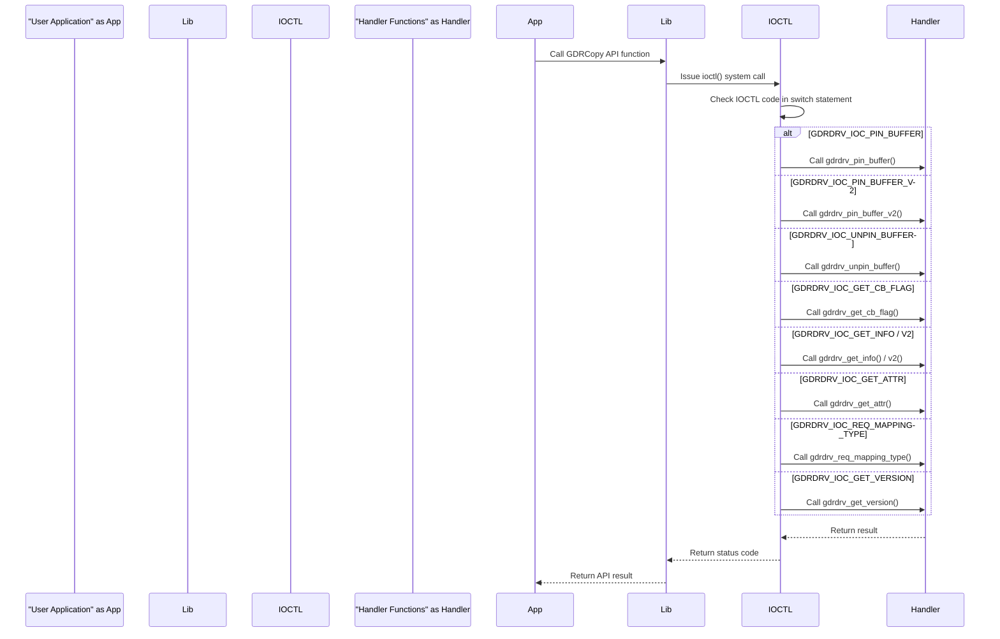
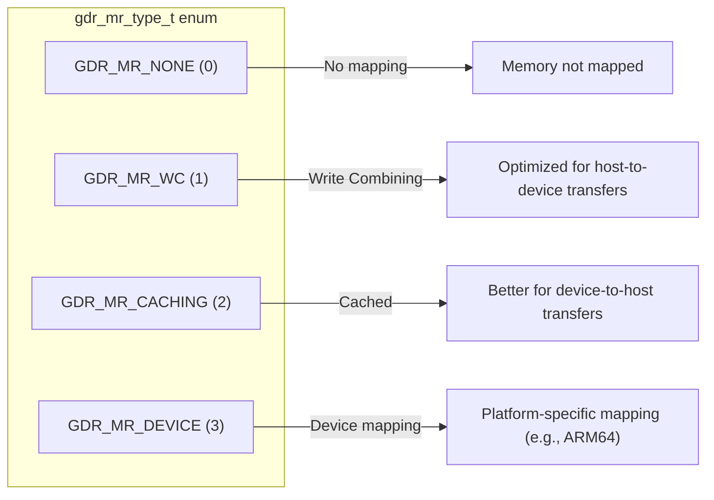
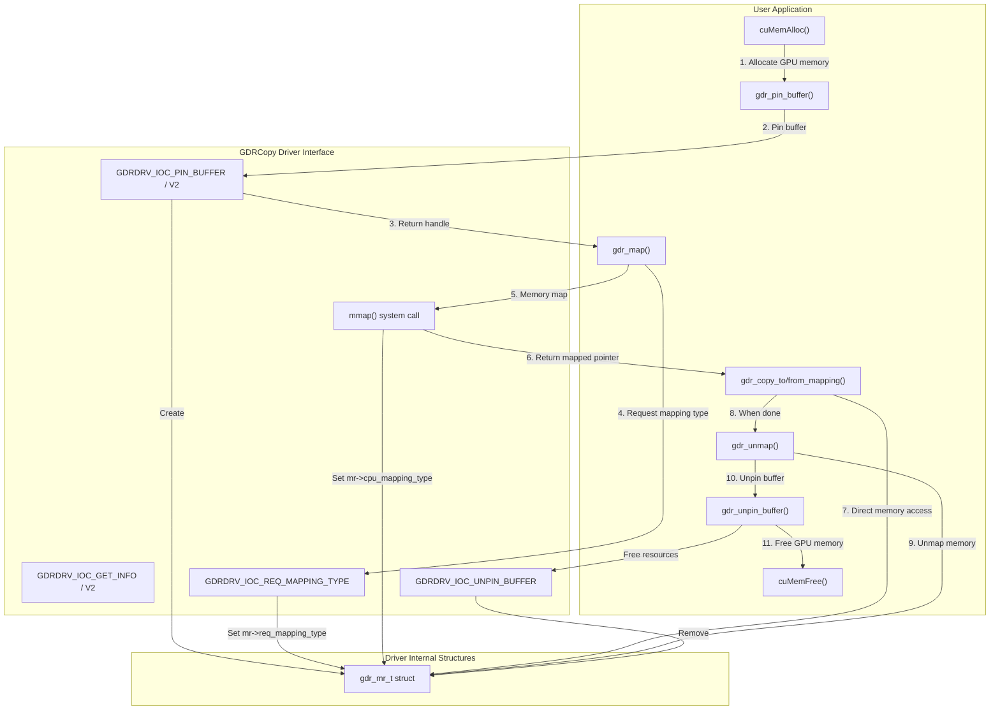
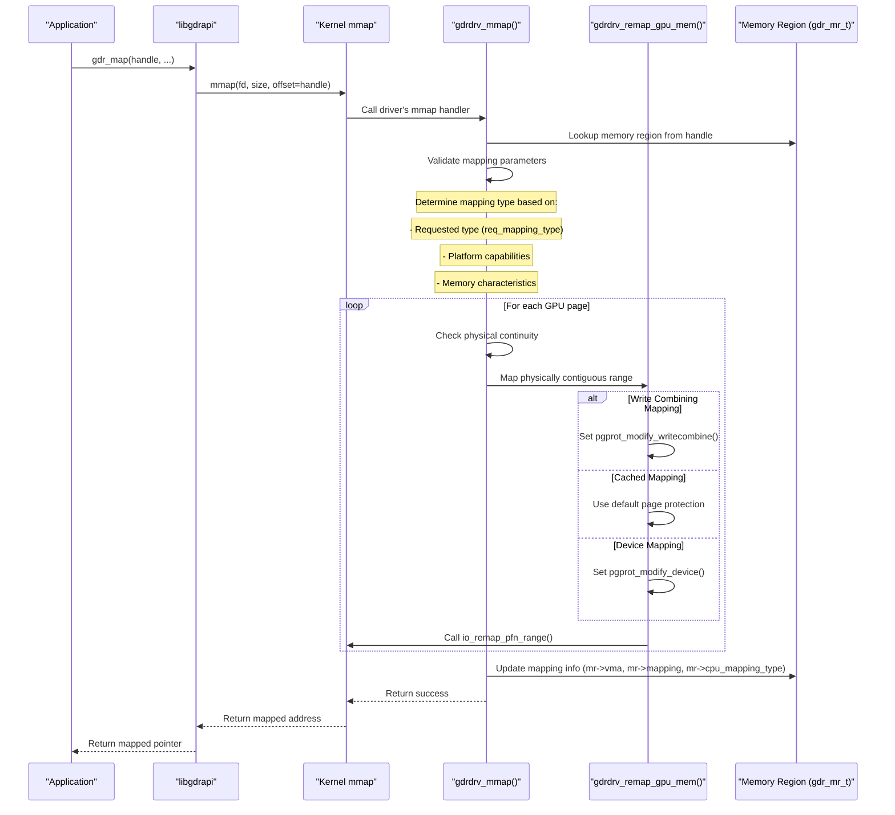

<!-- source: DeepWiki mcp.deepwiki.com · repo NVIDIA/gdrcopy · page 2.2 Driver Interface · fetched 2026-11-11 -->

# Driver Interface

<details>
<summary>Relevant source files</summary>

The following files were used as context for generating this wiki page:

- [scripts/test_gdrdrv_HAVE_PROC_OPS.sh](scripts/test_gdrdrv_HAVE_PROC_OPS.sh)
- [src/gdrdrv/gdrdrv.c](src/gdrdrv/gdrdrv.c)
- [src/gdrdrv/gdrdrv.h](src/gdrdrv/gdrdrv.h)

</details>


This page documents the kernel driver's interface for GDRCopy, including IOCTL commands, data structures, and memory mapping functions. The driver interface serves as the communication layer between user applications and the GDRCopy kernel module, providing mechanisms to pin, map, and access GPU memory directly from the CPU.

For information about the internal implementation of the driver, see [Driver Internals](#2.1).

## IOCTL Commands Overview

The GDRCopy driver exposes functionality to user applications through IOCTL commands. These commands allow applications to perform operations such as pinning GPU memory, requesting specific mapping types, and querying driver information.

### IOCTL Command Flow



Sources: [src/gdrdrv/gdrdrv.c:1323-1388]()

### Supported IOCTL Commands

The driver supports the following IOCTL commands:

| IOCTL Command | Code | Description | Added in Version |
|---------------|------|-------------|------------------|
| GDRDRV_IOC_PIN_BUFFER | 1 | Pin a GPU memory buffer | Initial |
| GDRDRV_IOC_UNPIN_BUFFER | 2 | Unpin a previously pinned buffer | Initial |
| GDRDRV_IOC_GET_CB_FLAG | 3 | Check if callback flag is set | Initial |
| GDRDRV_IOC_GET_INFO | 4 | Get information about a pinned region | Initial |
| GDRDRV_IOC_GET_INFO_V2 | 5 | Enhanced version of GET_INFO | 2.4 |
| GDRDRV_IOC_GET_ATTR | 6 | Query driver attributes | 2.5 |
| GDRDRV_IOC_PIN_BUFFER_V2 | 7 | Enhanced PIN_BUFFER with flags | 2.5 |
| GDRDRV_IOC_REQ_MAPPING_TYPE | 8 | Request specific mapping type | 2.5 |
| GDRDRV_IOC_GET_VERSION | 255 | Query driver version | Initial |

Sources: [src/gdrdrv/gdrdrv.h:45-184]()

## Data Structures and Types

The driver interface defines several data structures and types used for communication between user space and kernel space.

### Memory Region Types



Sources: [src/gdrdrv/gdrdrv.h:47-52]()

### Driver Attributes

The driver exposes attributes that can be queried through the `GDRDRV_IOC_GET_ATTR` command:

| Attribute | Value | Description |
|-----------|-------|-------------|
| GDRDRV_ATTR_USE_PERSISTENT_MAPPING | 1 | Indicates if persistent mapping is being used |
| GDRDRV_ATTR_SUPPORT_PIN_FLAG_FORCE_PCIE | 2 | Indicates if forcing PCIe mapping is supported |

Sources: [src/gdrdrv/gdrdrv.h:54-57]()

### Key IOCTL Parameter Structures

Below are the main data structures used for IOCTL communication:

#### Pin Buffer Parameters

```c
struct GDRDRV_IOC_PIN_BUFFER_PARAMS {
    // in
    __u64 addr;        // GPU memory address to pin
    __u64 size;        // Size of the memory region
    __u64 p2p_token;   // P2P token from NVIDIA driver
    __u32 va_space;    // Virtual address space
    // out
    gdr_hnd_t handle;  // Handle to the pinned memory region
};
```

#### Pin Buffer V2 Parameters

```c
struct GDRDRV_IOC_PIN_BUFFER_V2_PARAMS {
    // in
    __u64 addr;        // GPU memory address to pin
    __u64 size;        // Size of the memory region
    __u32 flags;       // Additional flags
    __u32 pad;         // Padding for alignment
    // out
    gdr_hnd_t handle;  // Handle to the pinned memory region
};
```

Sources: [src/gdrdrv/gdrdrv.h:63-156]()

## IOCTL Command Details

### Memory Region Operations



Sources: [src/gdrdrv/gdrdrv.c:760-935](), [src/gdrdrv/gdrdrv.c:939-972]()

### GDRDRV_IOC_PIN_BUFFER / GDRDRV_IOC_PIN_BUFFER_V2

These commands pin a GPU memory buffer to make it accessible to the CPU.

**Processing Steps:**
1. Validate user parameters
2. Align address and size to GPU page boundaries (64KB)
3. Call `nvidia_p2p_get_pages` or `nvidia_p2p_get_pages_persistent` to get page information
4. Create a memory region (`gdr_mr_t`) structure to track the pinned buffer
5. Return a handle to the pinned buffer

**Differences Between Versions:**
- Original version uses `p2p_token` and `va_space` parameters
- V2 version replaces these with a `flags` parameter that supports options like `GDRDRV_PIN_BUFFER_FLAG_FORCE_PCIE`

Sources: [src/gdrdrv/gdrdrv.c:976-1068]()

### GDRDRV_IOC_UNPIN_BUFFER

Unpins a previously pinned GPU memory buffer.

**Processing Steps:**
1. Find the memory region associated with the handle
2. Destroy any mappings associated with the region
3. Call `nvidia_p2p_put_pages` to release GPU resources
4. Free the memory region structure

Sources: [src/gdrdrv/gdrdrv.c:1072-1085]()

### GDRDRV_IOC_GET_CB_FLAG

Checks if the callback flag is set, which indicates if a pinned memory region has been invalidated by the GPU.

**Processing Steps:**
1. Find the memory region associated with the handle
2. Return the current state of the callback flag

Sources: [src/gdrdrv/gdrdrv.c:1089-1118]()

### GDRDRV_IOC_GET_INFO / GDRDRV_IOC_GET_INFO_V2

Gets information about a pinned memory region.

**Information Returned:**
- GPU virtual address
- Mapped size
- Page size
- Timing information (cycles and frequency)
- Mapping status (mapped/unmapped)
- Mapping type

**Differences Between Versions:**
- Original version returns `mapped` and `wc_mapping` flags
- V2 version returns a single `mapping_type` enum value with more options

Sources: [src/gdrdrv/gdrdrv.c:1122-1195]()

### GDRDRV_IOC_GET_ATTR

Queries driver attributes.

**Supported Attributes:**
- `GDRDRV_ATTR_USE_PERSISTENT_MAPPING`: Whether persistent mapping is used
- `GDRDRV_ATTR_SUPPORT_PIN_FLAG_FORCE_PCIE`: Whether forcing PCIe mapping is supported

Sources: [src/gdrdrv/gdrdrv.c:1199-1228]()

### GDRDRV_IOC_REQ_MAPPING_TYPE

Requests a specific mapping type for a pinned memory region before mapping it.

**Processing Steps:**
1. Validate the requested mapping type
2. Check if the mapping type is supported on the current platform
3. If the memory region is already mapped, return an error
4. Set the requested mapping type for the memory region

Sources: [src/gdrdrv/gdrdrv.c:1232-1301]()

### GDRDRV_IOC_GET_VERSION

Gets driver version information.

**Information Returned:**
- Current driver version
- Minimum compatible API version

Sources: [src/gdrdrv/gdrdrv.c:1305-1319]()

## Memory Mapping Interface

The GDRCopy driver also provides a memory mapping interface through the standard `mmap` system call. When an application calls `mmap` on the driver's file descriptor, the driver maps the pinned GPU memory into the application's address space.

### Memory Mapping Process



Sources: [src/gdrdrv/gdrdrv.c:1499-1717]()

### Mapping Types and Selection

The driver supports three types of memory mappings:

1. **Write Combining (WC)**: 
   - Optimized for host-to-device transfers
   - Uses write-combining to batch writes for better performance
   - Default for most GPU memory on x86 platforms

2. **Cached Mapping**:
   - CPU caches the contents of GPU memory
   - Better for frequent reads from GPU memory
   - Available on platforms with coherent GPU memory (e.g., Power9 with NVLink, Grace Hopper)

3. **Device Mapping**:
   - Direct device memory mapping
   - Required on some ARM64 platforms (e.g., BlueField)

The driver automatically selects the appropriate mapping type based on platform capabilities and memory characteristics, but applications can request a specific type using `GDRDRV_IOC_REQ_MAPPING_TYPE`.

Sources: [src/gdrdrv/gdrdrv.c:1622-1677]()

## Version Compatibility

The GDRCopy driver interface has evolved over time, with new features added in different versions. Applications should use `GDRDRV_IOC_GET_VERSION` to check compatibility before using newer features.

| Feature | Minimum Version | Macro |
|---------|----------------|-------|
| GET_INFO_V2 | 2.4 | GDRDRV_MINIMUM_VERSION_WITH_GET_INFO_V2 |
| GET_ATTR | 2.5 | GDRDRV_MINIMUM_VERSION_WITH_GET_ATTR |
| PIN_BUFFER_V2 | 2.5 | GDRDRV_MINIMUM_VERSION_WITH_PIN_BUFFER_V2 |
| REQ_MAPPING_TYPE | 2.5 | GDRDRV_MINIMUM_VERSION_WITH_REQ_MAPPING_TYPE |

The version number is encoded as `(major << 16) | minor`, so version 2.5 is represented as 0x20005.

Sources: [src/gdrdrv/gdrdrv.h:29-43]()

## Platform-Specific Behaviors

The GDRCopy driver has different behaviors on different platforms:

1. **x86-64**:
   - Write Combining (WC) mapping is the default
   - Cached mapping is not supported
   - Device mapping is not supported

2. **Power9 with NVLink**:
   - Both WC and Cached mappings are supported
   - Driver detects NVLink connection and enables cached mappings

3. **ARM64**:
   - WC mapping is the default
   - Some platforms (BlueField) require Device mapping
   - Grace Hopper supports Cached mapping

The driver automatically detects the platform capabilities and behaves accordingly.

Sources: [src/gdrdrv/gdrdrv.c:164-236](), [src/gdrdrv/gdrdrv.c:1872-1907]()

---

