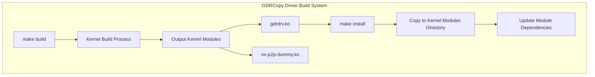
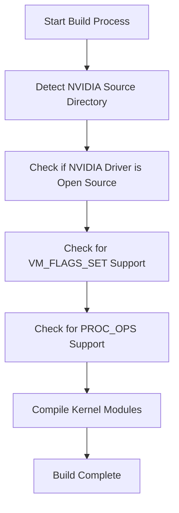
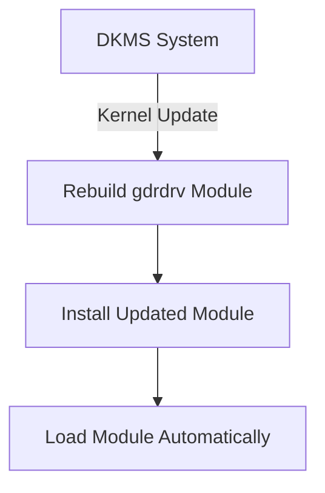

<!-- source: DeepWiki mcp.deepwiki.com · repo NVIDIA/gdrcopy · page 2.3 Building the Driver · fetched 2026-11-11 -->

# Building the Driver

<details>
<summary>Relevant source files</summary>

The following files were used as context for generating this wiki page:

- [packages/dkms.conf](packages/dkms.conf)
- [packages/dkms/Makefile](packages/dkms/Makefile)
- [packages/dkms/debian/prerm](packages/dkms/debian/prerm)
- [scripts/test_gdrdrv_HAVE_VM_FLAGS_SET.sh](scripts/test_gdrdrv_HAVE_VM_FLAGS_SET.sh)
- [src/gdrdrv/Makefile](src/gdrdrv/Makefile)

</details>


This document provides detailed instructions for building the GDRCopy kernel driver (gdrdrv) from source. The driver is a critical component of the GDRCopy system that enables direct memory access between GPU memory and CPU. For information about the driver's internal architecture, see [Driver Internals](#2.1), and for details about its interface, see [Driver Interface](#2.2).

## Overview

The GDRCopy kernel driver consists of two kernel modules:
- `gdrdrv.ko`: The main GDRCopy kernel driver
- `nv-p2p-dummy.ko`: A helper module for NVIDIA P2P functionality



Sources: [src/gdrdrv/Makefile:25-26](), [src/gdrdrv/Makefile:60-70]()

## Prerequisites

Before building the GDRCopy driver, ensure you have the following prerequisites:

| Requirement | Description |
|-------------|-------------|
| Linux Kernel Headers | Headers corresponding to your running kernel |
| GCC Compiler | Compatible with your kernel version |
| Make | Build automation tool |
| NVIDIA GPU Driver | Installed and working properly |

The driver build process requires the NVIDIA driver source files to locate and use the NVIDIA P2P headers. The build system will automatically detect the NVIDIA driver source directory.

Sources: [src/gdrdrv/Makefile:51-52]()

## Build Process

### Standard Build

The build process for the GDRCopy driver is managed through a Makefile located in the `src/gdrdrv` directory. The following steps outline how to build the driver:

1. Navigate to the gdrdrv directory:
   ```bash
   cd src/gdrdrv
   ```

2. Run the build command:
   ```bash
   make build
   ```

During the build process, the system will:
- Automatically detect the NVIDIA driver source directory
- Determine if the NVIDIA driver is open source
- Check for kernel compatibility features
- Compile the kernel modules against your current kernel



Sources: [src/gdrdrv/Makefile:51-65]()

### Build Configuration Options

The GDRCopy driver build system detects several features and sets compilation flags accordingly:

| Configuration | Description | Detection Method |
|---------------|-------------|-----------------|
| NVIDIA_SRC_DIR | Directory containing NVIDIA driver sources | Automatic detection |
| NVIDIA_IS_OPENSOURCE | Whether NVIDIA driver is open source | Checks for GPL license in source |
| HAVE_VM_FLAGS_SET | If kernel supports vm_flags_set function | Kernel feature test |
| HAVE_PROC_OPS | If kernel supports proc_ops structure | Kernel feature test |

You can manually specify these options if needed:

```bash
make NVIDIA_SRC_DIR=/path/to/nvidia/src build
```

Sources: [src/gdrdrv/Makefile:51-56](), [scripts/test_gdrdrv_HAVE_VM_FLAGS_SET.sh:1-80]()

## Installation

After successfully building the driver, you can install it using:

```bash
sudo make install
```

This will:
1. Copy the built kernel module to the appropriate kernel modules directory
2. Update the module dependencies with depmod

You can specify an alternative destination directory with:

```bash
sudo make DESTDIR=/path/to/destdir install
```

To load the driver after installation:

```bash
sudo modprobe gdrdrv
```

Sources: [src/gdrdrv/Makefile:67-70]()

## DKMS Support

GDRCopy supports DKMS (Dynamic Kernel Module Support), which automatically rebuilds the kernel module when the kernel is updated. This is especially useful in environments where kernel updates are frequent.



### Installing with DKMS

The DKMS configuration file (`dkms.conf`) defines how the module should be built:

```
PACKAGE_NAME="gdrdrv"
PACKAGE_VERSION="<version>"
BUILT_MODULE_NAME[0]="gdrdrv"
DEST_MODULE_LOCATION[0]="<module_location>"
AUTOINSTALL="yes"
MAKE[0]="cd $dkms_tree/gdrdrv/<version>/build && make CONF_SCRIPT_DIR=scripts KVER=$kernelver"
```

This configuration ensures that:
- The module is named "gdrdrv"
- DKMS will automatically install the module
- The build command is properly configured to use the correct scripts

To install using DKMS:

```bash
sudo dkms add -m gdrdrv -v <version>
sudo dkms build -m gdrdrv -v <version>
sudo dkms install -m gdrdrv -v <version>
```

Sources: [packages/dkms.conf:1-6](), [packages/dkms/Makefile:1-33]()

## Troubleshooting

### Common Build Issues

| Issue | Cause | Solution |
|-------|-------|----------|
| NVIDIA source not found | NVIDIA driver source files cannot be located | Install NVIDIA driver development package or specify NVIDIA_SRC_DIR manually |
| Kernel version mismatch | Driver is being built against wrong kernel headers | Ensure correct kernel headers are installed |
| Module load failure | Incompatible kernel or NVIDIA driver | Check dmesg for detailed error messages |

### Checking Build Configuration

To verify the detected build configuration:

```bash
make build
```

This will output the detected NVIDIA source directory and configuration options before compiling.

Sources: [src/gdrdrv/Makefile:60-65]()

## Clean Build

To clean previous build artifacts:

```bash
make clean
```

This removes all generated files and allows for a fresh build.

Sources: [src/gdrdrv/Makefile:75-76]()

## Platform-Specific Notes

### Note on Kernel Compatibility

The GDRCopy driver uses compatibility tests to adapt to different kernel versions. Two key features are tested:

1. VM_FLAGS_SET support: Used for proper virtual memory management
2. PROC_OPS support: Used for file operations in /proc

These tests ensure the driver builds correctly across different kernel versions.

Sources: [scripts/test_gdrdrv_HAVE_VM_FLAGS_SET.sh:37-80](), [src/gdrdrv/Makefile:34-40]()

---

