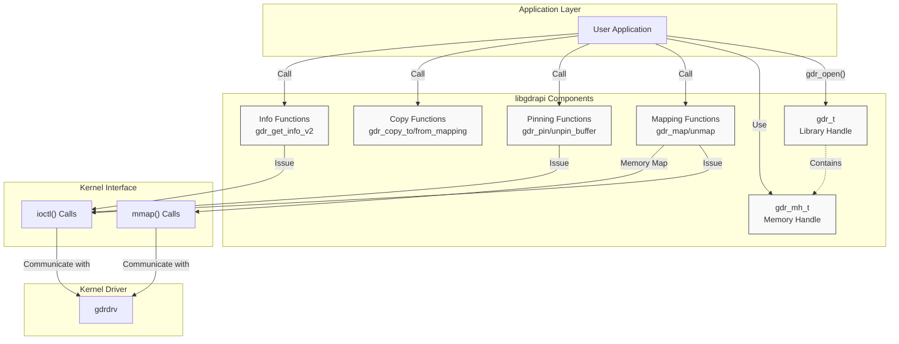
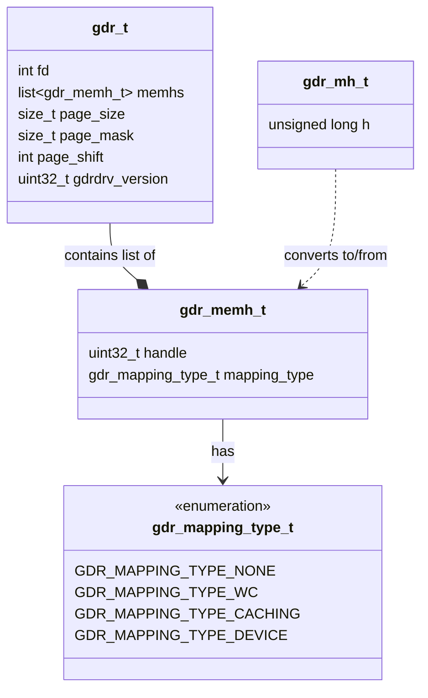
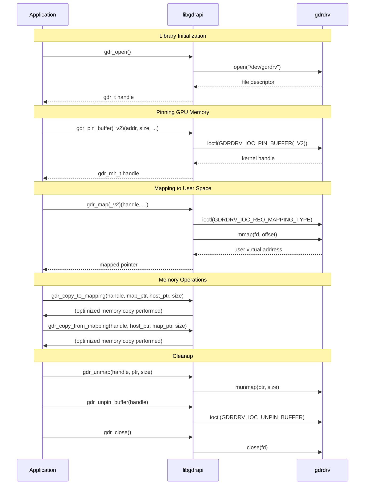
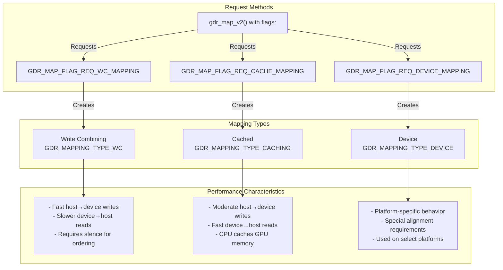
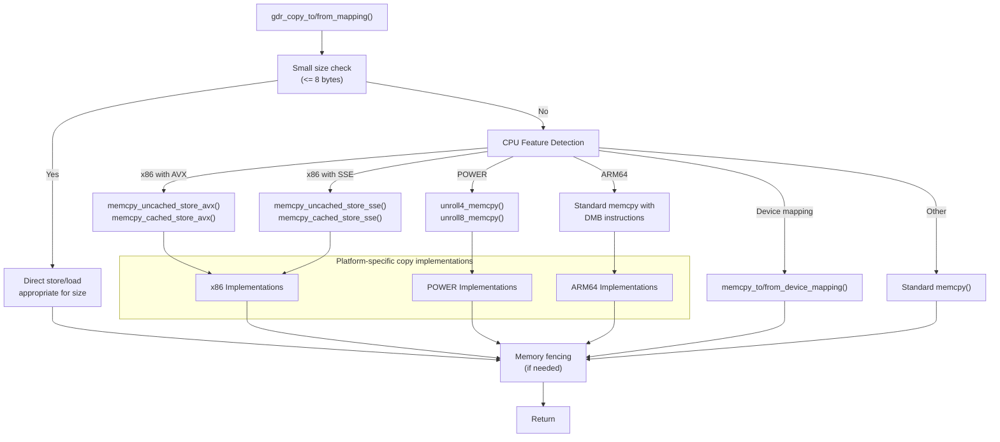
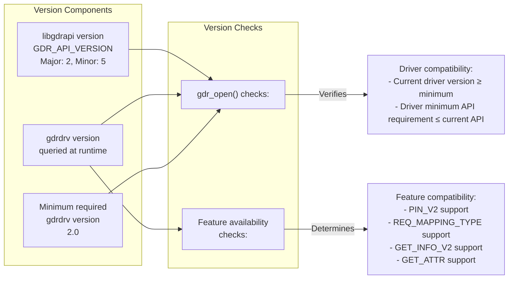

<!-- source: DeepWiki mcp.deepwiki.com · repo NVIDIA/gdrcopy · page 3 User-Space Library (libgdrapi) · fetched 2026-11-11 -->

# User-Space Library (libgdrapi)

<details>
<summary>Relevant source files</summary>

The following files were used as context for generating this wiki page:

- [include/gdrapi.h](include/gdrapi.h)
- [src/gdrapi.c](src/gdrapi.c)

</details>


The User-Space Library (libgdrapi) provides the application programming interface for accessing NVIDIA GPUDirect RDMA functionality within GDRCopy. It serves as the intermediary layer between user applications and the kernel driver (gdrdrv), offering a set of functions to establish low-latency, direct memory access between CPU and GPU memory.

For information about the kernel driver implementation, see [Kernel Driver (gdrdrv)](#2).

## Architecture Overview

The libgdrapi library follows a handle-based design pattern where operations are performed through opaque handles that represent GPU memory mappings.



Sources: [include/gdrapi.h:63-77](), [src/gdrapi.c:63-115]()

## Core Data Structures

The library uses several key data structures to manage GPU memory access:

1. **Library Handle (`gdr_t`)**: 
   - Represents a connection to the gdrdrv kernel module
   - Contains file descriptor and state information

2. **Memory Handle (`gdr_mh_t`)**: 
   - Opaque handle representing a pinned GPU memory region
   - Used in all memory operations

3. **Memory Mapping Types**: 
   - Defined by `gdr_mapping_type_t` enumeration
   - Controls the memory access characteristics



Sources: [include/gdrapi.h:63-77](), [include/gdrapi.h:111-117](), [src/gdrapi.c:107-115]()

## API Workflow

The typical workflow for using libgdrapi follows this sequence:



Sources: [src/gdrapi.c:124-228](), [src/gdrapi.c:231-319](), [src/gdrapi.c:410-546]()

## API Reference

### Initialization and Cleanup

```c
gdr_t gdr_open(void);
int gdr_close(gdr_t g);
```

These functions establish and terminate the connection to the gdrdrv kernel module.

- `gdr_open()`: Opens the device file `/dev/gdrdrv`, verifies driver version compatibility, and initializes a library handle.
- `gdr_close()`: Unpins any remaining buffers, releases all resources, and closes the driver connection.

Sources: [src/gdrapi.c:124-228]()

### Memory Pinning and Mapping

```c
int gdr_pin_buffer(gdr_t g, unsigned long addr, size_t size, uint64_t p2p_token, uint32_t va_space, gdr_mh_t *handle);
int gdr_pin_buffer_v2(gdr_t g, unsigned long addr, size_t size, uint32_t flags, gdr_mh_t *handle);
int gdr_unpin_buffer(gdr_t g, gdr_mh_t handle);
int gdr_map(gdr_t g, gdr_mh_t handle, void **va, size_t size);
int gdr_map_v2(gdr_t g, gdr_mh_t handle, void **ptr_va, size_t size, int flags);
int gdr_unmap(gdr_t g, gdr_mh_t handle, void *va, size_t size);
```

These functions manage pinning (making resident) and mapping GPU memory into the CPU address space:

- **Pinning**: Makes GPU memory resident and prevents it from being swapped out, using `nvidia_p2p_get_pages` in the kernel driver
- **Mapping**: Creates a user-space virtual memory mapping of the pinned GPU memory
- **Unpinning/Unmapping**: Releases the mapping and marks memory as unpinable again

The `_v2` variants provide additional functionality:
- `gdr_pin_buffer_v2` supports flags like `GDR_PIN_FLAG_FORCE_PCIE` to force BAR1 mapping
- `gdr_map_v2` supports selecting the mapping type via flags like `GDR_MAP_FLAG_REQ_WC_MAPPING`

Sources: [src/gdrapi.c:231-319](), [src/gdrapi.c:321-338](), [src/gdrapi.c:410-546]()

### Memory Copy Operations

```c
int gdr_copy_to_mapping(gdr_mh_t handle, void *map_d_ptr, const void *h_ptr, size_t size);
int gdr_copy_from_mapping(gdr_mh_t handle, void *h_ptr, const void *map_d_ptr, size_t size);
```

These functions provide optimized memory copies between host memory and mapped GPU memory:

- `gdr_copy_to_mapping`: Copies from host memory to mapped GPU memory (H→D)
- `gdr_copy_from_mapping`: Copies from mapped GPU memory to host memory (D→H)

The implementation includes platform-specific optimizations:
- x86: Uses SSE, AVX, or AVX2 instructions when available
- POWER: Uses optimized unrolled copy routines
- ARM64: Uses platform-specific memory ordering instructions

Sources: [src/gdrapi.c:800-953]()

### Information and Attribute Querying

```c
int gdr_get_info_v2(gdr_t g, gdr_mh_t handle, gdr_info_v2_t *info);
void gdr_runtime_get_version(int *major, int *minor);
int gdr_driver_get_version(gdr_t g, int *major, int *minor);
int gdr_get_attribute(gdr_t g, gdr_attr_t attr, int *v);
```

These functions retrieve information about mappings and system capabilities:

- `gdr_get_info_v2`: Gets detailed information about a pinned memory region
- `gdr_runtime_get_version`: Gets the libgdrapi version
- `gdr_driver_get_version`: Gets the gdrdrv kernel module version
- `gdr_get_attribute`: Queries system-wide attributes like persistent mapping support

Sources: [src/gdrapi.c:358-408](), [src/gdrapi.c:956-1024]()

## Memory Mapping Types

GDRCopy supports different types of memory mappings, each with different performance characteristics:



### Write Combining (WC) Mapping

- Default mapping type in earlier versions
- Uses CPU write-combining buffers to optimize host-to-device transfers
- Performs well for writes but poorer for reads
- Requires memory barriers (`_mm_sfence()` on x86) for write ordering

### Cached Mapping

- CPU caches GPU memory contents
- Better balanced performance for both reads and writes
- Leverages CPU cache prefetching for improved read performance
- Suitable for workloads with frequent reads from GPU memory

### Device Mapping

- Platform-specific behavior
- Has special alignment requirements
- Used in special configurations
- Performance characteristics vary by platform

Sources: [include/gdrapi.h:111-117](), [src/gdrapi.c:410-508]()

## Copy Implementation Details

The memory copy operations use different implementations based on the mapping type and available CPU features:



Key optimization strategies:

1. **Small transfers**: Direct stores/loads with proper alignment checks
2. **SIMD Acceleration**: Uses AVX/SSE on x86 platforms when available
3. **Platform-specific optimizations**:
   - x86: Uses AVX, SSE4.1, or SSE based on CPU capabilities
   - POWER: Uses unrolled copies with 4-byte or 8-byte accesses
   - ARM64: Uses appropriate DMB (Data Memory Barrier) instructions
4. **Memory barriers**:
   - WC mapping: Uses `wc_store_fence()` to ensure visibility
   - Mixed mappings: Uses `memory_fence()` for full ordering
   - Device mapping: Uses aligned accesses with `READ_ONCE`/`WRITE_ONCE` macros

Sources: [src/gdrapi.c:547-798](), [src/gdrapi.c:800-953]()

## Version Compatibility

The library implements version checking to ensure compatibility between components:



The library checks for compatibility in several areas:

1. **API Version**: The user-space library (libgdrapi) has its own version:
   - Major: 2, Minor: 5 (as of the current version)
   - Used to indicate feature availability to applications

2. **Driver Version Compatibility**:
   - Minimum required gdrdrv version: 2.0
   - Checks are performed when opening the library
   - Returns error if driver is too old

3. **Feature Availability**:
   - Different features require specific minimum driver versions
   - The library contains fallbacks for older drivers when possible
   - Version-dependent features include:
     - `gdr_pin_buffer_v2` (requires version with `PIN_BUFFER_V2` support)
     - Custom mapping types (requires version with `REQ_MAPPING_TYPE` support)
     - Extended information queries (requires version with `GET_INFO_V2` support)

Sources: [include/gdrapi.h:29-38](), [src/gdrapi.c:124-199](), [src/gdrapi.c:303-319]()

## Building the Library

The libgdrapi library is built as a shared library. It includes:

1. Core implementation in `src/gdrapi.c`
2. Architecture-specific optimizations for x86, POWER, and ARM64
3. Public headers in `include/gdrapi.h`

For build instructions, see [Building the Library](#3.4) wiki page.

Sources: [src/gdrapi.c:1-1103](), [include/gdrapi.h:1-205]()

---

