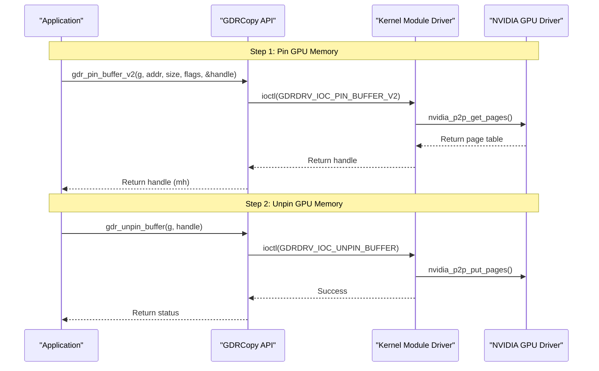
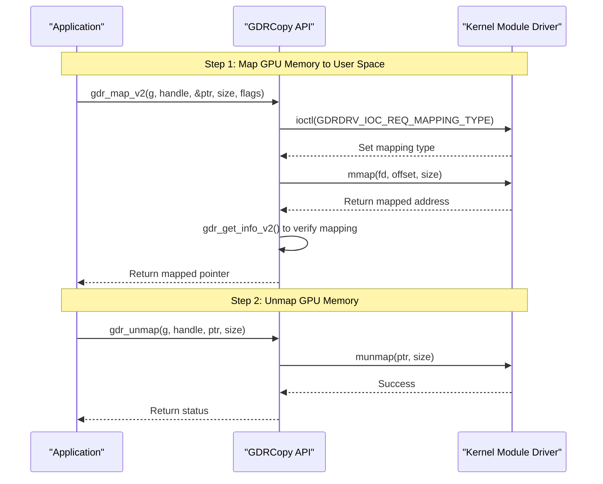
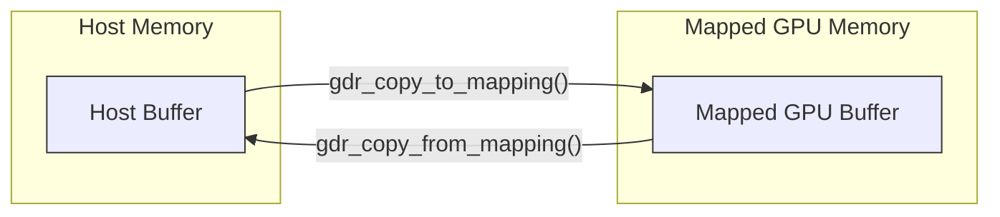
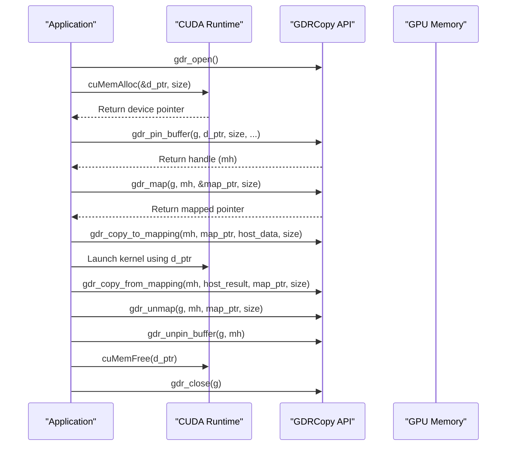
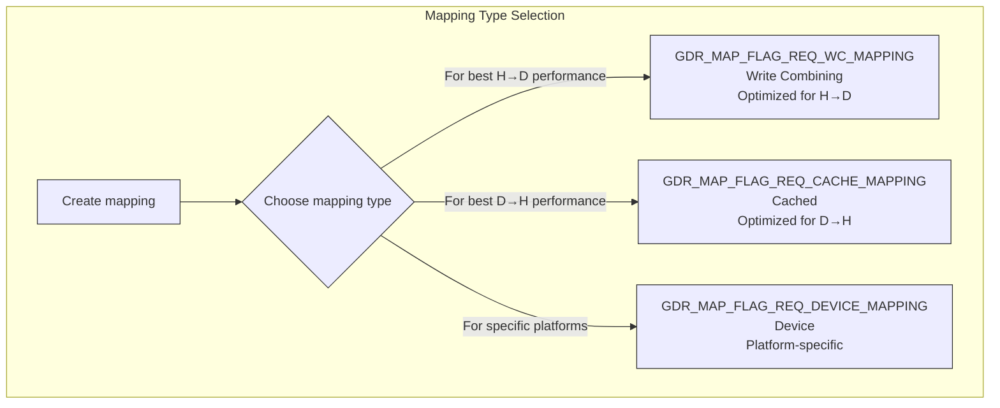

<!-- source: DeepWiki mcp.deepwiki.com · repo NVIDIA/gdrcopy · page 3.1 API Reference · fetched 2026-11-11 -->

# API Reference

<details>
<summary>Relevant source files</summary>

The following files were used as context for generating this wiki page:

- [include/gdrapi.h](include/gdrapi.h)
- [src/gdrapi.c](src/gdrapi.c)
- [tests/sanity.cpp](tests/sanity.cpp)

</details>


This document provides a comprehensive reference for the GDRCopy API, a low-latency GPU memory copy library leveraging NVIDIA's GPUDirect RDMA technology. It covers all public functions, data structures, and enumerations available in the libgdrapi user-space library. For information about the kernel driver, see [Kernel Driver (gdrdrv)](#2) and for memory mapping types, see [Memory Mapping Types](#3.2).

## API Overview

```mermaid
graph TD
    subgraph "API Categories"
        Init["Initialization & Cleanup"]
        MemMgmt["Memory Management"]
        MemOps["Memory Operations"]
        Info["Information & Attributes"]
    end

    subgraph "Initialization & Cleanup"
        Open["gdr_open()"]
        Close["gdr_close()"]
    end

    subgraph "Memory Management"
        Pin["gdr_pin_buffer()\ngdr_pin_buffer_v2()"]
        Unpin["gdr_unpin_buffer()"]
        Map["gdr_map()\ngdr_map_v2()"]
        Unmap["gdr_unmap()"]
    end

    subgraph "Memory Operations"
        ToMap["gdr_copy_to_mapping()"]
        FromMap["gdr_copy_from_mapping()"]
    end

    subgraph "Information & Attributes"
        GetInfo["gdr_get_info_v2()"]
        GetFlag["gdr_get_callback_flag()"]
        GetVer1["gdr_runtime_get_version()"]
        GetVer2["gdr_driver_get_version()"]
        GetAttr["gdr_get_attribute()"]
        GetMapStr["gdr_get_mapping_type_string()"]
    end

    Init --> Open
    Init --> Close
    MemMgmt --> Pin
    MemMgmt --> Unpin
    MemMgmt --> Map
    MemMgmt --> Unmap
    MemOps --> ToMap
    MemOps --> FromMap
    Info --> GetInfo
    Info --> GetFlag
    Info --> GetVer1
    Info --> GetVer2
    Info --> GetAttr
    Info --> GetMapStr

    classDef default stroke:#333,stroke-width:1px;
```



Sources: [include/gdrapi.h:22-202](), [src/gdrapi.c:22-1103]()

## Data Types and Structures

### Primary Structures

```mermaid
classDiagram
    class "gdr_t" {
        Library handle
        Opaque pointer to internal state
    }
    
    class "gdr_mh_t" {
        unsigned long h
        Opaque memory handle
    }
    
    class "gdr_info_v2_t" {
        uint64_t va
        uint64_t mapped_size
        uint32_t page_size
        uint64_t tm_cycles
        uint32_t cycles_per_ms
        unsigned mapped:1
        unsigned wc_mapping:1
        gdr_mapping_type_t mapping_type
    }
    
    "gdr_t" -- "gdr_mh_t" : manages
    "gdr_mh_t" -- "gdr_info_v2_t" : describes
```

Sources: [include/gdrapi.h:63-137]()

### Enumerations

The API defines several enumerations to control behavior:

#### Mapping Types

```c
typedef enum gdr_mapping_type {
    GDR_MAPPING_TYPE_NONE = 0,    // No mapping
    GDR_MAPPING_TYPE_WC = 1,      // Write Combining mapping
    GDR_MAPPING_TYPE_CACHING = 2, // Cached mapping
    GDR_MAPPING_TYPE_DEVICE = 3,  // Device mapping
    GDR_MAPPING_TYPE_MAX          // Not an actual type (internal use)
} gdr_mapping_type_t;
```

#### Pin Flags

```c
typedef enum gdr_pin_flags {
    GDR_PIN_FLAG_DEFAULT = 0,     // Default mapping mechanism
    GDR_PIN_FLAG_FORCE_PCIE = 1   // Force creation of a GPU BAR1 mapping
} gdr_pin_flags_t;
```

#### Map Flags

```c
typedef enum gdr_map_flags {
    GDR_MAP_FLAG_DEFAULT = 0,          // Default mapping
    GDR_MAP_FLAG_REQ_WC_MAPPING = 1,   // Request Write Combining mapping
    GDR_MAP_FLAG_REQ_CACHE_MAPPING = 2, // Request Cached mapping
    GDR_MAP_FLAG_REQ_DEVICE_MAPPING = 3 // Request Device mapping
} gdr_map_flags_t;
```

#### Attributes

```c
typedef enum gdr_attr {
    GDR_ATTR_USE_PERSISTENT_MAPPING = 1,     // Query persistent mapping usage
    GDR_ATTR_SUPPORT_PIN_FLAG_FORCE_PCIE = 2, // Check FORCE_PCIE support
    GDR_ATTR_MAX                             // Internal use only
} gdr_attr_t;
```

Sources: [include/gdrapi.h:83-189]()

## Initialization and Cleanup

### gdr_open

```c
gdr_t gdr_open(void);
```

**Description**: Initializes the library by opening a connection to the kernel-mode driver.

**Returns**: A handle to the library state object or NULL on failure.

**Example Usage**:
```c
gdr_t g = gdr_open();
if (!g) {
    // Handle error
}
```

Sources: [src/gdrapi.c:124-200]()

### gdr_close

```c
int gdr_close(gdr_t g);
```

**Description**: Destroys the library state object and closes the connection to the kernel-mode driver. Will also automatically unpin any memory handles that weren't explicitly unpinned.

**Parameters**:
- `g`: The library handle returned by `gdr_open()`

**Returns**: 0 on success, or an error code on failure.

Sources: [src/gdrapi.c:202-229]()

## Memory Management

### Buffer Pinning and Unpinning



Sources: [src/gdrapi.c:231-338]()

#### gdr_pin_buffer

```c
int gdr_pin_buffer(gdr_t g, unsigned long addr, size_t size, uint64_t p2p_token, uint32_t va_space, gdr_mh_t *handle);
```

**Description**: Creates a peer-to-peer mapping of the device memory buffer, returning an opaque handle. The memory is pinned (made resident) but not yet accessible to user-space.

**Parameters**:
- `g`: Library handle returned by `gdr_open()`
- `addr`: GPU memory address to pin
- `size`: Size of the memory area to pin
- `p2p_token`: CUDA P2P token (can be 0 for newer CUDA versions)
- `va_space`: CUDA VA space (can be 0 for newer CUDA versions)
- `handle`: Output parameter that will contain the memory handle

**Returns**: 0 on success, or an error code on failure.

Sources: [src/gdrapi.c:231-264]()

#### gdr_pin_buffer_v2

```c
int gdr_pin_buffer_v2(gdr_t g, unsigned long addr, size_t size, uint32_t flags, gdr_mh_t *handle);
```

**Description**: Enhanced version of `gdr_pin_buffer()` that accepts flags to control the mapping behavior. P2P tokens are deprecated, so they've been removed from this version.

**Parameters**:
- `g`: Library handle returned by `gdr_open()`
- `addr`: GPU memory address to pin
- `size`: Size of the memory area to pin
- `flags`: Control flags (GDR_PIN_FLAG_DEFAULT or GDR_PIN_FLAG_FORCE_PCIE)
- `handle`: Output parameter that will contain the memory handle

**Returns**: 0 on success, or an error code on failure.

**Notes**:
- GDR_PIN_FLAG_FORCE_PCIE forces creation of a GPU BAR1 mapping
- Requires a supported coherent platform
- Persistent mappings must be enabled
- Requires GPU driver r570+ and a sufficiently new gdrdrv version

Sources: [src/gdrapi.c:266-319]()

#### gdr_unpin_buffer

```c
int gdr_unpin_buffer(gdr_t g, gdr_mh_t handle);
```

**Description**: Destroys the peer-to-peer mapping and frees the handle.

**Parameters**:
- `g`: Library handle
- `handle`: Memory handle to unpin

**Returns**: 0 on success, or an error code on failure.

**Notes**: If there exists a corresponding user-space mapping, `gdr_unmap()` should be called before this function.

Sources: [src/gdrapi.c:321-338]()

### Memory Mapping and Unmapping



Sources: [src/gdrapi.c:410-546]()

#### gdr_map

```c
int gdr_map(gdr_t g, gdr_mh_t handle, void **va, size_t size);
```

**Description**: Creates a user-space mapping of the memory handle.

**Parameters**:
- `g`: Library handle
- `handle`: Memory handle returned by `gdr_pin_buffer()`
- `va`: Output parameter that will contain the user-space virtual address
- `size`: Size of the memory area to map

**Returns**: 0 on success, or an error code on failure.

**Warning**: The address could be potentially aligned to the boundary of the page size before being mapped in user-space, so the pointer returned might be affected by an offset. `gdr_get_info_v2()` can be used to calculate that offset.

Sources: [src/gdrapi.c:510-513]()

#### gdr_map_v2

```c
int gdr_map_v2(gdr_t g, gdr_mh_t handle, void **ptr_va, size_t size, int flags);
```

**Description**: Enhanced version of `gdr_map()` that accepts flags to control the mapping type.

**Parameters**:
- `g`: Library handle
- `handle`: Memory handle returned by `gdr_pin_buffer()`
- `ptr_va`: Output parameter that will contain the user-space virtual address
- `size`: Size of the memory area to map
- `flags`: Mapping type flags:
  - `GDR_MAP_FLAG_DEFAULT`: Default mapping
  - `GDR_MAP_FLAG_REQ_WC_MAPPING`: Request Write Combining mapping
  - `GDR_MAP_FLAG_REQ_CACHE_MAPPING`: Request Cached mapping
  - `GDR_MAP_FLAG_REQ_DEVICE_MAPPING`: Request Device mapping

**Returns**: 0 on success, or an error code on failure.

Sources: [src/gdrapi.c:410-508]()

#### gdr_unmap

```c
int gdr_unmap(gdr_t g, gdr_mh_t handle, void *va, size_t size);
```

**Description**: Gets rid of a user-space mapping.

**Parameters**:
- `g`: Library handle
- `handle`: Memory handle
- `va`: User-space virtual address returned by `gdr_map()`
- `size`: Size of the mapped area

**Returns**: 0 on success, or an error code on failure.

Sources: [src/gdrapi.c:515-546]()

## Memory Operations



Sources: [src/gdrapi.c:800-953]()

### gdr_copy_to_mapping

```c
int gdr_copy_to_mapping(gdr_mh_t handle, void *map_d_ptr, const void *h_ptr, size_t size);
```

**Description**: Copies data from host memory to mapped GPU memory.

**Parameters**:
- `handle`: Memory handle
- `map_d_ptr`: Destination pointer in mapped GPU memory
- `h_ptr`: Source pointer in host memory
- `size`: Size of data to copy

**Returns**: 0 on success, or an error code on failure.

**Warning**: Both integrity and ordering of data as observed by pre-launched GPU work is not guaranteed by this API. For more information, see the NVIDIA GPUDirect RDMA documentation.

Sources: [src/gdrapi.c:931-941]()

### gdr_copy_from_mapping

```c
int gdr_copy_from_mapping(gdr_mh_t handle, void *h_ptr, const void *map_d_ptr, size_t size);
```

**Description**: Copies data from mapped GPU memory to host memory.

**Parameters**:
- `handle`: Memory handle
- `h_ptr`: Destination pointer in host memory
- `map_d_ptr`: Source pointer in mapped GPU memory
- `size`: Size of data to copy

**Returns**: 0 on success, or an error code on failure.

Sources: [src/gdrapi.c:943-953]()

## Information and Status Functions

### gdr_get_info_v2

```c
int gdr_get_info_v2(gdr_t g, gdr_mh_t handle, gdr_info_v2_t *info);
```

**Description**: Gets information about the mapped area.

**Parameters**:
- `g`: Library handle
- `handle`: Memory handle
- `info`: Output parameter that will be filled with information about the mapping

**Returns**: 0 on success, or an error code on failure.

**Notes**: After pinning, the info struct contains details of the mapped area. Both `info->va` and `info->mapped_size` might be different from the original address passed to `gdr_pin_buffer()` due to alignment in the kernel-mode driver.

Sources: [src/gdrapi.c:358-408]()

### gdr_get_callback_flag

```c
int gdr_get_callback_flag(gdr_t g, gdr_mh_t handle, int *flag);
```

**Description**: Checks if the kernel callback (relative to the nvidia_p2p_get_pages) was invoked, e.g., when `cuMemFree()` is called before `gdr_unpin_buffer()`.

**Parameters**:
- `g`: Library handle
- `handle`: Memory handle
- `flag`: Output parameter that will be set to the callback flag value

**Returns**: 0 on success, or an error code on failure.

Sources: [src/gdrapi.c:340-356]()

### gdr_runtime_get_version

```c
void gdr_runtime_get_version(int *major, int *minor);
```

**Description**: Returns the version of the libgdrapi runtime.

**Parameters**:
- `major`: Output parameter for the major version number
- `minor`: Output parameter for the minor version number

Sources: [src/gdrapi.c:956-960]()

### gdr_driver_get_version

```c
int gdr_driver_get_version(gdr_t g, int *major, int *minor);
```

**Description**: Returns the version of the gdrdrv driver.

**Parameters**:
- `g`: Library handle
- `major`: Output parameter for the major version number
- `minor`: Output parameter for the minor version number

**Returns**: 0 on success, or an error code on failure.

Sources: [src/gdrapi.c:962-979]()

### gdr_get_attribute

```c
int gdr_get_attribute(gdr_t g, gdr_attr_t attr, int *v);
```

**Description**: Queries a system-wide attribute of GDRCopy.

**Parameters**:
- `g`: Library handle
- `attr`: Attribute to query:
  - `GDR_ATTR_USE_PERSISTENT_MAPPING`: Check if gdrdrv uses persistent mapping
  - `GDR_ATTR_SUPPORT_PIN_FLAG_FORCE_PCIE`: Check if FORCE_PCIE is supported
- `v`: Output parameter that will be set to the attribute value

**Returns**: 0 on success, or an error code on failure.

**Note**: This is for querying system-wide attributes. To query attributes associated with a memory handle, use `gdr_get_info_v2()` instead.

Sources: [src/gdrapi.c:981-1024]()

### gdr_get_mapping_type_string

```c
int gdr_get_mapping_type_string(gdr_mapping_type_t mapping_type, const char **pstr);
```

**Description**: Gets a string representation of the mapping type.

**Parameters**:
- `mapping_type`: The mapping type
- `pstr`: Output parameter that will be set to a string describing the mapping type

**Returns**: 0 on success, or an error code on failure.

Sources: [src/gdrapi.c:1073-1092]()

## Usage Patterns

### Basic Usage Pattern



Sources: [tests/sanity.cpp:228-287](), [tests/sanity.cpp:544-727]()

### Using Different Mapping Types



Sources: [include/gdrapi.h:148-153](), [src/gdrapi.c:410-450]()

## Common Error Handling Patterns

Most GDRCopy API functions return an integer error code (0 for success, non-zero for failure). Error codes are typically POSIX error codes (defined in errno.h). Here's a common pattern for error handling:

```c
gdr_t g = gdr_open();
if (!g) {
    fprintf(stderr, "Failed to open GDRCopy device\n");
    return -1;
}

int ret;
gdr_mh_t mh;
ret = gdr_pin_buffer(g, d_ptr, size, 0, 0, &mh);
if (ret) {
    fprintf(stderr, "Failed to pin buffer: %s\n", strerror(ret));
    gdr_close(g);
    return -1;
}

// Continue with error handling for other operations...
```

Sources: [tests/sanity.cpp:228-287]()

## Version Compatibility

GDRCopy maintains version compatibility between the library and driver. The API provides functions to check versions:

```c
int major, minor;
gdr_runtime_get_version(&major, &minor);
printf("GDRCopy runtime version: %d.%d\n", major, minor);

gdr_driver_get_version(g, &major, &minor);
printf("GDRCopy driver version: %d.%d\n", major, minor);
```

The current minimum required driver version is 2.0.

Sources: [include/gdrapi.h:32-38](), [src/gdrapi.c:143-169]()

## Thread Safety

GDRCopy API is not thread-safe. Applications need to implement their own synchronization when using GDRCopy from multiple threads.

Sources: [src/gdrapi.c:499]()

---

