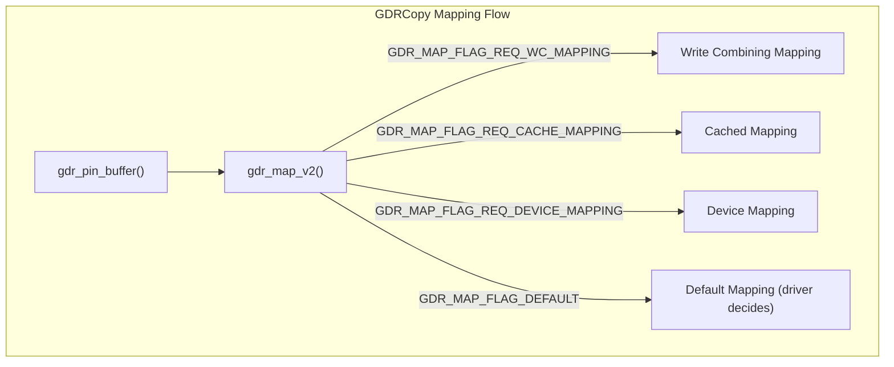
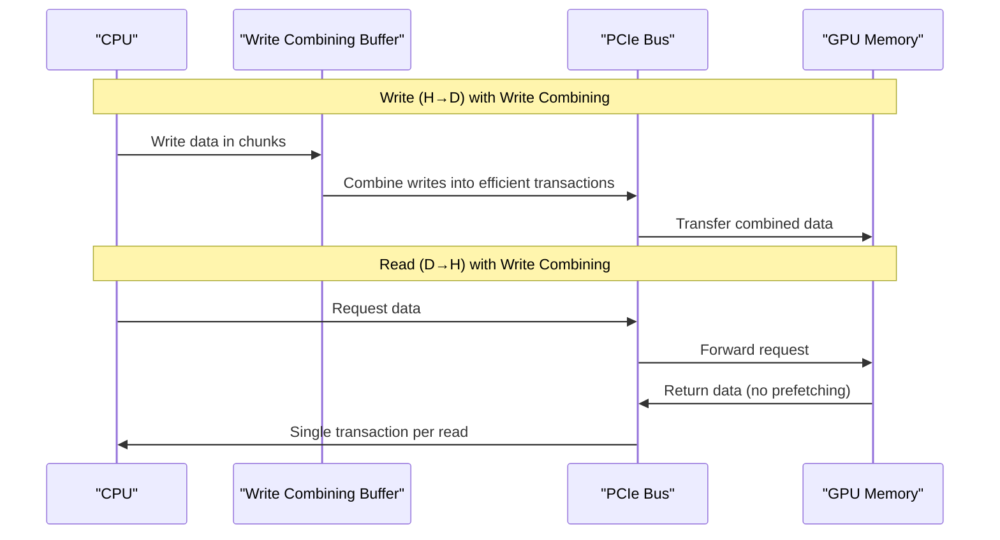
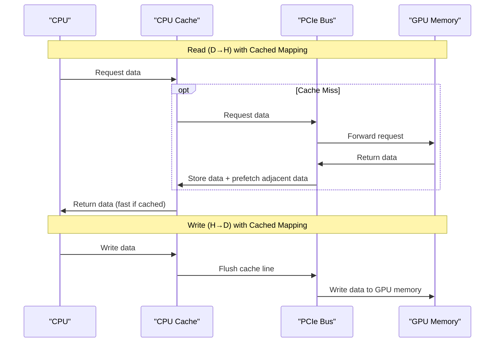
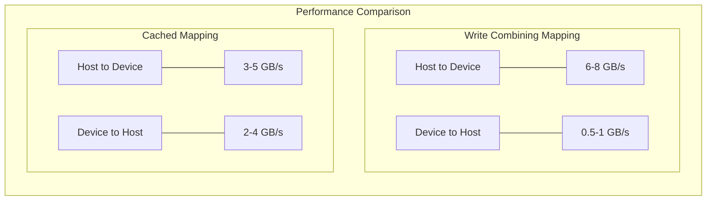
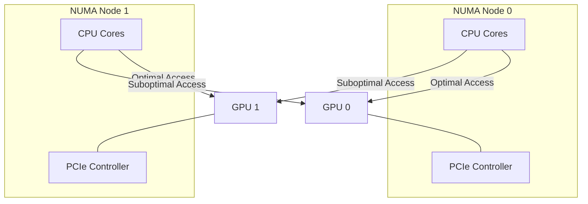
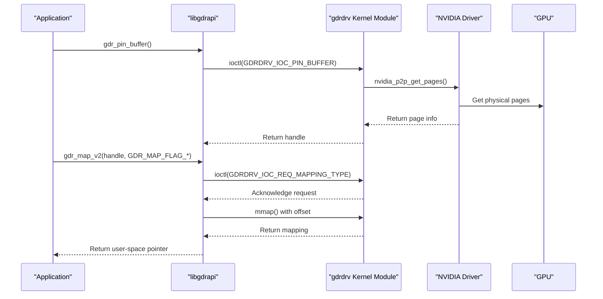
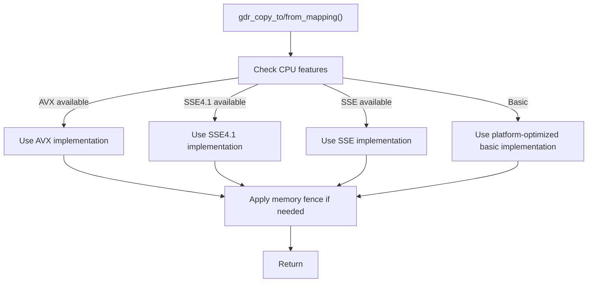
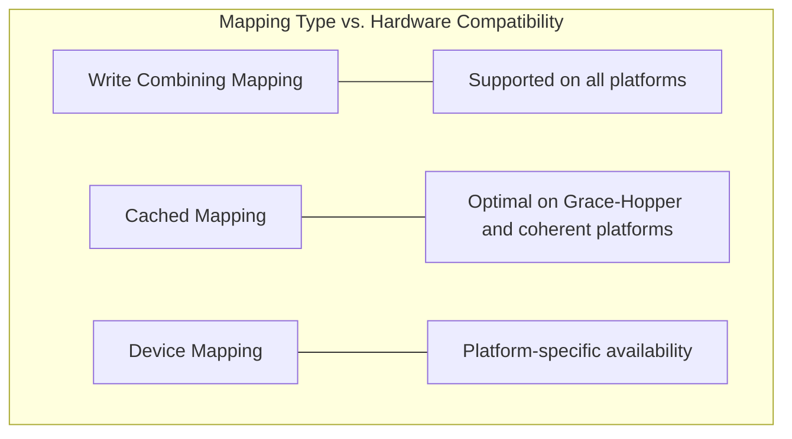

<!-- source: DeepWiki mcp.deepwiki.com · repo NVIDIA/gdrcopy · page 3.2 Memory Mapping Types · fetched 2026-11-11 -->

# Memory Mapping Types

<details>
<summary>Relevant source files</summary>

The following files were used as context for generating this wiki page:

- [README.md](README.md)
- [include/gdrapi.h](include/gdrapi.h)
- [packages/rhel/gdrcopy.service](packages/rhel/gdrcopy.service)
- [src/gdrapi.c](src/gdrapi.c)
- [tests/copylat.cpp](tests/copylat.cpp)

</details>


This page documents the different memory mapping types available in GDRCopy and their performance characteristics. These mapping types determine how CPU accesses GPU memory through the mappings created by the GDRCopy library. For general information about the GDRCopy API, see [API Reference](#3.1).

## Introduction to Memory Mapping Types

GDRCopy provides different memory mapping types that control how the CPU accesses GPU memory through PCI Express (PCIe). Each mapping type has specific performance characteristics, making some better for writes (host-to-device transfers) and others better for reads (device-to-host transfers).



Sources: [include/gdrapi.h:148-153](), [include/gdrapi.h:111-117](), [src/gdrapi.c:410-508]()

## Types of Memory Mappings

GDRCopy supports several memory mapping types, each designed for specific use cases:

### Write Combining (WC) Mapping

Write Combining mapping is optimized for host-to-device (CPU to GPU) transfers. It uses the x86 Write Combining feature (or equivalent on other architectures) to batch writes, reducing PCIe transaction overhead.

**Key characteristics:**
- Fast write performance (host-to-device)
- Relatively slow read performance (device-to-host)
- Does not use CPU cache for reading GPU memory
- Suitable for workloads dominated by writes to GPU



Sources: [README.md:30-35](), [src/gdrapi.c:800-870]()

### Cached Mapping

Cached mapping allows the CPU to cache the contents of GPU memory in the CPU cache hierarchy. This improves read performance but may introduce cache coherency issues.

**Key characteristics:**
- Medium write performance (host-to-device)
- Good read performance due to CPU prefetching
- Uses CPU cache for reading GPU memory
- Suitable for read-heavy workloads



Sources: [tests/copylat.cpp:254-257](), [src/gdrapi.c:872-929]()

### Device Mapping

Device mapping provides direct memory mapping specific to certain hardware platforms. Its performance characteristics depend on the underlying hardware.

**Key characteristics:**
- Performance varies by platform
- May have special hardware-specific optimizations
- Used for specific hardware configurations

Sources: [src/gdrapi.c:846-848](), [src/gdrapi.c:906-908]()

## Selecting a Mapping Type

You can select a mapping type when calling `gdr_map_v2()` by passing one of the following flags:

| Flag | Mapping Type | Description |
|------|--------------|-------------|
| `GDR_MAP_FLAG_REQ_WC_MAPPING` | Write Combining | Optimized for host-to-device transfers |
| `GDR_MAP_FLAG_REQ_CACHE_MAPPING` | Cached | Better balance between read and write performance |
| `GDR_MAP_FLAG_REQ_DEVICE_MAPPING` | Device | Platform-specific direct mapping |
| `GDR_MAP_FLAG_DEFAULT` | Default | Let the driver decide the optimal mapping |

Example usage:

```c
void *map_d_ptr = NULL;
// Request a write combining mapping
gdr_map_v2(g, mh, &map_d_ptr, size, GDR_MAP_FLAG_REQ_WC_MAPPING);
```

The mapping type can be verified by checking the `mapping_type` field in the information structure:

```c
gdr_info_t info;
gdr_get_info(g, mh, &info);
if (info.mapping_type == GDR_MAPPING_TYPE_WC) {
    // Using write combining mapping
}
```

Sources: [include/gdrapi.h:148-153](), [src/gdrapi.c:410-508]()

## Performance Characteristics

The different mapping types have significantly different performance characteristics, especially for read and write operations.

### Benchmark Results

Below is a typical performance comparison between the different memory mapping types:

| Operation | Mapping Type | Typical Bandwidth |
|-----------|--------------|-------------------|
| Write (H→D) | Write Combining | 6-8 GB/s |
| Read (D→H) | Write Combining | 0.5-1 GB/s |
| Write (H→D) | Cached | 3-5 GB/s |
| Read (D→H) | Cached | 2-4 GB/s |
| Write/Read | Device | Platform-dependent |



Sources: [README.md:30-35](), [README.md:224-302]()

### NUMA Effects

Performance of all mapping types can be affected by NUMA (Non-Uniform Memory Access) topology. If the CPU accessing the GPU memory is not on the same NUMA node as the PCIe controller connecting to the GPU, performance may be reduced.



To achieve the best performance, use `numactl` to bind the process to the same NUMA node as the GPU:

```bash
numactl -N 0 -l ./your_application  # For a GPU connected to NUMA node 0
```

Sources: [README.md:360-434]()

## Implementation Details

### Memory Mapping Process

The process of mapping GPU memory involves several steps:



Sources: [src/gdrapi.c:410-508]()

### Memory Copy Implementation

GDRCopy implements optimized memory copy functions for different architectures:

1. **X86 Architecture:**
   - Uses AVX, SSE, and SSE4.1 instructions when available
   - Different implementations for cached/uncached and read/write operations

2. **POWER Architecture:**
   - Specialized implementations optimized for the Power architecture
   - Uses different unroll strategies for better performance

3. **ARM64 Architecture:**
   - Architecture-specific memory operations
   - Custom memory barriers

The implementation automatically selects the most efficient method based on the CPU capabilities and mapping type:



Sources: [src/gdrapi.c:548-999]()

### Memory Fencing

Different memory mapping types require different memory fencing strategies:

- **Write Combining mapping:** Requires a `wc_store_fence()` after writes to ensure data is flushed
- **Mixed mapping types:** Uses a full `memory_fence()` to ensure proper ordering
- **Cached mapping:** May not require explicit fences for certain operations

Sources: [src/gdrapi.c:65-76](), [src/gdrapi.c:854-868](), [src/gdrapi.c:920-927]()

## Best Practices

To get the best performance from GDRCopy memory mappings:

1. **Choose the right mapping type:**
   - Use Write Combining for write-heavy workloads
   - Use Cached mapping for read-heavy workloads
   - Test Device mapping on specific platforms

2. **Mind NUMA topology:**
   - Use `numactl` to bind your process to the same NUMA node as the GPU
   - Performance can vary significantly across NUMA nodes

3. **Buffer alignment:**
   - Ensure buffers are aligned to GPU page boundaries (typically 64KB)
   - Unaligned accesses might cause performance issues

4. **Consider buffer size:**
   - Small transfers benefit more from GDRCopy compared to standard CUDA transfers
   - For large transfers, the initialization overhead becomes less significant

5. **Cold cache considerations:**
   - For cached mappings, be aware of cold cache effects
   - First access to GPU memory will be slower due to cache misses

Sources: [tests/copylat.cpp:252-257](), [README.md:439-458]()

## Mapping Type Compatibility

Not all mapping types may be available on all systems or GPU generations:



To get the string representation of a mapping type for debugging or logging:

```c
const char *mapping_type_str;
gdr_get_mapping_type_string(info.mapping_type, &mapping_type_str);
printf("Using mapping type: %s\n", mapping_type_str);
```

Sources: [src/gdrapi.c:1073-1092]()

---

