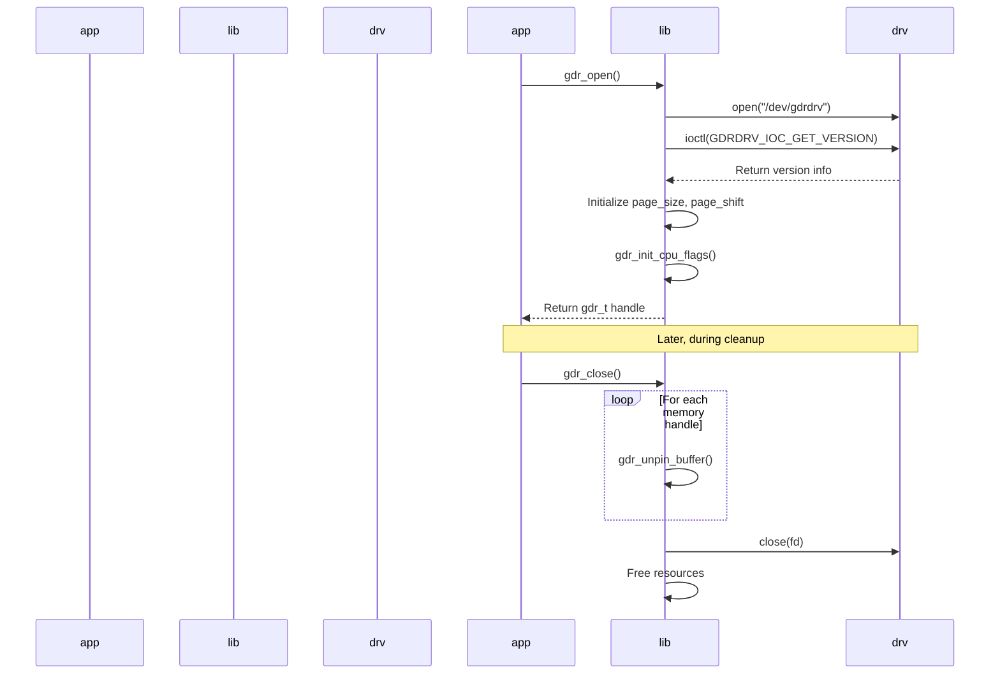
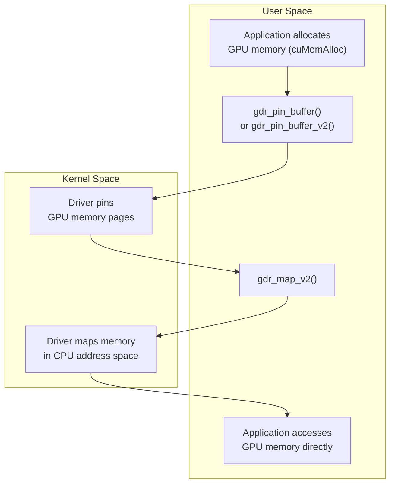
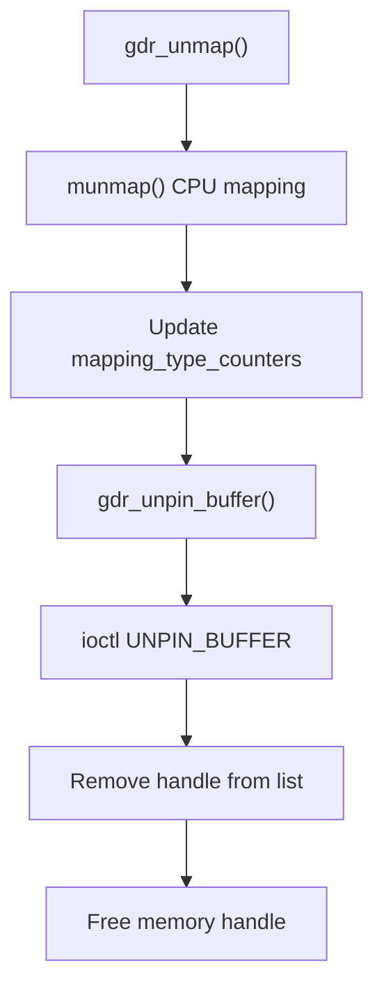
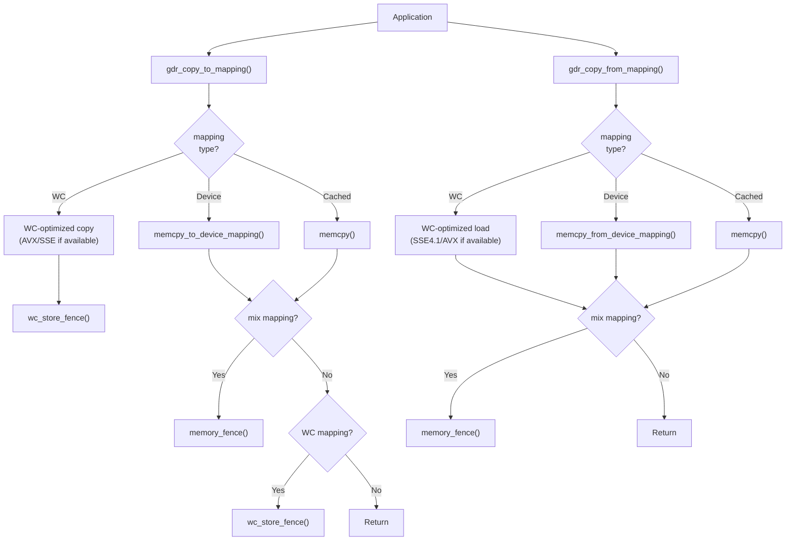
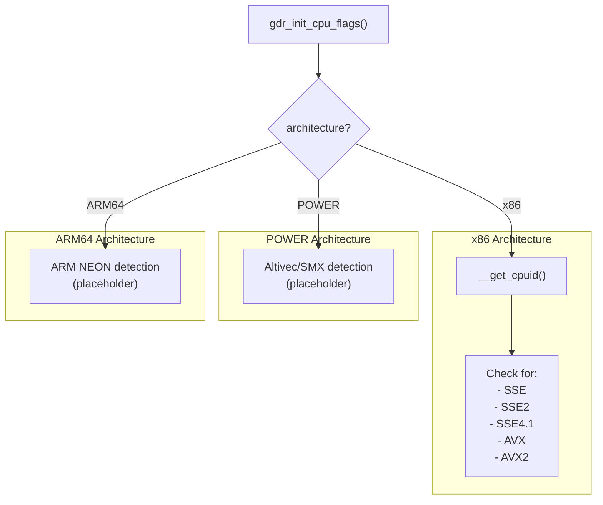
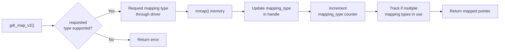
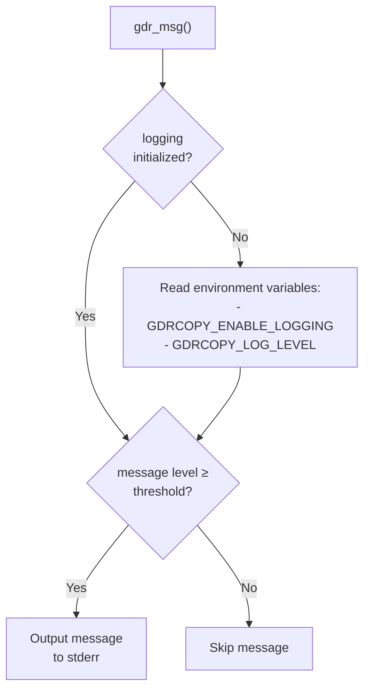

<!-- source: DeepWiki mcp.deepwiki.com · repo NVIDIA/gdrcopy · page 3.3 Library Internals · fetched 2026-11-11 -->

# Library Internals

<details>
<summary>Relevant source files</summary>

The following files were used as context for generating this wiki page:

- [insmod.sh](insmod.sh)
- [src/gdrapi.c](src/gdrapi.c)
- [src/gdrapi_internal.h](src/gdrapi_internal.h)

</details>


This page documents the internal implementation of the GDRCopy user-space library (libgdrapi) and its interaction with the kernel driver (gdrdrv). For information about the public API, see [API Reference](#3.1), and for details about the kernel driver implementation, see [Driver Internals](#2.1).

## Core Data Structures

The GDRCopy library uses two main data structures to manage GPU memory:

```mermaid
classDiagram
    class "gdr_t" {
        int fd
        linked_list memhs
        size_t page_size
        size_t page_mask
        uint8_t page_shift
        uint32_t gdrdrv_version
    }
    
    class "gdr_memh_t" {
        uint32_t handle
        LIST_ENTRY entries
        gdr_mapping_type_t mapping_type
    }
    
    "gdr_t" --> "gdr_memh_t" : contains list of
```

1. **GDR Context (`gdr_t`)**: Represents a connection to the GDRCopy driver
   - `fd`: File descriptor for the open driver device
   - `memhs`: Linked list of memory handles
   - `page_size`, `page_mask`, `page_shift`: Page-related information for memory operations
   - `gdrdrv_version`: Version of the kernel driver

2. **Memory Handle (`gdr_memh_t`)**: Represents a pinned GPU memory region
   - `handle`: Driver-assigned identifier
   - `entries`: Linked list entry for tracking in the GDR context
   - `mapping_type`: Type of CPU mapping (none, write combining, cached, device)

Sources: [src/gdrapi_internal.h:55-68]()

## Library Initialization Flow

The library follows a specific initialization and cleanup flow:



The initialization process in `gdr_open()` includes:
1. Memory allocation for the GDR context
2. Opening the driver device file `/dev/gdrdrv`
3. Checking the driver version compatibility
4. Detecting CPU features for optimized memory operations
5. Calculating page size parameters

During `gdr_close()`, the library:
1. Automatically unpins any remaining memory handles
2. Closes the driver connection
3. Frees allocated resources

Sources: [src/gdrapi.c:124-229]()

## Memory Management

### Pinning and Mapping

GDRCopy uses a two-step process to access GPU memory from the CPU:



The pinning process:
1. Creates a new memory handle object
2. Sends the GPU memory address to the driver via ioctl
3. The driver ensures the memory is resident and won't be swapped out
4. Adds the handle to the GDR context's linked list

The mapping process:
1. Checks if the memory handle is already mapped
2. Requests a specific mapping type (if supported by the driver)
3. Uses `mmap()` to map the memory region into the CPU address space
4. Verifies the mapping was successful
5. Updates the memory handle's mapping type

Sources: [src/gdrapi.c:231-301](), [src/gdrapi.c:410-513]()

### Unmapping and Unpinning



The cleanup process is the reverse of the setup:
1. Unmap the memory from CPU address space
2. Update the mapping type counters
3. Tell the driver to unpin the memory
4. Remove the handle from the linked list
5. Free the memory handle structure

Sources: [src/gdrapi.c:321-338](), [src/gdrapi.c:515-546]()

## Memory Copying Mechanisms

GDRCopy provides optimized functions for copying data between CPU and GPU memory:



Key aspects of the memory copying implementation:

1. **Platform-specific optimizations**:
   - x86: Uses AVX, SSE4.1, or SSE instructions if available
   - POWER: Optimized for the POWER architecture
   - ARM64: Basic implementation with proper memory barriers

2. **Mapping type handling**:
   - Write Combining (WC) mappings: Uses specialized copy functions
   - Device mappings: Uses aligned access functions to ensure correctness
   - Cached mappings: Uses standard memcpy

3. **Memory ordering**:
   - WC mappings require explicit store fences
   - Mixed mapping types require full memory fences
   - Tracks mapping types using global counters

Sources: [src/gdrapi.c:718-957]()

## CPU Feature Detection

The library detects CPU features to select the most efficient memory copy implementation:



The detected CPU features determine which memory copy implementation is used:
- For x86: AVX, SSE4.1, or SSE implementations
- For POWER: Custom unrolled implementations
- For ARM64: Generic implementations with proper memory barriers

Sources: [src/gdrapi.c:547-631]()

## Driver Interaction

The library interacts with the kernel driver through the following ioctl commands:

| IOCTL Command | Purpose | Data Structure |
|---------------|---------|----------------|
| `GDRDRV_IOC_GET_VERSION` | Get driver version | `GDRDRV_IOC_GET_VERSION_PARAMS` |
| `GDRDRV_IOC_PIN_BUFFER` | Pin GPU memory | `GDRDRV_IOC_PIN_BUFFER_PARAMS` |
| `GDRDRV_IOC_PIN_BUFFER_V2` | Pin GPU memory (v2) | `GDRDRV_IOC_PIN_BUFFER_V2_PARAMS` |
| `GDRDRV_IOC_UNPIN_BUFFER` | Unpin GPU memory | `GDRDRV_IOC_UNPIN_BUFFER_PARAMS` |
| `GDRDRV_IOC_GET_CB_FLAG` | Get callback flag | `GDRDRV_IOC_GET_CB_FLAG_PARAMS` |
| `GDRDRV_IOC_GET_INFO` | Get memory info | `GDRDRV_IOC_GET_INFO_PARAMS` |
| `GDRDRV_IOC_GET_INFO_V2` | Get memory info (v2) | `GDRDRV_IOC_GET_INFO_V2_PARAMS` |
| `GDRDRV_IOC_REQ_MAPPING_TYPE` | Request mapping type | `GDRDRV_IOC_REQ_MAPPING_TYPE_PARAMS` |

The library handles version compatibility by:
1. Checking the driver version during initialization
2. Using conditional logic to call the appropriate version of functions
3. Implementing fallbacks for older drivers when possible

Sources: [src/gdrapi.c:144-169](), [src/gdrapi.c:307-318](), [src/gdrapi.c:359-408](), [src/gdrapi.c:450-495]()

## Mapping Type Tracking

GDRCopy tracks the different mapping types used across all memory handles:



The library maintains counters for each mapping type to detect when multiple types are in use simultaneously. This information is used to determine the appropriate memory barriers when copying data:

- When using a single mapping type: Only requires type-specific fences (e.g., WC store fence)
- When using multiple mapping types: Requires full memory fences to ensure memory ordering

Sources: [src/gdrapi.c:63-77](), [src/gdrapi.c:856-869](), [src/gdrapi.c:920-927]()

## Logging and Debugging

The library includes a flexible logging system:



Logging levels:
- DEBUG: Detailed debugging information
- INFO: Informational messages
- WARN: Warning conditions
- ERROR: Error conditions

The logging behavior can be controlled through environment variables:
- `GDRCOPY_ENABLE_LOGGING`: Enable or disable logging
- `GDRCOPY_LOG_LEVEL`: Set the minimum logging level

Sources: [src/gdrapi.c:53-105]()

---

