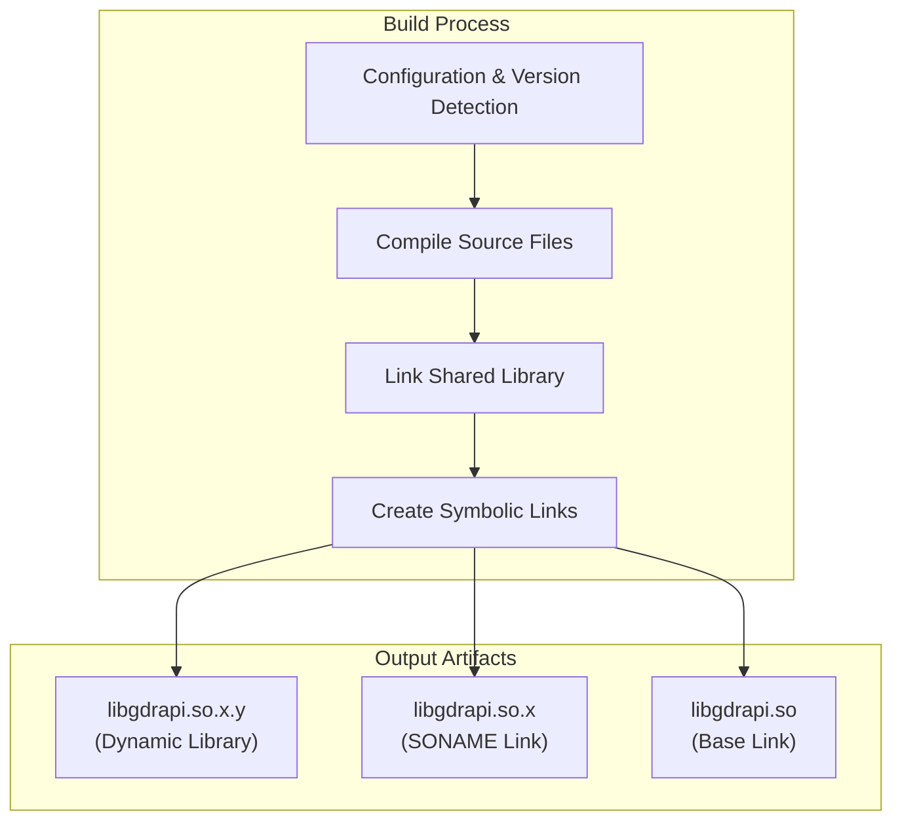
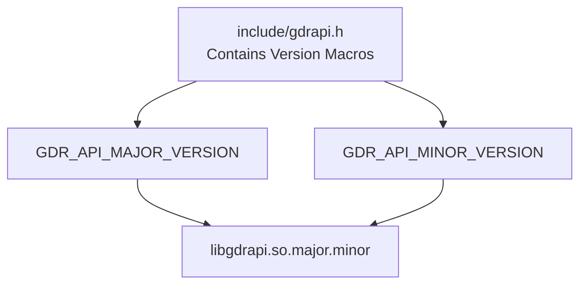
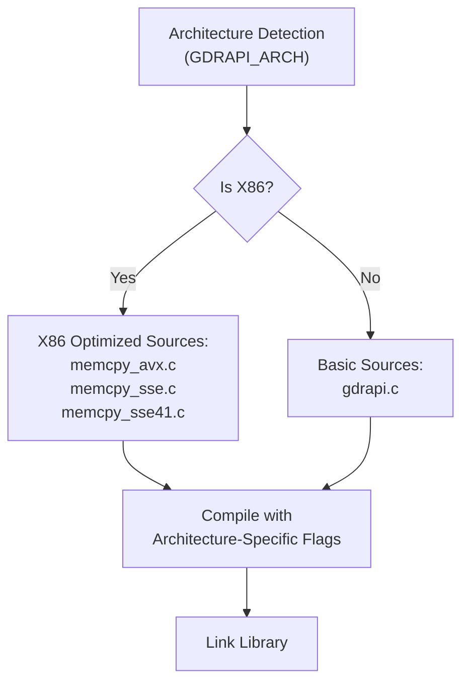
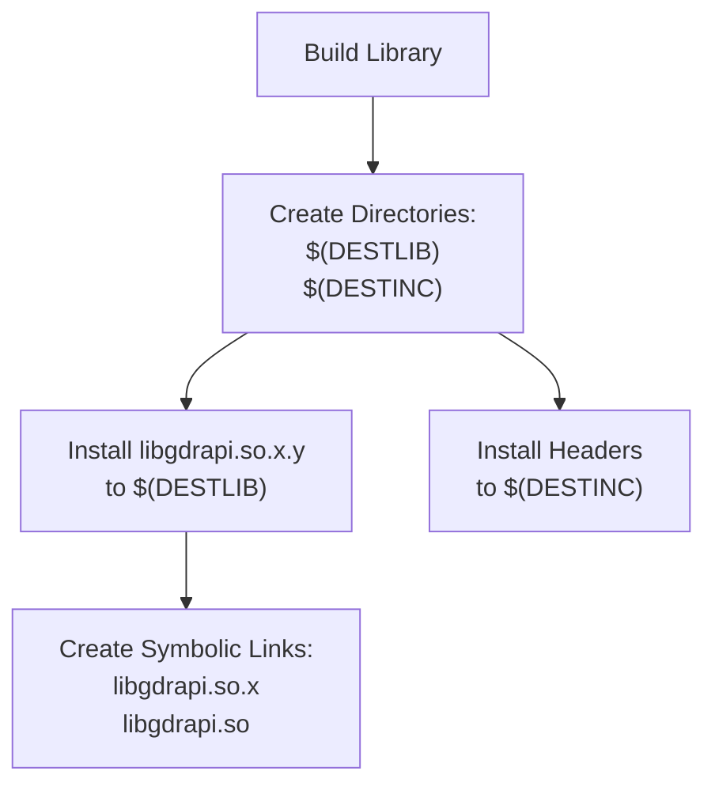

<!-- source: DeepWiki mcp.deepwiki.com · repo NVIDIA/gdrcopy · page 3.4 Building the Library · fetched 2026-11-11 -->

# Building the Library

<details>
<summary>Relevant source files</summary>

The following files were used as context for generating this wiki page:

- [.gitignore](.gitignore)
- [Makefile](Makefile)
- [src/Makefile](src/Makefile)

</details>


This page provides detailed instructions for building the GDRCopy user-space library (`libgdrapi`). For information about building the kernel driver component, see [Building the Driver](#2.3).

## Overview

The GDRCopy library (`libgdrapi`) is the user-space component that provides the API for applications to perform efficient GPU-CPU data transfers. Building the library creates the shared library files that applications can link against to use GDRCopy functionality.



Sources: [Makefile:57-62](). [src/Makefile:58-62]()

## Prerequisites

Before building the library, ensure you have the following:

1. GCC compiler and standard development tools
2. Development headers for your system
3. Libraries for threading (`pthread`) and dynamic loading (`dl`)

## Build Configuration Options

The build process can be customized with several environment variables:

| Variable | Description | Default |
|----------|-------------|---------|
| `prefix` | Installation prefix | `/usr/local` |
| `exec_prefix` | Executable installation prefix | `$(prefix)` |
| `libdir` | Library installation directory | `$(exec_prefix)/lib` |
| `includedir` | Header files installation directory | `$(prefix)/include` |
| `DESTDIR` | Root directory for installation (for packaging) | Empty |
| `GDRAPI_ARCH` | Target architecture (detected automatically) | Result of `./config_arch` |

Sources: [Makefile:21-37](). [src/Makefile:24-25]()

## Library Versioning

The library uses semantic versioning derived from the header file:



The version is automatically extracted from the header file during the build process:

| Library Artifact | Naming Convention | Example |
|------------------|-------------------|---------|
| Dynamic Library | `libgdrapi.so.$(LIB_MAJOR_VER).$(LIB_MINOR_VER)` | `libgdrapi.so.2.3` |
| SONAME Link | `libgdrapi.so.$(LIB_MAJOR_VER)` | `libgdrapi.so.2` |
| Base Link | `libgdrapi.so` | `libgdrapi.so` |

Sources: [Makefile:34-43](). [src/Makefile:21-38]()

## Building the Library

### Basic Build

To build the library with default settings, simply run:

```bash
make lib
```

This will:
1. Detect the architecture using `./config_arch`
2. Extract library version from header files
3. Compile the source files with appropriate flags
4. Create the shared library and symbolic links

### Architecture-Specific Optimizations

On x86 architectures, the library automatically includes specialized memory copy implementations:

| Source File | Optimization | Compiler Flag |
|-------------|--------------|---------------|
| `memcpy_avx.c` | AVX instructions | `-mavx` |
| `memcpy_sse.c` | SSE instructions | `-msse` |
| `memcpy_sse41.c` | SSE 4.1 instructions | `-msse4.1` |

These optimized implementations are conditionally included based on the detected architecture:



Sources: [src/Makefile:40-43](). [src/Makefile:65-72]()

## Installing the Library

After building the library, you can install it with:

```bash
make lib_install
```

This will:
1. Create the necessary installation directories
2. Install the dynamic library in `$(DESTLIB)`
3. Install the header files in `$(DESTINC)`
4. Create the required symbolic links

You can customize installation paths using the variables described in the configuration section.



Sources: [Makefile:67-75]()

## Building the Complete GDRCopy System

To build both the library and other components of GDRCopy:

| Target | Command | Description |
|--------|---------|-------------|
| Everything | `make all` | Builds configuration, driver, library and tests |
| Library Only | `make lib` | Builds only the library |
| Driver | `make driver` | Builds only the kernel driver |
| Examples/Tests | `make exes` | Builds example programs (requires library) |
| Install All | `make install` | Installs library and executables |
| Clean | `make clean` | Removes build artifacts |

Sources: [Makefile:45-93]()

## Troubleshooting

Common issues when building the library:

1. **Missing dependencies**: Ensure you have all required development packages installed
2. **Architecture detection failure**: If `./config_arch` fails, you can set `GDRAPI_ARCH` manually
3. **Installation permission issues**: Use `sudo` for system-wide installation or set custom paths with `prefix`

For advanced installation methods including package-based installation, refer to [Installation](#4) and its subsections.

---

