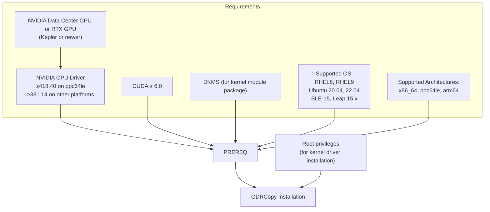
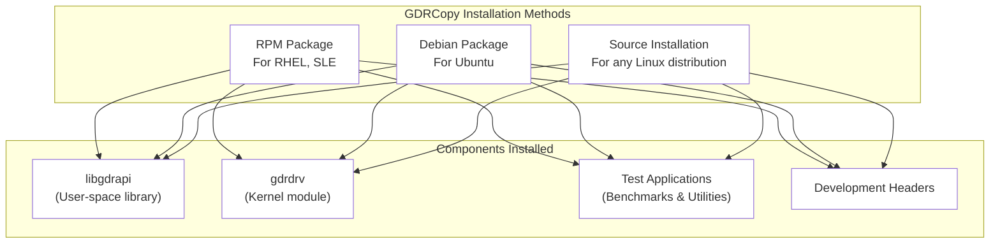
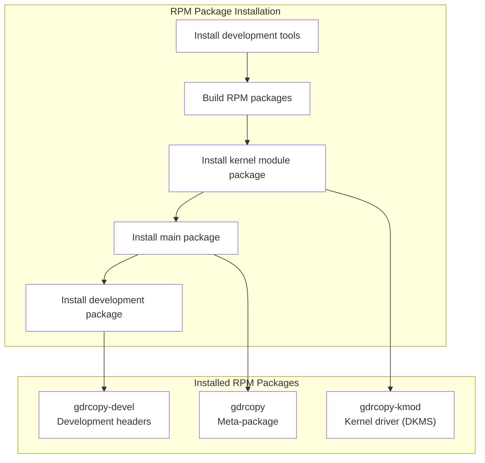
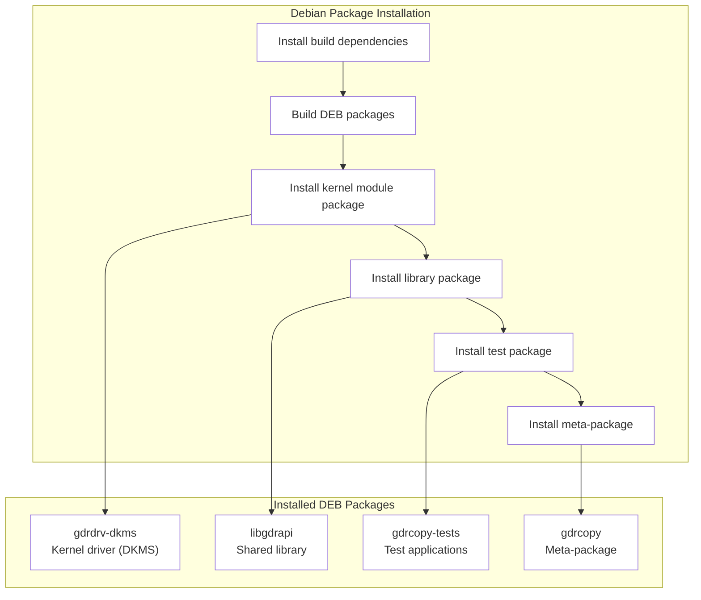
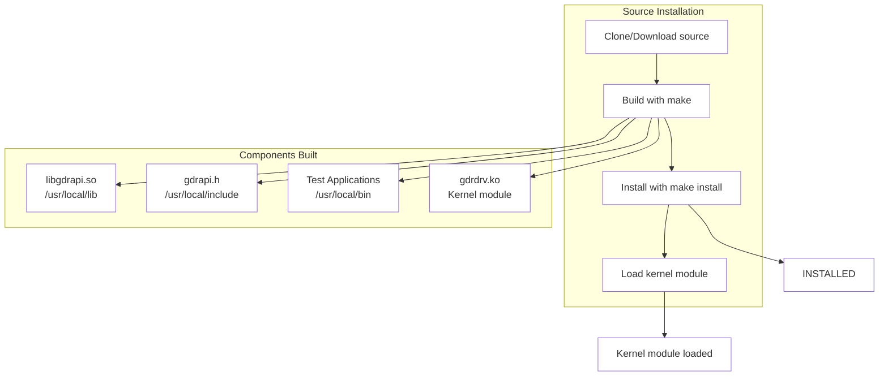
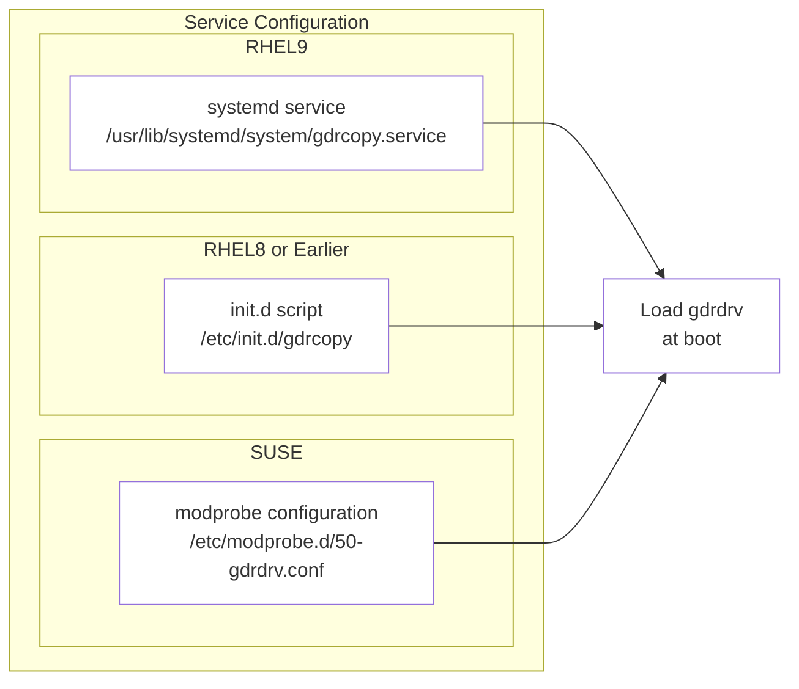

<!-- source: DeepWiki mcp.deepwiki.com · repo NVIDIA/gdrcopy · page 4 Installation · fetched 2026-11-11 -->

# Installation

<details>
<summary>Relevant source files</summary>

The following files were used as context for generating this wiki page:

- [README.md](README.md)
- [packages/build-deb-packages.sh](packages/build-deb-packages.sh)
- [packages/debian-tests/rules](packages/debian-tests/rules)
- [packages/dkms/debian/postinst](packages/dkms/debian/postinst)
- [packages/gdrcopy.spec](packages/gdrcopy.spec)
- [packages/rhel/gdrcopy.service](packages/rhel/gdrcopy.service)
- [tests/copylat.cpp](tests/copylat.cpp)

</details>


This page provides comprehensive instructions for installing GDRCopy on supported platforms. GDRCopy installation includes three main components: the user-space library (`libgdrapi`), the kernel-mode driver (`gdrdrv`), and test/benchmark applications. For information about GDRCopy's architecture, see [Architecture](#1.1).

## Prerequisites

Before installing GDRCopy, ensure your system meets the following requirements:



Sources: [README.md:44-87]()

### Required Packages

Install these prerequisite packages before proceeding:

#### For RHEL/SLE:
```bash
# On RHEL
sudo yum install dkms
# On SLE/Leap
sudo zypper install dkms rpmbuild
```

#### For Debian/Ubuntu:
```bash
sudo apt install build-essential devscripts debhelper fakeroot pkg-config dkms
```

### NVIDIA Driver Headers

The NVIDIA driver headers must be installed. These are usually included with the driver installation from the NVIDIA runfile, but if you installed via package management:

```bash
# On RHEL
sudo dnf module install nvidia-driver:latest-dkms
# On Debian/Ubuntu
sudo apt install nvidia-dkms-<your-nvidia-driver-version>
# On SLE
sudo zypper install nvidia-gfx<your-nvidia-driver-version>-kmp
```

## Installation Methods

GDRCopy can be installed using three different methods:



Sources: [README.md:89-91]()

### RPM Package Installation

The RPM installation method is recommended for RHEL and SLE/Leap systems.



#### Installation Steps:

1. Install development tools:
   ```bash
   # For RHEL:
   sudo yum groupinstall 'Development Tools'
   sudo yum install dkms rpm-build make

   # For SLE:
   sudo zypper in dkms rpmbuild
   ```

2. Build and install RPM packages:
   ```bash
   cd packages
   CUDA=<cuda-install-top-dir> ./build-rpm-packages.sh
   sudo rpm -Uvh gdrcopy-kmod-<version>dkms.noarch.<platform>.rpm
   sudo rpm -Uvh gdrcopy-<version>.<arch>.<platform>.rpm
   sudo rpm -Uvh gdrcopy-devel-<version>.noarch.<platform>.rpm
   ```

3. Verify installation:
   ```bash
   # Check if the module is loaded
   lsmod | grep gdrdrv
   # Run a sanity test
   gdrcopy_sanity
   ```

#### Notes for RPM Installation:

- By default, `build-rpm-packages.sh` generates a DKMS package for the kernel module.
- To create a prebuilt kernel module package instead of DKMS, use the `-m` option with `build-rpm-packages.sh`.
- On SLE, you may need to set `allow_unsupported_modules 1` in `/etc/modprobe.d/unsupported-modules` to allow loading third-party modules.

Sources: [README.md:93-114](), [packages/gdrcopy.spec:12-140]()

### Debian Package Installation

The Debian installation method is recommended for Ubuntu systems.



#### Installation Steps:

1. Install build dependencies:
   ```bash
   sudo apt install build-essential devscripts debhelper fakeroot pkg-config dkms
   ```

2. Build and install Debian packages:
   ```bash
   cd packages
   CUDA=<cuda-install-top-dir> ./build-deb-packages.sh
   sudo dpkg -i gdrdrv-dkms_<version>_<arch>.<platform>.deb
   sudo dpkg -i libgdrapi_<version>_<arch>.<platform>.deb
   sudo dpkg -i gdrcopy-tests_<version>_<arch>.<platform>.deb
   sudo dpkg -i gdrcopy_<version>_<arch>.<platform>.deb
   ```

3. Verify installation:
   ```bash
   # Check if the module is loaded
   lsmod | grep gdrdrv
   # Run a sanity test
   gdrcopy_sanity
   ```

#### Notes for Debian Installation:

- The `build-deb-packages.sh` script has several options:
  - `-d`: Skip build dependency checks
  - `-t`: Skip building the gdrcopy-tests package
  - `-k`: Skip building the gdrdrv-dkms package

Sources: [README.md:116-126](), [packages/build-deb-packages.sh:49-60]()

### Installation from Source

Building from source allows installation on any supported Linux distribution.



#### Installation Steps:

1. Download and extract the source code:
   ```bash
   git clone https://github.com/NVIDIA/gdrcopy.git
   cd gdrcopy
   ```

2. Build and install:
   ```bash
   make prefix=<install-to-this-location> CUDA=<cuda-install-top-dir> all install
   sudo ./insmod.sh
   ```

3. Verify installation:
   ```bash
   # Check if the module is loaded
   lsmod | grep gdrdrv
   # Run a sanity test
   <install-location>/bin/gdrcopy_sanity
   ```

#### Notes for Source Installation:

- By default, GDRCopy will be installed to `/usr/local` if no prefix is specified.
- The `insmod.sh` script automates the loading of the kernel module.
- When compiling the kernel driver (`gdrdrv`), the build system will automatically try to find the NVIDIA driver source code at `/usr/src/nvidia-<version>`.
- You can specify the path manually using the `NVIDIA_SRC_DIR` environment variable:
  ```bash
  export NVIDIA_SRC_DIR=/usr/src/nvidia-520.61.05/nvidia
  ```

Sources: [README.md:128-152]()

## NVIDIA Driver Flavors and Compatibility

GDRCopy supports two major flavors of NVIDIA drivers:

| Driver Flavor | Features and Restrictions |
|---------------|---------------------------|
| Proprietary | - Can be loaded with any NVIDIA driver<br>- May have suboptimal performance on coherent platforms (Grace-Hopper)<br>- Does not work correctly on Intel CPUs with Linux kernel built with confidential compute (CC) support |
| Open Source | - Provides full functionality and high performance on all platforms<br>- Cannot be loaded when the proprietary NVIDIA driver is loaded |

Sources: [README.md:137-152]()

## Service Configuration

After installation, GDRCopy will configure a service that loads the kernel module at boot:



For RHEL9, the service is managed with systemd:
```bash
# Enable and start the service
sudo systemctl enable gdrcopy
sudo systemctl start gdrcopy

# Check service status
sudo systemctl status gdrcopy
```

For RHEL8 or earlier, the service is managed with the traditional init system:
```bash
# Start the service
sudo service gdrcopy start

# Check if module is loaded
lsmod | grep gdrdrv
```

For SUSE, the module is loaded through modprobe configuration.

Sources: [packages/gdrcopy.spec:187-212](), [packages/rhel/gdrcopy.service:1-14]()

## Troubleshooting Installation Issues

### Common Issues and Solutions

1. **Module not loading after installation**:
   - Check kernel logs: `dmesg | grep gdrdrv`
   - Verify NVIDIA driver is loaded: `lsmod | grep nvidia`
   - Ensure NVIDIA driver version meets minimum requirements

2. **Build errors related to NVIDIA driver source**:
   - Set the correct NVIDIA source directory:
     ```bash
     export NVIDIA_SRC_DIR=/usr/src/nvidia-<your-driver-version>/nvidia
     ```

3. **Permission issues with device file**:
   - Check if `/dev/gdrdrv` has the correct permissions
   - Add your user to the appropriate group (usually "video")

4. **Conflicts with existing NVIDIA installations**:
   - If you compiled with the opensource flavor but have the proprietary driver loaded, you'll need to recompile

5. **Test applications fail**:
   - Verify CUDA installation: `nvcc --version`
   - Check GPU visibility: `nvidia-smi`
   - Make sure libraries are in the search path: `ldconfig -p | grep gdrapi`

### Verifying Installation

To verify a successful installation, run the sanity test:

```bash
gdrcopy_sanity
```

A successful output will show a series of passed tests without failures.

You can also check the bandwidth performance with:

```bash
gdrcopy_copybw
```

And latency with:

```bash
gdrcopy_copylat
```

Sources: [README.md:154-190](), [tests/copylat.cpp:63-78]()

## Uninstallation

To uninstall GDRCopy:

### RPM Packages
```bash
sudo rpm -e gdrcopy-devel gdrcopy gdrcopy-kmod
```

### Debian Packages
```bash
sudo dpkg -r gdrcopy gdrcopy-tests libgdrapi gdrdrv-dkms
```

### Source Installation
```bash
# Stop the module
sudo rmmod gdrdrv
# Remove files from installation directory
sudo rm -f <install-location>/lib/libgdrapi.so*
sudo rm -f <install-location>/include/gdrapi.h
sudo rm -f <install-location>/include/gdrconfig.h
sudo rm -f <install-location>/bin/gdrcopy_*
```

Sources: [packages/gdrcopy.spec:239-251]()

---

