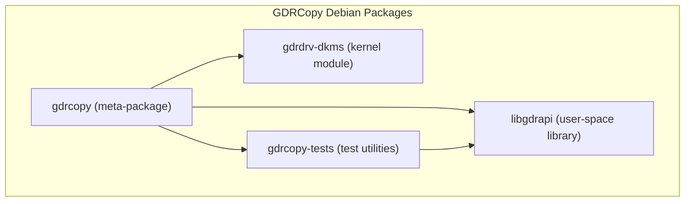
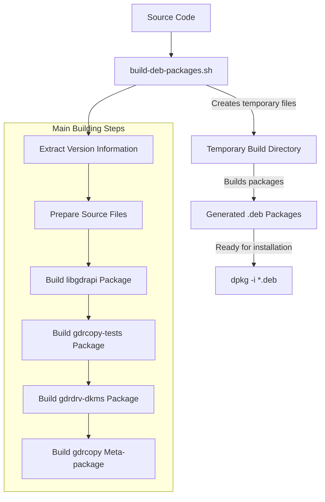

<!-- source: DeepWiki mcp.deepwiki.com · repo NVIDIA/gdrcopy · page 4.2 Debian Installation · fetched 2026-11-11 -->

# Debian Installation

<details>
<summary>Relevant source files</summary>

The following files were used as context for generating this wiki page:

- [packages/build-deb-packages.sh](packages/build-deb-packages.sh)
- [packages/debian-lib/control](packages/debian-lib/control)
- [packages/debian-tests/control](packages/debian-tests/control)
- [packages/dkms/debian/changelog](packages/dkms/debian/changelog)
- [packages/dkms/debian/postinst](packages/dkms/debian/postinst)

</details>


This page provides instructions for installing GDRCopy on Debian-based systems (including Ubuntu). It covers both installing pre-built Debian packages and building the packages from source code. For installation using RPM packages, see [RPM Installation](#4.1).

## Package Structure

GDRCopy is distributed as a set of Debian packages, each serving a specific function in the system:

- **libgdrapi** - The core user-space library that provides the GDRCopy API
- **gdrdrv-dkms** - The kernel module packaged as a DKMS module
- **gdrcopy-tests** - Test and benchmark utilities for verifying functionality
- **gdrcopy** - A meta-package that depends on all the above components

### Package Relationships Diagram



Sources: [packages/debian-lib/control](), [packages/debian-tests/control](), [packages/build-deb-packages.sh]()

## Installation Prerequisites

Before installing GDRCopy, ensure your system meets these requirements:

1. A compatible NVIDIA GPU with the NVIDIA driver installed
2. CUDA Toolkit (required for running tests and benchmarks)
3. Required build tools if building from source:
   - `build-essential`
   - `dkms` (Dynamic Kernel Module Support)
   - `debhelper`

## Installation Methods

### Method 1: Installing Pre-built Packages

If you have pre-built Debian packages (`.deb` files), you can install them directly:

```bash
# Install the kernel module first
sudo dpkg -i gdrdrv-dkms_<version>.deb

# Install the library and tests
sudo dpkg -i libgdrapi_<version>.deb
sudo dpkg -i gdrcopy-tests_<version>.deb

# Or simply install the meta-package which depends on all components
sudo dpkg -i gdrcopy_<version>.deb
```

If you encounter dependency errors, you can resolve them with:

```bash
sudo apt-get install -f
```

### Method 2: Building and Installing from Source

#### Debian Package Building Process



Sources: [packages/build-deb-packages.sh:22-105]()

To build and install GDRCopy from source:

1. Clone the repository and navigate to it:
   ```bash
   git clone https://github.com/NVIDIA/gdrcopy.git
   cd gdrcopy
   ```

2. Run the Debian package build script:
   ```bash
   CUDA=/path/to/cuda ./packages/build-deb-packages.sh
   ```
   
   The script supports several options:
   - `-d`: Skip build dependency checks
   - `-t`: Skip building the gdrcopy-tests package
   - `-k`: Skip building the gdrdrv-dkms package
   - `-h`: Show help text

3. Install the generated packages:
   ```bash
   sudo dpkg -i *.deb
   sudo apt-get install -f  # Fix any dependencies if needed
   ```

Sources: [packages/build-deb-packages.sh:49-59]()

## Package Details

### libgdrapi Package

This package contains the user-space library that provides the GDRCopy API. It includes:

- Shared library files (`libgdrapi.so`) 
- Development headers
- pkg-config files

The library provides the interface between user applications and the kernel module.

Sources: [packages/debian-lib/control:12-19]()

### gdrdrv-dkms Package

The kernel module is packaged using the Dynamic Kernel Module Support (DKMS) framework, which automatically rebuilds the module when the kernel is updated.

Upon installation, the DKMS package:
1. Copies the module source to `/usr/src/gdrdrv-<version>/`
2. Builds the module for the current kernel
3. Installs the built module
4. Sets up automatic rebuilding for kernel updates

Sources: [packages/dkms/debian/postinst:9-28]()

### gdrcopy-tests Package

This package contains test utilities for verifying GDRCopy functionality:

- `gdrcopy_sanity`: Basic functionality test
- `gdrcopy_copybw`: Bandwidth measurement tool
- `gdrcopy_copylat`: Latency measurement tool
- `gdrcopy_pplat`: Pin & copy latency measurement

These tests require CUDA and the NVIDIA driver to be installed.

Sources: [packages/debian-tests/control:12-18]()

### gdrcopy Meta-Package

This is a virtual package that depends on all the component packages. Installing this package will ensure all required components are installed.

## Post-Installation Steps

After installing the packages, the kernel module should be loaded automatically. If not, you can load it manually:

```bash
sudo modprobe gdrdrv
```

Verify that the module is loaded:

```bash
lsmod | grep gdrdrv
```

Check that the device node is created:

```bash
ls -l /dev/gdrdrv
```

## Version and Changelog Information

The GDRCopy Debian packages follow a version numbering scheme with format `MAJOR.MINOR-DEBIAN_VERSION`. The current version information is extracted from the source files during package building:

- Major version from `GDR_API_MAJOR_VERSION` in `include/gdrapi.h`
- Minor version from `GDR_API_MINOR_VERSION` in `include/gdrapi.h`
- Debian version is set in the build script

Sources: [packages/build-deb-packages.sh:97-104](), [packages/dkms/debian/changelog:1-91]()

## Troubleshooting

### Common Issues

1. **Missing CUDA installation**:
   If building the test package fails with "CUDA environment variable is not defined", ensure you have:
   - CUDA installed
   - Specified the CUDA path: `CUDA=/path/to/cuda ./packages/build-deb-packages.sh`

2. **Module build failures**:
   If the kernel module fails to build after installation:
   ```bash
   sudo dkms status
   sudo dkms build gdrdrv/<version>
   sudo dkms install gdrdrv/<version>
   ```

3. **Permission issues with /dev/gdrdrv**:
   Ensure your user has permissions to access the device:
   ```bash
   sudo chmod 666 /dev/gdrdrv  # Or add your user to the appropriate group
   ```

### Checking Installation Status

To verify all components are properly installed:

```bash
dpkg -l | grep -E 'gdrcopy|gdrdrv|libgdrapi'
```

All packages should show `ii` status in the output.

---

