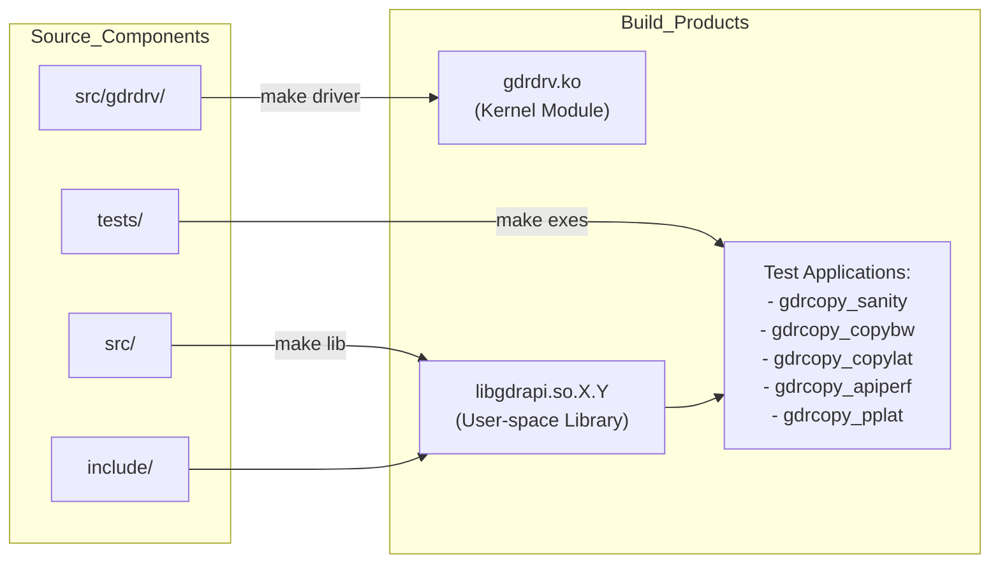

<!-- source: DeepWiki mcp.deepwiki.com · repo NVIDIA/gdrcopy · page 4.3 Source Installation · fetched 2026-11-11 -->

# Source Installation

<details>
<summary>Relevant source files</summary>

The following files were used as context for generating this wiki page:

- [Makefile](Makefile)
- [README.md](README.md)
- [packages/rhel/gdrcopy.service](packages/rhel/gdrcopy.service)
- [scripts/test_gdrdrv_HAVE_VM_FLAGS_SET.sh](scripts/test_gdrdrv_HAVE_VM_FLAGS_SET.sh)
- [src/gdrdrv/Makefile](src/gdrdrv/Makefile)
- [tests/copylat.cpp](tests/copylat.cpp)

</details>


This page provides step-by-step instructions for building and installing GDRCopy from source code. For package-based installation methods, see [RPM Installation](#4.1) or [Debian Installation](#4.2).

## Prerequisites

Before installing GDRCopy from source, ensure your system meets the following requirements:

| Component | Requirement |
|-----------|-------------|
| Hardware | NVIDIA Data Center GPU or NVIDIA RTX GPU (formerly Tesla and Quadro) based on Kepler or newer |
| GPU Driver | ≥ 418.40 on ppc64le and ≥ 331.14 on other platforms |
| CUDA | ≥ 6.0 |
| Architecture | Linux x86_64, ppc64le, or arm64 |
| Platforms | RHEL8, RHEL9, Ubuntu20_04, Ubuntu22_04, SLE-15 (any SP), Leap 15.x |

Additionally, you need:

- NVIDIA driver source code (typically found at `/usr/src/nvidia-<version>`)
- Root privileges (for loading the kernel module)
- Build tools (gcc, make)

Sources: [README.md:44-86]()

## Installation Workflow

```mermaid
flowchart TD
    subgraph "1_Requirements"
        prereq["Check Prerequisites"]
        nv_src["Locate NVIDIA Driver Sources"]
        cuda_path["Identify CUDA Path"]
    end
    
    subgraph "2_Build_Process"
        make_all["make all"]
        make_all --> make_config["make config"]
        make_all --> make_driver["make driver"]
        make_all --> make_lib["make lib"]
        make_all --> make_exes["make exes"]
    end
    
    subgraph "3_Installation"
        make_install["make install"]
        make_install --> lib_install["lib_install"]
        make_install --> exes_install["exes_install"]
        drv_install["make drv_install"]
        load_mod["Load Kernel Module (insmod.sh)"]
    end
    
    prereq --> nv_src
    prereq --> cuda_path
    nv_src --> make_driver
    cuda_path --> make_exes
    "1_Requirements" --> "2_Build_Process"
    "2_Build_Process" --> "3_Installation"
```

Sources: [Makefile:45-93](), [README.md:128-134]()

## Source Components and Build Products



Sources: [Makefile:44-93](), [README.md:17-42]()

## Step-by-Step Installation

### 1. Clone the Repository (if needed)

```bash
git clone https://github.com/NVIDIA/gdrcopy.git
cd gdrcopy
```

### 2. Building from Source

The main build command combines building the kernel module, library, and test applications:

```bash
make prefix=<install-to-this-location> CUDA=<cuda-install-top-dir> all
```

Where:
- `prefix`: Specifies the installation directory (default: `/usr/local`)
- `CUDA`: Path to your CUDA installation (default: `/usr/local/cuda`)

You can also build components individually:

```bash
# Build only the kernel driver
make driver

# Build only the library
make lib

# Build only the test applications
make exes
```

Sources: [Makefile:45-63](), [README.md:128-130]()

### 3. Installing Components

```bash
# Install library and test executables
make prefix=<install-to-this-location> install

# Install the kernel driver (requires root privileges)
sudo make drv_install
```

The `install` target installs both the library and test executables. It:
- Creates needed directories
- Installs library files to `$(prefix)/lib`
- Installs header files to `$(prefix)/include`
- Installs executables to `$(prefix)/bin`

Sources: [Makefile:65-83](), [README.md:131-133]()

### 4. Loading the Kernel Module

After installation, load the kernel module with:

```bash
sudo ./insmod.sh
```

This script loads the `gdrdrv` kernel module, which provides the necessary kernel-level functionality for GDRCopy.

Sources: [README.md:134]()

## Build System Details

### Makefile Hierarchy

GDRCopy's build system is organized as follows:

| Makefile | Purpose |
|----------|---------|
| `/Makefile` | Main makefile that coordinates the build process |
| `/src/gdrdrv/Makefile` | Builds the kernel driver module |
| `/src/Makefile` | Builds the libgdrapi shared library |
| `/tests/Makefile` | Builds the test applications |

### Driver Compilation Notes

When compiling the kernel driver (`gdrdrv`), the build system:

1. Automatically detects the NVIDIA driver source code location
2. Determines whether the NVIDIA driver is open-source or proprietary
3. Sets appropriate compiler flags based on platform characteristics

You can specify the NVIDIA driver source directory explicitly with:

```bash
export NVIDIA_SRC_DIR=/usr/src/nvidia-520.61.05/nvidia
make driver
```

Sources: [src/gdrdrv/Makefile:21-66](), [README.md:137-151]()

### NVIDIA Driver Flavor Considerations

There are two major flavors of NVIDIA driver, with different features and restrictions:

| Driver Flavor | Features | Limitations |
|---------------|----------|-------------|
| **Open-source** | - Full functionality<br>- High performance on all platforms | Cannot be loaded when proprietary NVIDIA driver is loaded |
| **Proprietary** | - Compatible with both proprietary and open-source NVIDIA drivers | - Suboptimal performance on coherent platforms (e.g., Grace-Hopper)<br>- Doesn't work on Intel CPUs with Linux kernel built with confidential compute support |

The build system automatically detects the driver flavor based on the source code.

Sources: [README.md:142-151](), [src/gdrdrv/Makefile:29-32]()

## Verifying the Installation

After installation, you can verify that GDRCopy works correctly by running the included tests:

```bash
# Basic sanity test
gdrcopy_sanity

# Bandwidth test
gdrcopy_copybw

# Latency test
gdrcopy_copylat
```

The tests will output detailed information about the functionality and performance of GDRCopy on your system.

Sources: [README.md:154-306]()

## Troubleshooting

### Common Issues

1. **NVIDIA Driver Source Not Found**: 
   - Ensure NVIDIA driver is installed
   - Check if the driver source is available at `/usr/src/nvidia-*`
   - Set `NVIDIA_SRC_DIR` manually if needed

2. **Build Failures**:
   - Check that you have the correct build dependencies
   - Ensure you have the appropriate kernel development packages for your system

3. **Platform-Specific Issues**:
   - For SLE/Leap, you may need to set `allow_unsupported_modules 1` in `/etc/modprobe.d/unsupported-modules`

4. **Performance Issues**:
   - For POWER9 with NVLink, ensure you have CUDA 9.2+ and GPU Driver v396.37+ for optimal performance
   - Consider NUMA effects when running on multi-socket systems

Sources: [README.md:360-473]()

## Usage After Installation

After installing GDRCopy, you can:

1. Use the provided test applications to measure performance
2. Link against the installed library in your own applications
3. Include the GDRCopy headers to access the API

For API details and usage patterns, refer to [API Reference](#3.1).

---

