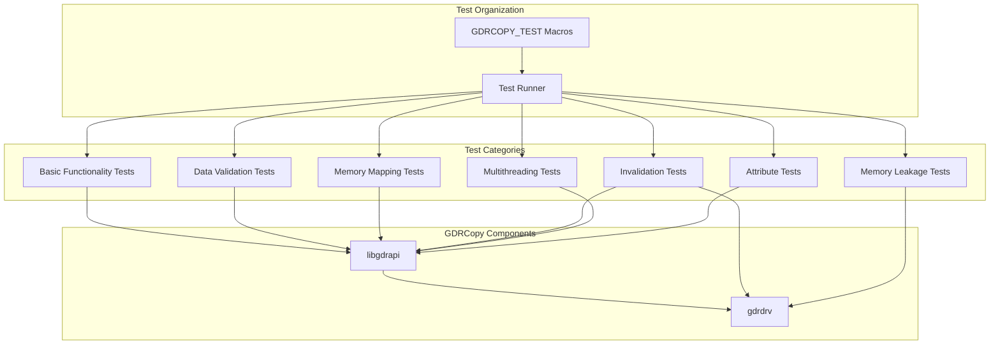
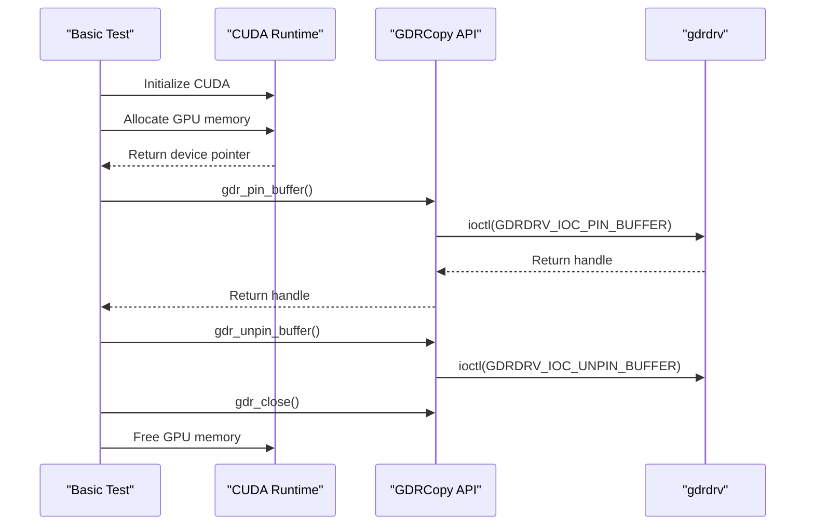
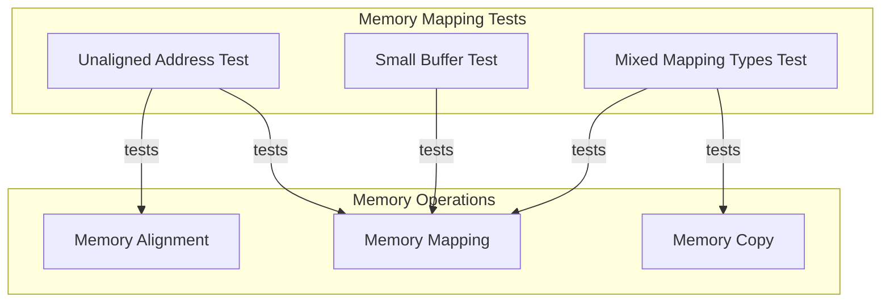
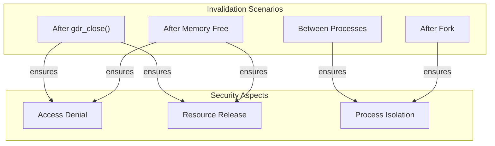
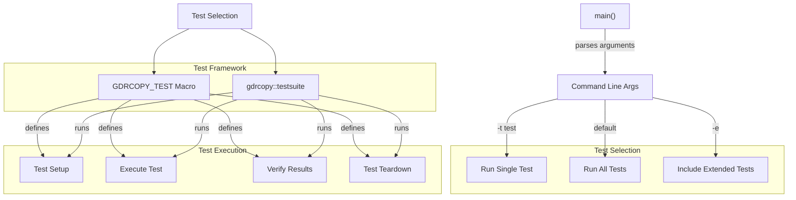

<!-- source: DeepWiki mcp.deepwiki.com · repo NVIDIA/gdrcopy · page 5.1 Sanity Tests · fetched 2026-11-11 -->

# Sanity Tests

<details>
<summary>Relevant source files</summary>

The following files were used as context for generating this wiki page:

- [tests/sanity.cpp](tests/sanity.cpp)

</details>


This document describes the sanity test suite included with GDRCopy. The sanity tests are designed to verify the correct functionality of the GDRCopy library and kernel driver components across various usage scenarios, edge cases, and potential security issues. For information about performance benchmarks, see [Performance Benchmarks](#5.2).

## Overview of the Sanity Test Suite

The GDRCopy sanity test suite consists of comprehensive unit tests that verify the functionality, reliability, and security of the GPU memory mapping and data transfer operations. These tests help ensure that GDRCopy behaves correctly on different hardware configurations and with various usage patterns.

### Test Architecture



Sources: [tests/sanity.cpp:2434-2493]()

## Test Categories

### Basic Functionality Tests

The basic functionality tests verify core operations of GDRCopy, particularly focusing on memory allocation, pinning, and unpinning. These tests ensure that the fundamental operations work correctly with different memory allocation methods.



These tests include:
- Basic tests with cuMemAlloc
- Basic tests with VMM allocation (CUDA 11.0+)
- Basic tests with tokens
- Tests using different API versions (v1 and v2)
- Tests with force PCI-e flags

Sources: [tests/sanity.cpp:289-318](), [tests/sanity.cpp:320-363]()

### Data Validation Tests

Data validation tests verify that data can be correctly copied to and from GPU memory using GDRCopy. These tests ensure that the contents of memory remain consistent throughout various copy operations.

The tests perform the following validations:
1. CPU initialization + readback via CUDA
2. Writing with gdr_copy_to_mapping + readback via CUDA
3. Writing with gdr_copy_to_mapping + readback via gdr_copy_from_mapping
4. Testing various offset patterns for both source and destination buffers

These tests also validate different memory mapping types (Write Combining, Cached) to ensure they behave correctly.

Sources: [tests/sanity.cpp:545-727](), [tests/sanity.cpp:729-749](), [tests/sanity.cpp:752-865]()

### Memory Mapping Tests

Memory mapping tests verify that GDRCopy correctly handles GPU memory mapping, especially in boundary conditions such as:

- Unaligned memory addresses
- Small buffer sizes
- Page boundary conditions

These tests are crucial for ensuring that GDRCopy properly enforces alignment requirements and correctly manages memory mappings across GPU page boundaries.



Sources: [tests/sanity.cpp:374-476](), [tests/sanity.cpp:489-543](), [tests/sanity.cpp:752-865]()

### Invalidation Tests

Invalidation tests ensure that GDRCopy correctly handles resource invalidation scenarios, which are critical for security and resource management. These tests verify:

1. Memory access after `gdr_close()` is properly prevented
2. Memory access after `cuMemFree()` is properly prevented
3. Processes cannot access each other's mappings
4. Child processes cannot access parent's mappings after fork
5. Mappings in one process are not affected by operations in another process



Sources: [tests/sanity.cpp:882-950](), [tests/sanity.cpp:975-1064](), [tests/sanity.cpp:1092-1170](), [tests/sanity.cpp:1205-1353](), [tests/sanity.cpp:1384-1516](), [tests/sanity.cpp:1547-1606](), [tests/sanity.cpp:1639-1752](), [tests/sanity.cpp:1786-1873](), [tests/sanity.cpp:1896-2025](), [tests/sanity.cpp:2042-2120]()

### Multithreading Tests

Multithreading tests verify that GDRCopy operations can be safely performed in a multithreaded environment, ensuring that concurrent operations on the same or different buffers work correctly.

These tests include:
- Single thread performing setup and teardown
- Two threads splitting setup and teardown
- Two threads concurrently pinning and mapping the same buffer

Sources: [tests/sanity.cpp:2123-2252]()

### Memory Leakage Tests

Memory leakage tests verify that GDRCopy properly cleans up resources, especially in scenarios that could potentially lead to resource leaks. These tests are particularly important for long-running applications.

The main leakage test focuses on ensuring that pinned pages are properly released in complex process lifecycle scenarios, such as:
- After fork without execv
- When a file descriptor is closed without proper unpinning

Sources: [tests/sanity.cpp:2273-2406]()

### Attribute Tests

Attribute tests verify that GDRCopy correctly reports its configuration and capabilities through the attribute query system, ensuring that applications can properly adapt to the underlying hardware capabilities.

Sources: [tests/sanity.cpp:2408-2419]()

## Test Implementation

### Core Test Structure

The sanity tests are implemented using a custom test framework defined in the `GDRCOPY_TEST` macro, which provides setup, execution, and verification for each test. The tests are organized in a way that allows for selective execution and clear reporting of test results.



Sources: [tests/sanity.cpp:2422-2499]()

### Common Test Patterns

Many tests follow a common pattern:

1. Initialize CUDA and get a device context
2. Allocate GPU memory
3. Initialize GDRCopy by opening the driver
4. Pin GPU memory
5. Perform test-specific operations
6. Unpin GPU memory
7. Close GDRCopy
8. Free GPU memory
9. Finalize CUDA

This pattern is often templated to allow testing different memory allocation methods (e.g., cuMemAlloc vs. VMM allocation) and different API versions.

Sources: [tests/sanity.cpp:250-287](), [tests/sanity.cpp:289-318]()

### Template-Based Test Design

Many tests use C++ templates to reuse test logic with different memory allocation mechanisms, API versions, and flags:

```cpp
template <gpu_memalloc_fn_t galloc_fn, gpu_memfree_fn_t gfree_fn, filter_fn_t filter_fn,
          bool use_v2 = false, uint32_t pin_flags = GDR_PIN_FLAG_DEFAULT>
void basic() {
    // Test implementation that works with different allocators and configurations
}

// Test variations using the template
GDRCOPY_TEST(basic_cumemalloc) {
    basic<gpu_mem_alloc, gpu_mem_free, null_filter>();
}

GDRCOPY_TEST(basic_v2_cumemalloc) {
    basic<gpu_mem_alloc, gpu_mem_free, null_filter, true>();
}
```

This approach allows for comprehensive testing of different API combinations without duplicating code.

Sources: [tests/sanity.cpp:250-287](), [tests/sanity.cpp:289-318]()

## Running the Tests

The sanity test suite provides a command-line interface for running the tests with various options:

```
Usage: gdrcopy_sanity [-h][-v][-s][-l][-t <test>][-d <gpu>][-e]

Options:
   -h              Print help text.
   -v              Increase report verbosity.
   -s              DON'T print summary report.
   -l              List all available tests.
   -t <test>       Run the specified test only.
   -d <gpu>        GPU ID (default: 0)
   -e              Enable extended unit tests.
```

To run a specific test:
```
./gdrcopy_sanity -t basic_cumemalloc
```

To run all tests with verbose output:
```
./gdrcopy_sanity -v
```

The test runner reports success, failure, or waived status for each test. Tests may be waived when they require specific hardware features not available on the test system.

Sources: [tests/sanity.cpp:2422-2433](), [tests/sanity.cpp:2434-2493]()

## Adding New Tests

New tests can be added to the sanity test suite by:

1. Creating a test function following existing patterns
2. Registering it using the `GDRCOPY_TEST` macro for normal tests or `GDRCOPY_EXTENDED_TEST` for extended tests
3. Ensuring it properly reports success, failure, or waived status

Extended tests are only run when specifically requested with the `-e` flag and typically test edge cases or scenarios that might affect system stability.

Sources: [tests/sanity.cpp:289-318](), [tests/sanity.cpp:2403-2406]()

## Test Helper Functions

The test suite provides several helper functions to simplify test implementation:

- `init_cuda()`: Initializes CUDA for testing
- `finalize_cuda()`: Cleans up CUDA resources
- `check_gdr_support()`: Verifies GPU supports GDRCopy
- Filtering functions (e.g., `null_filter()`, `vmm_filter()`) to waive tests on unsupported platforms
- Exception handling functions to detect expected access violations

Sources: [tests/sanity.cpp:55-91](), [tests/sanity.cpp:95-136]()

## Test Validation Methods

The test suite uses several methods to validate test results:

1. Assertion macros (e.g., `ASSERT`, `ASSERT_EQ`, `ASSERT_NEQ`) to verify conditions
2. Error counting to track data validation failures
3. Signal handlers to detect expected memory access violations
4. Process coordination using pipes and sockets for multi-process tests

These validation methods ensure thorough testing of both expected functionality and proper error handling.

Sources: [tests/sanity.cpp:55-62](), [tests/sanity.cpp:600-617](), [tests/sanity.cpp:934-945]()

---

