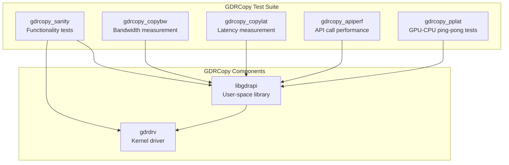
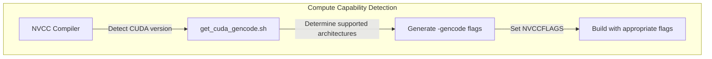
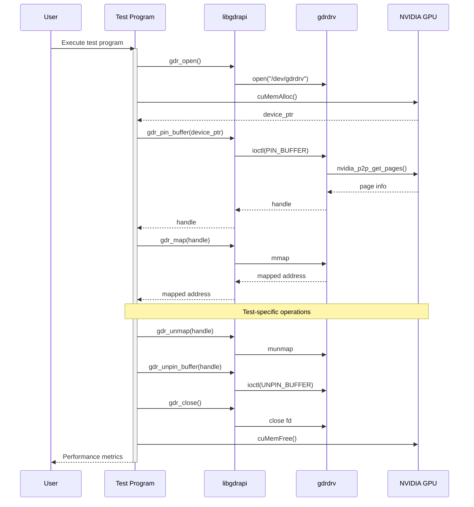

<!-- source: DeepWiki mcp.deepwiki.com · repo NVIDIA/gdrcopy · page 5.3 Running Tests · fetched 2026-11-11 -->

# Running Tests

<details>
<summary>Relevant source files</summary>

The following files were used as context for generating this wiki page:

- [README.md](README.md)
- [packages/rhel/gdrcopy.service](packages/rhel/gdrcopy.service)
- [scripts/get_cuda_gencode.sh](scripts/get_cuda_gencode.sh)
- [tests/Makefile](tests/Makefile)
- [tests/copylat.cpp](tests/copylat.cpp)
- [tests/pplat.cu](tests/pplat.cu)

</details>


This page provides instructions for building and running the GDRCopy test suite. These tests help verify the functionality of the GDRCopy installation and measure its performance characteristics. For information about the specific test capabilities and their implementation details, see [Sanity Tests](#5.1) and [Performance Benchmarks](#5.2).

## Test Suite Overview

GDRCopy includes several test and benchmark programs designed to validate functionality and measure performance:



Sources: [README.md:37-42](), [tests/Makefile:23-25]()

## Building the Tests

The GDRCopy test suite is built using the Makefile in the `tests` directory. The build process automatically detects the CUDA compute capabilities of your system using a script that selects appropriate compiler flags.

### Prerequisites

Before building the tests, ensure you have:

1. CUDA Toolkit (version ≥ 6.0)
2. NVIDIA GPU driver (version ≥ 418.40 on ppc64le or ≥ 331.14 on other platforms)
3. GCC or compatible C/C++ compiler
4. GDRCopy kernel module loaded (as described in the [Installation](#4) page)

### Build Options

The test build process supports several options:

| Option | Description | Default |
|--------|-------------|---------|
| `CUDA` | Path to CUDA installation | `/usr/local/cuda` |
| `NVCC` | Path to NVCC compiler | `$(CUDA)/bin/nvcc` |
| `DESTBIN` | Installation destination | Current directory |

### Building All Tests

To build all test programs:

```bash
cd tests/
make CUDA=/path/to/cuda
```

The build process will compile five executable test programs:
- `gdrcopy_sanity`
- `gdrcopy_copybw`
- `gdrcopy_copylat`
- `gdrcopy_apiperf`
- `gdrcopy_pplat`

Sources: [tests/Makefile:1-31](), [README.md:70-73]()

### CUDA Compute Capabilities

The test build script automatically detects and sets the appropriate CUDA compute capabilities for your system based on the CUDA version and supported GPU architectures.



Sources: [tests/Makefile:18-19](), [scripts/get_cuda_gencode.sh:1-76]()

## Running the Test Programs

Each test program serves a different purpose and accepts different command-line arguments. Below are instructions for running each program.

### gdrcopy_sanity

The sanity test verifies the basic functionality of the GDRCopy library and driver.

**Basic usage:**
```bash
./gdrcopy_sanity
```

**Output:** List of passed and failed tests, with a summary count at the end.

Sources: [README.md:158-190]()

### gdrcopy_copybw

This benchmark measures memory copy bandwidth between CPU and GPU.

**Basic usage:**
```bash
./gdrcopy_copybw [options]
```

**Common options:**
- `-d <gpu>`: GPU device ID (default: 0)
- `-s <size>`: Buffer size in bytes
- `-o <offset>`: Offset in bytes
- `-c <copy_size>`: Copy size in bytes
- `-a <alloc_fn>`: GPU buffer allocation function (cuMemAlloc or cuMemCreate)

**Example with NUMA optimization:**
```bash
numactl -N 0 -l ./gdrcopy_copybw -d 0 -s $((64 * 1024))
```

Sources: [README.md:191-222](), [README.md:372-400]()

### gdrcopy_copylat

This benchmark measures the latency of memory copy operations between CPU and GPU for different buffer sizes.

**Basic usage:**
```bash
./gdrcopy_copylat [options]
```

**Common options:**
- `-d <gpu>`: GPU device ID (default: 0)
- `-s <size>`: Maximum buffer size in bytes (default: 16MB)
- `-w <iters>`: Number of write iterations (default: 10000)
- `-r <iters>`: Number of read iterations (default: 100)
- `-a <alloc_fn>`: GPU buffer allocation function (cuMemAlloc or cuMemCreate)
- `-c`: Also run cuMemcpy benchmark
- `-C`: Use cold cache (effective with cache mapping, e.g., on Grace-Hopper)

Sources: [README.md:223-306](), [tests/copylat.cpp:47-62]()

### gdrcopy_apiperf

This benchmark measures the performance of individual GDRCopy API calls.

**Basic usage:**
```bash
./gdrcopy_apiperf [options]
```

**Common options:**
- `-s <size>`: Buffer size in bytes

Sources: [README.md:308-336]()

### gdrcopy_pplat

This benchmark measures the round-trip ping-pong latency between GPU and CPU.

**Basic usage:**
```bash
./gdrcopy_pplat [options]
```

**Common options:**
- `-d <gpu>`: GPU device ID (default: 0)
- `-t <iters>`: Number of iterations (default: 1000)
- `-s <size>`: Data size (default: 0, measures flag visibility latency only)
- `-m <mode>`: Benchmark mode (0: CPU produces/GPU consumes, 1: GPU produces/CPU consumes)
- `-G <loc>`: GPU flag location (gpumem or hostmem)
- `-C <loc>`: CPU flag location (gpumem or hostmem)
- `-D <loc>`: Data buffer location (gpumem or hostmem)

**Example with NUMA optimization:**
```bash
numactl -N 1 -l ./gdrcopy_pplat
```

Sources: [README.md:338-358](), [tests/pplat.cu:324-350]()

## Test Execution Workflow

The following diagram illustrates the typical workflow when running GDRCopy tests:



Sources: [tests/copylat.cpp:225-375](), [tests/pplat.cu:547-784]()

## Understanding Test Results

### Sanity Test Results

The `gdrcopy_sanity` test provides a list of passed and failed tests with a summary count. All tests should pass on a properly configured system. If any test fails, it indicates a problem with the installation or system configuration.

Sample output summary:
```
Total: 28, Passed: 28, Failed: 0, Waived: 0
```

### Copy Bandwidth Test Results

The `gdrcopy_copybw` test reports bandwidth measurements in MB/s for:
- **write BW**: CPU to GPU transfer speed (host to device)
- **read BW**: GPU to CPU transfer speed (device to host)

Write bandwidth is typically much higher than read bandwidth due to write combining optimizations.

### Copy Latency Test Results

The `gdrcopy_copylat` test reports latency measurements in microseconds for different buffer sizes. The output includes:
- **gdr_copy_to_mapping**: CPU to GPU copy latency
- **gdr_copy_from_mapping**: GPU to CPU copy latency

Latency generally increases with buffer size, with CPU to GPU transfers typically being faster than GPU to CPU transfers.

### API Performance Test Results

The `gdrcopy_apiperf` test reports the latency of each GDRCopy API call in microseconds, along with histograms showing the distribution of latencies. This helps identify potential bottlenecks in the API functions.

### Ping-Pong Latency Test Results

The `gdrcopy_pplat` test reports the round-trip latency in microseconds for communication between CPU and GPU. This test is useful for understanding the minimum achievable communication latency between host and device.

Sources: [README.md:158-358]()

## NUMA Considerations

Performance can be significantly affected by NUMA (Non-Uniform Memory Access) configurations in multi-socket systems. If the GPU is attached to a specific CPU socket, running tests from a different socket can result in lower performance due to additional memory transfer overhead.

To achieve optimal performance, use the `numactl` command to bind the test process to the CPU socket that hosts the GPU:

```bash
numactl -N <socket_id> -l ./gdrcopy_test [options]
```

The proper socket ID depends on your system's topology and how GPUs are connected to CPU sockets.

Sources: [README.md:360-434]()

## Troubleshooting

If you encounter issues when running the tests, check the following:

1. Ensure the GDRCopy kernel module is loaded
   ```bash
   lsmod | grep gdrdrv
   ```

2. Verify the GPU driver is working correctly
   ```bash
   nvidia-smi
   ```

3. Check that the test binaries were compiled for the correct CUDA version and GPU architecture
   ```bash
   ldd ./gdrcopy_sanity
   ```

4. For CUDA compatibility issues, inspect the compiler flags used:
   ```bash
   ./scripts/get_cuda_gencode.sh $(which nvcc)
   ```

If you encounter the error "CUDA_ERROR_NOT_READY" when running `gdrcopy_pplat`, check if your NVCC flags are appropriate for your GPU architecture. You might need to adjust the Makefile or provide specific compute capability flags.

Sources: [tests/pplat.cu:642-644]()