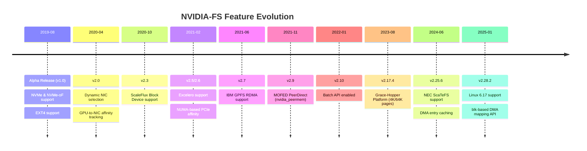
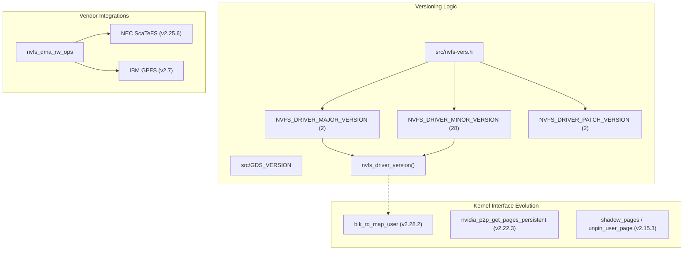

<!-- source: DeepWiki mcp.deepwiki.com · repo NVIDIA/gds-nvidia-fs · page 1.1 Features and Version History · fetched 2026-11-11 -->

# Features and Version History

Relevant source files

The following files were used as context for generating this wiki page:

- [ChangeLog](ChangeLog)
- [src/GDS_VERSION](src/GDS_VERSION)
- [src/nvfs-vers.h](src/nvfs-vers.h)

This page documents the key features, capabilities, and version history of the NVIDIA GPUDirect Storage (GDS) kernel driver (`nvidia-fs`). It tracks the evolution of the driver from its initial alpha release to the current production versions, highlighting support for various storage backends, filesystems, and hardware platforms.

## Features Overview

NVIDIA GPUDirect Storage (GDS) provides a direct data path between storage (local or remote) and GPU memory. By leveraging the `nvidia-fs` kernel module, applications can achieve higher throughput and lower latency by bypassing the CPU's system memory during I/O operations.

Key capabilities include:
- **Direct DMA**: Facilitates direct memory access between storage controllers and GPU VRAM [ChangeLog:138-139]().
- **Multi-Vendor Support**: A registration API allows third-party storage vendors to integrate their block devices and filesystems [ChangeLog:129-131]().
- **Topology Optimization**: Automated selection of the optimal data path based on PCIe and NUMA affinity [ChangeLog:101-102]().
- **RDMA Integration**: Support for remote storage via InfiniBand and RoCE, including integration with `nvidia_peermem` [ChangeLog:89-90]().
- **Batching**: A dedicated Batch I/O API to reduce syscall overhead for multiple small I/O requests [ChangeLog:84-85]().

Sources: [ChangeLog:1-141](), [src/nvfs-vers.h:27-36]()

## Feature Evolution Timeline

The following timeline illustrates the introduction of major architectural features and hardware support.

Sources: [ChangeLog:1-141]()

## Feature Capabilities Matrix

| Feature | Introduced | Description |
| :--- | :--- | :--- |
| **NVMe Direct** | v1.0 | Direct path for local NVMe and NVMe-over-Fabrics [ChangeLog:139](). |
| **Vendor Registration** | v2.0 | `nvfs_is_gpu_page`, `nvfs_gpu_index` for vendor callbacks [ChangeLog:131](). |
| **Distributed FS** | v2.0 | Dynamic NIC selection for remote filesystems [ChangeLog:127](). |
| **Block Device Support**| v2.3/2.5 | Support for ScaleFlux and Excelero (NVMesh) [ChangeLog:106,115](). |
| **RDMA DC Transport** | v2.7 | IBM GPFS support using userspace RDMA DC [ChangeLog:97](). |
| **Batch I/O** | v2.10 | High-performance batch submission for GDS [ChangeLog:84](). |
| **Persistent P2P** | v2.22.3 | `nvidia_p2p_get_pages_persistent` for x86 baremetal [ChangeLog:25-26](). |
| **Modern Kernels** | v2.28.2 | Support for Linux kernels up to 6.17 and `blk` DMA APIs [ChangeLog:2-3](). |

Sources: [ChangeLog:2-141]()

## Code Entity Map: Versioning and Components

This diagram maps the versioning logic and key driver components to their implementation symbols.

Sources: [src/nvfs-vers.h:27-44](), [src/GDS_VERSION:1](), [ChangeLog:2-16, 25-26, 57-58]()

## Detailed Version History

### Recent Releases (v2.20 - v2.28)
*   **v2.28.2**: Added support for Linux 6.17 and transitioned to a `blk` based API for mapping NVMe DMA requests [ChangeLog:2-3]().
*   **v2.26.6**: Compatibility fixes for Linux 6.11 and 6.14 [ChangeLog:7-8]().
*   **v2.25.6**: Introduced support for **NEC ScaTeFS** and implemented a domain-based key for the DMA entry cache hash table [ChangeLog:15-16]().
*   **v2.23.1**: Integrated `persistent_p2p` APIs for NVIDIA drivers >= 555 [ChangeLog:22]().
*   **v2.22.3**: Switched to `nvidia_p2p_get_pages_persistent()` for x86 baremetal environments [ChangeLog:25-26]().

### Mid-Life Updates (v2.10 - v2.19)
*   **v2.17.4**: Significant update for **Grace-Hopper** platforms, supporting both 4K and 64K page sizes [ChangeLog:47]().
*   **v2.15.3**: Fixed a critical memory leak in shadow pages by ensuring `unpin_user_page` is called [ChangeLog:58]().
*   **v2.10**: Enabled the **Batch API**, allowing userspace to submit multiple I/O operations in a single context [ChangeLog:84]().

### Early Development (v1.0 - v2.9)
*   **v2.9**: Added `nvidia_peermem` support for MOFED PeerDirect [ChangeLog:89]().
*   **v2.7**: Introduced IBM GPFS read support via userspace RDMA [ChangeLog:97]().
*   **v2.0**: Major architecture shift to support dynamic NIC selection and peer affinity statistics [ChangeLog:127-128]().
*   **v1.0**: Initial alpha release providing the core `nvidia-fs` kernel driver and the vendor DMA callback registration system [ChangeLog:137-138]().

Sources: [ChangeLog:1-141](), [src/nvfs-vers.h:27-33]()

## Versioning Implementation

The driver version is statically defined and can be retrieved via the `nvfs_driver_version` inline function, which packs the major and minor versions into a 32-bit integer.

*   **Major Version**: `NVFS_DRIVER_MAJOR_VERSION` [src/nvfs-vers.h:27]()
*   **Minor Version**: `NVFS_DRIVER_MINOR_VERSION` [src/nvfs-vers.h:29]()
*   **Patch Version**: `NVFS_DRIVER_PATCH_VERSION` [src/nvfs-vers.h:32]()
*   **GDS Release Version**: Tracked separately in `src/GDS_VERSION` (e.g., `1.17.0.44`) [src/GDS_VERSION:1]().

Sources: [src/nvfs-vers.h:27-44](), [src/GDS_VERSION:1]()

---

