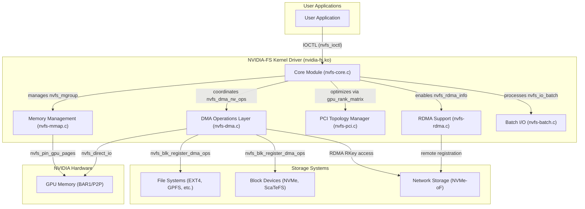
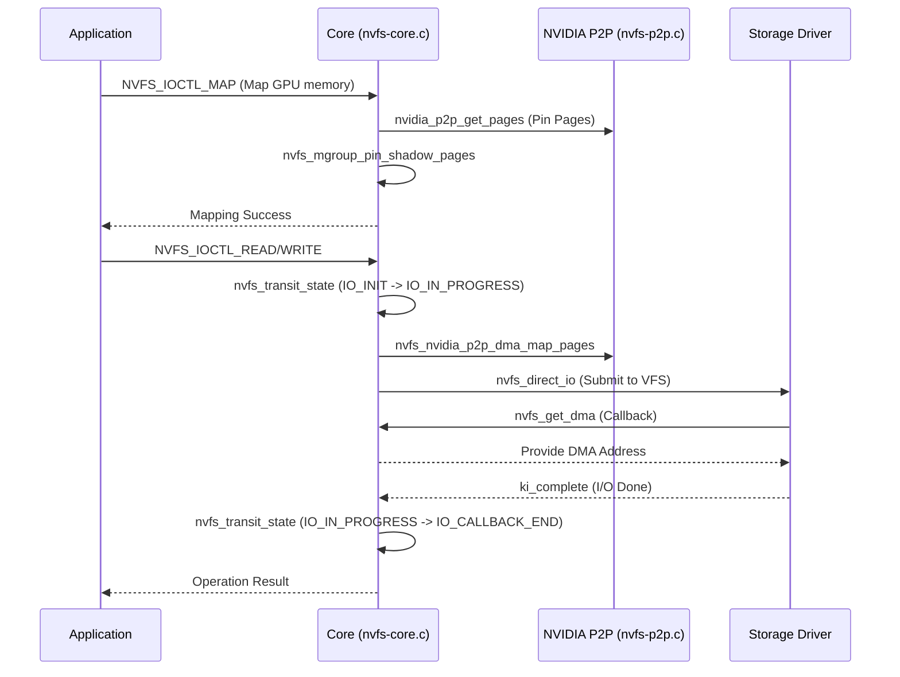

<!-- source: DeepWiki mcp.deepwiki.com · repo NVIDIA/gds-nvidia-fs · page 2 System Architecture · fetched 2026-11-11 -->

# System Architecture

Relevant source files

The following files were used as context for generating this wiki page:

- [ChangeLog](ChangeLog)
- [src/nvfs-core.c](src/nvfs-core.c)
- [src/nvfs-core.h](src/nvfs-core.h)

This page provides a comprehensive overview of the NVIDIA GPUDirect Storage (GDS) system architecture, focusing on the `nvidia-fs` kernel driver components, their interactions, and data flows. This document covers the key subsystems that enable direct data paths between GPU memory and storage devices, bypassing CPU involvement for improved performance.

For installation details, see [Installation & Configuration](#3), and for details about specific subsystems, see the relevant child pages linked throughout this document.

## High-Level Architecture Overview

Sources: [src/nvfs-core.c:57-68](), [src/nvfs-core.h:22-63](), [ChangeLog:15-16]()

The NVIDIA GPUDirect Storage system consists of several interconnected components that work together to enable direct data transfers between storage and GPU memory:

1.  **Core Module**: Handles initialization, device management, IOCTL processing, and coordinates all other components via the `nvfs_ioctl` interface [src/nvfs-core.c:864-972]().
2.  **Memory Management**: Manages memory mappings between CPU and GPU address spaces using `nvfs_mgroup` and shadow buffers [src/nvfs-core.h:32-33]().
3.  **DMA Operations Layer**: Provides an abstraction layer for direct memory access across different storage types using the `nvfs_dma_rw_ops` structure [src/nvfs-core.c:59-60]().
4.  **PCI Topology Manager**: Analyzes and optimizes data paths based on PCI device relationships and distance [src/nvfs-core.c:60-61]().
5.  **RDMA Support**: Enables Remote Direct Memory Access for distributed storage systems like GPFS [src/nvfs-core.c:65-67](), [ChangeLog:97-98]().
6.  **Batch I/O Operations**: Allows grouping multiple I/O operations into a single `NVFS_IOCTL_BATCH_IO` call to improve performance [src/nvfs-core.h:130-137]().

## Data Flow

The following sequence diagram illustrates the typical data flow for a GPUDirect Storage operation, mapping high-level actions to internal state transitions:

Sources: [src/nvfs-core.c:143-205](), [src/nvfs-core.c:1063-1099](), [src/nvfs-core.c:560-713]()

## Core Module

The Core Module serves as the central component of the NVIDIA-FS driver, providing fundamental functionality and coordination. It manages up to 16 GPU devices by default [src/nvfs-core.c:78-79]().

Key responsibilities include:
- **Device Management**: Creating the `nvidia-fs` character device and class [src/nvfs-core.h:24-25]().
- **IOCTL Dispatch**: Handling `NVFS_IOCTL_MAP`, `NVFS_IOCTL_READ`, `NVFS_IOCTL_WRITE`, and `NVFS_IOCTL_BATCH_IO` [src/nvfs-core.h:165-177]().
- **State Machine**: Managing the I/O lifecycle through states like `IO_FREE`, `IO_INIT`, `IO_IN_PROGRESS`, and `IO_TERMINATED` [src/nvfs-core.c:143-219]().

See the [Core Module](#2.1) page for more detailed information.

## Memory Management

The Memory Management subsystem facilitates data transfer between CPU and GPU memory spaces using the `nvfs_mgroup` structure. It supports features like sparse I/O via `nvfs_io_sparse_data` [src/nvfs-core.h:189-195]().

Key components:
- **nvfs_mgroup**: The primary structure for tracking pinned GPU pages and their associated shadow buffers.
- **Shadow Buffers**: CPU-side buffers used for metadata or fallback paths.
- **Reference Counting**: Using `nvfs_mgroup_get` and `nvfs_mgroup_put` to manage lifecycle [src/nvfs-core.c:165-166]().

See the [Memory Management](#2.2) page for more detailed information.

## DMA Operations Layer

The DMA Operations Layer provides a unified interface for direct memory access across different storage types, including NVMe, SCSI, and specialized block devices like ScaTeFS [ChangeLog:16-17]().

It manages the mapping of GPU pages to DMA addresses using the NVIDIA Peer-to-Peer (P2P) APIs. The driver supports both legacy P2P allocation and a newer persistent P2P mode for NVIDIA driver versions >= 555 [src/nvfs-core.c:107-108](), [ChangeLog:21-22]().

See the [DMA Operations](#2.3) page for more detailed information.

## PCI Topology Management

The PCI Topology Management component optimizes data paths based on the physical relationship between PCI devices. It calculates distances and ranks paths to ensure that DMA transfers occur over the most efficient bus routes, avoiding unnecessary traversals of the CPU root complex where possible [ChangeLog:101-102]().

See the [PCI Topology Management](#2.4) page for more detailed information.

## RDMA Support

The RDMA Support component enables Remote Direct Memory Access for distributed storage systems. It uses the `nvfs_ioctl_set_rdma_reg_info_args` structure to register memory keys (rkeys) and connection information in the kernel [src/nvfs-core.h:140-151](). This integration is critical for high-performance distributed filesystems like GPFS [ChangeLog:97-98]().

See the [RDMA Support](#2.5) page for more detailed information.

## Batch I/O Operations

The Batch I/O Operations component allows processing multiple I/O operations in a single call using the `nvfs_ioctl_batch_ioargs_t` structure [src/nvfs-core.h:131-137](). This reduces the overhead of multiple system calls and improves performance for GDS [ChangeLog:84-86]().

See the [Batch I/O Operations](#2.6) page for more detailed information.

## NVIDIA P2P API Integration

The driver acts as a shim for the NVIDIA Peer-to-Peer kernel API. It handles the pinning of GPU pages via `nvidia_p2p_get_pages` (or the persistent variant `nvidia_p2p_get_pages_persistent` on newer drivers) and mapping them for DMA via `nvidia_p2p_dma_map_pages` [ChangeLog:25-26]().

See the [NVIDIA P2P API Integration](#2.7) page for more detailed information.

---

