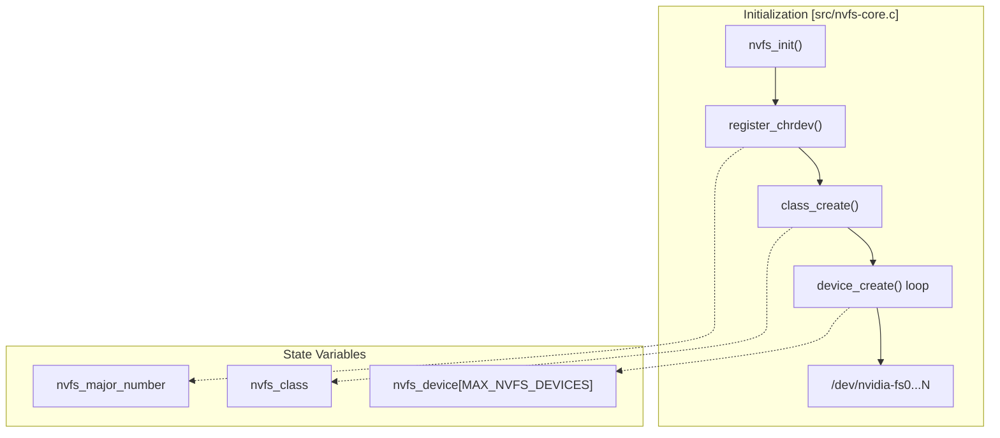
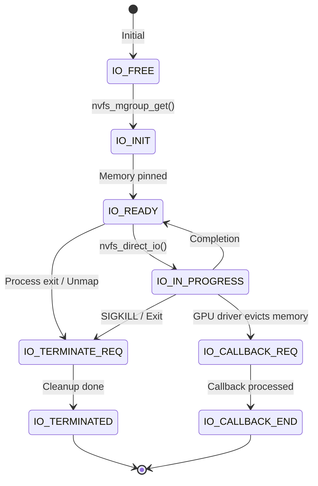
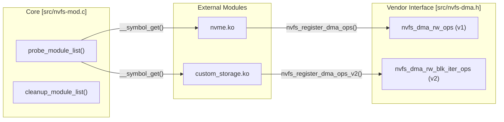

<!-- source: DeepWiki mcp.deepwiki.com · repo NVIDIA/gds-nvidia-fs · page 2.1 Core Module · fetched 2026-11-11 -->

# Core Module

Relevant source files

The following files were used as context for generating this wiki page:

- [src/nvfs-core.c](src/nvfs-core.c)
- [src/nvfs-core.h](src/nvfs-core.h)
- [src/nvfs-kernel-interface.h](src/nvfs-kernel-interface.h)
- [src/nvfs-mod.c](src/nvfs-mod.c)

The Core Module is the central coordinator of the NVIDIA GPUDirect Storage (GDS) kernel driver. It manages the lifecycle of the `nvidia-fs` kernel module, provides the character device interface for userspace libraries (like `libcufile`), and implements the I/O state machine that orchestrates data transfers between storage and GPU memory.

## Module Initialization and Device Management

The module initializes by registering a major number and creating a class in `sysfs` to manage multiple character device nodes. By default, it supports up to 16 device instances to optimize parallel 4K I/O operations across multiple GPU devices [src/nvfs-core.c:75-78]().

Sources: [src/nvfs-core.c:92-94](), [src/nvfs-core.c:75-78]()

### Module Parameters
The behavior of the core module is tunable via `insmod` parameters:
* `nvfs_dbg_enabled`: Enables verbose debug logging [src/nvfs-core.c:102]().
* `nvfs_max_devices`: Sets the number of character devices to create (default 16) [src/nvfs-core.c:106]().
* `nvfs_use_legacy_p2p_allocation`: Controls whether to use legacy P2P allocation modes [src/nvfs-core.c:107]().

## Character Device Interface (IOCTLs)

Userspace communicates with the driver via `ioctl` calls on `/dev/nvidia-fsX`. The driver defines a union, `nvfs_ioctl_param_union`, to handle various command structures [src/nvfs-core.h:165-177]().

| IOCTL Command | Structure | Description |
| :--- | :--- | :--- |
| `NVFS_IOCTL_MAP` | `nvfs_ioctl_map_t` | Pins GPU memory and creates a shadow buffer mapping [src/nvfs-core.h:91-101](). |
| `NVFS_IOCTL_READ` / `WRITE` | `nvfs_ioctl_ioargs_t` | Initiates a GDS I/O operation (Direct I/O) [src/nvfs-core.h:112-128](). |
| `NVFS_IOCTL_BATCH_IO` | `nvfs_ioctl_batch_ioargs_t` | Submits multiple I/O operations in a single call [src/nvfs-core.h:131-136](). |
| `NVFS_IOCTL_SET_RDMA_REG` | `nvfs_ioctl_set_rdma_reg_info_args_t` | Configures RDMA registration for remote storage [src/nvfs-core.h:140-151](). |

Sources: [src/nvfs-core.h:91-177]()

## I/O Lifecycle State Machine

To handle asynchronous events like process termination or GPU memory deallocation (via NVIDIA driver callbacks), the module implements a strict state machine for every I/O group (`nvfs_io_mgroup`).

### State Transitions
The function `nvfs_transit_state` manages transitions using atomic compare-and-swap (`atomic_cmpxchg`) to prevent race conditions between the I/O thread and the GPU memory eviction callback [src/nvfs-core.c:143-178]().

Sources: [src/nvfs-core.c:143-205](), [src/nvfs-core.c:207-219]()

## I/O Execution Path

The core module intercepts standard Linux file operations and converts them into Peer-to-Peer (P2P) DMA operations.

### Direct I/O Logic
When a `READ` or `WRITE` IOCTL is received, the driver performs the following:
1. **Validation**: Calls `nvfs_rw_verify_area` to check file permissions and offsets [src/nvfs-core.c:931-975]().
2. **Setup**: Initializes `nvfs_io_t` and `kiocb` structures for the VFS layer [src/nvfs-core.c:561-600]().
3. **Execution**: Calls `call_read_iter` or `call_write_iter` on the target file [src/nvfs-core.c:637-650]().
4. **DMA Mapping**: During the VFS iteration, the storage driver (e.g., NVMe) calls back into `nvfs_get_dma` to get the P2P DMA address of the GPU pages [src/nvfs-core.c:739-806]().

### Termination Handling
If a process is killed while I/O is in flight, `nvfs_io_terminate_requested` ensures that the driver waits for the hardware to finish the DMA transfer before releasing GPU memory references, preventing system crashes [src/nvfs-core.c:207-240]().

## Integration with Storage Vendors

The core module uses a registration system to allow different storage drivers (NVMe, ScaleOut, etc.) to hook into the GDS pipeline.

Sources: [src/nvfs-mod.c:40-129](), [src/nvfs-mod.c:131-162]()

The `probe_module_list` function scans a predefined list of modules and uses `__symbol_get` to find registration functions exported by storage drivers [src/nvfs-mod.c:56-64](). It supports both the legacy `v1` API and the newer `v2` iterator-based API required by modern Linux kernels [src/nvfs-mod.c:86-104]().

## Error Handling and Fault Injection
The module integrates with the Linux kernel's fault injection framework. If `CONFIG_FAULT_INJECTION` is enabled, the driver can simulate state transition failures in `nvfs_transit_state` to verify the robustness of the cleanup logic [src/nvfs-core.c:153-172]().

Sources:
* **Core Logic**: [src/nvfs-core.c:1-284](), [src/nvfs-core.h:24-177]()
* **Module Loading**: [src/nvfs-mod.c:40-162]()
* **Kernel Shim**: [src/nvfs-kernel-interface.h:38-50]()

---

