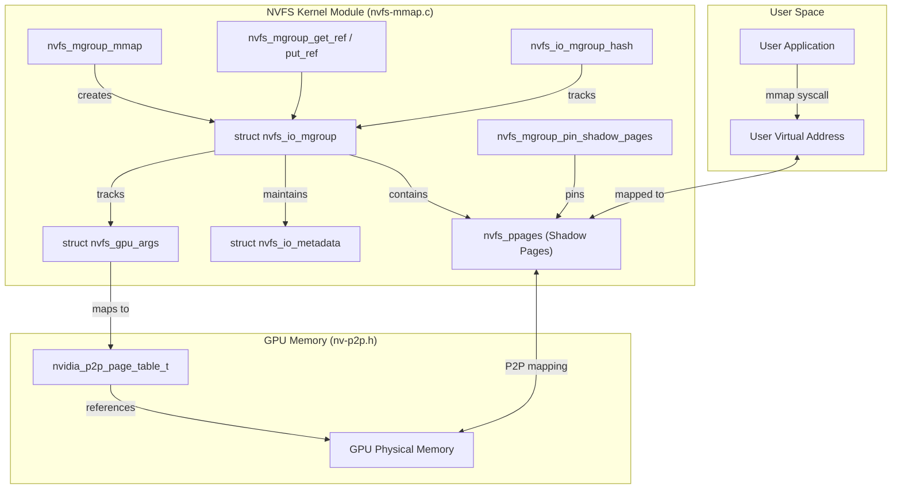

<!-- source: DeepWiki mcp.deepwiki.com · repo NVIDIA/gds-nvidia-fs · page 2.2 Memory Management · fetched 2026-11-11 -->

# Memory Management

<details>
<summary>Relevant source files</summary>

The following files were used as context for generating this wiki page:

- [src/nvfs-mmap.c](src/nvfs-mmap.c)
- [src/nvfs-mmap.h](src/nvfs-mmap.h)

</details>


## Overview

The Memory Management subsystem in NVIDIA GPUDirect Storage (GDS) provides the foundation for efficient direct data transfers between storage and GPU memory. This subsystem manages the mapping, tracking, and synchronization of memory resources across user-space, kernel-space, and GPU memory domains.

The primary purpose of this system is to create and maintain "shadow buffers" — special memory regions that serve as intermediaries between traditional storage I/O operations and GPU memory. By establishing these mappings, GDS enables direct I/O to and from GPU memory without traditional CPU-based data copying.

Sources: [src/nvfs-mmap.h:22-24](), [src/nvfs-mmap.c:1-24]()

## Architecture

The memory management system relies on several key components working together to provide efficient memory mapping and tracking between CPU and GPU address spaces.

### System Mapping Data Flow
The following diagram bridges the natural language concept of "Memory Mapping" to the specific code entities in `nvfs-mmap.c` and `nvfs-mmap.h`.



The architecture centers around the `nvfs_io_mgroup` structure, which serves as the core data structure for managing memory operations. It maintains shadow buffer pages in system memory that are mapped to both user virtual addresses and GPU memory via the NVIDIA Peer-to-Peer (P2P) APIs.

Sources: [src/nvfs-mmap.h:170-188](), [src/nvfs-mmap.c:53-56](), [src/nvfs-mmap.c:618-807]()

## Key Components

### Memory Group Structure (`nvfs_io_mgroup`)

The `nvfs_io_mgroup` structure is the fundamental building block of the memory management system. It encapsulates all state required for a specific memory mapping.

```mermaid
classDiagram
    class nvfs_io_mgroup {
        +atomic_t ref
        +atomic_t dma_ref
        +hlist_node hash_link
        +u64 cpu_base_vaddr
        +unsigned long base_index
        +unsigned long nvfs_blocks_count
        +struct page** nvfs_ppages
        +struct nvfs_io_metadata* nvfs_metadata
        +struct nvfs_gpu_args gpu_info
        +nvfs_io_t nvfsio
    }

    class nvfs_io_metadata {
        +u64 nvfs_start_magic
        +enum nvfs_block_state nvfs_state
        +struct page* page
    }

    class nvfs_gpu_args {
        +nvidia_p2p_page_table_t* page_table
        +u64 gpuvaddr
        +u64 gpu_buf_len
        +atomic_t io_state
        +HASHTABLE buckets
    }

    nvfs_io_mgroup --> nvfs_io_metadata : contains
    nvfs_io_mgroup --> nvfs_gpu_args : contains
    nvfs_io_mgroup --> "nvfs_io_t" : contains
```

Each memory group maintains:
- **Reference counts**: `ref` and `dma_ref` for lifecycle tracking [src/nvfs-mmap.c:74-82]().
- **Shadow buffer pages**: `nvfs_ppages` (array of `struct page*`) [src/nvfs-mmap.c:163-171]().
- **Metadata**: `nvfs_metadata` for tracking the state of each 4KB block [src/nvfs-mmap.h:154-158]().
- **GPU info**: `gpu_info` (`struct nvfs_gpu_args`) which holds the P2P page tables [src/nvfs-mmap.h:136-152]().

Sources: [src/nvfs-mmap.h:170-188](), [src/nvfs-mmap.h:129-145](), [src/nvfs-mmap.h:147-151]()

### Block State Tracking

GDS manages memory in 4KB units defined by `NVFS_BLOCK_SIZE` [src/nvfs-mmap.h:39](). Each block's lifecycle is tracked via `enum nvfs_block_state`:

| State | Description |
|-------|-------------|
| `NVFS_IO_FREE` | Block is initialized and available [src/nvfs-mmap.h:59](). |
| `NVFS_IO_ALLOC` | Block has been allocated for an operation [src/nvfs-mmap.h:60](). |
| `NVFS_IO_QUEUED` | Block is queued in the I/O subsystem [src/nvfs-mmap.h:62](). |
| `NVFS_IO_DMA_START` | DMA transfer has been initiated [src/nvfs-mmap.h:63](). |
| `NVFS_IO_DONE` | DMA operation completed successfully [src/nvfs-mmap.h:64](). |
| `NVFS_IO_DMA_ERROR` | DMA operation failed [src/nvfs-mmap.h:65](). |

Sources: [src/nvfs-mmap.h:58-67](), [src/nvfs-mmap.c:832-1003]()

## Memory Mapping Lifecycle

### The `mmap` Workflow

When a user application calls `mmap` on the NVIDIA-FS character device, the following sequence occurs:

1. **`nvfs_mgroup_mmap`**: The entry point for the mmap syscall. It allocates a new `nvfs_io_mgroup` [src/nvfs-mmap.c:618-650]().
2. **Hash Insertion**: The mgroup is assigned a `base_index` and inserted into the `nvfs_io_mgroup_hash` table using `hash_add_rcu` [src/nvfs-mmap.c:736-745]().
3. **Shadow Page Allocation**: System memory pages are allocated to back the shadow buffer [src/nvfs-mmap.c:680-700]().
4. **VMA Setup**: The `vm_area_struct` is configured with custom `nvfs_vm_ops` [src/nvfs-mmap.c:800-805]().

### Reference Counting and Cleanup

The lifecycle is strictly controlled by reference counts to prevent use-after-free during asynchronous DMA:
- `nvfs_mgroup_get`: Increments the reference count [src/nvfs-mmap.c:115-123]().
- `nvfs_mgroup_put_internal`: Decrements the count and triggers `nvfs_mgroup_free` if it reaches zero [src/nvfs-mmap.c:182-216]().
- **Process Context Check**: `nvfs_check_process_context` ensures that certain cleanup operations (like unpinning GPU pages) occur in the correct process context [src/nvfs-mmap.c:56-72]().

Sources: [src/nvfs-mmap.c:125-177](), [src/nvfs-mmap.c:182-216]()

## VMA Operations

NVIDIA-FS implements custom `vm_operations_struct` (`nvfs_vm_ops`) to manage the mapped memory region:

| Function | Role |
|----------|------|
| `nvfs_vma_open` | Increments mgroup reference when VMA is duplicated [src/nvfs-mmap.c:501-512](). |
| `nvfs_vma_close` | Decrements mgroup reference and cleans up resources [src/nvfs-mmap.c:514-539](). |
| `nvfs_vma_fault` | Handles page faults by mapping shadow pages into the process address space [src/nvfs-mmap.c:541-581](). |
| `nvfs_vma_split` / `mremap` | Explicitly disallowed to maintain mapping integrity [src/nvfs-mmap.c:590-602](). |

Sources: [src/nvfs-mmap.c:604-616]()

## Sparse I/O and Metadata Management

The system supports sparse I/O detection through the `nvfs_io_t` structure and metadata states:
- **`nvfs_metastate_enum`**: Tracks if a block is `NVFS_IO_META_CLEAN` or `NVFS_IO_META_SPARSE` [src/nvfs-mmap.h:87-91]().
- **Metadata Search**: `nvfs_mgroup_metadata_search` allows the driver to find the state of specific blocks within an mgroup [src/nvfs-mmap.c:905-930]().
- **State Updates**: `nvfs_mgroup_metadata_set_dma_state` updates the block state after DMA operations complete [src/nvfs-mmap.c:968-1003]().

Sources: [src/nvfs-mmap.h:154-158](), [src/nvfs-mmap.c:832-1003]()

## GPU Integration (P2P)

The connection to GPU memory is handled via `struct nvfs_gpu_args`:
- **Page Tables**: Holds the `nvidia_p2p_page_table_t` which contains the physical GPU addresses [src/nvfs-mmap.h:137]().
- **Physical Address Retrieval**: `nvfs_mgroup_get_gpu_physical_address` translates a GPU virtual address into a physical address suitable for DMA by storage controllers [src/nvfs-mmap.c:1079-1093]().
- **IO State**: `io_state` (e.g., `IO_IN_PROGRESS`, `IO_DONE`) synchronizes the GPU memory availability with the kernel I/O state [src/nvfs-mmap.h:69-85]().

Sources: [src/nvfs-mmap.h:136-152](), [src/nvfs-mmap.c:1018-1067]()

---

