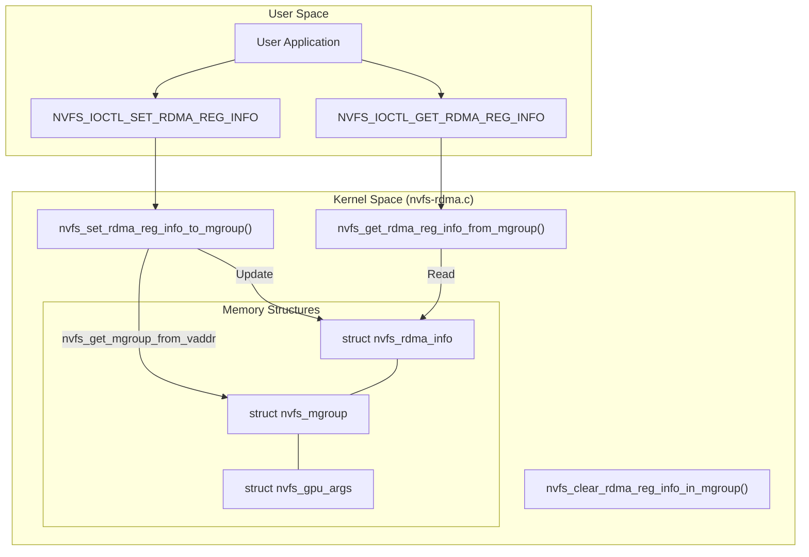
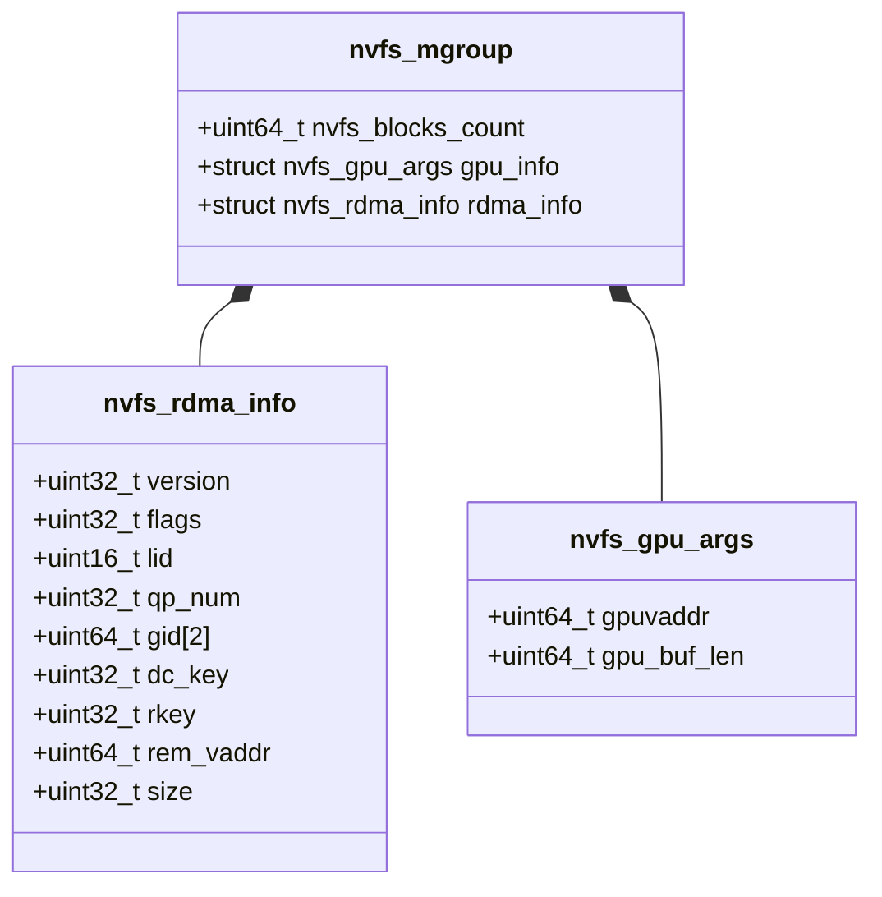

<!-- source: DeepWiki mcp.deepwiki.com · repo NVIDIA/gds-nvidia-fs · page 2.5 RDMA Support · fetched 2026-11-11 -->

# RDMA Support

Relevant source files

The following files were used as context for generating this wiki page:

- [src/nvfs-rdma.c](src/nvfs-rdma.c)
- [src/nvfs-rdma.h](src/nvfs-rdma.h)

## Purpose and Scope

This document details the Remote Direct Memory Access (RDMA) capabilities within the NVIDIA GPUDirect Storage (GDS) driver. RDMA support enables direct memory transfer between remote storage systems and GPU memory without CPU involvement, providing significant performance benefits for distributed storage workloads. This functionality is conditionally compiled under the `NVFS_ENABLE_KERN_RDMA_SUPPORT` macro [src/nvfs-rdma.c:25-25]().

## RDMA Architecture Overview

RDMA support in GDS extends the core functionality by providing mechanisms to register, retrieve, and manage RDMA-related information associated with GPU memory regions. This capability enables distributed storage systems (like IBM Spectrum Scale/GPFS) to perform direct RDMA transfers to/from GPU memory by leveraging registered keys and queue pair information.

### RDMA Data Flow and Entity Mapping

The following diagram bridges the high-level RDMA concepts to the specific code entities and functions defined in `nvfs-rdma.c`.

**RDMA Entity Mapping Diagram**

Sources: [src/nvfs-rdma.c:33-46](), [src/nvfs-rdma.c:116-132](), [src/nvfs-rdma.h:29-41]()

## RDMA Information Structure

The NVIDIA-FS driver maintains RDMA information within memory groups (`nvfs_mgroup`). Each memory group contains an `nvfs_rdma_info` structure that stores essential RDMA parameters needed for remote systems to access GPU memory.

**Memory Group and RDMA Information Structure**

The `nvfs_rdma_info` structure contains:
- `version`: RDMA protocol version. The driver validates this against `NVFS_RDMA_MIN_SUPPORTED_VERSION` [src/nvfs-rdma.c:68-73]().
- `lid`: Local identifier for InfiniBand [src/nvfs-rdma.c:77-77]().
- `qp_num`: Queue pair number [src/nvfs-rdma.c:78-78]().
- `gid`: Global identifier (128-bit, stored as two 64-bit values) [src/nvfs-rdma.c:79-80]().
- `rkey`: Remote memory access key [src/nvfs-rdma.c:86-86]().
- `rem_vaddr`: Remote virtual address, which is mapped to the GPU virtual address (`gpuvaddr`) [src/nvfs-rdma.c:87-87]().
- `size`: Size of the memory region, derived from `gpu_info.gpu_buf_len` [src/nvfs-rdma.c:88-88]().

Sources: [src/nvfs-rdma.c:74-102]()

## RDMA Registration Process

The RDMA registration process involves three primary kernel functions invoked via IOCTLs.

### Setting RDMA Registration Information
The `nvfs_set_rdma_reg_info_to_mgroup()` function allows applications to register RDMA parameters with a specific GPU memory region:
1. **MGroup Lookup**: It retrieves the `nvfs_mgroup` using the CPU virtual address provided in `rdma_reg_info_args->cpuvaddr` [src/nvfs-rdma.c:46-46]().
2. **Validation**: It checks that `nkeys` is valid (currently supports 1 key) [src/nvfs-rdma.c:54-57]() and ensures the version meets the minimum requirement [src/nvfs-rdma.c:68-73]().
3. **Data Transfer**: It populates the `rdma_info` fields within the `mgroup` using data from the IOCTL arguments [src/nvfs-rdma.c:75-81]().
4. **GPU Binding**: It automatically fills `rem_vaddr` and `size` using the existing GPU buffer information stored in the `mgroup` [src/nvfs-rdma.c:83-88]().

### Retrieving RDMA Registration Information
The `nvfs_get_rdma_reg_info_from_mgroup()` function retrieves stored parameters:
1. It locates the `nvfs_mgroup` from the CPU virtual address [src/nvfs-rdma.c:132-132]().
2. It copies the entire `nvfs_rdma_info` structure from the kernel `mgroup` back to the user-provided IOCTL argument structure [src/nvfs-rdma.c:142-143]().

### Clearing RDMA Registration Information
The `nvfs_clear_rdma_reg_info_in_mgroup()` function removes RDMA registration:
1. It identifies the target `nvfs_mgroup` [src/nvfs-rdma.c:215-215]().
2. It uses `memset` to zero out the `rdma_info` structure within that group [src/nvfs-rdma.c:222-222]().

Sources: [src/nvfs-rdma.c:33-110](), [src/nvfs-rdma.c:116-206](), [src/nvfs-rdma.c:208-225]()

## Integration with Distributed Storage (GPFS)

The driver includes specific hooks and testing paths for GPFS (IBM Spectrum Scale). When `NVFS_TEST_GPFS_CALLBACK` is defined, the driver simulates the GPFS callback mechanism [src/nvfs-rdma.c:112-114]().

### GPFS RDMA Info Retrieval Logic
The driver provides a mechanism to extract RDMA info from a scatter-gather list (SGL) which is often used by filesystem IO paths:
- **SGL Construction**: In testing modes, the driver allocates an SGL and pins user pages using `pin_user_pages_fast` or `get_user_pages_fast` [src/nvfs-rdma.c:162-171]().
- **Callback Simulation**: It calls `nvfs_get_gpu_sglist_rdma_info()` to verify that RDMA metadata can be correctly associated with a list of physical pages [src/nvfs-rdma.c:183-183]().

| Feature | Implementation Detail |
|:---|:---|
| **Callback Function** | `nvfs_get_gpu_sglist_rdma_info` |
| **Memory Pinning** | Uses `pin_user_pages_fast` (Kernel 5.6+) or `get_user_pages_fast` |
| **Page Association** | `sg_set_page` maps specific GPU pages to the RDMA-enabled SGL |

Sources: [src/nvfs-rdma.c:157-185]()

## Error Handling and Constraints

The RDMA subsystem enforces several constraints to ensure stability:
- **Reference Counting**: Every lookup of an `mgroup` via `nvfs_get_mgroup_from_vaddr` is paired with `nvfs_mgroup_put` to prevent memory leaks [src/nvfs-rdma.c:104-108](), [src/nvfs-rdma.c:203-224]().
- **Key Limits**: The driver currently limits RDMA registration to a single key (`nkeys > 1` results in `-EINVAL`) [src/nvfs-rdma.c:54-57]().
- **Version Guard**: Versions lower than `NVFS_RDMA_MIN_SUPPORTED_VERSION` are rejected to prevent ABI mismatches between userspace libraries and the kernel module [src/nvfs-rdma.c:68-73]().

Sources: [src/nvfs-rdma.c:42-109](), [src/nvfs-rdma.c:133-136]()

---

