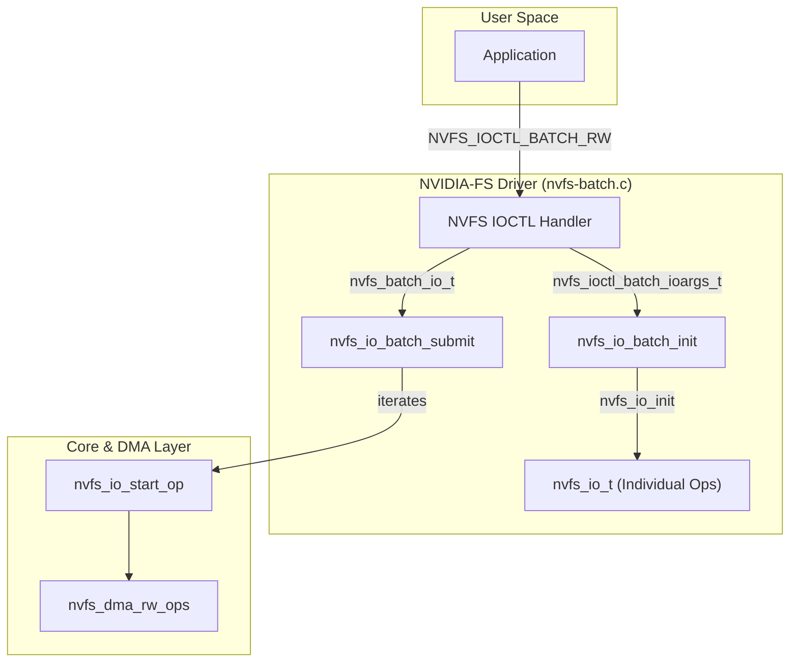
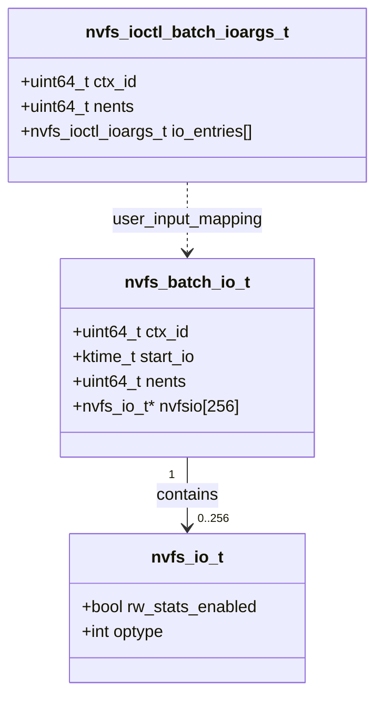

<!-- source: DeepWiki mcp.deepwiki.com · repo NVIDIA/gds-nvidia-fs · page 2.6 Batch I/O Operations · fetched 2026-11-11 -->

# Batch I/O Operations

Relevant source files

The following files were used as context for generating this wiki page:

- [src/nvfs-batch.c](src/nvfs-batch.c)
- [src/nvfs-batch.h](src/nvfs-batch.h)

## Introduction

The NVIDIA GPUDirect Storage (GDS) Batch I/O Operations subsystem provides a mechanism for grouping multiple I/O operations into a single batch submission. This capability is designed to improve performance by reducing system call overhead and optimizing I/O patterns. The batch I/O system supports grouping of both read and write operations, allowing applications to efficiently process multiple data transfers in a single operation.

For information about the underlying DMA operations used by the batch system, see [DMA Operations](2.3).

Sources: [src/nvfs-batch.h:22-39](), [src/nvfs-batch.c:68-70]()

## Architecture Overview

The Batch I/O subsystem sits within the NVIDIA-FS driver and coordinates multiple I/O operations as a single unit:

The batch I/O system provides two main functions:
1. **Initialization** (`nvfs_io_batch_init`): Prepares the batch context and individual I/O operations by copying user arguments and initializing `nvfs_io_t` structures.
2. **Submission** (`nvfs_io_batch_submit`): Executes all operations in the batch using the core state machine and tracks their completion.

Sources: [src/nvfs-batch.c:71-146](), [src/nvfs-batch.c:148-178](), [src/nvfs-batch.h:37-38]()

## Data Structures and Constants

The batch I/O system is built around the `nvfs_batch_io_t` structure, which represents a collection of I/O operations:

Key components include:
- **NVFS_MAX_BATCH_ENTRIES**: Defines the maximum number of I/O operations (256) that can be included in a single batch [src/nvfs-batch.h:28]().
- **ctx_id**: Context identifier for the batch operation [src/nvfs-batch.h:31]().
- **start_io**: Timestamp (`ktime_t`) for performance monitoring and latency calculation [src/nvfs-batch.h:32]().
- **nents**: Number of entries (I/O operations) currently in the batch [src/nvfs-batch.h:33]().
- **nvfsio**: Array of pointers to individual `nvfs_io_t` operation structures [src/nvfs-batch.h:34]().

Sources: [src/nvfs-batch.h:28-35](), [src/nvfs-batch.c:71-74]()

## Operation Workflow

The batch I/O operations follow a two-phase workflow:

### 1. Initialization Phase (`nvfs_io_batch_init`)

During initialization, the driver performs the following steps:
1. **Validation**: Checks if `nents` is within the allowed range (1 to `NVFS_MAX_BATCH_ENTRIES`) [src/nvfs-batch.c:82-85]().
2. **Allocation**: Allocates the `nvfs_batch_io_t` structure using `kzalloc` [src/nvfs-batch.c:87-90]().
3. **Loop Processing**: For each entry in the user-provided `io_entries` array:
    - Copies `nvfs_ioctl_ioargs_t` from user space using `copy_from_user` [src/nvfs-batch.c:101-106]().
    - Initializes an individual I/O tracking structure via `nvfs_io_init` [src/nvfs-batch.c:116]().
    - Updates global statistics (`nvfs_n_reads`, `nvfs_n_writes`) if stats are enabled [src/nvfs-batch.c:122-132]().

Sources: [src/nvfs-batch.c:71-146]()

### 2. Submission Phase (`nvfs_io_batch_submit`)

During submission:
1. **Execution**: Iterates through the `nvfsio` array and calls `nvfs_io_start_op` for each entry [src/nvfs-batch.c:152-153]().
2. **Error Handling**: If any individual operation fails to start, the loop terminates and enters the cleanup path [src/nvfs-batch.c:154-158]().
3. **Latency Tracking**: Calculates the time delta from `start_io` to the current time and updates `nvfs_batch_submit_latency_per_sec` [src/nvfs-batch.c:161-163]().
4. **Finalization**: Frees the batch container structure while individual I/O operations continue their lifecycle independently [src/nvfs-batch.c:164-165]().

Sources: [src/nvfs-batch.c:148-178]()

## Error Handling and Recovery

The batch I/O system implements robust cleanup logic to prevent memory leaks during failures:

- **Initialization Failure**: If an error occurs while processing entries (e.g., `copy_from_user` fails or `nvfs_io_init` fails), the driver enters a `cleanup` label. It iterates through all previously initialized entries in the batch and calls `nvfs_io_free` with `-EINVAL` before freeing the batch structure itself [src/nvfs-batch.c:137-145]().
- **Submission Failure**: If `nvfs_io_start_op` fails for an entry, the driver cleans up all entries in the batch using `nvfs_io_free` [src/nvfs-batch.c:167-174]().
- **Input Validation**: Rejects batches with zero or excessive entries immediately with `-EINVAL` [src/nvfs-batch.c:82-85]().

Sources: [src/nvfs-batch.c:82-85](), [src/nvfs-batch.c:137-145](), [src/nvfs-batch.c:167-174]()

## Performance Monitoring

The batch I/O system integrates with the `nvfs-stat` subsystem to provide telemetry:

| Metric | Code Entity | Description |
| :--- | :--- | :--- |
| **Read Ops** | `nvfs_n_reads`, `nvfs_n_op_reads` | Incremented during `nvfs_io_batch_init` for each READ entry [src/nvfs-batch.c:123-124](). |
| **Write Ops** | `nvfs_n_writes`, `nvfs_n_op_writes` | Incremented during `nvfs_io_batch_init` for each WRITE entry [src/nvfs-batch.c:128-129](). |
| **Batch Latency** | `nvfs_batch_submit_latency_per_sec` | Tracks the time taken from batch initialization to submission completion [src/nvfs-batch.c:161-163](). |

Sources: [src/nvfs-batch.c:122-132](), [src/nvfs-batch.c:161-163]()

## Usage Considerations

- **Conditional Compilation**: The entire batch system is wrapped in `#ifdef NVFS_BATCH_SUPPORT`, meaning it must be enabled at build time [src/nvfs-batch.c:24]().
- **Resource Limits**: The `NVFS_MAX_BATCH_ENTRIES` is hardcoded to 256 [src/nvfs-batch.h:28]().
- **Memory Context**: The system uses `GFP_KERNEL` for allocations, meaning initialization may sleep [src/nvfs-batch.c:87]().

Sources: [src/nvfs-batch.c:24-87](), [src/nvfs-batch.h:28]()

---

