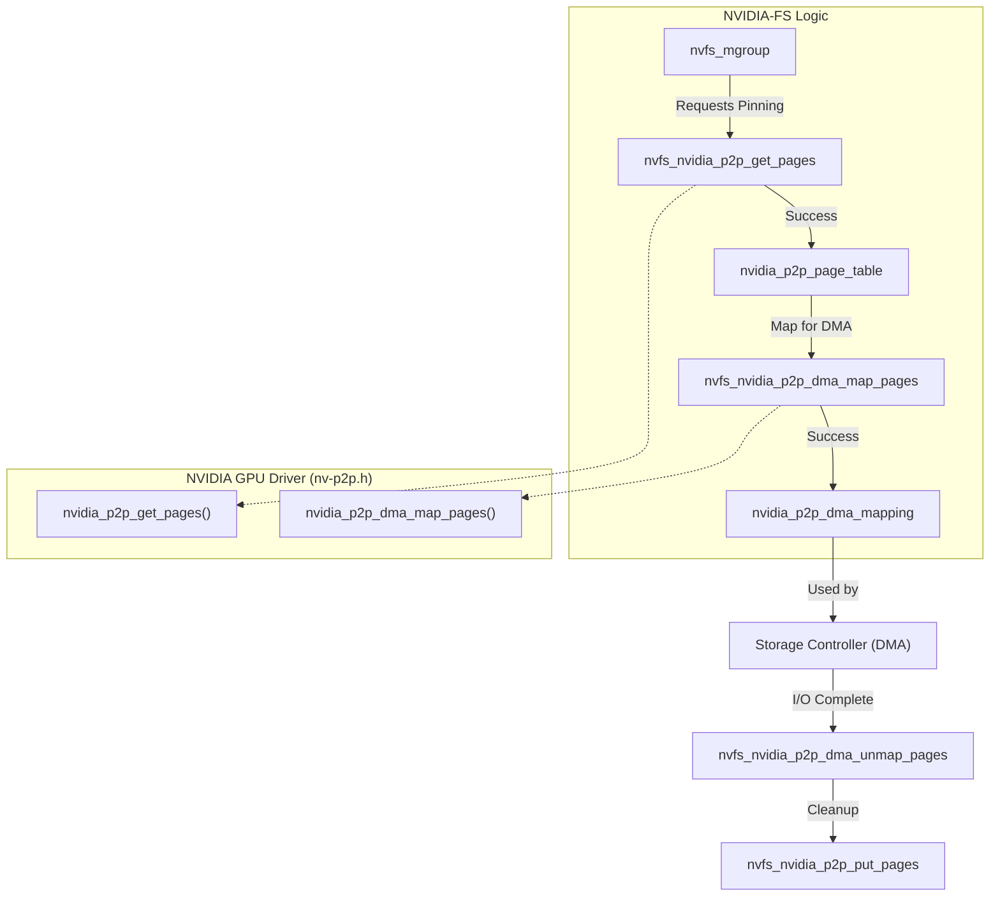
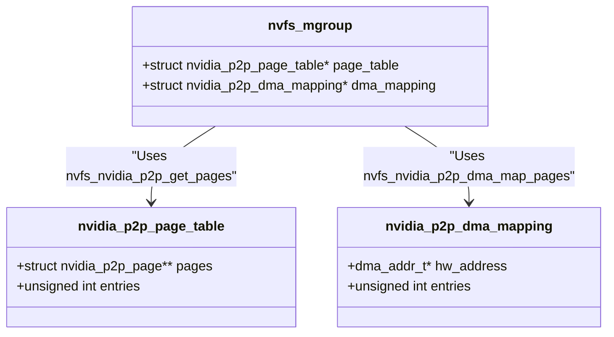

<!-- source: DeepWiki mcp.deepwiki.com · repo NVIDIA/gds-nvidia-fs · page 2.7 NVIDIA P2P API Integration · fetched 2026-11-11 -->

# NVIDIA P2P API Integration

Relevant source files

The following files were used as context for generating this wiki page:

- [src/nvfs-p2p.h](src/nvfs-p2p.h)

The NVIDIA Peer-to-Peer (P2P) API integration provides a shim layer between the `nvidia-fs` kernel module and the core NVIDIA GPU driver. This integration is critical for GPU Direct Storage (GDS) as it enables the pinning of GPU memory pages and the creation of DMA mappings that allow storage controllers to transfer data directly to or from GPU memory without CPU intervention.

## Architectural Overview

The P2P integration layer abstracts the complexities of GPU memory management, specifically focusing on the lifecycle of page tables and DMA mappings. The `nvidia-fs` driver utilizes these APIs to ensure that GPU memory addresses remain valid and accessible by peer PCI devices (such as NVMe controllers or NICs) during the lifetime of an I/O operation.

### Data Flow: GPU Memory Pinning and Mapping

The following diagram illustrates the lifecycle of a GPU memory buffer as it is prepared for P2P DMA operations.

**GPU P2P Mapping Lifecycle**

**Sources:** [src/nvfs-p2p.h:26-35](), [src/nvfs-p2p.h:1-21]()

## API Aliasing and Shim Layer

The file `src/nvfs-p2p.h` defines a set of macros that alias `nvfs_nvidia_p2p_*` functions to the underlying `nvidia_p2p_*` symbols provided by the NVIDIA kernel driver's P2P API. This abstraction allows the `nvidia-fs` codebase to maintain a consistent naming convention while interfacing with the `nv-p2p.h` header.

### Key Function Aliases

| NVIDIA-FS Alias | Core NVIDIA P2P Function | Purpose |
| :--- | :--- | :--- |
| `nvfs_nvidia_p2p_get_pages` | `nvidia_p2p_get_pages` | Pins GPU pages for a given virtual address range. [src/nvfs-p2p.h:30]() |
| `nvfs_nvidia_p2p_dma_map_pages` | `nvidia_p2p_dma_map_pages` | Maps pinned GPU pages into the DMA address space of a peer device. [src/nvfs-p2p.h:32]() |
| `nvfs_nvidia_p2p_put_pages` | `nvidia_p2p_put_pages` | Unpins and releases GPU pages. [src/nvfs-p2p.h:31]() |
| `nvfs_nvidia_p2p_dma_unmap_pages` | `nvidia_p2p_dma_unmap_pages` | Removes the DMA mapping for a peer device. [src/nvfs-p2p.h:33]() |
| `nvfs_nvidia_p2p_free_page_table` | `nvidia_p2p_free_page_table` | Frees the `nvidia_p2p_page_table` structure. [src/nvfs-p2p.h:34]() |
| `nvfs_nvidia_p2p_free_dma_mapping` | `nvidia_p2p_free_dma_mapping` | Frees the `nvidia_p2p_dma_mapping` structure. [src/nvfs-p2p.h:35]() |

**Sources:** [src/nvfs-p2p.h:23-37]()

## Persistent vs. Legacy P2P Modes

The driver supports two primary modes for managing GPU page lifetimes: Persistent and Legacy (Standard).

### Persistent P2P Mode
Persistent mode is used to reduce the overhead of frequently pinning and unpinning memory for long-lived buffers. This is particularly useful in high-performance computing (HPC) environments where the same GPU memory regions are reused for multiple I/O operations.

*   **`nvfs_nvidia_p2p_get_pages_persistent`**: Aliased to `nvidia_p2p_get_pages_persistent`. This function ensures that the pages remain pinned even if the calling process is not actively performing I/O, provided the memory handle remains valid. [src/nvfs-p2p.h:28]()
*   **`nvfs_nvidia_p2p_put_pages_persistent`**: Aliased to `nvidia_p2p_put_pages_persistent`. Used to release the persistent pinning. [src/nvfs-p2p.h:29]()

### Legacy P2P Mode
In standard mode, pages are pinned via `nvfs_nvidia_p2p_get_pages` at the start of a transaction (or memory group registration) and released via `nvfs_nvidia_p2p_put_pages` once the I/O or the memory group is destroyed. [src/nvfs-p2p.h:30-31]()

## Memory Mapping Lifecycle

The integration manages two distinct but related structures:
1.  **`nvidia_p2p_page_table`**: Represents the physical pages of the GPU memory.
2.  **`nvidia_p2p_dma_mapping`**: Represents the I/O Virtual Address (IOVA) mapping of those pages for a specific PCI device.

**Code Entity Relationship**

The `nvfs_nvidia_p2p_free_page_table` and `nvfs_nvidia_p2p_free_dma_mapping` functions are responsible for deallocating the metadata structures themselves, ensuring no memory leaks occur in the kernel shim after the actual unpinning/unmapping has been performed by the core NVIDIA driver. [src/nvfs-p2p.h:34-35]()

**Sources:** [src/nvfs-p2p.h:23-37]()

---

