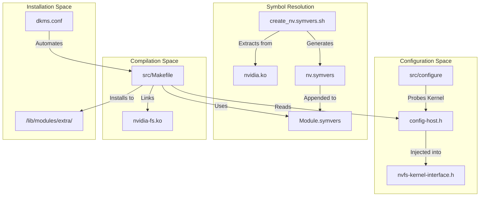
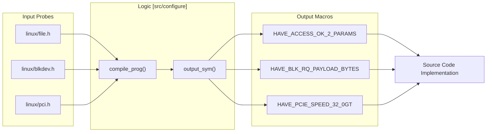

<!-- source: DeepWiki mcp.deepwiki.com · repo NVIDIA/gds-nvidia-fs · page 3 Installation & Configuration · fetched 2026-11-11 -->

# Installation & Configuration

<details>
<summary>Relevant source files</summary>

The following files were used as context for generating this wiki page:

- [src/Makefile](src/Makefile)
- [src/configure](src/configure)
- [src/dkms.conf](src/dkms.conf)
- [src/nvfs-pci.h](src/nvfs-pci.h)

</details>


This page provides comprehensive instructions for building, installing, and configuring the NVIDIA GPUDirect Storage (NVIDIA-FS) kernel driver. It covers the build system's automated feature detection, dependency resolution for NVIDIA symbols, and DKMS integration.

## Build Process Overview

The NVIDIA-FS build system is designed to handle kernel API shifts across different Linux distributions. It utilizes a custom configuration script to probe the host kernel and a symbol resolution script to link against the proprietary NVIDIA GPU driver.

### Build Workflow and Entity Mapping

The following diagram maps the build stages to the specific scripts and files responsible for them in the codebase.


Sources: [src/Makefile:105-115](), [src/configure:1-35](), [src/dkms.conf:52-56]()

## Building the Driver

The driver build relies on `make` which orchestrates feature detection and symbol resolution before invoking the Kbuild system.

### Core Build Steps
1. **Feature Detection**: The `nv_configure` target runs `src/configure`, which performs trial compilations to detect supported kernel structures like `struct fd` [src/configure:117-130]() or `call_read_iter` [src/configure:183-197]().
2. **Symbol Resolution**: The `nv_symbols` target executes `create_nv.symvers.sh`. This is critical because `nvidia-fs` depends on symbols from the NVIDIA GPU driver (e.g., `nv_p2p_get_pages`) which are not part of the standard kernel headers [src/Makefile:108-112]().
3. **Compilation**: The `module` target compiles the object files defined in `nvidia-fs-y`, including core logic and optional features like RDMA or Batch I/O [src/Makefile:55-71]().

For a deep dive into the build logic and dependency resolution, see **[Building the Driver](#3.1)**.

## Configuration Options

Configuration is handled at three levels: automated detection, build-time flags, and DKMS environment variables.

### Automated Kernel Compatibility
The `src/configure` script generates `config-host.h`, defining macros that the source code uses to toggle implementation paths. For example:
* `HAVE_STRUCT_FD_FILE_PARAM`: Set if `struct fd` contains a `.file` member [src/configure:128-130]().
* `HAVE_KI_COMPLETE`: Set if `struct kiocb` has the `.ki_complete` field [src/configure:245-247]().
* `HAVE_VM_FAULT`: Detects the presence of the `vm_fault_t` type [src/configure:260-262]().

### Build-time Macros
Users can influence driver limits and features via `make` variables:
* `NVFS_MAX_PEER_DEVS`: Limits the number of supported peer storage/network devices (Default: 64) [src/nvfs-pci.h:44-50]().
* `NVFS_MAX_PCI_DEPTH`: Defines the maximum depth of the PCI tree for distance calculations (Default: 16) [src/nvfs-pci.h:44-50]().
* `CONFIG_NVFS_STATS`: Enables I/O and performance telemetry [src/Makefile:56]().

### Configuration System Architecture


Sources: [src/configure:53-77](), [src/configure:146-180](), [src/configure:275-277]()

For a full list of supported macros and how they modify driver behavior, see **[Configuration Options](#3.2)**.

## DKMS Integration

The repository includes a `dkms.conf` file to support Automatic Kernel Module Building. This ensures that `nvidia-fs` is rebuilt automatically whenever the system kernel is updated.

* **Dependencies**: DKMS is configured to recognize the `nvidia` driver as a build dependency [src/dkms.conf:54]().
* **MOFED Detection**: The DKMS configuration includes logic to detect Mellanox OFED versions to ensure RDMA peer memory registration compatibility [src/dkms.conf:32-49]().
* **Custom Limits**: Environment variables `NVFS_MAX_PEER_DEVS` and `NVFS_MAX_PCI_DEPTH` can be passed to DKMS to override default topology limits [src/dkms.conf:29-30]().

Sources: [src/dkms.conf:23-62]()

## Installation

### Standard Installation
The driver can be installed manually after a successful build:
```bash
sudo make install
```
This copies `nvidia-fs.ko` to the kernel's `extra` directory and runs `depmod` to refresh the module dependency map [src/Makefile:117-120]().

### Loading the Driver
Once installed, the driver is loaded via `modprobe`:
```bash
sudo modprobe nvidia-fs
```
The driver will initialize the `/proc/driver/nvidia-fs` interface and begin discovery of supported PCI devices [src/nvfs-pci.h:64-77]().

Sources: [src/Makefile:117-120](), [src/nvfs-pci.h:31-40]()

---

