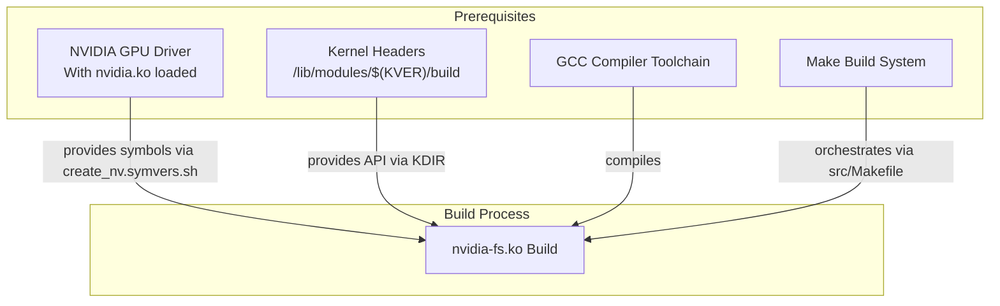
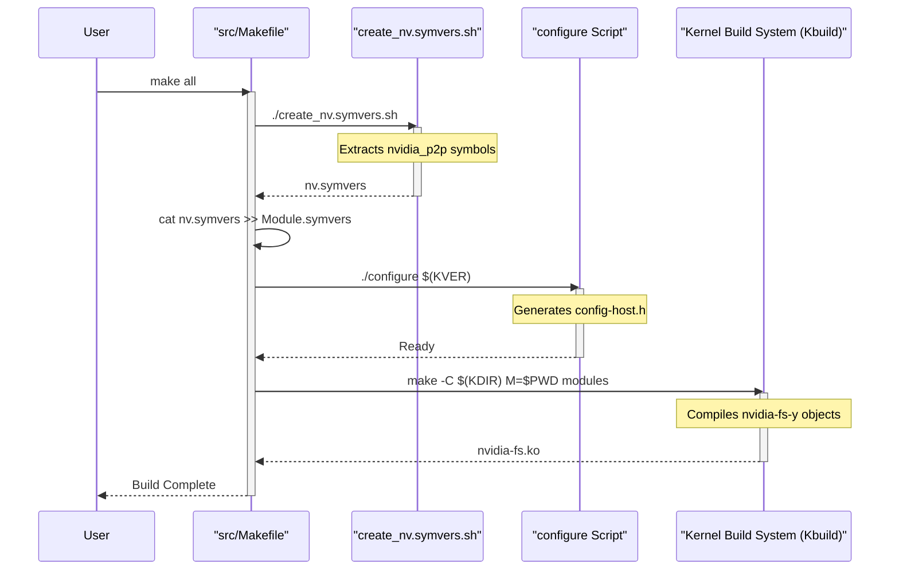
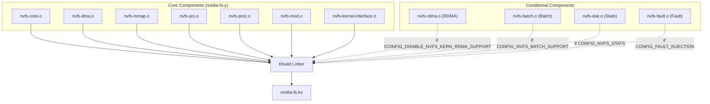

<!-- source: DeepWiki mcp.deepwiki.com · repo NVIDIA/gds-nvidia-fs · page 3.1 Building the Driver · fetched 2026-11-11 -->

# Building the Driver

Relevant source files

The following files were used as context for generating this wiki page:

- [src/Makefile](src/Makefile)
- [src/create_nv.symvers.sh](src/create_nv.symvers.sh)
- [src/dkms.conf](src/dkms.conf)
- [src/nvfs-pci.h](src/nvfs-pci.h)

This document provides comprehensive instructions for building the NVIDIA GPUDirect Storage (GDS) kernel driver from source code. The build process involves checking system compatibility, gathering NVIDIA driver symbols, and compiling the kernel module.

For information about configuring the driver after building, see [Configuration Options](#3.2).

## Prerequisites

Before building the NVIDIA-FS driver, you must have the following components installed:

- Linux kernel headers for your running kernel.
- NVIDIA GPU driver (installed and loaded).
- GCC compiler toolchain.
- Make build system.

### Build Environment Logic
The `Makefile` identifies the target kernel version and source directories for both the Linux kernel and the NVIDIA driver.

| Entity | Code Reference | Description |
| :--- | :--- | :--- |
| **Kernel Version** | `KVER` | Defaults to `$(shell uname -r)` [src/Makefile:21]() |
| **Kernel Directory** | `KDIR` | Points to `/lib/modules/$(KVER)/build` [src/Makefile:94]() |
| **NVIDIA Sources** | `NVIDIA_SRC_DIR` | Scanned in `/usr/src/nvidia-$(nv_version)/` for `nv-p2p.h` [src/Makefile:23-29]() |

Title: Build System Dependency Flow

Sources: [src/Makefile:21-29](), [src/Makefile:92-94](), [src/create_nv.symvers.sh:31-33]()

## Build Process Overview

The build process consists of three main stages:

1.  **Symbol Collection**: Extracting `nvidia_p2p_*` symbols from the installed NVIDIA driver to resolve dependencies.
2.  **Configuration**: Running the `./configure` script to detect kernel features and generate `config-host.h`.
3.  **Compilation**: Invoking Kbuild to produce the `nvidia-fs.ko` module.

Title: Makefile Execution Sequence

Sources: [src/Makefile:103-115](), [src/create_nv.symvers.sh:67]()

## Symbol Resolution (create_nv.symvers.sh)

The NVIDIA-FS driver depends on the NVIDIA Peer-to-Peer (P2P) APIs provided by the base NVIDIA GPU driver. Since these symbols are not part of the standard kernel, the build system must resolve their CRCs (Cyclic Redundancy Checks).

The `create_nv.symvers.sh` script performs the following:
1.  **Binary Inspection**: Uses `nm -o` on the installed `nvidia.ko` to find `__crc_nvidia_p2p_` symbols [src/create_nv.symvers.sh:108-122]().
2.  **Fallback Compilation**: If the binary contains relative CRCs (common on PPC), it attempts to recompile the NVIDIA driver from `/usr/src/nvidia-*` to generate a fresh `Module.symvers` [src/create_nv.symvers.sh:97-106]().
3.  **Symbol Generation**: Outputs a formatted `nv.symvers` file which is appended to the local `Module.symvers` [src/Makefile:112]().

Sources: [src/create_nv.symvers.sh:36-71](), [src/create_nv.symvers.sh:108-126](), [src/Makefile:108-112]()

## DKMS Integration

The driver supports Dynamic Kernel Module Support (DKMS) via `src/dkms.conf`. This ensures the driver is automatically rebuilt when the system kernel is upgraded.

Key DKMS configurations:
-   **Package Name/Version**: `nvidia-fs` version `2.7` [src/dkms.conf:23-25]().
-   **Dependencies**: Explicitly depends on the `nvidia` module [src/dkms.conf:54]().
-   **Build Command**: Executes `make` with specific overrides for peer device limits and PCI depth [src/dkms.conf:55]().
-   **OFED Detection**: Checks for Mellanox OFED versions (4.6+) to ensure compatibility with `ib_register_peer_memory_client` [src/dkms.conf:32-49]().

Sources: [src/dkms.conf:23-56]()

## Platform and Feature Flags

The build system adjusts the driver based on the architecture and environment variables.

### Architecture Support
-   **ARM64**: If `uname -m` returns `aarch64`, the flag `-DAARCH64_PLATFORM` is added [src/Makefile:41-49]().

### Custom Limits
Users can override default PCI and peer device limits via environment variables:
-   `NVFS_MAX_PEER_DEVS`: Maximum number of peer storage/NIC devices (Default: 64) [src/nvfs-pci.h:45-50]().
-   `NVFS_MAX_PCI_DEPTH`: Maximum depth of the PCI tree for topology calculations (Default: 16) [src/nvfs-pci.h:45-50]().

### Feature Toggles
| Flag | Effect | Code Reference |
| :--- | :--- | :--- |
| `CONFIG_NVFS_STATS` | Enables I/O and telemetry tracking in `nvfs-stat.c` | [src/Makefile:56]() |
| `CONFIG_FAULT_INJECTION` | Enables error simulation in `nvfs-fault.c` | [src/Makefile:57]() |
| `NVFS_ENABLE_KERN_RDMA_SUPPORT` | Includes RDMA support in `nvfs-rdma.c` | [src/Makefile:64-67]() |
| `NVFS_BATCH_SUPPORT` | Enables high-throughput batch I/O via `nvfs-batch.c` | [src/Makefile:68-71]() |

Sources: [src/Makefile:33-71](), [src/nvfs-pci.h:44-50]()

## Module Components

The final `nvidia-fs.ko` is linked from several object files, categorized by subsystem:

Title: Object Composition Map

Sources: [src/Makefile:55-71]()

## Installation and Removal

### Install
The `make install` target performs the following:
1.  Creates the destination directory `/lib/modules/$(KVER)/extra/` [src/Makefile:118]().
2.  Copies `nvidia-fs.ko` to the extra modules path [src/Makefile:119]().
3.  Invokes `depmod -a` to update the module dependency database [src/Makefile:120]().

### Uninstall
The `make uninstall` target removes the `.ko` file and refreshes `depmod` [src/Makefile:123-124]().

Sources: [src/Makefile:117-125]()

---

