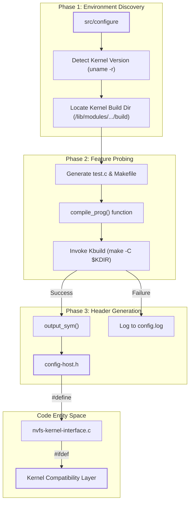
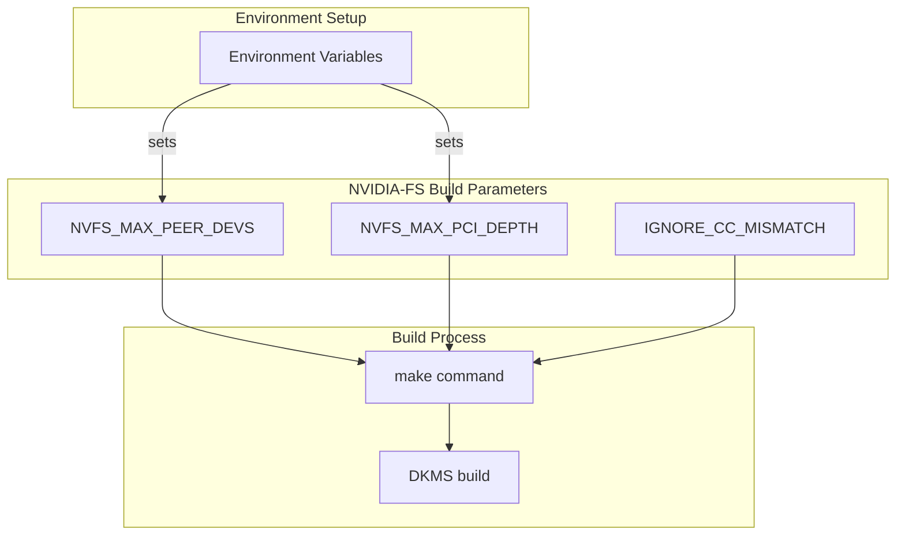
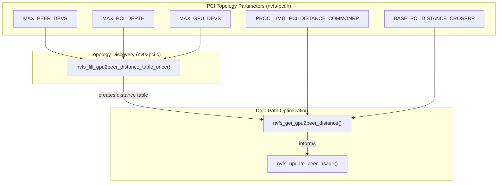

<!-- source: DeepWiki mcp.deepwiki.com · repo NVIDIA/gds-nvidia-fs · page 3.2 Configuration Options · fetched 2026-11-11 -->

# Configuration Options

Relevant source files

The following files were used as context for generating this wiki page:

- [src/configure](src/configure)
- [src/nvfs-kernel-interface.c](src/nvfs-kernel-interface.c)

This page documents the available configuration options for the NVIDIA GPUDirect Storage kernel driver (`nvidia-fs`). It covers the automated kernel compatibility detection system, the generated `config-host.h` macros, and build-time parameters that affect driver behavior across different Linux kernel versions.

## Kernel Compatibility Detection System

The `nvidia-fs` driver utilizes a custom configuration script to handle the diversity of Linux kernel APIs. Instead of relying solely on `LINUX_VERSION_CODE` macros, the build system performs feature-based probing to ensure compatibility with various distributions and backported kernels.

Sources: [src/configure:1-35](), [src/configure:53-77](), [src/configure:90-105]()

### The `configure` Script
The `src/configure` script is a shell script that automates the detection of kernel structures and function signatures. It creates a temporary directory `build/` and attempts to compile small kernel modules (`test.c`) against the target kernel headers.

Key functions in `src/configure`:
- `compile_prog()`: The core execution engine that calls `make` on the generated test files and checks the return code [src/configure:53-77]().
- `output_sym()`: Appends a `#define` to `config-host.h` if a probe succeeds [src/configure:42-44]().

### Generated Macros in `config-host.h`
The following table describes the primary macros generated by the probing system and how they influence driver implementation:

| Macro | Probe Logic | Effect on Driver |
|-------|-------------|------------------|
| `HAVE_STRUCT_FD_FILE_PARAM` | Checks if `struct fd` has a `.file` member [src/configure:120-127](). | Affects how file descriptors are dereferenced in VFS operations. |
| `HAVE_ACCESS_OK_3_PARAMS` | Checks if `access_ok()` takes 3 arguments (older kernels) [src/configure:140-142](). | Used in `nvfs_check_access` to validate user buffers [src/nvfs-kernel-interface.c:28-39](). |
| `HAVE_ACCESS_OK_2_PARAMS` | Checks if `access_ok()` takes 2 arguments (newer kernels) [src/configure:157-158](). | Used in `nvfs_check_access` [src/nvfs-kernel-interface.c:41-47](). |
| `HAVE_BLK_RQ_PAYLOAD_BYTES` | Checks for `blk_rq_payload_bytes` in `blkdev.h` [src/configure:173-174](). | Enables optimized block request size calculations. |
| `HAVE_CALL_READ_WRITE_ITER` | Checks for `call_read_iter` and `call_write_iter` in `fs.h` [src/configure:189-191](). | Determines the VFS entry point for I/O operations. |
| `HAVE_SECURITY_FILE_PERMISSION` | Checks `System.map` and headers for LSM hooks [src/configure:222-229](). | Enables mandatory access control checks during I/O. |
| `HAVE_KI_COMPLETE` | Checks if `struct kiocb` has a `.ki_complete` field [src/configure:239-242](). | Necessary for asynchronous I/O completion callbacks. |
| `HAVE_VM_FAULT` | Checks for the `vm_fault_t` type [src/configure:255-257](). | Standardizes return types for page fault handlers. |

Sources: [src/configure:114-262](), [src/nvfs-kernel-interface.c:26-50]()

## Build-Time Configuration Parameters

The NVIDIA-FS driver provides several build-time configuration parameters that can be customized during installation to adapt the driver to specific system requirements.

### Key Build Parameters

| Parameter | Default Value | Description |
|-----------|---------------|-------------|
| `NVFS_MAX_PEER_DEVS` | 64 | Maximum number of peer devices (storage/network) that can be tracked for GPU affinity |
| `NVFS_MAX_PCI_DEPTH` | 16 | Maximum PCI tree depth for topology discovery |
| `IGNORE_CC_MISMATCH` | 1 | Ignore compiler version mismatches during build |

These parameters can be set as environment variables before building the driver or passed directly to the make command. When using DKMS for driver installation, these parameters are defined in the `dkms.conf` file.

Sources: [src/dkms.conf:29-30](), [src/dkms.conf:55]()

## PCI Topology Configuration

The PCI topology configuration parameters control how the driver discovers and optimizes data paths between GPUs and storage/network devices.

### PCI Topology Parameters

| Parameter | Default Value | Description |
|-----------|---------------|-------------|
| `MAX_PEER_DEVS` | 64 | Maximum number of peer devices that can be tracked. On DGX-2, this covers 8 IB ports [src/nvfs-pci.h:44](). |
| `MAX_PCI_DEPTH` | 16 | Maximum PCI tree depth for topology discovery [src/nvfs-pci.h:47](). |
| `MAX_GPU_DEVS` | 64 | Maximum number of GPUs that can be tracked [src/nvfs-pci.h:50](). |
| `PROC_LIMIT_PCI_DISTANCE_COMMONRP` | 2 × `MAX_PCI_DEPTH` | Distance limit for devices under the same Root Port [src/nvfs-pci.h:55](). |
| `BASE_PCI_DISTANCE_CROSSRP` | `S8_MAX` | Minimum distance applied when paths cross Root Ports [src/nvfs-pci.h:58](). |

Sources: [src/nvfs-pci.h:44-58]()

## Module Parameters

The NVIDIA-FS driver supports load-time parameters to adjust its behavior without recompilation. These can be set in `/etc/modprobe.d/nvidia-fs.conf`.

### Runtime Configuration

| Parameter | Default | Description |
|-----------|---------|-------------|
| `nvfs_peer_distance_debug` | 0 | Enable detailed logging of PCI distance calculations. |
| `nvfs_optimize_gpu_affinity` | 1 | Enable GPU affinity optimization based on PCI topology. |

### Verifying Configuration
The state of the driver and its affinity mapping can be inspected via the `procfs` interface:
- `/proc/fs/nvfs/peer_distance`: Displays the calculated PCI distance matrix between GPUs and peers.
- `/proc/fs/nvfs/peer_affinity`: Displays GPU-to-peer device affinity statistics.

Sources: [src/nvfs-pci.h:227-250]()

---

