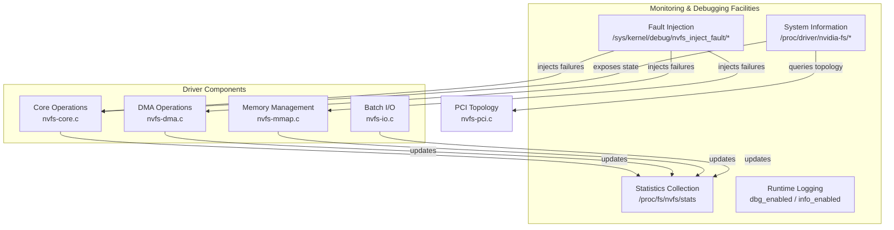
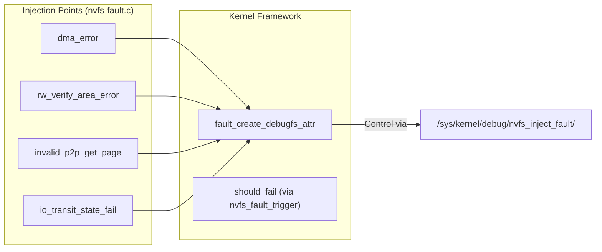

<!-- source: DeepWiki mcp.deepwiki.com · repo NVIDIA/gds-nvidia-fs · page 4 Debugging & Monitoring · fetched 2026-11-11 -->

# Debugging & Monitoring

Relevant source files

The following files were used as context for generating this wiki page:

- [src/nvfs-fault.c](src/nvfs-fault.c)
- [src/nvfs-proc.c](src/nvfs-proc.c)
- [src/nvfs-stat.c](src/nvfs-stat.c)
- [src/nvfs-stat.h](src/nvfs-stat.h)

This document provides a high-level overview of the debugging, monitoring, and fault injection capabilities of the NVIDIA GPUDirect Storage (GDS) driver. The `nvidia-fs` kernel module exposes internal state, performance metrics, and testing hooks through standard Linux interfaces like `procfs` and `debugfs`.

## Overview of Monitoring Facilities

The driver architecture includes dedicated subsystems for telemetry and error simulation. These components interact with the core I/O and memory management layers to provide visibility into the GDS pipeline.

**Sources:** [src/nvfs-proc.c:241-285](), [src/nvfs-stat.c:38-110](), [src/nvfs-fault.c:39-63]()

---

## Statistics and Telemetry

The statistics subsystem tracks the lifecycle of GDS operations. It utilizes atomic counters (e.g., `atomic64_t`) to maintain performance metrics without significant lock contention. Key metrics include I/O throughput, average latency for reads/writes, and BAR1 memory pressure per GPU.

- **Per-GPU Metrics:** Tracks `active_bar_memory_pinned` and `max_bar_memory_pinned` using a hash table indexed by GPU UUID.
- **I/O Counters:** Monitors successful and failed operations, including sparse I/O regions and batch submission latencies.
- **Interface:** Exposed via `/proc/fs/nvfs/stats` (implemented in `nvfs_stats_show`).

For details on available counters and performance calculation logic, see **[Statistics and Telemetry](#4.1)**.

**Sources:** [src/nvfs-stat.h:42-123](), [src/nvfs-stat.c:163-205]()

---

## Procfs Interface

The driver maintains a structured directory under `/proc/driver/nvidia-fs/` to provide the userspace library (`libnvdls`) and administrators with system-level metadata. This interface is initialized during module load via `nvfs_proc_init`.

| Entry | Code Entity | Description |
|-------|-------------|-------------|
| `version` | `nvfs_version_show` | Driver major/minor version. |
| `devcount` | `nvfs_devices_show` | Total count of NVIDIA GPUs visible to the driver. |
| `bridges` | `nvfs_bridge_show` | PCI devices with Access Control Services (ACS) enabled. |
| `peer_distance` | `nvfs_peer_distance_show` | Matrix of PCI distances between storage and GPU devices. |
| `modules` | `nvfs_modules_show` | List of registered vendor-specific DMA modules. |

For a complete map of the procfs hierarchy and its role in peer affinity discovery, see **[Procfs Interface](#4.2)**.

**Sources:** [src/nvfs-proc.c:41-56](), [src/nvfs-proc.c:84-90](), [src/nvfs-proc.c:117-128](), [src/nvfs-proc.c:241-275]()

---

## Fault Injection

To ensure driver robustness, NVIDIA-FS integrates with the Linux Kernel Fault Injection framework. When `CONFIG_FAULT_INJECTION` is enabled, developers can simulate failures in critical code paths through `debugfs`.

This framework allows testing of error recovery in the I/O state machine and memory pinning logic. For instructions on how to trigger specific failure modes, see **[Fault Injection](#4.3)**.

**Sources:** [src/nvfs-fault.c:31-37](), [src/nvfs-fault.c:49-62]()

---

## Logging Control

The driver supports three verbosity levels: `warn` (default), `info`, and `debug`. These are controlled by module parameters `dbg_enabled` and `info_enabled`. The current active level is reported in the general statistics output.

- **Debug Level:** Detailed trace of IOCTL arguments and internal state transitions.
- **Info Level:** High-level operation milestones and module registration events.
- **Warn/Error:** Critical failures and unexpected state machine conditions.

**Sources:** [src/nvfs-stat.c:192-194]()

---

