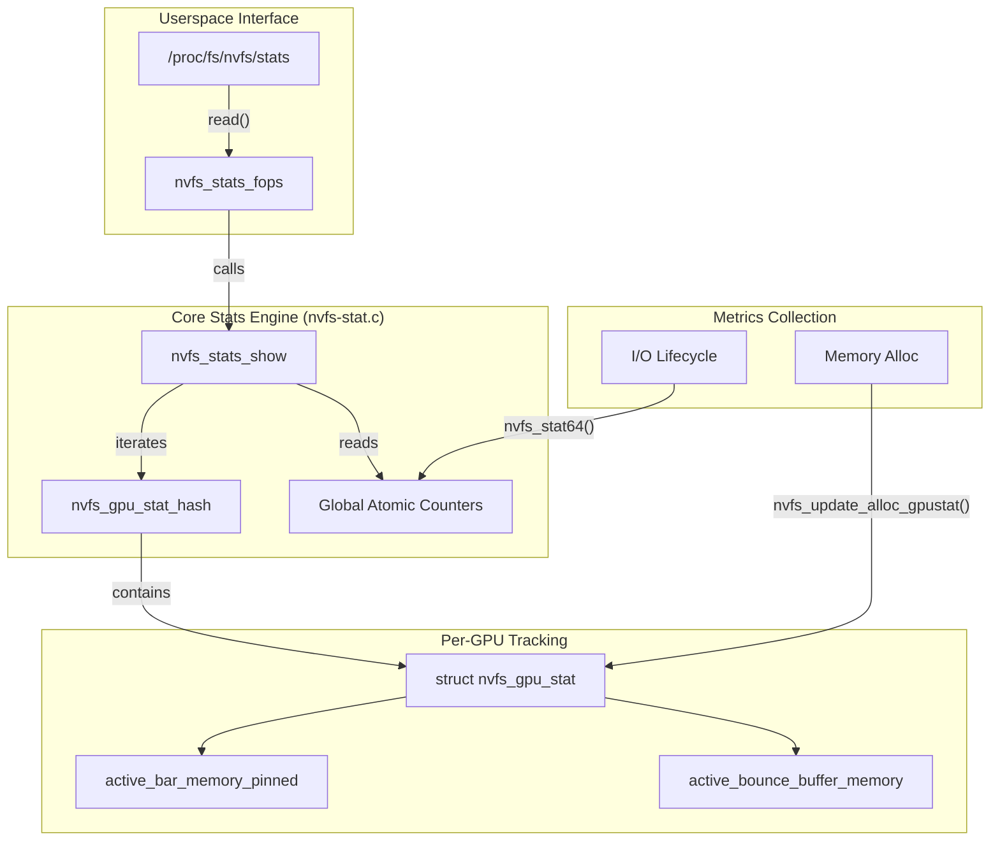
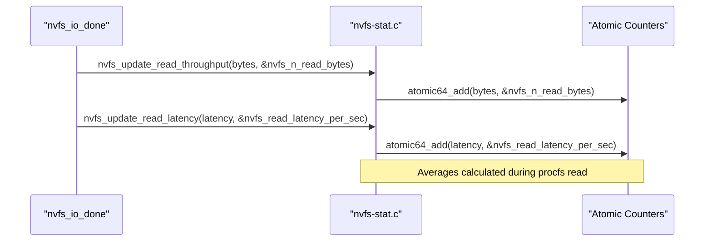

<!-- source: DeepWiki mcp.deepwiki.com · repo NVIDIA/gds-nvidia-fs · page 4.1 Statistics and Telemetry · fetched 2026-11-11 -->

# Statistics and Telemetry

Relevant source files

The following files were used as context for generating this wiki page:

- [src/nvfs-stat.c](src/nvfs-stat.c)
- [src/nvfs-stat.h](src/nvfs-stat.h)

The NVIDIA-FS driver includes a comprehensive statistics collection subsystem designed to monitor the health, performance, and resource utilization of GPU Direct Storage (GDS) operations. This subsystem tracks I/O throughput, latency, memory usage (specifically BAR1 and bounce buffers), and error rates. Data is exposed to userspace through a dedicated `procfs` interface at `/proc/fs/nvfs/stats`.

## Architecture Overview

The statistics subsystem is centered around a set of global atomic counters and a per-GPU hash table. The collection is conditionally compiled based on the `CONFIG_NVFS_STATS` macro [src/nvfs-stat.h:40]().

### Data Flow and Update Mechanism
The driver uses inline helper functions to update counters during the I/O lifecycle. For example, when a read operation is initiated, `nvfs_stat64(&nvfs_n_reads)` is called [src/nvfs-stat.h:158-161](). If an error occurs, error-specific counters like `nvfs_n_read_err` are incremented [src/nvfs-stat.c:43]().

### Telemetry Entity Mapping
The following diagram illustrates how high-level telemetry concepts map to specific code entities and data structures within the driver.

**Telemetry to Code Mapping**

**Sources:** [src/nvfs-stat.c:35-110](), [src/nvfs-stat.h:42-49](), [src/nvfs-stat.h:126-129]()

## Per-GPU Metrics

The driver tracks resource consumption on a per-GPU basis using the `nvfs_gpu_stat` structure. This is critical for monitoring BAR1 memory pressure and bounce buffer utilization in heterogeneous environments.

| Metric | Code Entity | Description |
| :--- | :--- | :--- |
| **BAR1 Pinned** | `active_bar_memory_pinned` | Current amount of GPU BAR1 memory pinned for DMA [src/nvfs-stat.h:45](). |
| **Max BAR1** | `max_bar_memory_pinned` | High-water mark for BAR1 memory pinning [src/nvfs-stat.h:47](). |
| **Bounce Buffer** | `active_bounce_buffer_memory` | Memory consumed by shadow/bounce buffers for this GPU [src/nvfs-stat.h:46](). |
| **Peer Usage** | `nvfs_aggregate_cross_peer_usage` | Percentage of traffic crossing PCIe root ports [src/nvfs-stat.c:151](). |

**Sources:** [src/nvfs-stat.h:42-49](), [src/nvfs-stat.c:132-155]()

## I/O Performance Tracking

The driver calculates throughput and latency for both standard and batch I/O operations. These metrics are updated via specific functions that handle time-averaging and accumulation.

### Throughput and Latency Functions
*   **`nvfs_update_read_throughput`**: Accumulates bytes read and updates `nvfs_read_throughput` [src/nvfs-stat.h:209-210]().
*   **`nvfs_update_read_latency`**: Tracks the time delta for read operations and updates `nvfs_avg_read_latency` [src/nvfs-stat.h:212-213]().
*   **`nvfs_update_batch_latency`**: Specifically tracks the submission latency for batch I/O operations [src/nvfs-stat.h:218-219]().

### Implementation of Metric Updates
The following sequence diagram shows how an I/O completion triggers a statistics update.

**I/O Completion Stats Update**

**Sources:** [src/nvfs-stat.c:41-74](), [src/nvfs-stat.h:179-182](), [src/nvfs-stat.h:209-221]()

## The /proc/fs/nvfs/stats Interface

The primary method for accessing telemetry is reading `/proc/fs/nvfs/stats`. This interface is implemented using the kernel `seq_file` API.

### Output Content
When read, the `nvfs_stats_show` function generates a report including:
1.  **Driver Metadata**: GDS Version, Driver Version, and Mellanox PeerDirect support status [src/nvfs-stat.c:164-187]().
2.  **Global Counters**: Total reads/writes, success counts, and error counts [src/nvfs-stat.c:205-220]().
3.  **Performance Metrics**: Throughput (MiB/s) and Average Latency (us) [src/nvfs-stat.c:212-218]().
4.  **Sparse I/O**: Statistics on sparse file reads and region counts [src/nvfs-stat.c:222-225]().
5.  **Memory Stats**: Active shadow buffer size and process counts [src/nvfs-stat.c:196-201]().
6.  **Error Breakdown**: Detailed counters for DMA mapping errors, SG list errors, and CPU/GPU mixed memory errors [src/nvfs-stat.c:237-240]().

### Resetting Statistics
Writing to the proc file triggers a reset of the high-water marks and cumulative counters via `nvfs_stats_write` [src/nvfs-stat.c:306](). Specifically, it calls `nvfs_reset_gpuinfo_stats()` to clear the `max_bar_memory_pinned` metric for all registered GPUs [src/nvfs-stat.c:112-123]().

**Sources:** [src/nvfs-stat.c:163-260](), [src/nvfs-stat.c:306-320](), [src/nvfs-stat.h:125-129]()

## Configuration and Debugging

The statistics subsystem behavior can be tuned via kernel module parameters:
*   **`nvfs_rw_stats_enabled`**: Enables/disables the collection of I/O read/write counters [src/nvfs-stat.c:189]().
*   **`nvfs_peer_stats_enabled`**: Enables/disables tracking of PCIe peer-to-peer cross-traffic [src/nvfs-stat.c:190]().
*   **`CONFIG_NVFS_DEBUG_STATS`**: If enabled during compilation, the driver performs additional validation on statistics (e.g., checking for negative counter values) and issues warnings on inconsistency [src/nvfs-stat.h:138-142]().

**Sources:** [src/nvfs-stat.c:188-190](), [src/nvfs-stat.h:138-146](), [src/nvfs-stat.h:165-173]()

---

