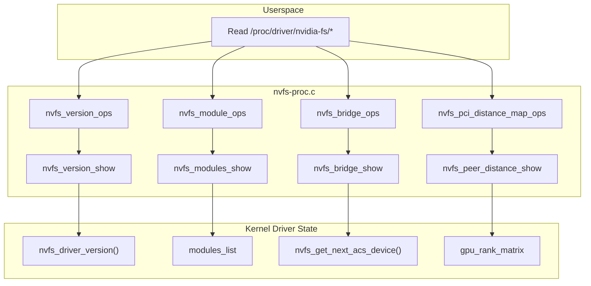
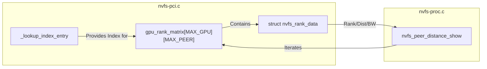

<!-- source: DeepWiki mcp.deepwiki.com · repo NVIDIA/gds-nvidia-fs · page 4.2 Procfs Interface · fetched 2026-11-11 -->

# Procfs Interface

Relevant source files

The following files were used as context for generating this wiki page:

- [src/nvfs-pci.c](src/nvfs-pci.c)
- [src/nvfs-proc.c](src/nvfs-proc.c)

The `nvidia-fs` kernel module exposes a structured interface via `procfs` located at `/proc/driver/nvidia-fs/`. This interface provides critical system metadata, PCI topology information, and driver state to userspace libraries (such as `libcufile`). It serves as the primary mechanism for userspace to discover GPU-to-Peer device distances, active storage modules, and hardware configuration constraints like ACS (Access Control Services) status.

## Directory Structure and Entry Overview

The interface is initialized during module loading via `nvfs_proc_init` [src/nvfs-proc.c:241-274](). It populates the `/proc/driver/nvidia-fs/` directory with several read-only entries.

| Entry Name | Functionality | Code Reference |
|:---|:---|:---|
| `version` | Returns the driver major and minor version. | [src/nvfs-proc.c:84-90]() |
| `devcount` | Returns the number of registered GPU devices. | [src/nvfs-proc.c:156-161]() |
| `bridges` | Lists PCI bridge BDFs with ACS enabled. | [src/nvfs-proc.c:117-128]() |
| `modules` | Lists registered storage vendor modules and versions. | [src/nvfs-proc.c:41-56]() |
| `peer_affinity` | Shows GPU-to-Peer device affinity and NUMA proximity. | [src/nvfs-proc.c:191-194]() |
| `peer_distance` | Displays the calculated PCI distance matrix. | [src/nvfs-proc.c:216-219]() |

**Sources:** [src/nvfs-proc.c:241-274](), [src/nvfs-proc.c:41-236]()

## Implementation and Data Flow

The procfs implementation relies on the Linux `seq_file` interface to handle potentially large outputs (like distance matrices) efficiently. Each entry is backed by a `proc_ops` (or `file_operations` on older kernels) structure that defines the `open`, `read`, and `release` handlers.

### Code Entity Mapping: Procfs to Internal State
The following diagram illustrates how procfs read operations traverse the driver's internal data structures to provide system information.

**Procfs Data Resolution Flow**

**Sources:** [src/nvfs-proc.c:41-236](), [src/nvfs-pci.c:110]()

## Detailed Entry Descriptions

### 1. Driver Version and Device Count
*   **`version`**: Userspace libraries check this to ensure compatibility with the kernel module API. It calls `nvfs_driver_version()` [src/nvfs-proc.c:86]() and formats it using `nvfs_major_version` and `nvfs_minor_version` [src/nvfs-proc.c:87-88]().
*   **`devcount`**: Invokes `nvfs_get_device_count()` to report the total number of GPUs currently managed by the driver [src/nvfs-proc.c:158]().

### 2. Storage Modules (`modules`)
This entry iterates through the `modules_list`, protected by `nvfs_module_mutex` [src/nvfs-proc.c:46-54](). It displays the name and version of every storage vendor module (e.g., for DDN, Weka, or generic NVMe) that has successfully registered with the `nvidia-fs` core.

### 3. PCI Bridges and ACS (`bridges`)
The `bridges` entry identifies PCI switches that might impact Peer-to-Peer (P2P) performance. It uses `nvfs_get_next_acs_device()` to traverse the PCI tree and print the BDF (Bus:Device.Function) of bridges where Access Control Services (ACS) are detected [src/nvfs-proc.c:120-126](). ACS can force P2P traffic up to the Root Complex, significantly increasing latency.

### 4. Peer Distance and Affinity
These entries are critical for the GDS I/O path selection logic in `libcufile`.
*   **`peer_distance`**: Displays the `gpu_rank_matrix` [src/nvfs-pci.c:110](). This matrix contains `nvfs_rank_data` which includes:
    *   `pci_dist`: The hop count between GPU and Peer [src/nvfs-pci.c:94]().
    *   `bw_index`: An indicator of available PCIe bandwidth [src/nvfs-pci.c:95]().
    *   `count`: Number of P2P DMA operations performed between the pair [src/nvfs-pci.c:96]().
*   **`peer_affinity`**: Shows the NUMA node affinity for each GPU-Peer pair, allowing userspace to pin threads to the optimal CPU core for specific I/O operations.

**PCI Topology and Rank Mapping**

**Sources:** [src/nvfs-pci.c:91-110](), [src/nvfs-proc.c:216-219]()

## Usage by Userspace Libraries
The GDS userspace library (`libcufile.so`) parses these procfs entries during `cuFileDriverOpen()`.
1.  **Validation**: It reads `version` to check for API mismatches.
2.  **Topology Awareness**: It parses `peer_distance` and `bridges` to build an internal map of the fastest data paths.
3.  **Optimization**: If a storage device and GPU are behind a bridge listed in `bridges` with ACS enabled, the library may warn the user or attempt to route traffic differently to avoid the performance penalty.

**Sources:** [src/nvfs-proc.c:83-116](), [src/nvfs-pci.c:110-156]()

---

