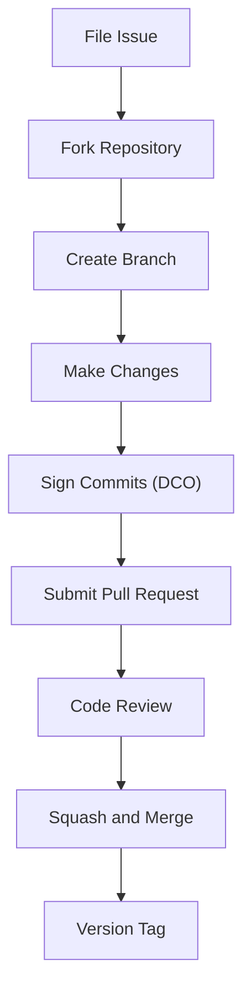
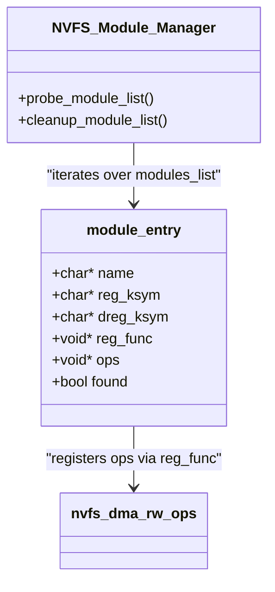

<!-- source: DeepWiki mcp.deepwiki.com · repo NVIDIA/gds-nvidia-fs · page 5 Development · fetched 2026-11-11 -->

# Development

Relevant source files

The following files were used as context for generating this wiki page:

- [CONTRIBUTING.md](CONTRIBUTING.md)
- [src/nvfs-kernel-interface.c](src/nvfs-kernel-interface.c)
- [src/nvfs-kernel-interface.h](src/nvfs-kernel-interface.h)
- [src/nvfs-mod.c](src/nvfs-mod.c)

This page provides essential information for developers who want to contribute to or work with the NVIDIA GPUDirect Storage (GDS) kernel driver codebase. It covers contribution guidelines, development workflows, and high-level architectural patterns for kernel compatibility and vendor integration.

## Contribution Guidelines

NVIDIA welcomes contributions to the GDS-NVIDIA-FS codebase. The project follows specific guidelines to ensure code quality and project consistency.

### Filing Issues First

Before submitting any code changes:
- Create an issue for bug reports or feature suggestions.
- Allow for discussion to ensure alignment with project goals.
- Use the issue as a reference when submitting your PR.

### Versioning

The project follows [Semantic Versioning](https://semver.org/):
- **MAJOR** version for incompatible API changes.
- **MINOR** version for backward-compatible functionality additions (e.g., adding support for new filesystems).
- **PATCH** version for backward-compatible bug fixes.

Contributors should not include version changes in their pull requests. Version bumps are handled separately by maintainers.

### Contribution Workflow

The diagram below illustrates the standard fork and pull request workflow used in this project:

**GDS Contribution Lifecycle**

Sources: [CONTRIBUTING.md:1-55]()

### Commit Message Format

All commit messages must follow the [Conventional Commits](https://www.conventionalcommits.org/) specification. This makes history clearer and rollbacks more manageable.

Sources: [CONTRIBUTING.md:36-40]()

## Code Sign-off Process

GDS-NVIDIA-FS requires a Developer Certificate of Origin (DCO) sign-off for all contributions. This certifies that you have the right to submit the code under the project's license. To sign your commits, add a `Signed-off-by` line to your commit messages. You can automate this with `git commit -s`.

Sources: [CONTRIBUTING.md:57-111]()

## Kernel Compatibility Layer

The driver must support a wide range of Linux kernel versions. To manage this, the codebase uses a compatibility shim that abstracts version-specific kernel APIs.

- **Feature Probing**: The build system uses a `configure` script to detect kernel capabilities and generate `config-host.h` [src/nvfs-kernel-interface.h:35-35]().
- **Interface Abstraction**: Files like `nvfs-kernel-interface.h` and `nvfs-kernel-interface.c` provide wrappers for APIs that change across versions, such as `access_ok` [src/nvfs-kernel-interface.c:26-50]() and memory management types like `vm_fault_t` [src/nvfs-kernel-interface.h:41-45]().

For details, see [Kernel Compatibility Layer](#5.1).

Sources: [src/nvfs-kernel-interface.h:22-50](), [src/nvfs-kernel-interface.c:26-70]()

## Vendor and Peer Device Integration

The GDS driver uses a modular architecture to interface with third-party storage drivers (e.g., NVMe, distributed filesystems).

### Module Registration System

The driver maintains a `modules_list` [src/nvfs-mod.c:38-38]() containing `struct module_entry` objects. Each entry identifies a vendor module and the symbols required for registration.

**Module Discovery Logic**

### Dynamic Symbol Resolution
During initialization, `probe_module_list` [src/nvfs-mod.c:40-40]() attempts to resolve vendor symbols using `__symbol_get` [src/nvfs-mod.c:56-56](). If found, it invokes the vendor's registration function, passing the appropriate version of the DMA operations structure (e.g., `nvfs_dma_rw_ops` for v1 or `nvfs_dma_rw_blk_iter_ops` for v2) [src/nvfs-mod.c:86-104]().

For details, see [Vendor and Peer Device Integration](#5.2).

Sources: [src/nvfs-mod.c:40-129](), [src/nvfs-mod.c:131-162]()

## Development Best Practices

### Code Formatting
- Follow existing file formats.
- Prioritize clarity over brevity.
- Keep lines under 80 columns whenever reasonable [CONTRIBUTING.md:51-55]().

### Adding Support for New Storage
1. Define a new entry in `modules_list`.
2. Implement the `nvfs_dma_rw_ops` callback interface.
3. Ensure compatibility with the `nvfs_extend_sg_markers` logic for scatter-gather list management [src/nvfs-kernel-interface.c:52-70]().

Sources: [CONTRIBUTING.md:51-55](), [src/nvfs-mod.c:38-44](), [src/nvfs-kernel-interface.c:52-70]()

---

