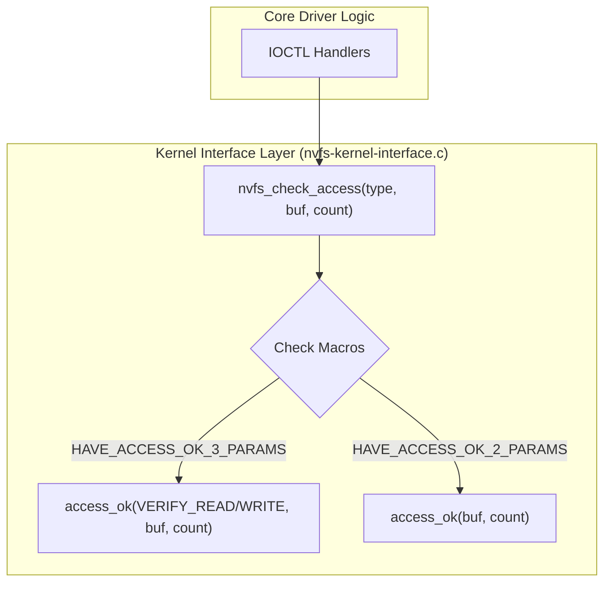
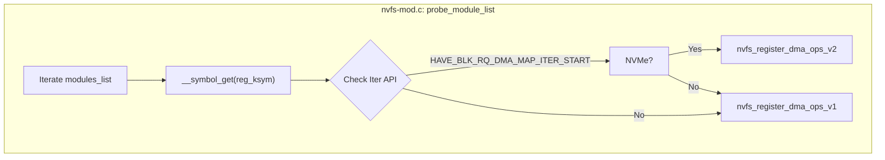

<!-- source: DeepWiki mcp.deepwiki.com · repo NVIDIA/gds-nvidia-fs · page 5.1 Kernel Compatibility Layer · fetched 2026-11-11 -->

# Kernel Compatibility Layer

Relevant source files

The following files were used as context for generating this wiki page:

- [src/configure](src/configure)
- [src/nvfs-kernel-interface.c](src/nvfs-kernel-interface.c)
- [src/nvfs-kernel-interface.h](src/nvfs-kernel-interface.h)
- [src/nvfs-mod.c](src/nvfs-mod.c)

The **Kernel Compatibility Layer** in the NVIDIA-FS driver is a multi-tier abstraction system designed to ensure the driver remains functional across a wide range of Linux kernel versions. Because the Linux kernel does not maintain a stable internal ABI, the driver must adapt to changes in core structures (such as `struct fd`, `kiocb`, and `folio`), function signatures (like `access_ok`), and memory management types (such as `vm_fault_t`).

This layer consists of a build-time configuration probe system (`src/configure`) and a shim interface (`nvfs-kernel-interface.h/c`) that abstracts version-specific logic.

## 1. The Configure Probe System

The primary mechanism for detecting kernel capabilities is the `src/configure` script. Unlike standard GNU Autotools, this script performs targeted compilation tests against the specific kernel headers of the target environment.

### 1.1 Detection Logic
The script generates a temporary kernel module (`test.o`) to verify if specific symbols, structure members, or function signatures are present. Based on the success or failure of these compilations, it generates `config-host.h`, which contains macros used throughout the codebase.

| Probe Feature | Macro Generated | Code Entity Tested |
|:---|:---|:---|
| `struct fd` member | `HAVE_STRUCT_FD_FILE_PARAM` | `fd.file` [src/configure:122-123]() |
| `access_ok` signature | `HAVE_ACCESS_OK_3_PARAMS` | `access_ok(VERIFY_READ, ...)` [src/configure:140]() |
| `access_ok` signature | `HAVE_ACCESS_OK_2_PARAMS` | `access_ok(NULL, 0)` [src/configure:157]() |
| Block Layer I/O | `HAVE_BLK_RQ_PAYLOAD_BYTES` | `blk_rq_payload_bytes()` [src/configure:173]() |
| VFS Iterators | `HAVE_CALL_READ_WRITE_ITER` | `call_read_iter()` [src/configure:189]() |
| MM Types | `HAVE_VM_FAULT` | `vm_fault_t` [src/configure:255]() |
| Module Locking | `HAVE_MODULE_MUTEX` | `module_mutex` [src/configure:340]() |

**Sources:** [src/configure:42-44](), [src/configure:86-88](), [src/configure:114-130](), [src/configure:249-262]()

## 2. Kernel Interface Shim

The files `nvfs-kernel-interface.h` and `nvfs-kernel-interface.c` provide a unified API for the rest of the driver, hiding the complexity of the macros generated by the configure script.

### 2.1 User Access Validation
The function `nvfs_check_access` abstracts the transition of the `access_ok` macro from three parameters (type, addr, size) to two parameters (addr, size) in newer kernels.

**Flow of User Access Validation:**
The driver uses the probe-generated macros to determine which signature to invoke, ensuring that memory safety checks are performed correctly regardless of the kernel version.

**Kernel Interface Data Flow**

**Sources:** [src/nvfs-kernel-interface.c:26-50](), [src/nvfs-kernel-interface.h:47]()

### 2.2 Memory Management Compatibility
The driver defines `nvfs_vma_fault_t` to handle the transition from `int` to `vm_fault_t` for VMA fault handlers. This prevents type-mismatch warnings and errors in the memory mapping subsystem.

**Sources:** [src/nvfs-kernel-interface.h:41-45]()

## 3. Dynamic Module Integration

The compatibility layer also handles how the driver interacts with other kernel modules (like NVMe or vendor-specific storage drivers). It uses the `probe_module_list` function to resolve symbols at runtime.

### 3.1 Registration Versioning
Depending on the kernel version and block layer capabilities (e.g., `HAVE_BLK_RQ_DMA_MAP_ITER_START`), the driver chooses between different registration paths for DMA operations.

**Module Registration Logic**

**Sources:** [src/nvfs-mod.c:40-44](), [src/nvfs-mod.c:86-104]()

## 4. Scatter-Gather and Block Layer Shims

The driver must often manipulate scatter-gather lists in ways that are sensitive to internal kernel changes. For example, `nvfs_extend_sg_markers` handles SG chaining and termination, which is version-dependent due to changes in how drivers like NVMe handle segment limits.

| Function | Responsibility | Version Dependency |
|:---|:---|:---|
| `nvfs_extend_sg_markers` | Unmarks SG end and prepares next segment for chaining. | Requires `KERNEL_VERSION(4,18,0)` or higher [src/nvfs-kernel-interface.c:57-70]() |
| `GPU_BIOVEC_PHYS_MERGEABLE` | Macro to check if two BIO vectors are physically contiguous. | Relies on `page_index` [src/nvfs-kernel-interface.h:38-39]() |

**Sources:** [src/nvfs-kernel-interface.c:52-71](), [src/nvfs-kernel-interface.h:38-39]()

## 5. Summary of Key Entities

| Code Entity | File | Purpose |
|:---|:---|:---|
| `config-host.h` | Generated | Contains all `HAVE_*` compatibility macros [src/configure:32]() |
| `nvfs_check_access` | `nvfs-kernel-interface.c` | Version-agnostic wrapper for `access_ok` [src/nvfs-kernel-interface.c:26]() |
| `nvfs_vma_fault_t` | `nvfs-kernel-interface.h` | Typedef for VMA fault return types [src/nvfs-kernel-interface.h:42]() |
| `probe_module_list` | `nvfs-mod.c` | Dynamically links to vendor modules based on available APIs [src/nvfs-mod.c:40]() |

**Sources:** [src/configure:32](), [src/nvfs-kernel-interface.c:26](), [src/nvfs-kernel-interface.h:42](), [src/nvfs-mod.c:40]()

---

