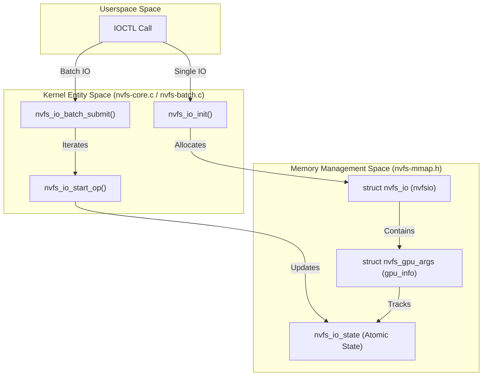
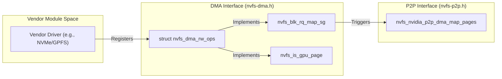

<!-- source: DeepWiki mcp.deepwiki.com · repo NVIDIA/gds-nvidia-fs · page 6 Glossary · fetched 2026-11-11 -->

# Glossary

Relevant source files

The following files were used as context for generating this wiki page:

- [ChangeLog](ChangeLog)
- [src/nvfs-batch.c](src/nvfs-batch.c)
- [src/nvfs-core.c](src/nvfs-core.c)
- [src/nvfs-dma.h](src/nvfs-dma.h)
- [src/nvfs-mmap.h](src/nvfs-mmap.h)
- [src/nvfs-p2p.h](src/nvfs-p2p.h)
- [src/nvfs-pci.c](src/nvfs-pci.c)
- [src/nvfs-rdma.c](src/nvfs-rdma.c)

This page defines codebase-specific terms, abbreviations, and domain concepts used within the `gds-nvidia-fs` driver. It provides technical details on implementation, data flow, and links to relevant code entities to assist onboarding engineers.

## Core Concepts & Data Structures

### nvfs_io (nvfsio)
The central structure representing a single I/O operation. It contains the user-space virtual address, file descriptor, offset, length, and the kernel `kiocb` used for asynchronous I/O submission.
*   **Implementation**: Defined in [src/nvfs-mmap.h:104-127]().
*   **Key Fields**:
    *   `cpuvaddr`: Shadow buffer address (4k aligned) [src/nvfs-mmap.h:105]().
    *   `common`: The `struct kiocb` used for VFS-level read/write [src/nvfs-mmap.h:123]().
    *   `state`: Tracks if the I/O encountered sparse data or errors [src/nvfs-mmap.h:120]().

### nvfs_io_mgroup (mgroup)
A "Memory Group" that encapsulates the relationship between a user-space memory mapping and the underlying GPU memory. It manages the lifecycle of pinned GPU pages and associated DMA mappings.
*   **Implementation**: Linked to `nvfs_gpu_args` [src/nvfs-mmap.h:136-152]().
*   **Data Flow**: When a user-space process initiates GDS, an `mgroup` is retrieved or created based on the virtual address [src/nvfs-rdma.c:46-50]().

### nvfs_gpu_args (gpu_info)
Contained within an `mgroup`, this structure tracks GPU-specific metadata for an I/O, including the NVIDIA Peer-to-Peer (P2P) page table and PCI topology information.
*   **Implementation**: Defined in [src/nvfs-mmap.h:136-152]().
*   **Key Fields**:
    *   `page_table`: Pointer to `nvidia_p2p_page_table_t` [src/nvfs-mmap.h:137]().
    *   `io_state`: Atomic state machine for I/O transitions [src/nvfs-mmap.h:142]().
    *   `buckets`: A hash table for caching DMA mappings per PCI device [src/nvfs-mmap.h:151]().

### I/O State Machine
The driver uses an atomic state machine to track the lifecycle of an I/O request and ensure safe cleanup during concurrent operations or process termination.
*   **States**: `IO_FREE`, `IO_INIT`, `IO_READY`, `IO_IN_PROGRESS`, `IO_TERMINATE_REQ`, `IO_TERMINATED`, `IO_CALLBACK_REQ`, `IO_CALLBACK_END` [src/nvfs-mmap.h:69-85]().
*   **Transitions**: Managed via `nvfs_transit_state` [src/nvfs-core.c:143-205]().

### PCI Ranking & Distance
To optimize performance, the driver calculates a "rank" for Peer-to-Peer (P2P) transfers based on PCI topology (e.g., whether devices share a Common Root Port).
*   **nvfs_rank_data**: Stores rank, PCI distance, and bandwidth index [src/nvfs-pci.c:91-97]().
*   **Calculation**: Performed during device discovery to determine the affinity between GPUs and storage controllers [src/nvfs-pci.c:110]().

---

## Code Entity Map: I/O Submission Path

The following diagram illustrates how natural language concepts of "I/O Request" and "Memory Mapping" map to specific code entities and functions during the submission flow.

**I/O Submission Logic Flow**

Sources: [src/nvfs-batch.c:71-146](), [src/nvfs-core.c:143-205](), [src/nvfs-mmap.h:104-152]()

---

## Storage & DMA Integration

### nvfs_dma_rw_ops
A callback interface used by third-party storage drivers (vendors) to integrate with NVIDIA-FS. This allows the driver to support various filesystems (NVMe, GPFS, Weka, etc.).
*   **Implementation**: Defined in [src/nvfs-dma.h:74-101]().
*   **Key Callbacks**:
    *   `nvfs_blk_rq_map_sg`: Maps a block request to a scatter-gather list [src/nvfs-dma.h:77]().
    *   `nvfs_is_gpu_page`: Checks if a specific page resides on GPU memory [src/nvfs-dma.h:92]().

### RDMA Integration
For distributed filesystems like GPFS, the driver manages RDMA registration information to facilitate remote P2P transfers.
*   **nvfs_rdma_info**: Stores QP numbers, GIDs, and RKeys [src/nvfs-mmap.h:160-175]().
*   **Functions**: `nvfs_set_rdma_reg_info_to_mgroup` handles the IOCTL to register RDMA capabilities [src/nvfs-rdma.c:33-110]().

**DMA and Vendor Callback Mapping**

Sources: [src/nvfs-dma.h:74-124](), [src/nvfs-p2p.h:28-35](), [src/nvfs-rdma.c:33-110]()

---

## Technical Glossary Table

| Term | Definition | Relevant Files |
| :--- | :--- | :--- |
| **P2P (Peer-to-Peer)** | Direct data transfer between two PCI devices (e.g., NVMe to GPU) bypassing CPU memory. | [src/nvfs-p2p.h]() |
| **Shadow Buffer** | A temporary CPU-side buffer used when direct P2P is not possible or for metadata. | [src/nvfs-mmap.h:105]() |
| **Scatter-Gather (SG)** | A list of non-contiguous memory pages involved in a single DMA operation. | [src/nvfs-dma.h:79]() |
| **RKey (Remote Key)** | A security token used in RDMA operations to access remote memory. | [src/nvfs-mmap.h:171]() |
| **ACS (Access Control Services)** | A PCI Express feature that can restrict P2P; the driver checks for this to determine path safety. | [src/nvfs-pci.c:229]() |
| **Batch I/O** | A mechanism to submit multiple I/O requests in a single IOCTL to reduce overhead. | [src/nvfs-batch.c]() |
| **VMA (Virtual Memory Area)** | A kernel structure representing a range of virtual memory in a process. | [src/nvfs-core.c:36]() |
| **kiocb** | Kernel I/O Control Block, used to track asynchronous I/O in the VFS layer. | [src/nvfs-mmap.h:123]() |

Sources: [src/nvfs-mmap.h:1-175](), [src/nvfs-dma.h:1-124](), [src/nvfs-pci.c:1-230](), [src/nvfs-batch.c:1-178]()