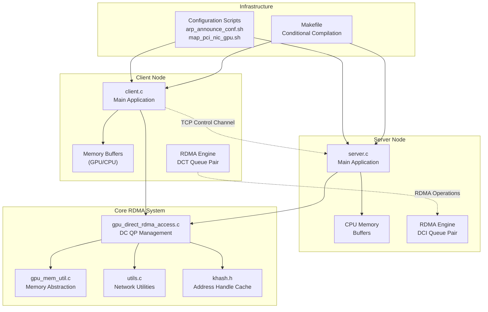
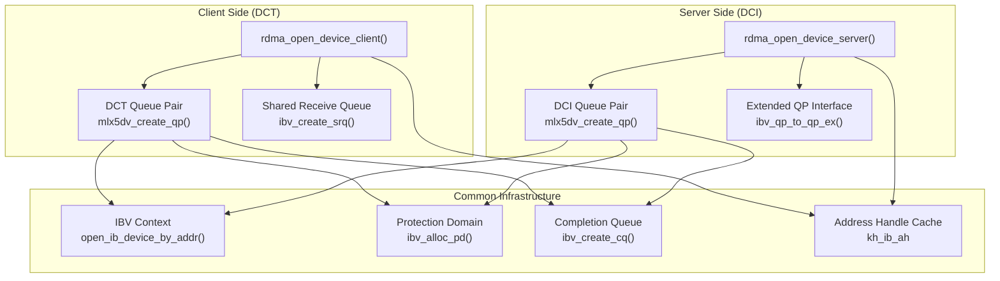
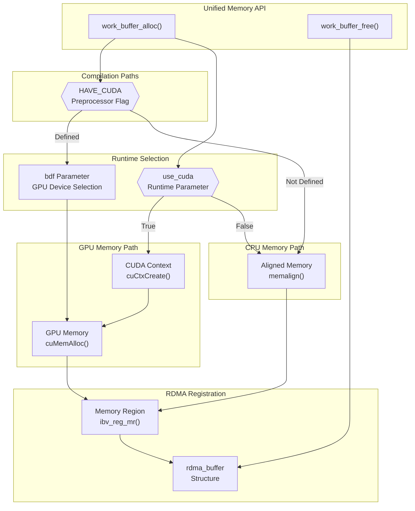
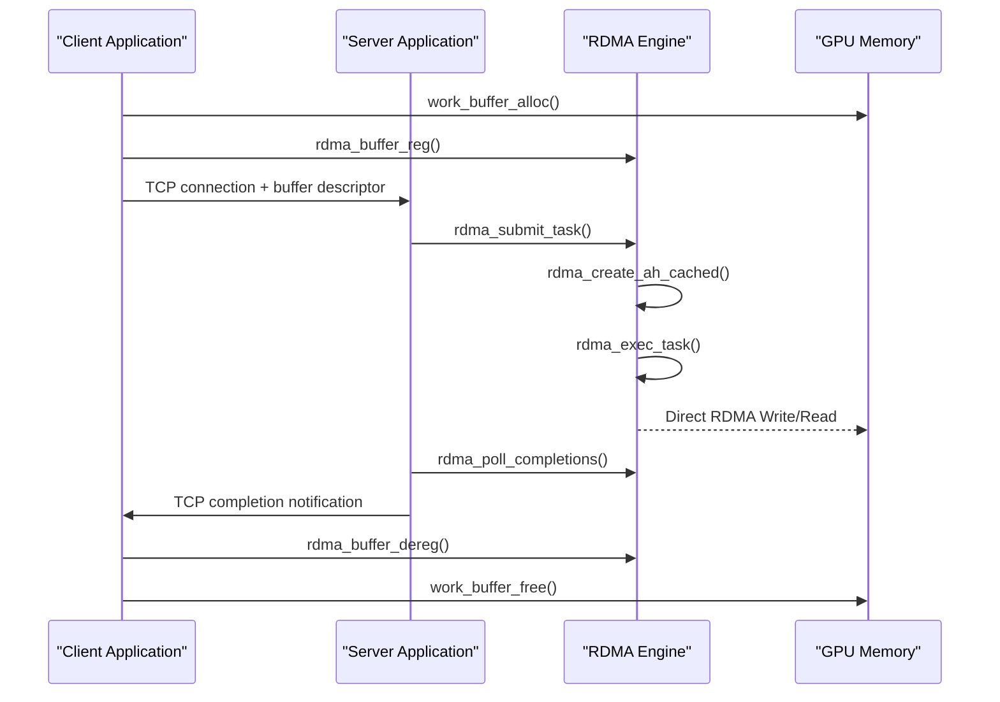

<!-- source: DeepWiki mcp.deepwiki.com · repo Mellanox/gpu_direct_rdma_access · page 1 Overview · fetched 2026-11-11 -->

# Overview

Relevant source files

The following files were used as context for generating this wiki page:

- [Makefile](Makefile)
- [README.md](README.md)
- [gpu_direct_rdma_access.c](gpu_direct_rdma_access.c)

## Purpose and Scope

This document provides an overview of the GPU Direct RDMA Access system, a high-performance data transfer solution that enables direct memory access between distributed systems using Mellanox Dynamic Connect (DC) Queue Pairs. The system supports both GPU and CPU memory allocation with transparent RDMA operations, eliminating traditional CPU-mediated data transfers for optimal performance.

The system consists of client-server applications that demonstrate GPU Direct RDMA capabilities, along with supporting libraries for memory management, network configuration, and hardware topology discovery. For detailed information about specific subsystems, see the [Build System](#2), [Core RDMA Engine](#3), [Memory Management Subsystem](#4), and [Client-Server Applications](#5).

Sources: [README.md:1-4](), [gpu_direct_rdma_access.c:1-31]()

## High-Level Architecture

The GPU Direct RDMA Access system implements a distributed architecture where clients can perform high-performance data transfers to remote servers using RDMA operations directly to GPU or CPU memory buffers.

### System Architecture Overview

Sources: [Makefile:1-55](), [gpu_direct_rdma_access.c:97-154](), [README.md:10-16]()

## Key Features

### Dynamic Connect Queue Pairs
The system uses Mellanox-specific Dynamic Connect (DC) Queue Pairs to achieve high performance RDMA operations. The client creates a DCT (Dynamic Connect Target) while the server uses DCI (Dynamic Connect Initiator) for scalable one-to-many connections.

### Unified Memory Management
The memory subsystem provides a transparent abstraction layer supporting both CUDA GPU memory and traditional CPU memory allocation through a single API, enabling deployment flexibility across different hardware configurations.

### Address Handle Caching
Performance optimization through cached address resolution using hash tables to store `ibv_ah` structures, reducing overhead for repeated RDMA operations to the same destinations.

### Conditional Compilation
Sophisticated build system supporting multiple variants: GPU-enabled vs CPU-only builds, with optional latency measurement capabilities through preprocessor flags.

Sources: [gpu_direct_rdma_access.c:618-621](), [gpu_direct_rdma_access.c:796-798](), [gpu_direct_rdma_access.c:76](), [Makefile:5-19]()

## Core System Components

### RDMA Device Management

Sources: [gpu_direct_rdma_access.c:526-711](), [gpu_direct_rdma_access.c:714-886](), [gpu_direct_rdma_access.c:97-143]()

### Memory Management Architecture

Sources: [gpu_mem_util.c:1-200](), [gpu_direct_rdma_access.c:1155-1212]()

## Build System Architecture

The build system uses conditional compilation to create different variants from the same codebase:

| Build Flag | Purpose | Libraries | Target Use Case |
|------------|---------|-----------|-----------------|
| `USE_CUDA=1` | Enable GPU support | `-lcuda` + RDMA libs | Client machines with GPU |
| `USE_CUDA=0` | CPU-only build | RDMA libs only | Server machines |
| `PRINT_LAT=1` | Enable latency measurement | Extended CQ support | Performance analysis |
| `PRINT_LAT=0` | Standard build | Standard CQ | Production deployment |

### Core Dependencies
- **RDMA Libraries**: `libverbs`, `lrdmacm`, `lmlx5` for InfiniBand/RoCE operations
- **CUDA Libraries**: `libcuda` for GPU memory management (conditional)
- **Source Components**: `gpu_direct_rdma_access.c`, `gpu_mem_util.c`, `utils.c`
- **Header Dependencies**: All `.h` files defining API interfaces

Sources: [Makefile:5-32](), [Makefile:37-45]()

## Task Execution Flow

Sources: [gpu_direct_rdma_access.c:1342-1419](), [gpu_direct_rdma_access.c:890-1006](), [gpu_direct_rdma_access.c:1422-1548]()

## Hardware Requirements and Configuration

### Required Hardware
- **NICs**: Mellanox ConnectX-5 or newer for DC QP support
- **GPUs**: NVIDIA GPUs with CUDA support (client-side optional)
- **Network**: InfiniBand or RoCE-capable Ethernet infrastructure

### Configuration Scripts
- **`arp_announce_conf.sh`**: Configures ARP handling for multi-homed RoCE networks
- **`map_pci_nic_gpu.sh`**: Discovers optimal GPU-NIC pairings on same PCI bridge for performance

Sources: [README.md:23-42](), [README.md:75-84]()

## Performance Characteristics

The system is optimized for high-performance data transfer with several key optimizations:

- **Zero-copy transfers**: Direct GPU-to-GPU memory access bypassing CPU
- **Address handle caching**: Reduces connection setup overhead using `khash` implementation
- **Polling-based completion**: Eliminates interrupt overhead for low latency
- **Scatter-gather support**: Efficient handling of non-contiguous memory regions through `iovec` arrays

Optional latency measurement capabilities provide detailed timing analysis across the entire RDMA operation pipeline when compiled with `PRINT_LAT=1`.

Sources: [gpu_direct_rdma_access.c:128](), [gpu_direct_rdma_access.c:1422-1548](), [gpu_direct_rdma_access.c:88-142]()

---

