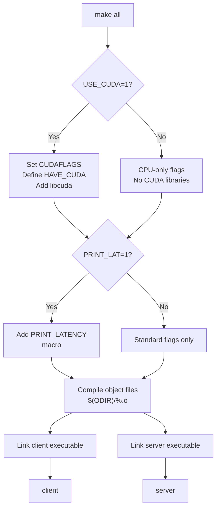
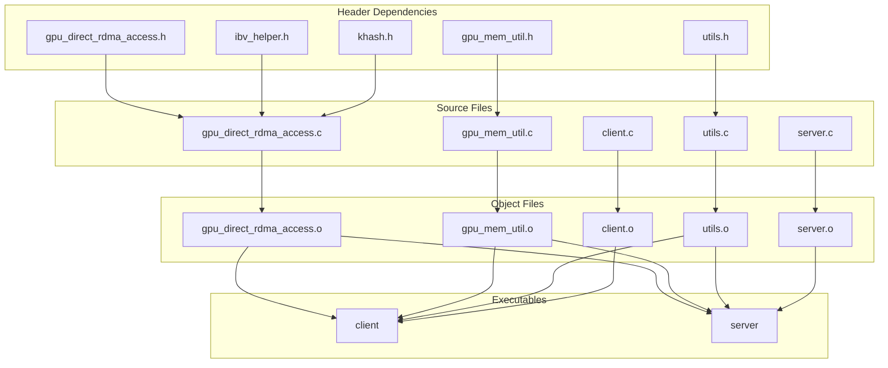

<!-- source: DeepWiki mcp.deepwiki.com · repo Mellanox/gpu_direct_rdma_access · page 2 Build System · fetched 2026-11-11 -->

# Build System

<details>
<summary>Relevant source files</summary>

The following files were used as context for generating this wiki page:

- [Makefile](Makefile)

</details>


This document describes the build system for the GPU Direct RDMA Access project, covering compilation options, dependencies, build targets, and configuration variants. The build system uses GNU Make with conditional compilation to support different hardware configurations and feature sets from a single codebase.

For information about the core RDMA functionality that gets built, see [Core RDMA Engine](#3). For details about the memory management compilation options, see [Memory Management Subsystem](#4).

## Build Configuration

The build system supports conditional compilation through environment variables that enable different feature sets and hardware support configurations.

### Compilation Flags

The build system recognizes two primary environment variables that control compilation behavior:

| Environment Variable | Purpose | Default Behavior |
|---------------------|---------|------------------|
| `USE_CUDA` | Enables GPU memory support via CUDA | CPU-only build |
| `PRINT_LAT` | Enables latency measurement output | No latency printing |

When `USE_CUDA=1` is set, the build system:
- Adds CUDA include paths [Makefile:6-7]()
- Defines the `HAVE_CUDA` preprocessor macro [Makefile:8]()
- Links against the CUDA runtime library [Makefile:9]()

When `PRINT_LAT=1` is set, the build system defines the `PRINT_LATENCY` preprocessor macro [Makefile:16]().

Sources: Makefile

### Build Flow Diagram



Sources: Makefile

## Build Targets

The build system produces two primary executables from shared object files and target-specific source files.

### Executable Targets

| Target | Source Files | Purpose |
|--------|-------------|---------|
| `client` | client.c + shared objects | Client application for RDMA operations |
| `server` | server.c + shared objects | Server application for RDMA operations |

Both executables share the same core object files but have different main application logic [Makefile:41-45]().

### Shared Object Files

The build system compiles these core source files into shared object files [Makefile:30-32]():

- `gpu_direct_rdma_access.o` - Core RDMA functionality
- `gpu_mem_util.o` - Memory management abstraction
- `utils.o` - Network and performance utilities

### Dependency Management



Sources: Makefile

## External Dependencies

The build system requires several external libraries that provide RDMA and GPU functionality.

### Required Libraries

| Library | Purpose | Conditional |
|---------|---------|-------------|
| `lrdmacm` | RDMA Connection Manager | Always required |
| `libverbs` | InfiniBand Verbs API | Always required |
| `lmlx5` | Mellanox ConnectX driver | Always required |
| `lcuda` | CUDA Runtime API | Only when `USE_CUDA=1` |

### CUDA Include Paths

When CUDA support is enabled, the build system searches for CUDA headers in these locations [Makefile:6-7]():
- `/usr/local/cuda-10.1/targets/x86_64-linux/include`
- `/usr/local/cuda/include`

The build system uses a hardcoded path approach rather than dynamic CUDA detection, requiring manual adjustment for different CUDA installations.

Sources: Makefile

## Build Process

The build process follows a standard GNU Make pattern with object file generation and linking phases.

### Object File Compilation

Object files are compiled using the pattern rule [Makefile:34-35]():
```makefile
$(ODIR)/%.o: %.c $(DEPS)
	$(CC) -c -o $@ $< $(CFLAGS)
```

All object files depend on the complete header dependency list defined in the `DEPS` variable [Makefile:24-28]().

### Directory Structure

The build system creates an `obj/` directory for intermediate object files [Makefile:47-48]():
- Source files remain in the root directory
- Object files are placed in `obj/`
- Executables are created in the root directory

### Clean Target

The clean target removes all build artifacts [Makefile:52-53]():
- Executable files (`client`, `server`)
- Object files in `obj/` directory  
- Backup files (`*~`, `core.*`)
- Header backup files

Sources: Makefile

## Configuration Variants

The conditional compilation system creates four possible build variants based on the two configuration flags.

### Build Variant Matrix

| USE_CUDA | PRINT_LAT | Features | Use Case |
|----------|-----------|----------|----------|
| 0 | 0 | CPU memory only | Basic testing |
| 0 | 1 | CPU memory + latency | Performance analysis (CPU) |
| 1 | 0 | GPU memory support | Production GPU workloads |
| 1 | 1 | GPU memory + latency | Performance analysis (GPU) |

### Preprocessor Macros

The build system defines these macros based on configuration:

- `HAVE_CUDA` - Enables GPU memory allocation code paths
- `PRINT_LATENCY` - Enables performance measurement output

These macros control conditional compilation within the source files, allowing the same codebase to support different hardware configurations and debugging levels.

Sources: Makefile

---

