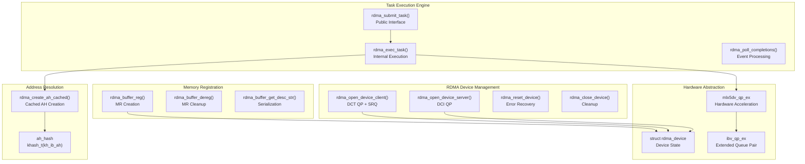
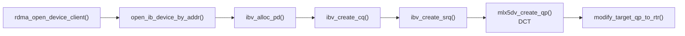
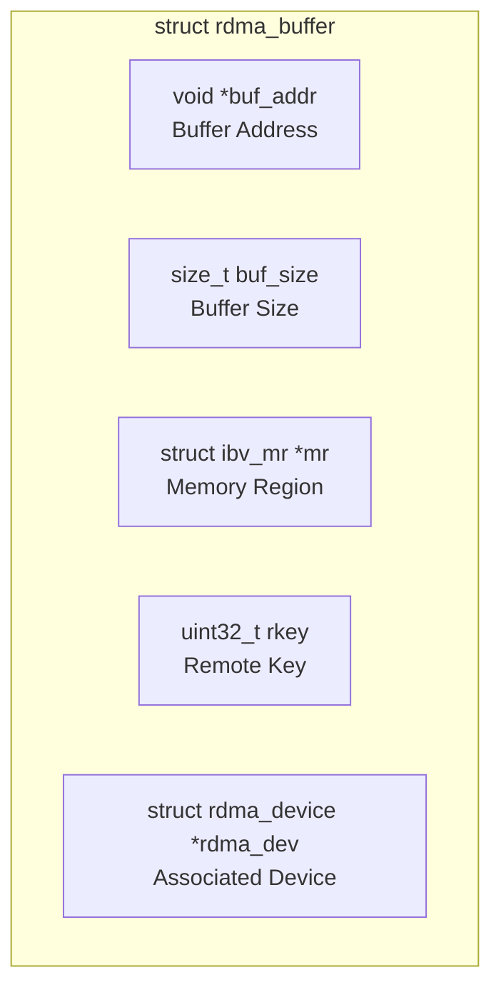
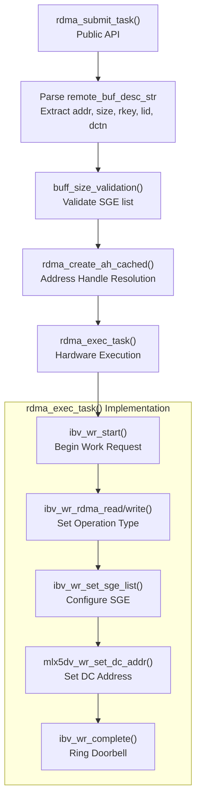
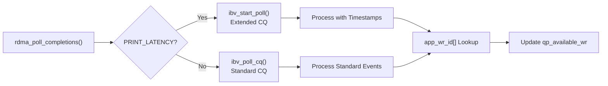
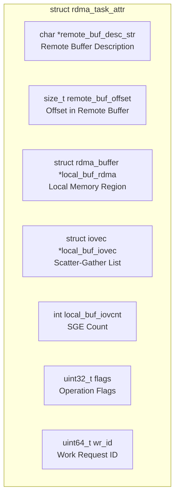

<!-- source: DeepWiki mcp.deepwiki.com · repo Mellanox/gpu_direct_rdma_access · page 3 Core RDMA Engine · fetched 2026-11-11 -->

# Core RDMA Engine

Relevant source files

The following files were used as context for generating this wiki page:

- [gpu_direct_rdma_access.c](gpu_direct_rdma_access.c)
- [gpu_direct_rdma_access.h](gpu_direct_rdma_access.h)

## Purpose and Scope

The Core RDMA Engine provides the fundamental RDMA (Remote Direct Memory Access) functionality that enables GPU Direct memory operations using Mellanox Dynamic Connect Queue Pairs. This subsystem abstracts the complexities of InfiniBand/RoCE hardware management, memory registration, and task execution to provide a high-level API for direct memory transfers between distributed systems.

For information about the public API interfaces, see [RDMA Interface Definition](#3.1). For internal implementation details, see [RDMA Implementation Details](#3.2). For memory management abstractions used by this engine, see [Memory Management Subsystem](#4).

## Architecture Overview

The Core RDMA Engine implements a sophisticated architecture centered around Mellanox's Dynamic Connect (DC) transport, which provides scalable one-to-many connectivity without per-connection state overhead.

**Sources:** [gpu_direct_rdma_access.h:90-91](), [gpu_direct_rdma_access.c:526-711](), [gpu_direct_rdma_access.c:714-885]()

## Device Management

The RDMA engine supports two distinct device roles: client (target) and server (initiator), each with different Queue Pair configurations optimized for their respective functions.

### Client Device Initialization

Client devices use Dynamic Connect Target (DCT) Queue Pairs with Shared Receive Queues (SRQ) for scalable reception of RDMA operations:

**Sources:** [gpu_direct_rdma_access.c:526-711](), [gpu_direct_rdma_access.c:586-596](), [gpu_direct_rdma_access.c:618-630]()

### Server Device Initialization

Server devices use Dynamic Connect Initiator (DCI) Queue Pairs with extended capabilities for issuing RDMA operations:

```mermaid
graph LR
    rdma_open_device_server["rdma_open_device_server()"] --> open_ib_device_by_addr["open_ib_device_by_addr()"]
    open_ib_device_by_addr --> ibv_alloc_pd["ibv_alloc_pd()"]
    ibv_alloc_pd --> ibv_create_cq["ibv_create_cq()"]
    ibv_create_cq --> mlx5dv_create_qp["mlx5dv_create_qp()<br/>DCI"]
    mlx5dv_create_qp --> ibv_qp_to_qp_ex["ibv_qp_to_qp_ex()"]
    ibv_qp_to_qp_ex --> mlx5dv_qp_ex_from_ibv_qp_ex["mlx5dv_qp_ex_from_ibv_qp_ex()"]
    mlx5dv_qp_ex_from_ibv_qp_ex --> modify_source_qp_rst2rts["modify_source_qp_rst2rts()"]
```

**Sources:** [gpu_direct_rdma_access.c:714-885](), [gpu_direct_rdma_access.c:796-827](), [gpu_direct_rdma_access.c:818-823]()

## Memory Registration Subsystem

The memory registration subsystem provides abstraction over InfiniBand Memory Regions (MRs) and serialization for network communication.

| Function | Purpose | Key Parameters |
|----------|---------|----------------|
| `rdma_buffer_reg()` | Register memory with RDMA device | `rdma_dev`, `addr`, `length` |
| `rdma_buffer_dereg()` | Unregister and cleanup | `rdma_buff` |
| `rdma_buffer_get_desc_str()` | Serialize buffer info | `rdma_buff`, `desc_str`, `desc_length` |

The `struct rdma_buffer` encapsulates both buffer metadata and RDMA-specific information:

**Sources:** [gpu_direct_rdma_access.c:1155-1192](), [gpu_direct_rdma_access.c:1195-1212](), [gpu_direct_rdma_access.c:145-154]()

## Task Execution Engine

The task execution engine processes RDMA read/write operations through a multi-stage pipeline that handles address resolution, work request construction, and hardware interaction.

### Task Submission Flow

**Sources:** [gpu_direct_rdma_access.c:1342-1419](), [gpu_direct_rdma_access.c:890-1006](), [gpu_direct_rdma_access.c:904-905]()

### Completion Processing

The completion processing system handles both standard and extended (latency measurement) completion events:

**Sources:** [gpu_direct_rdma_access.c:1422-1548](), [gpu_direct_rdma_access.c:1440-1522](), [gpu_direct_rdma_access.c:1524-1546]()

## Address Resolution Caching

The address resolution system uses a hash table to cache Address Handles (AHs), eliminating the overhead of repeated AH creation for the same destinations.

### Hash Table Implementation

The system employs `khash.h` with custom hash and equality functions for `struct ibv_ah_attr`:

| Component | Function | Purpose |
|-----------|----------|---------|
| `kh_ib_ah_hash_func()` | Hash calculation | XOR of GID and LID values |
| `kh_ib_ah_hash_equal()` | Equality comparison | `memcmp()` of attributes |
| `rdma_create_ah_cached()` | Cache management | Lookup or create AH |

**Sources:** [gpu_direct_rdma_access.c:178-194](), [gpu_direct_rdma_access.c:1264-1305](), [gpu_direct_rdma_access.c:76]()

## Core Data Structures

### struct rdma_device

The central device structure maintains all RDMA resources and state:

| Field Group | Key Members | Purpose |
|-------------|-------------|---------|
| **Context** | `context`, `pd`, `cq` | Basic InfiniBand resources |
| **Queue Pairs** | `qp`, `qpex`, `mqpex`, `srq` | Extended queue pair interfaces |
| **Address Info** | `ib_port`, `gid`, `lid`, `mtu` | Network addressing |
| **Work Management** | `app_wr_id[]`, `qp_available_wr` | Outstanding operation tracking |
| **Address Cache** | `ah_hash` | Cached address handles |

**Sources:** [gpu_direct_rdma_access.c:97-143](), [gpu_direct_rdma_access.c:109-112](), [gpu_direct_rdma_access.c:128]()

### struct rdma_task_attr

The task attribute structure defines RDMA operation parameters:

**Sources:** [gpu_direct_rdma_access.h:69-78](), [gpu_direct_rdma_access.h:65-67](), [gpu_direct_rdma_access.c:156-169]()

---

