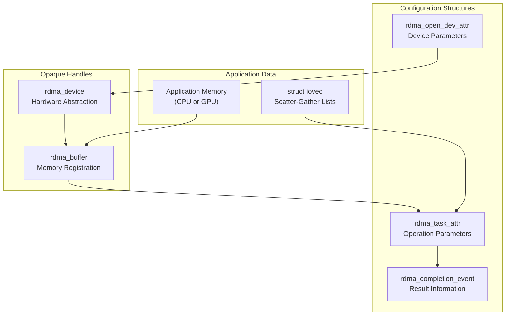
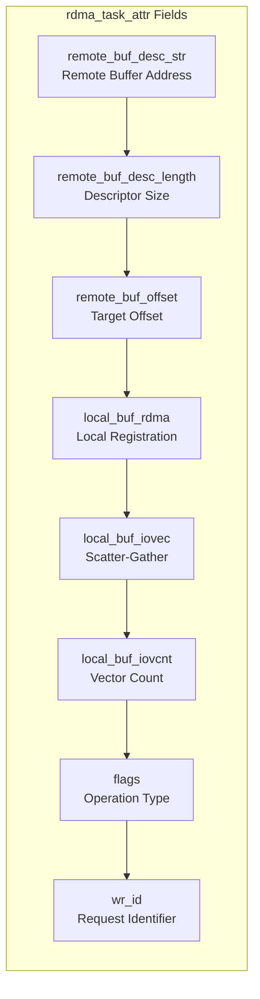
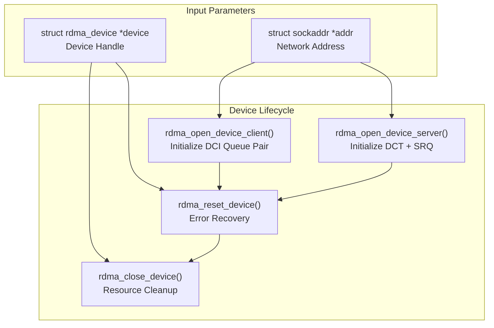
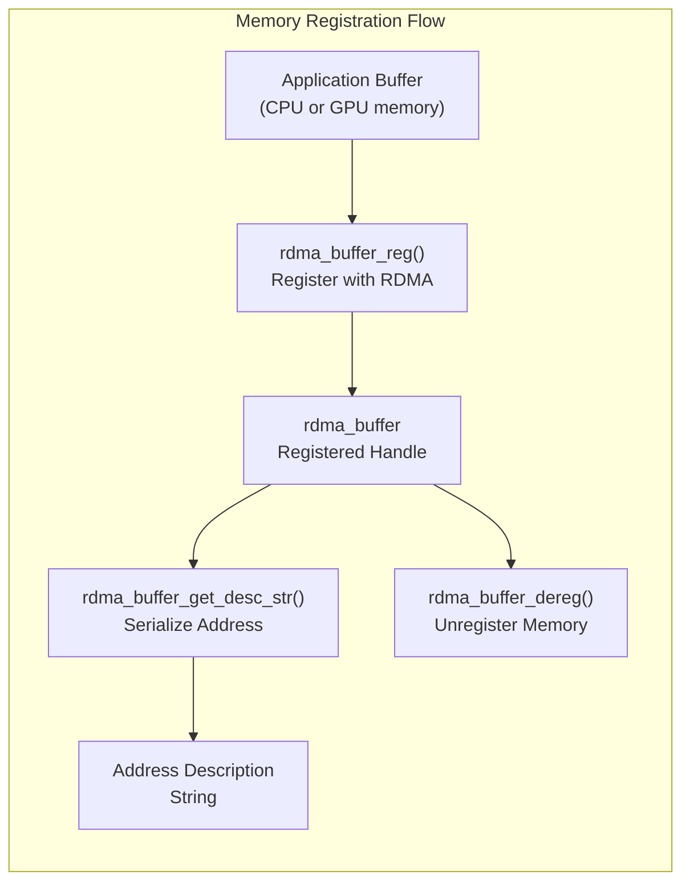
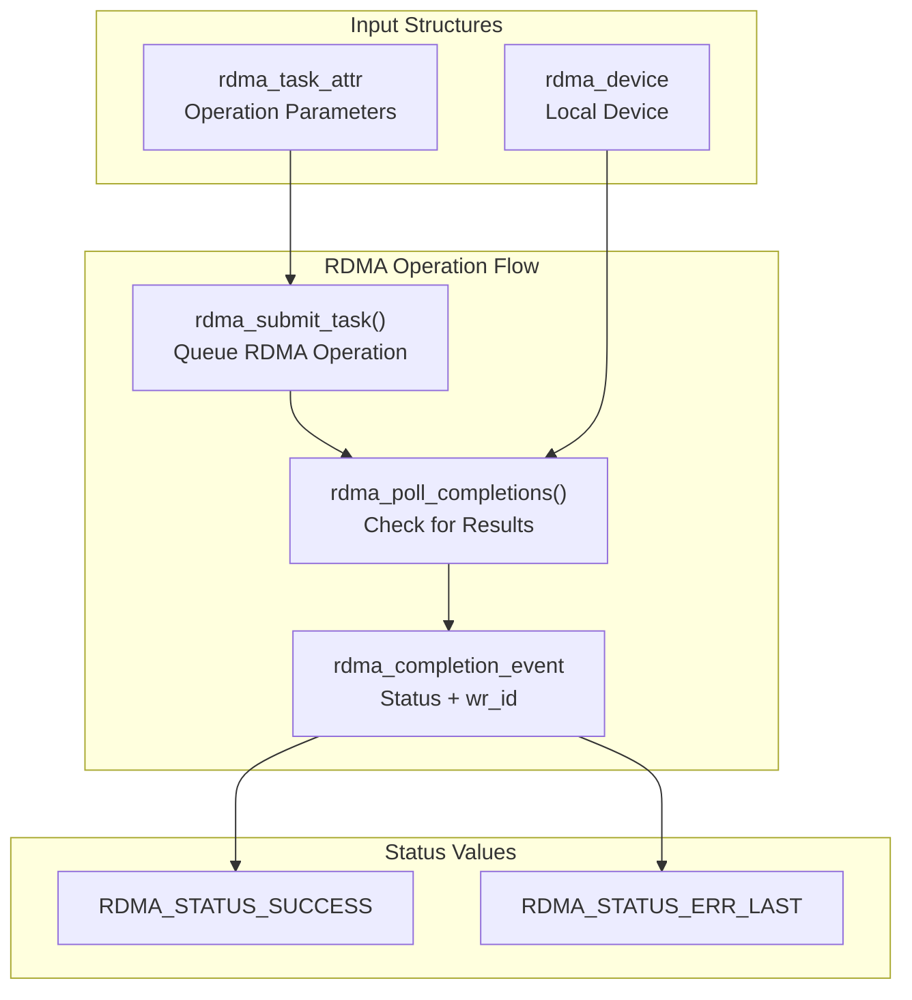
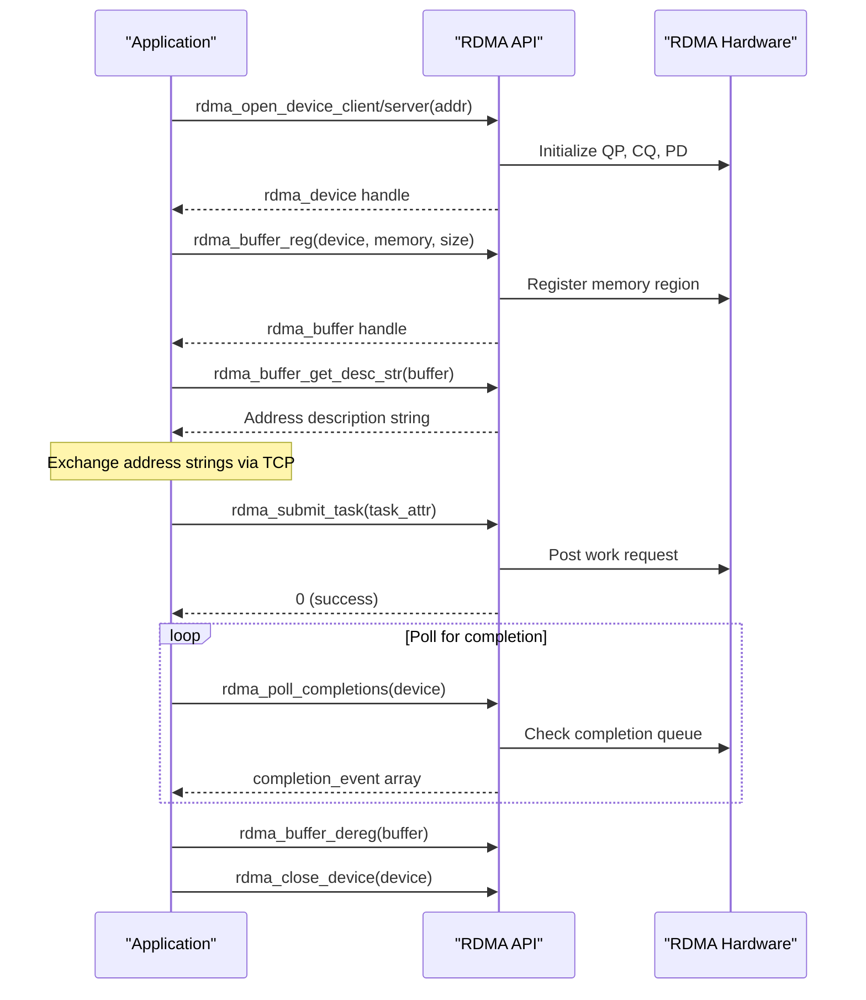

<!-- source: DeepWiki mcp.deepwiki.com · repo Mellanox/gpu_direct_rdma_access · page 3.1 RDMA Interface Definition · fetched 2026-11-11 -->

# RDMA Interface Definition

Relevant source files

The following files were used as context for generating this wiki page:

- [gpu_direct_rdma_access.h](gpu_direct_rdma_access.h)

This document defines the public API interface for the GPU Direct RDMA Access system. It covers the data structures, function prototypes, and usage patterns that applications use to perform RDMA operations with GPU memory support.

For implementation details of how these interfaces are realized internally, see [RDMA Implementation Details](#3.2). For examples of how client and server applications use these interfaces, see [Client Application](#5.1) and [Server Application](#5.2).

## Core Data Structures

The RDMA interface is built around several key data structures that abstract the underlying InfiniBand hardware and provide a simplified API for applications.

### Device and Buffer Abstractions

**Sources:** [gpu_direct_rdma_access.h:47-57]()

The system uses two primary opaque handle types:
- `struct rdma_device` represents a local RDMA-capable network interface
- `struct rdma_buffer` represents a registered memory region that can be accessed via RDMA

### Device Configuration Structure

The `rdma_open_dev_attr` structure specifies which RDMA device to open and how to configure it:

| Field | Type | Purpose |
|-------|------|---------|
| `ib_devname` | `const char *` | InfiniBand device name (e.g., "mlx5_0") |
| `ib_port` | `int` | Physical port number on the device |
| `gidx` | `int` | GID table index for address resolution |

**Sources:** [gpu_direct_rdma_access.h:59-63]()

### Task Execution Structure  

The `rdma_task_attr` structure contains all parameters needed to execute an RDMA operation:

**Sources:** [gpu_direct_rdma_access.h:69-78]()

The `flags` field uses `enum rdma_task_attr_flags` values:
- `RDMA_TASK_ATTR_RDMA_READ` (bit 0): Perform RDMA read instead of write

## API Function Categories

### Device Management Functions

These functions manage the lifecycle of RDMA devices and handle role-specific initialization:

**Sources:** [gpu_direct_rdma_access.h:90-101]()

| Function | Purpose | Return Value |
|----------|---------|--------------|
| `rdma_open_device_client` | Initialize client-side RDMA device with DCI QP | `struct rdma_device *` or NULL |
| `rdma_open_device_server` | Initialize server-side RDMA device with DCT QP + SRQ | `struct rdma_device *` or NULL |  
| `rdma_reset_device` | Reset device from failed state to operational state | 0 on success, errno on failure |
| `rdma_close_device` | Release all device resources | void |

### Memory Registration Functions

These functions handle registration and deregistration of application memory buffers for RDMA access:

**Sources:** [gpu_direct_rdma_access.h:106-121]()

| Function | Parameters | Purpose |
|----------|------------|---------|
| `rdma_buffer_reg` | `device`, `addr`, `length` | Register memory region for RDMA access |
| `rdma_buffer_dereg` | `buffer` | Unregister and cleanup memory region |
| `rdma_buffer_get_desc_str` | `rdma_buff`, `desc_str`, `desc_length` | Serialize buffer address for remote access |

### Task Execution Functions

These functions handle the submission and completion of RDMA operations:

**Sources:** [gpu_direct_rdma_access.h:138-158]()

The `rdma_completion_event` structure reports operation results:

| Field | Type | Purpose |
|-------|------|---------|
| `wr_id` | `uint64_t` | Work request identifier from `rdma_task_attr` |
| `status` | `enum rdma_completion_status` | Operation result (success or error) |

## API Usage Workflow

The typical usage pattern follows this sequence:

**Sources:** [gpu_direct_rdma_access.h:80-158]()

## Constants and Limits

The interface defines several important constants:

| Constant | Value | Purpose |
|----------|-------|---------|
| `MAX_SEND_SGE` | 10 | Maximum scatter-gather elements per operation |

**Sources:** [gpu_direct_rdma_access.h:45]()

The system requires specific header files for operation:
- `<sys/uio.h>` for `struct iovec` scatter-gather support
- `<infiniband/verbs.h>` for standard InfiniBand verbs
- `<infiniband/mlx5dv.h>` for Mellanox direct verbs extensions

**Sources:** [gpu_direct_rdma_access.h:36-39]()

---

