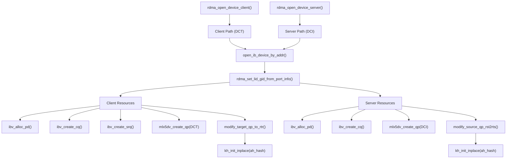
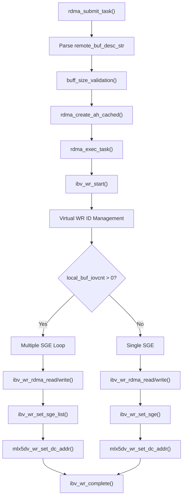
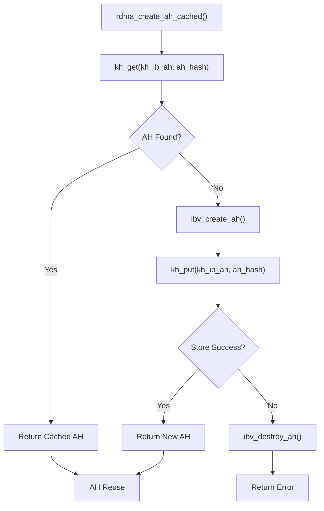
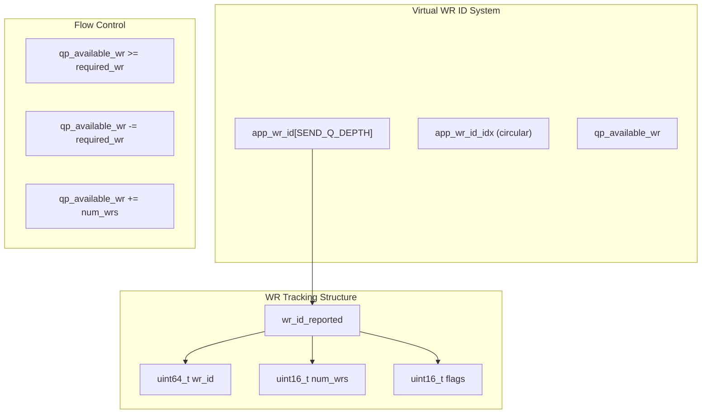
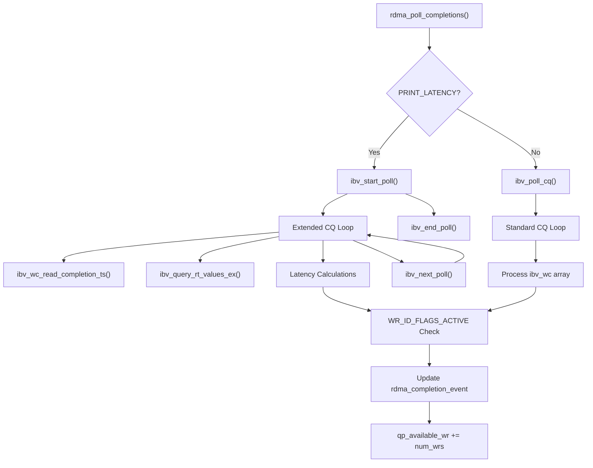
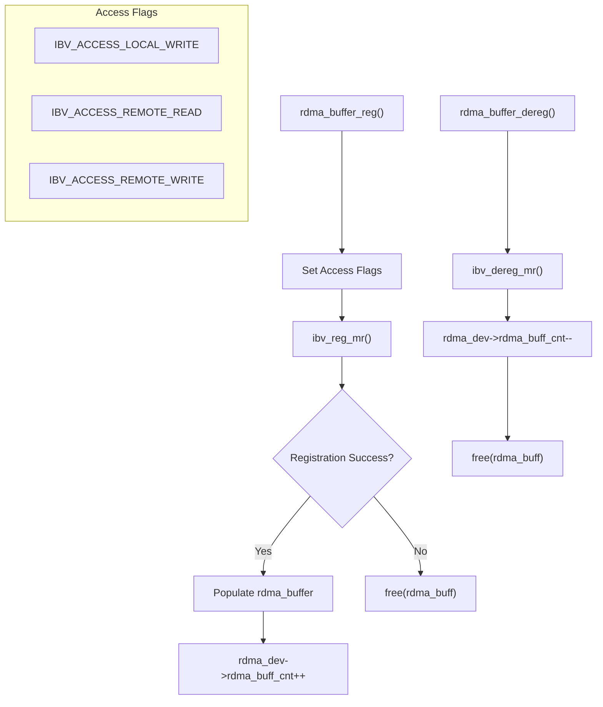
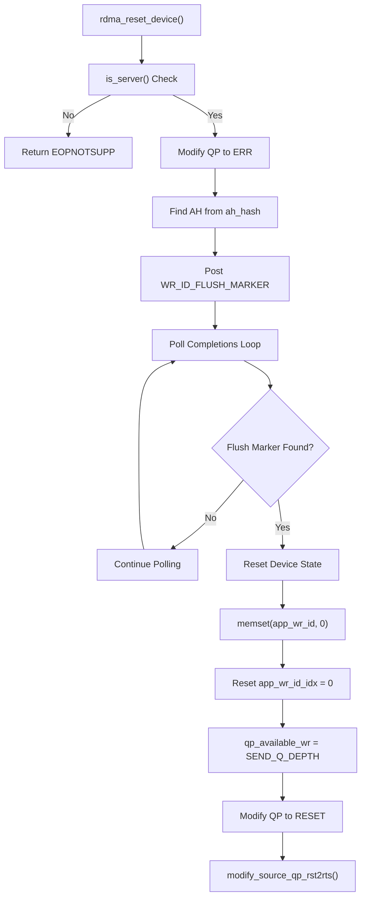

<!-- source: DeepWiki mcp.deepwiki.com · repo Mellanox/gpu_direct_rdma_access · page 3.2 RDMA Implementation Details · fetched 2026-11-11 -->

# RDMA Implementation Details

<details>
<summary>Relevant source files</summary>

The following files were used as context for generating this wiki page:

- [gpu_direct_rdma_access.c](gpu_direct_rdma_access.c)

</details>


This document covers the internal implementation architecture of the RDMA subsystem that enables GPU Direct memory access using Dynamic Connect Queue Pairs. It focuses on device management, task execution engines, address resolution caching, and completion handling mechanisms. For the public API interface and data structures, see [RDMA Interface Definition](#3.1).

## Core Data Structures

The RDMA implementation centers around three primary data structures that encapsulate device state, buffer management, and task execution parameters.

```mermaid
classDiagram
    class rdma_device {
        +rdma_event_channel* cm_channel
        +rdma_cm_id* cm_id
        +ibv_context* context
        +ibv_pd* pd
        +ibv_cq* cq
        +ibv_srq* srq
        +ibv_qp* qp
        +ibv_qp_ex* qpex
        +mlx5dv_qp_ex* mqpex
        +int ib_port
        +union ibv_gid gid
        +uint16_t lid
        +wr_id_reported app_wr_id[SEND_Q_DEPTH]
        +int app_wr_id_idx
        +int qp_available_wr
        +khash_t ah_hash
    }
    
    class rdma_buffer {
        +void* buf_addr
        +size_t buf_size
        +ibv_mr* mr
        +uint32_t rkey
        +rdma_device* rdma_dev
    }
    
    class rdma_exec_params {
        +rdma_device* device
        +uint64_t wr_id
        +unsigned long rem_buf_rkey
        +unsigned long long rem_buf_addr
        +uint32_t rem_buf_size
        +ibv_ah* ah
        +unsigned long rem_dctn
        +uint32_t local_buf_mr_lkey
        +void* local_buf_addr
        +iovec* local_buf_iovec
        +int local_buf_iovcnt
        +uint32_t flags
    }
    
    rdma_device ||--o{ rdma_buffer : "manages"
    rdma_exec_params ||--|| rdma_device : "executes on"
    rdma_exec_params ||--|| rdma_buffer : "operates on"
```

The `rdma_device` structure maintains both InfiniBand Verbs objects and mlx5dv extensions for hardware acceleration. The `srq` field distinguishes client (DCT) from server (DCI) configurations, while the address handle hash table `ah_hash` provides performance optimization for repeated connections.

**Sources:** [gpu_direct_rdma_access.c:97-143](), [gpu_direct_rdma_access.c:145-154](), [gpu_direct_rdma_access.c:156-169]()

## Device Initialization Architecture

The device initialization follows distinct paths for client and server roles, leveraging different Dynamic Connect queue pair types and initialization sequences.



The key architectural difference lies in queue pair configuration: clients create DCT (Dynamic Connect Target) queue pairs with SRQ (Shared Receive Queue), while servers create DCI (Dynamic Connect Initiator) queue pairs without SRQ. The `is_server()` function uses the presence of SRQ to distinguish between roles.

**Sources:** [gpu_direct_rdma_access.c:526-711](), [gpu_direct_rdma_access.c:714-886](), [gpu_direct_rdma_access.c:172-175]()

## Task Execution Engine

The task execution engine implements a sophisticated work request submission system with virtual work request ID management and scatter-gather list support.



The engine manages work request availability through `qp_available_wr` tracking and implements virtual work request IDs via circular indexing in `app_wr_id_idx`. For scatter-gather operations exceeding `MAX_SEND_SGE`, it automatically splits requests across multiple work requests.

**Sources:** [gpu_direct_rdma_access.c:1342-1419](), [gpu_direct_rdma_access.c:890-1006]()

## Address Resolution and Caching

The address handle caching system optimizes performance by avoiding repeated address handle creation for the same destination endpoints.



The caching mechanism uses a custom hash function `kh_ib_ah_hash_func()` that combines GID subnet prefix, interface ID, and LID values. The hash table implementation leverages the khash library with custom equality comparison through `kh_ib_ah_hash_equal()`.

**Sources:** [gpu_direct_rdma_access.c:1264-1305](), [gpu_direct_rdma_access.c:178-194]()

## Work Request Management

The implementation employs a sophisticated virtual work request ID system to decouple application work request IDs from hardware queue management.



Each work request submission decrements `qp_available_wr` by the number of hardware work requests required, while completion processing increments it back. The `WR_ID_FLAGS_ACTIVE` flag prevents double-processing of completion events.

**Sources:** [gpu_direct_rdma_access.c:82-86](), [gpu_direct_rdma_access.c:920-934](), [gpu_direct_rdma_access.c:1452-1456]()

## Completion Handling

The completion polling system supports both standard and extended completion queues with optional latency measurement capabilities.



The latency measurement feature tracks three timing points: work request start (`wr_start_ts`), completion in hardware (`completion_ts`), and software polling (`read_comp_ts`). These measurements utilize the HCA core clock for nanosecond precision.

**Sources:** [gpu_direct_rdma_access.c:1422-1548](), [gpu_direct_rdma_access.c:89-95]()

## Memory Registration

RDMA buffer registration creates memory regions with appropriate access flags for both local and remote operations.



The registration process includes reference counting in `rdma_buff_cnt` to prevent device closure while buffers remain registered. The `rdma_buffer_get_desc_str()` function serializes buffer metadata for network transmission.

**Sources:** [gpu_direct_rdma_access.c:1155-1192](), [gpu_direct_rdma_access.c:1195-1212](), [gpu_direct_rdma_access.c:1242-1262]()

## Error Recovery and Reset

The reset mechanism provides server-side error recovery by transitioning the queue pair through error states and flushing outstanding work completions.



The flush mechanism ensures all outstanding work completions are properly drained before resetting queue pair state. The special `WR_ID_FLUSH_MARKER` value (`UINT64_MAX`) serves as a sentinel to detect completion of the flush process.

**Sources:** [gpu_direct_rdma_access.c:1009-1075](), [gpu_direct_rdma_access.c:72]()

---

